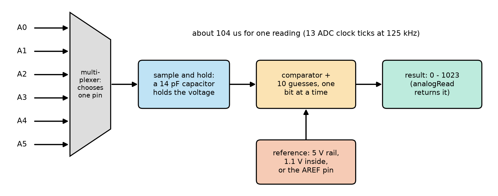
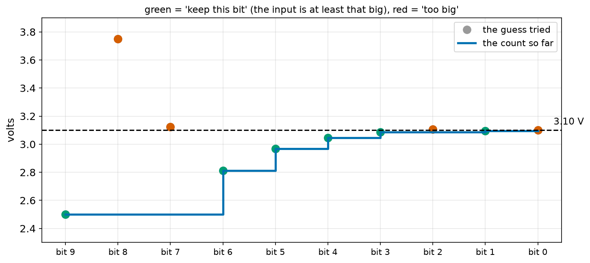
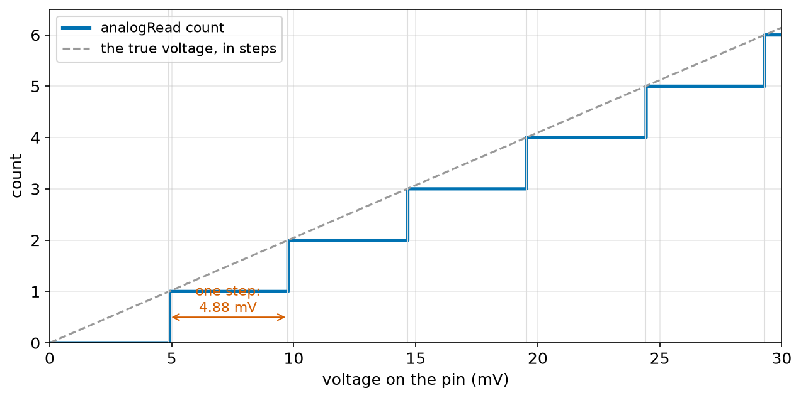
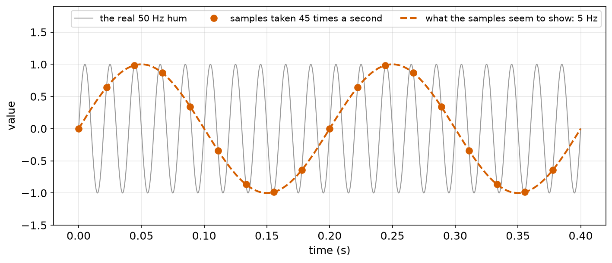
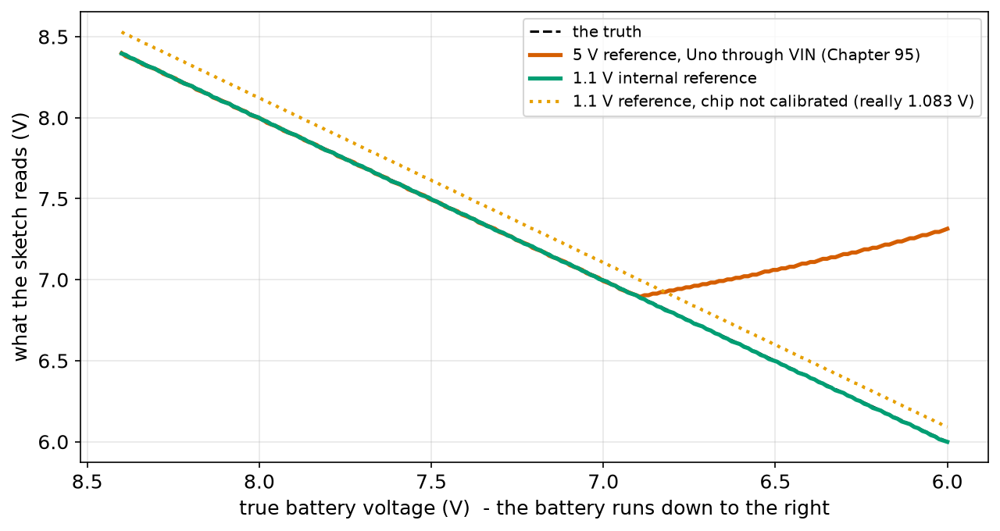
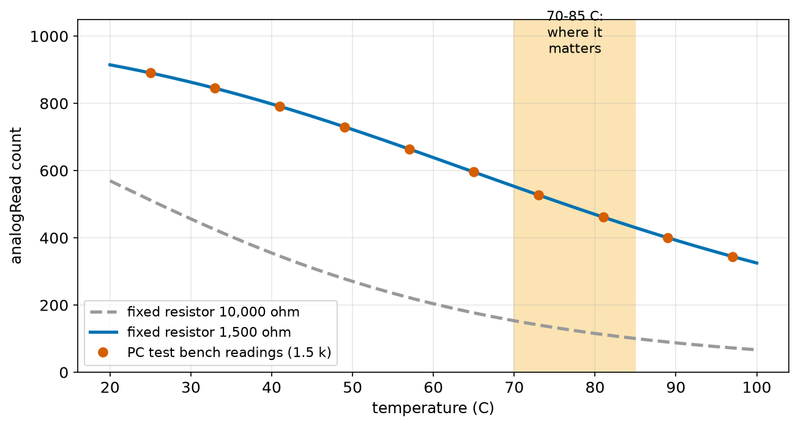

# Chapter 101 — Analog Input: the ADC

> **Part 6 · Chapter 101 of 749**
> **You need:** Chapter 43 (straight lines), Chapter 74 (thermistors), Chapter 79 (voltage dividers), Chapter 84 (RC filters), Chapter 91 (bits, steps and resolution), Chapter 95 (Rover's battery and the sagging 5 V rail), Chapters 96–97 (C++ types, averaging) and Chapter 100 (printing).
> **You will make:** a sketch that shows a voltage as a count, in volts and in millivolts (and the overflow that catches everyone), a potentiometer that measures a joint angle, a model of how the ADC finds its number, a demonstration of aliasing, Rover's battery monitor that no longer lies when the 5 V rail sags, and a motor-driver thermometer that stops the motors when it gets too hot or its wire breaks.

---

## What you will learn

- What `analogRead` does inside the chip, step by step, and how long it takes.
- How to turn a count into volts, and back, without overflow.
- What the **reference voltage** is, why it matters, and when to use the chip's own **1.1 V** reference.
- Which sensors are **ratiometric** (they do not care about the reference) and which are not.
- How the source's resistance and fast noise can spoil readings, and what **aliasing** is.
- How to read a potentiometer, a battery and a thermistor, and how to catch a broken sensor wire.

---

## New words in this chapter

| Word | Simple meaning |
|---|---|
| **ADC** | Analog-to-digital converter: the part that turns a voltage into a number. |
| **count** | The number `analogRead` returns: 0 to 1,023 on the Uno. |
| **reference voltage** | The voltage the ADC compares with; it would give a count of 1,024. |
| **multiplexer** | A switch that connects one of several pins to the single ADC. |
| **sample and hold** | Catching the voltage on a tiny capacitor and holding it still while it is measured. |
| **successive approximation** | Finding a number by guessing one bit at a time, from the biggest. |
| **ratiometric** | A sensor whose output is a fraction of the supply, so supply changes cancel out. |
| **calibrate** | Measure a known value and correct the program so its readings agree. |
| **sampling rate** | How many readings are taken per second. |
| **aliasing** | A fast signal, sampled too slowly, looking like a slow signal that is not there. |
| **oversampling** | Taking several readings and averaging them to reduce noise. |

---

## 101.1 What `analogRead` does

Chapter 91 introduced the ADC: a circuit that turns a voltage into a number. On the Uno, `analogRead(A0)` returns a whole number from **0** (0 V) to **1,023** (just under 5 V). Here is what happens inside, in about a tenth of a millisecond.



*Figure 101.1 — The parts of the ATmega328P's ADC. One ADC is shared by the six analog pins.*

**How to read this picture:** Follow the arrows from left to right. The six analog pins A0–A5 enter a **multiplexer**, which connects only the one you asked for. Its voltage is caught on a tiny capacitor (**sample and hold**), then a comparator finds the number in 10 guesses, comparing against the **reference** (red box, below). The result, 0 to 1,023, is what `analogRead` returns.

📖 **New word: multiplexer** — a set of switches that connects one of several inputs to a single output. The Uno has only **one** ADC; the multiplexer lets it measure any of the six analog pins, one at a time.

📖 **New word: sample and hold** — the ADC first connects the pin to a tiny capacitor (about 14 pF) for a moment, so the capacitor charges to the pin's voltage, then disconnects it. The voltage on the capacitor stays still while the ADC measures it, even if the pin's voltage keeps changing.

📖 **New word: successive approximation** — the way the ADC finds the number: a guessing game, like finding a number between 0 and 1,023 by asking "is it at least 512?", then "at least 768?" or "at least 256?", and so on. Each answer fixes one bit, so 10 questions find a 10-bit number.

The program `sar.py` (in the Code section) plays the game for 3.10 V:

```
bit 9: try  512 = 2.5000 V -> keep   count = 512
bit 8: try  768 = 3.7500 V -> too big   count = 512
bit 7: try  640 = 3.1250 V -> too big   count = 512
bit 6: try  576 = 2.8125 V -> keep   count = 576
bit 5: try  608 = 2.9688 V -> keep   count = 608
bit 4: try  624 = 3.0469 V -> keep   count = 624
bit 3: try  632 = 3.0859 V -> keep   count = 632
bit 2: try  636 = 3.1055 V -> too big   count = 632
bit 1: try  634 = 3.0957 V -> keep   count = 634
bit 0: try  635 = 3.1006 V -> too big   count = 634
result: 634, which means 3.0957 V (one step = 4.88 mV)
```



*Figure 101.2 — The ten guesses for 3.10 V. Dots: the voltage each guess stands for (green = kept, red = too big). Blue: the count so far.*

**How to read this picture:** Read from left to right, one bit per column. The first guess (2.5 V) is below 3.10 V, so it is kept. The next two (3.75 V and 3.125 V) are too big and are dropped. From then on, the blue staircase climbs in smaller and smaller steps towards the dashed line at 3.10 V, getting within one step (4.88 mV) after the tenth guess. This is the same halving idea as a binary search.

🔢 **Timing.** The ADC has its own clock: the Uno's 16 MHz divided by 128 = 125 kHz. One conversion takes 13 of its ticks: 13 ÷ 125,000 = **104 µs**. With the Arduino function's own work, `analogRead` takes about **112 µs**, so at most about 9,000 readings per second, and every one of them stops your program for that time (Chapter 94 counted it in Rover's CPU budget).

---

## 101.2 From count to volts

The ADC compares the pin's voltage with its **reference voltage** (section 101.3), which is 5 V by default. The rule from the datasheet:

🔢 **count = V_in × 1,024 ÷ V_ref**, rounded **down** to a whole number (and never more than 1,023).
🔢 **V_in ≈ count × V_ref ÷ 1,024**: one step is 5 ÷ 1,024 = **4.88 mV**.

📖 **New word: count** — the whole number the ADC gives. It is not a voltage; it is "how many 4.88 mV steps fit under the input".



*Figure 101.3 — The count for every input voltage from 0 to 30 mV.*

**How to read this picture:** The horizontal axis is the voltage on the pin, in millivolts; the vertical axis is the count. The blue staircase goes up by one every 4.88 mV: everything from 0 to 4.87 mV gives 0, everything from 4.88 to 9.76 mV gives 1, and so on. The grey dashed line is the true voltage in steps; the ADC always lands on or below it, because it rounds down. A voltage change smaller than one step may not change the count at all.

💡 **Tip: 1,023 or 1,024?** Many sketches and books divide by 1,023, so that count 1,023 means exactly 5.00 V. The datasheet's formula uses 1,024. The difference is 0.1%, far smaller than the reference's own error (section 101.3). This course uses 1,024, like Chapter 91.

### Doing the sum without overflow

The sketch `read_volts.ino` (in the Code section) shows a voltage three ways. On the PC test bench, with A0 stepped through five voltages:

```
0 counts = 0.000 V = 0 mV   (int maths gives 0)
204 counts = 0.996 V = 996 mV   (int maths gives -27)
512 counts = 2.500 V = 2500 mV   (int maths gives 4)
634 counts = 3.096 V = 3095 mV   (int maths gives 23)
1021 counts = 4.985 V = 4985 mV   (int maths gives -6)
```

The float version (`count * 5.0 / 1024`) and the long version (`count * 5000L / 1024`) agree. The `int` version is nonsense: `count * 5000` is done in 16-bit int (Chapter 96), and 204 × 5,000 = 1,020,000 does not fit. This is the bug Chapter 96 promised: on the Uno, write **`5000L`**.

Look at the first non-zero line too: the input was 1.000 V, but the reading is 0.996 V. 1.000 × 1,024 ÷ 5 = 204.8, rounded down to 204; 204 steps are 0.996 V. That 4 mV is the ADC's resolution at work.

---

## 101.3 The reference voltage

📖 **New word: reference voltage** — the voltage the ADC compares the input with. It decides what a count **means**: count 512 is half of the reference. The ATmega328P can use three references:

| `analogReference(…)` | Reference | Range of inputs | Notes |
|---|---|---|---|
| `DEFAULT` | the 5 V rail (AVcc) | 0 to 5 V | the default; as accurate as the 5 V rail |
| `INTERNAL` | about 1.1 V, made inside the chip | 0 to 1.1 V | steady, whatever the supply; 1.0 to 1.2 V from chip to chip |
| `EXTERNAL` | whatever you connect to the AREF pin | 0 to that voltage | for a precise reference chip |

With `DEFAULT`, the ADC quietly assumes the 5 V rail is exactly 5.00 V. If the rail is really 4.85 V (USB from a long cable, a weak battery, Chapter 95's VIN problem), then every count is 3% too high for the voltage it stands for.

⚠️ **Careful: never connect anything to the AREF pin unless you use `EXTERNAL`.** With `DEFAULT` or `INTERNAL`, the chip connects its own reference to AREF inside, and a voltage you connect there would fight it and can damage the chip.

### Ratiometric sensors do not care

📖 **New word: ratiometric** — a sensor whose output is a **fraction of its supply**. A potentiometer's wiper, or a divider made of a sensor and a resistor, gives "supply × some fraction". If the same 5 V rail feeds the sensor **and** is the ADC's reference, a sagging rail lowers the sensor's output **and** the reference by the same factor, and the count does not change:

🔢 count = (V_rail × fraction) × 1,024 ÷ V_rail = **fraction × 1,024**. V_rail cancels.

So potentiometers and thermistor dividers powered from the Uno's 5V pin are read correctly with `DEFAULT`, even on a wobbly supply. Application 2 tests this with a 4.8 V rail.

A battery is **not** ratiometric: its voltage has nothing to do with the Uno's 5 V rail. That is exactly why Chapter 95's battery reading went **up** as the battery died. The fix is to compare the battery with a reference that does not move: `INTERNAL`. Application 1 builds it.

---

## 101.4 Reading a potentiometer: angles and `map`

A potentiometer (Chapter 79) is a resistor with a sliding contact. With its ends on 5V and GND, its middle pin gives a voltage that is a fraction of 5 V, set by the knob: a perfect ratiometric sensor. Robot arms and hobby servos use one to measure a joint's angle (Chapter 116).

Converting a count to an angle is the straight line of Chapter 43: count 0 is 0°, count 1,023 is the full turn (270° for a common potentiometer). Arduino's `map` function does exactly that:

```cpp
int angle = map(count, 0, 1023, 0, 270);
```

`map(x, in_low, in_high, out_low, out_high)` gives (x − in_low) × (out_high − out_low) ÷ (in_high − in_low) + out_low, in whole numbers (it uses `long` inside, so it does not overflow). The sketch `pot_angle.ino` turns five readings into angles:

```
count 0 -> angle 0 degrees
count 256 -> angle 67 degrees
count 512 -> angle 135 degrees
count 768 -> angle 202 degrees
count 1023 -> angle 270 degrees
```

🔢 256 × 270 ÷ 1,023 = 67.6, and `map` drops the decimals: 67. Each count is 270 ÷ 1,023 = 0.26°, so the ADC can tell joint angles apart a quarter of a degree apart, as long as the potentiometer is that good (real ones are not perfectly straight lines: a few percent off is common).

---

## 101.5 The source matters: resistance and capacitors

The sample-and-hold capacitor must charge to the pin's voltage in a few microseconds. If the sensor's output has a large resistance, the capacitor does not finish charging, and the reading comes out wrong, often pulled towards the **previous** pin's voltage, because the same capacitor was just used for it. The datasheet's advice: a source resistance of **10 kΩ or less**.

For a divider, the source resistance is its two resistors in parallel (Chapter 79). A 10 kΩ potentiometer: at most 2.5 kΩ, fine. A 1 MΩ / 1 MΩ divider (to save battery current): 500 kΩ, far too high. The fix from Chapter 79: a capacitor of about 100 nF from the pin to ground. It holds the divider's voltage and gives the ADC's capacitor a quick charge, while the big resistors still drain almost no current.

💡 **Tip: reading several pins.** If one pin's reading seems to follow another pin's, read each pin **twice** and keep the second reading. The first gives the capacitor time to settle after the multiplexer switches.

---

## 101.6 Too fast to see: aliasing

📖 **New word: sampling rate** — how many readings per second the program takes. Rover's loop might read a sensor 45 times per second.

The ADC sees only the moments it samples. What happens to things that change faster than that? The program `aliasing.py` samples a 50 Hz signal (the "hum" from mains wiring that a long sensor wire picks up) at 45 readings per second:

```
sampling the 50 Hz hum 45 times a second (first 10 samples):
  t = 0.000 s   value = +0.000
  t = 0.022 s   value = +0.643
  t = 0.044 s   value = +0.985
  t = 0.067 s   value = +0.866
  t = 0.089 s   value = +0.342
  t = 0.111 s   value = -0.342
  t = 0.133 s   value = -0.866
  t = 0.156 s   value = -0.985
  t = 0.178 s   value = -0.643
  t = 0.200 s   value = +0.000
```

Those samples rise, fall and come back to 0 in 0.2 seconds: they look exactly like a slow, smooth **5 Hz** wave.



*Figure 101.4 — A 50 Hz hum (grey) sampled 45 times per second (red dots). The dots fit a 5 Hz wave (red dashes) that does not exist.*

**How to read this picture:** The thin grey line is the real signal, wiggling 50 times per second. The red dots are the only moments the program sees. Joined up, they trace the red dashed wave, which goes up and down only 5 times per second. Nothing in the samples tells the program that the real signal is fast.

📖 **New word: aliasing** — a fast signal, sampled too slowly, appearing as a slower signal that is not really there. The false frequency is the distance from the real frequency to the nearest whole multiple of the sampling rate: |50 − 45| = 5 Hz. The rest of `aliasing.py`'s output:

```
 samples per second    what the samples seem to show
                 45                        5 Hz   a FALSE wave
                 60                       10 Hz   a FALSE wave
                 90                       40 Hz   a FALSE wave
                110                       50 Hz   the true 50 Hz
               1000                       50 Hz   the true 50 Hz
```

🧠 **To see a signal truly, sample more than twice as fast as its fastest part** (this is the Nyquist rule). And because a robot cannot always do that, **remove the fast parts before sampling**: a resistor and capacitor in front of the ADC pin (Chapter 84's RC filter) smooths the 50 Hz hum away before the ADC can turn it into a false slow wave. Averaging in software **after** sampling cannot fix aliasing: by then the false wave looks exactly like a real one.

---

## 101.7 Less noise: oversampling

📖 **New word: oversampling** — taking several readings in a row and averaging them. With random noise, averaging N readings reduces the noise by about √N (Chapter 31; Chapter 97 measured it): 16 readings cut it by 4. Sixteen readings take 16 × 112 µs = 1.8 ms: fine for a battery read once a second, too slow for a fast control loop.

Averaging reduces **random** noise only. It does not fix a wrong reference (that is a steady error), or aliasing (section 101.6).

---

## Code

All sketch outputs come from the PC test bench with the Uno's 16-bit `int` (in which `analogRead` also returns a 16-bit `int`, as on the Uno). The bench's ADC rounds down to whole steps, and can be given a sagging 5 V rail and a chip-specific internal reference.

File `code/ch101/sar.py`:

```python
# sar.py - how the Uno's ADC finds the number for a voltage: 10 guesses, one bit at a time
V_IN = 3.10                     # the voltage on the pin
V_REF = 5.0                     # the ADC's reference: the voltage that would give 1024
BITS = 10

count = 0
for bit in range(BITS - 1, -1, -1):          # from the biggest bit (512) down to the smallest (1)
    trial = count + 2 ** bit                 # try switching this bit on
    trial_v = trial * V_REF / 2 ** BITS      # the voltage that trial number stands for
    keep = V_IN >= trial_v                   # the comparator: is the input at least that big?
    if keep:
        count = trial
    print(f"bit {bit}: try {trial:4d} = {trial_v:.4f} V -> {'keep' if keep else 'too big'}   count = {count}")
print(f"result: {count}, which means {count * V_REF / 2 ** BITS:.4f} V (one step = {V_REF / 2 ** BITS * 1000:.2f} mV)")
```

| Line | Code | What it does (simple English) |
|---|---|---|
| 1 | `# sar.py …` | A comment. |
| 2–4 | `V_IN = 3.10`, `V_REF = 5.0`, `BITS = 10` | The input, the reference and the number of bits. |
| 5 | (blank) | Spacing. |
| 6 | `count = 0` | Start with every bit off. |
| 7 | `for bit in range(BITS - 1, -1, -1):` | Bits 9, 8, …, 0: from the biggest down (Chapter 20's `range` with a step of −1). |
| 8 | `trial = count + 2 ** bit` | The count with this bit switched on. `2 ** 9` is 512. |
| 9 | `trial_v = trial * V_REF / 2 ** BITS` | The voltage that number stands for. |
| 10 | `keep = V_IN >= trial_v` | The comparator's job: is the input at least that big? |
| 11–12 | `if keep: count = trial` | Yes: keep the bit. No: leave it off. |
| 13 | `print(…)` | One line per guess. |
| 14 | `print(…)` | The final count, the voltage it means, and the size of one step. |

The output is in section 101.1.

File `code/ch101/read_volts/read_volts.ino`:

```cpp
// read_volts.ino - read the voltage on A0 and show it three ways: the raw count, volts, and millivolts
const int SENSOR_PIN = A0;

void setup() {
  Serial.begin(115200);
}

void loop() {
  int count = analogRead(SENSOR_PIN);  // 0 to 1023
  float volts = count * 5.0 / 1024;    // the count back into volts (the reference is 5 V)
  long mv = count * 5000L / 1024;      // whole millivolts with no float: 5000L makes it long maths
  int mvWrong = count * 5000 / 1024;   // WRONG: count * 5000 is done in int and overflows (Chapter 96)
  Serial.print(count);
  Serial.print(" counts = ");
  Serial.print(volts, 3);
  Serial.print(" V = ");
  Serial.print(mv);
  Serial.print(" mV   (int maths gives ");
  Serial.print(mvWrong);
  Serial.println(")");
  delay(500);
}
```

| Line | Code | What it does (simple English) |
|---|---|---|
| 1 | `// read_volts.ino - …` | A comment. |
| 2 | `const int SENSOR_PIN = A0;` | The analog pin. `A0` is a name the Arduino software gives to analog pin 0. |
| 3 | (blank) | Spacing. |
| 4–6 | `void setup() { Serial.begin(115200); }` | Fast Serial (Chapter 100). No `pinMode` is needed for `analogRead`. |
| 7 | (blank) | Spacing. |
| 8 | `void loop() {` | Twice a second. |
| 9 | `int count = analogRead(SENSOR_PIN);` | Read the ADC: 0 to 1,023. It takes about 112 µs. |
| 10 | `float volts = count * 5.0 / 1024;` | Back to volts. `5.0` makes it float maths. |
| 11 | `long mv = count * 5000L / 1024;` | Whole millivolts, without floats: `5000L` is a long, so the product is done in long (Chapter 96). |
| 12 | `int mvWrong = count * 5000 / 1024;` | The same without the `L`: done in int, so it overflows. Kept on purpose, to show the bug. |
| 13–20 | `Serial.print(count); …` | Print all three, and the wrong one, on one line. `volts, 3` prints 3 decimals. |
| 21 | `delay(500);` | Two readings per second. |
| 22 | `}` | End of `loop`. |

The output is in section 101.2.

File `code/ch101/pot_angle/pot_angle.ino`:

```cpp
// pot_angle.ino - a potentiometer on a robot arm's joint: turn its reading into an angle
const int POT_PIN = A1;
const int MAX_ANGLE = 270;             // this potentiometer turns 270 degrees from end to end

void setup() {
  Serial.begin(115200);
}

void loop() {
  int count = analogRead(POT_PIN);
  int angle = map(count, 0, 1023, 0, MAX_ANGLE);   // a straight line from counts to degrees (Chapter 43)
  Serial.print("count ");
  Serial.print(count);
  Serial.print(" -> angle ");
  Serial.print(angle);
  Serial.println(" degrees");
  delay(500);
}
```

| Line | Code | What it does (simple English) |
|---|---|---|
| 1 | `// pot_angle.ino - …` | A comment. |
| 2 | `const int POT_PIN = A1;` | The potentiometer's middle pin is on A1. |
| 3 | `const int MAX_ANGLE = 270;` | Its full turn. |
| 4 | (blank) | Spacing. |
| 5–7 | `void setup() { Serial.begin(115200); }` | Start. |
| 8 | (blank) | Spacing. |
| 9 | `void loop() {` | Twice a second. |
| 10 | `int count = analogRead(POT_PIN);` | Read it. |
| 11 | `int angle = map(count, 0, 1023, 0, MAX_ANGLE);` | 0 → 0°, 1,023 → 270°, a straight line between. |
| 12–16 | `Serial.print("count "); …` | Print both. |
| 17 | `delay(500);` | Twice a second. |
| 18 | `}` | End of `loop`. |

The output is in section 101.4.

File `code/ch101/aliasing.py`:

```python
# aliasing.py - sample a fast 50 Hz hum too slowly and it pretends to be a slow wave
import math

F_SIGNAL = 50.0                 # mains hum picked up by a sensor wire, Hz

print("sampling the 50 Hz hum 45 times a second (first 10 samples):")
for k in range(10):
    t = k / 45.0
    print(f"  t = {t:.3f} s   value = {math.sin(2 * math.pi * F_SIGNAL * t):+.3f}")
print()

print(f"{'samples per second':>19s} {'what the samples seem to show':>32s}")
for fs in [45, 60, 90, 110, 1000]:
    alias = abs(F_SIGNAL - round(F_SIGNAL / fs) * fs)      # the nearest whole number of sampling rates
    note = "the true 50 Hz" if fs > 2 * F_SIGNAL else "a FALSE wave"
    print(f"{fs:19d} {alias:24.0f} Hz   {note}")
```

| Line | Code | What it does (simple English) |
|---|---|---|
| 1 | `# aliasing.py …` | A comment. |
| 2 | `import math` | For `sin` and `pi` (Chapter 26). |
| 3 | (blank) | Spacing. |
| 4 | `F_SIGNAL = 50.0` | The fast signal: 50 Hz. |
| 5 | (blank) | Spacing. |
| 6 | `print(…)` | A heading. |
| 7–9 | `for k in range(10): t = k / 45.0; print(…)` | The first 10 sample times, 1/45 s apart, and the signal's value at each: sin(2π × 50 × t) (Chapter 49). `:+.3f` always prints a sign. |
| 10 | `print()` | An empty line. |
| 11 | (blank) | Spacing. |
| 12 | `print(…)` | The table heading. |
| 13 | `for fs in [45, 60, 90, 110, 1000]:` | Five sampling rates. |
| 14 | `alias = abs(F_SIGNAL - round(F_SIGNAL / fs) * fs)` | The frequency the samples seem to show: how far 50 Hz is from the nearest whole multiple of the sampling rate. |
| 15 | `note = …` | Faster than twice 50 Hz: the samples show the truth. |
| 16 | `print(…)` | One row. |

The output is in section 101.6.

---

## Small examples

**Example 1.** 2.00 V on A0: 2.00 × 1,024 ÷ 5 = 409.6 → count **409**.

**Example 2.** Count 750 means 750 × 5 ÷ 1,024 = 3.66 V.

**Example 3.** With `INTERNAL` (1.1 V), one step is 1.1 ÷ 1,024 = 1.07 mV: 4.5 times finer than with 5 V, but only for inputs up to 1.1 V.

**Example 4.** `map(600, 0, 1023, 0, 180)` = 600 × 180 ÷ 1,023 = 105.6 → **105**.

**Example 5.** A 10 kΩ / 10 kΩ divider has a source resistance of 5 kΩ: fine. A 100 kΩ / 47 kΩ divider: 32 kΩ: add a 100 nF capacitor.

**Example 6.** A 60 Hz hum sampled 50 times per second shows up as a false |60 − 50| = 10 Hz wave.

**Example 7.** Reading 6 analog pins once each takes 6 × 112 µs = 0.67 ms.

**Example 8.** Averaging 64 readings cuts random noise by √64 = 8, and takes 64 × 112 µs = 7.2 ms.

---

## 🏭 Real robot applications

### Application 1 (worked in full) — 🤖 Rover's battery monitor that does not lie

**1. The real problem.** Chapter 95 found a dangerous bug: when Rover's Uno was powered through VIN, its 5 V rail sagged as the battery emptied, and because the ADC used that rail as its reference, the battery reading went **up** while the battery went down. Rover's own LDO fixed the rail, but we want a battery monitor that is right **whatever** the 5 V rail does: robots are often built with less careful power supplies, and a battery monitor must never be the thing that fails.

**2. Why this theory.** Section 101.3: a battery is not ratiometric, so it must be compared with a reference that does not depend on the supply: the chip's **internal 1.1 V reference**. Section 101.5: keep the divider's source resistance under 10 kΩ. Section 101.7: average 16 readings.

**3. The numbers.** The battery: 8.4 V full, 6.0 V empty. The pin must stay under 1.1 V, so the divider must divide by more than 8.4 ÷ 1.1 = 7.6. With 68 kΩ on top and 10 kΩ below, the pin sees 10 ÷ 78 = 0.128 of the battery: 8.4 V → 1.077 V. Source resistance: 68 kΩ and 10 kΩ in parallel = 8.7 kΩ: under 10 kΩ. Current through the divider: 8.4 ÷ 78,000 = 0.11 mA: negligible. Status bands as in Chapter 98: fine ≥ 7.2 V, low ≥ 6.6 V, below that "go home".

**4. The maths.** Battery volts = count × 1.1 ÷ 1,024 ÷ (10 ÷ 78). One step of the count is 1.1 ÷ 1,024 ÷ 0.128 = **8.4 mV of battery**, a little finer than the 5 ÷ 1,024 ÷ 0.5 = 9.8 mV per step of Chapter 95's 10 kΩ / 10 kΩ divider with the 5 V reference. The internal reference is not exactly 1.1 V: the datasheet allows 1.0 to 1.2 V. That error is the same every time on one chip, so it can be measured once and corrected (**calibrated**, Lab 101.2).

📖 **New word: calibrate** — measure a known value with a trusted instrument, compare it with the program's reading, and correct the program's constant so they agree.

**5. The code.** File `code/ch101/battery_monitor/battery_monitor.ino`:

```cpp
// battery_monitor.ino - read Rover's battery against the chip's own 1.1 V reference, so a sagging 5 V rail does not matter
const int BATTERY_PIN = A3;
const float REF_V = 1.1;               // the internal reference: about 1.1 V on every chip (calibrate it: Lab 101.2)
const float DIVIDER = 10.0 / 78.0;     // 68 k on top, 10 k below: the pin sees 10/78 of the battery
const int SAMPLES = 16;                // average 16 readings to cut the noise by 4 (Chapter 97)

float readBattery() {
  long sum = 0;
  for (int i = 0; i < SAMPLES; i++) {
    sum = sum + analogRead(BATTERY_PIN);
  }
  float count = sum / (float)SAMPLES;          // the average count, with decimals
  return count * REF_V / 1024 / DIVIDER;       // count -> volts on the pin -> volts of the battery
}

void setup() {
  Serial.begin(115200);
  analogReference(INTERNAL);           // compare with the 1.1 V reference instead of the 5 V rail
  analogRead(BATTERY_PIN);             // throw away the first reading after changing the reference
  delay(10);                           // and give the reference a moment to settle
}

void loop() {
  float volts = readBattery();
  Serial.print("battery ");
  Serial.print(volts, 2);
  Serial.print(" V  ");
  if (volts >= 7.2) {
    Serial.println("fine");
  } else if (volts >= 6.6) {
    Serial.println("low");
  } else {
    Serial.println("GO HOME");
  }
  delay(1000);
}
```

| Line | Code | What it does (simple English) |
|---|---|---|
| 1 | `// battery_monitor.ino - …` | A comment. |
| 2 | `const int BATTERY_PIN = A3;` | The divider's middle point is on A3 (Rover's pin plan, Figure 95.8). |
| 3 | `const float REF_V = 1.1;` | The internal reference's voltage, as the program believes it. Lab 101.2 calibrates it. |
| 4 | `const float DIVIDER = 10.0 / 78.0;` | The fraction of the battery the pin sees. `10.0` makes it a float division (Chapter 96). |
| 5 | `const int SAMPLES = 16;` | How many readings to average. |
| 6 | (blank) | Spacing. |
| 7 | `float readBattery() {` | A function that returns the battery voltage. |
| 8 | `long sum = 0;` | A `long`: 16 × 1,023 = 16,368 fits in an int, but 64 readings would not. |
| 9–11 | `for (…) { sum = sum + analogRead(BATTERY_PIN); }` | Add up 16 readings: about 1.8 ms. |
| 12 | `float count = sum / (float)SAMPLES;` | Their average, keeping the decimals (averaging gives finer than one step). |
| 13 | `return count * REF_V / 1024 / DIVIDER;` | Count → volts on the pin (× 1.1 ÷ 1,024) → volts of the battery (÷ the divider's fraction). |
| 14 | `}` | End of `readBattery`. |
| 15 | (blank) | Spacing. |
| 16–17 | `void setup() { Serial.begin(115200);` | Start. |
| 18 | `analogReference(INTERNAL);` | Switch the ADC to the internal 1.1 V reference. |
| 19 | `analogRead(BATTERY_PIN);` | One reading thrown away: the first one after changing the reference may be wrong. |
| 20 | `delay(10);` | Let the reference settle. |
| 21 | `}` | End of `setup`. |
| 22 | (blank) | Spacing. |
| 23–36 | `void loop() { … }` | Once a second: read, print with 2 decimals, and print the status band (Chapter 98's bands). |

The test file drains the battery from 8.4 V to 6.0 V in 8 seconds **and** lets the 5 V rail sag with it exactly as in Chapter 95 (the Uno powered through VIN: the rail falls below 5 V once the battery is under 6.9 V). Output:

```
battery 8.40 V  fine
battery 8.09 V  fine
battery 7.79 V  fine
battery 7.49 V  fine
battery 7.19 V  low
battery 6.89 V  low
battery 6.59 V  GO HOME
battery 6.29 V  GO HOME
battery 5.99 V  GO HOME
```

(The true battery at the moment of each reading was 8.40, 8.10, 7.80, … 6.00 V: every reading is within 0.01 V.) The same test with a chip whose internal reference is really 1.083 V, but with the sketch still believing 1.1 V:

```
battery 8.52 V  fine
battery 8.22 V  fine
battery 7.91 V  fine
battery 7.61 V  fine
battery 7.31 V  fine
battery 7.00 V  low
battery 6.69 V  low
battery 6.38 V  GO HOME
battery 6.08 V  GO HOME
```



*Figure 101.5 — What the sketch reads as the battery runs down from 8.4 V to 6.0 V, three ways.*

**How to read this picture:** The horizontal axis is the true battery voltage, falling to the right; the black dashed line is a perfect reading. The red line is Chapter 95's design (5 V reference, Uno through VIN): perfect until 6.9 V, then it turns upwards, telling Rover the battery is recovering. The green line, this chapter's monitor, lies on the truth all the way. The orange dotted line is an uncalibrated chip: always 1.6% high, but it moves in the right direction and is easy to correct.

**6. The result.** With the internal reference, the sagging 5 V rail has no effect at all: the readings follow the battery to the end, and "GO HOME" comes at the right time. The remaining error is the reference's own value, a fixed 1.6% on this chip, which made a 7.20 V battery read 7.31 V, "fine" instead of "low". A one-time calibration removes it. Rover now has a battery monitor that is right whatever happens to its supply.

**7. Going further.** Products use a dedicated reference chip (more accurate than the internal 1.1 V, and steady with temperature) on the AREF pin, or a battery "fuel gauge" chip (Chapter 89) that measures the current flowing in and out, not just the voltage. A related trick measures the 5 V rail **itself**: the ATmega328P can point its ADC at its own 1.1 V reference while using the 5 V rail as the reference; the count then tells you the rail's voltage (V_rail = 1.1 × 1,024 ÷ count). Chapter 151 builds Rover's full power monitor.

### Application 2 (worked in full) — 🏭 A motor driver that protects itself from heat

**1. The real problem.** Chapter 74 described a warehouse robot whose motor driver chip must stay below 85 °C, and should slow down above 70 °C. A 10 kΩ NTC thermistor is glued to the chip, and Chapter 79 designed the divider. Now the robot's microcontroller must read it, turn the count into degrees, and act. It must also notice if the thermistor's wire breaks: a robot that thinks its driver is cold because the sensor is unplugged could burn the driver.

**2. Why this theory.** Section 101.3: a divider powered from the same 5 V rail as the reference is ratiometric, so we can work in fractions and never need the rail's exact voltage. Chapter 79: the resistance from the fraction. Chapter 74: the temperature from the resistance.

**3. The numbers.** Thermistor: R₂₅ = 10,000 Ω, B = 3,950 (Chapter 74). Fixed resistor on top: 1.5 kΩ (Chapter 79 found that about 1.4 kΩ makes the reading most sensitive at 70–85 °C; 1.5 kΩ is the nearest common value). Thermistor at the bottom, so the pin voltage falls as the temperature rises. Warn at 70 °C, stop at 85 °C. The test: the driver heats from 25 °C by 8 °C per second, the supply is only 4.8 V (to show that it does not matter), and at 9.5 s the wire breaks.

**4. The maths.** The fraction: ratio = count ÷ 1,024 = R ÷ (R_fixed + R). Turned round (Chapter 79): **R = R_fixed × ratio ÷ (1 − ratio)**. Then Chapter 74's formula turned round: **1/T = 1/298.15 + ln(R / 10,000) ÷ 3,950**, with T in kelvin. Example: at 85 °C the thermistor is 1,087 Ω, so ratio = 1,087 ÷ 2,587 = 0.420, count = 430. Back: ratio = 430 ÷ 1,024 = 0.4199; R = 1,500 × 0.4199 ÷ 0.5801 = 1,086 Ω; ln(1,086 ÷ 10,000) = −2.220; ÷ 3,950 = −0.000562; 1/T = 0.0033540 − 0.000562 = 0.002792; T = 358.2 K = **85.0 °C**.

A broken wire (the thermistor disconnected) leaves only the fixed resistor pulling the pin up to the supply: count 1,023. A short circuit pulls it to 0. Neither is a possible temperature for a working sensor, so counts below 5 or above 1,018 mean "fault".

**5. The code.** File `code/ch101/thermistor/thermistor.ino`:

```cpp
// thermistor.ino - a motor driver's temperature from a 10 k NTC thermistor (Chapters 74 and 79)
const int THERM_PIN = A1;
const float R_FIXED = 1500.0;          // the fixed resistor (top of the divider): good for 70-85 C (Chapter 79)
const float R_25 = 10000.0;            // the thermistor: 10 k at 25 C ...
const float B = 3950.0;                // ... and its B value (Chapter 74)

// Returns the temperature in C, or -999 if the reading is impossible (a broken or shorted wire).
float readTemperature() {
  int count = analogRead(THERM_PIN);
  if (count < 5 || count > 1018) {
    return -999;                                   // stuck near 0 V or 5 V: the sensor is not connected
  }
  float ratio = count / 1024.0;                    // the pin's share of the supply: no volts needed
  float r = R_FIXED * ratio / (1.0 - ratio);       // the thermistor's resistance (Chapter 79, turned round)
  float invT = 1.0 / 298.15 + log(r / R_25) / B;   // Chapter 74's formula, turned round
  return 1.0 / invT - 273.15;                      // kelvin to degrees C
}

void setup() {
  Serial.begin(115200);
}

void loop() {
  float t = readTemperature();
  if (t < -100) {
    Serial.println("sensor fault: stop the motors");
  } else {
    Serial.print("driver ");
    Serial.print(t, 1);
    Serial.print(" C  ");
    if (t >= 85) {
      Serial.println("TOO HOT: stop the motors");
    } else if (t >= 70) {
      Serial.println("warm: slow down");
    } else {
      Serial.println("ok");
    }
  }
  delay(1000);
}
```

| Line | Code | What it does (simple English) |
|---|---|---|
| 1 | `// thermistor.ino - …` | A comment. |
| 2 | `const int THERM_PIN = A1;` | The divider's middle point. |
| 3–5 | `const float R_FIXED …`, `R_25 …`, `B …` | The divider's fixed resistor and the thermistor's two datasheet numbers. |
| 6 | (blank) | Spacing. |
| 7 | `// Returns the temperature …` | A comment explaining the function, including its special "fault" value. |
| 8 | `float readTemperature() {` | Read and convert. |
| 9 | `int count = analogRead(THERM_PIN);` | The raw count. |
| 10–12 | `if (count < 5 \|\| count > 1018) { return -999; }` | An impossible reading: return a value no real temperature could have. |
| 13 | `float ratio = count / 1024.0;` | The pin's fraction of the supply. `1024.0` makes it float division. |
| 14 | `float r = R_FIXED * ratio / (1.0 - ratio);` | The thermistor's resistance. |
| 15 | `float invT = 1.0 / 298.15 + log(r / R_25) / B;` | 1/T from the B formula. `log` is the natural logarithm, Python's `math.log` (Chapter 52). |
| 16 | `return 1.0 / invT - 273.15;` | T in kelvin, then in °C. |
| 17 | `}` | End of the function. |
| 18 | (blank) | Spacing. |
| 19–21 | `void setup() { Serial.begin(115200); }` | Start. No `analogReference`: a ratiometric divider uses `DEFAULT`. |
| 22 | (blank) | Spacing. |
| 23 | `void loop() {` | Once a second. |
| 24 | `float t = readTemperature();` | Read. |
| 25–26 | `if (t < -100) { Serial.println("sensor fault: …"); }` | The fault value: treat it as the most dangerous case. |
| 27–38 | `} else { … }` | Print the temperature with 1 decimal and the action: stop at 85 °C, slow down at 70 °C, otherwise ok. |
| 39 | `delay(1000);` | Once a second. |
| 40 | `}` | End of `loop`. |

Output (the true temperatures were 25, 33, 41, … 97 °C; supply 4.8 V):

```
driver 25.1 C  ok
driver 33.1 C  ok
driver 41.1 C  ok
driver 49.0 C  ok
driver 57.0 C  ok
driver 65.1 C  ok
driver 73.0 C  warm: slow down
driver 81.1 C  warm: slow down
driver 89.0 C  TOO HOT: stop the motors
driver 97.1 C  TOO HOT: stop the motors
sensor fault: stop the motors
```



*Figure 101.6 — The count from the divider at each temperature, with a 10 kΩ and a 1.5 kΩ fixed resistor; the red dots are the bench readings.*

**How to read this picture:** Both curves fall as the thermistor heats up (its resistance falls, Chapter 74). The orange band is 70–85 °C, where the decisions are made. The grey dashed curve (10 kΩ, Chapter 79's first design) is low and nearly flat there: only about 3.5 counts per degree. The blue curve (1.5 kΩ) is in the middle of the range and steep: about 8.2 counts per degree, more than twice the resolution where it matters. The red dots, from the bench, lie on the blue curve.

**6. The result.** Every reading is within 0.1 °C of the truth, even though the supply was 4.8 V instead of 5 V: the ratiometric divider made the supply cancel out, as section 101.3 promised. The decisions come at the right temperatures, and when the wire broke, the sketch said "sensor fault: stop the motors" instead of reporting a cold driver. Without the fault check, the broken wire would have given count 1,023, a "temperature" of about −60 °C, and the robot would have happily driven on with a cooking driver.

**7. Going further.** Practical firmware adds hysteresis (Chapter 91: slow down at 70 °C, but only speed up again below 65 °C), smooths the reading (Chapter 134), and reduces the motor current gradually rather than in two steps. Many modern motor driver chips have their own temperature sensor built in and switch themselves off at about 150 °C as a last defence; the thermistor lets the robot act long before that.

### Application 3 — 🦾 The potentiometer inside every hobby servo

Open a hobby servo (Chapter 143) and you find a small motor, a gearbox, a little circuit board and a **potentiometer** turned by the output shaft. The board's microcontroller (or a dedicated chip) reads the potentiometer exactly as `pot_angle.ino` does, compares the angle with the one it was told to go to, and drives the motor until they match: a complete feedback loop in a box the size of a matchbox. Small arms like Scribe (Chapter 348) and small humanoids like Buddy (Part 32) are built from such servos. The potentiometer's limits are the servo's limits: its resolution (often a few tenths of a degree, set by the ADC and the potentiometer's quality), its noise (a jittering servo is often a noisy potentiometer reading), and its wear: after millions of small movements the track wears and the readings jump. That is why better robot joints use magnetic encoders instead (Chapter 123).

### Application 4 — 🤖 Measuring motor current with the ADC

Chapter 75 said the Arduino can measure voltages but not currents. A current sensor turns current into a voltage, and then the ADC can read it. A common board for robots, based on the ACS712-5A chip, gives 2.5 V at 0 A and changes by 0.185 V per amp. Rover's motor normally draws 0.5 A: 2.5 + 0.5 × 0.185 = 2.59 V, count 531. When it stalls against a wall it draws 1.5 A: 2.78 V, count 568. A sketch that reads it 100 times per second and sees the count stay above 560 for half a second knows the motor is stalled even if the bumper missed the wall, and can stop it before it overheats (Chapter 129). The sensor is powered from the same 5 V rail as the reference and is ratiometric, so the rail's exact voltage does not matter.

### Application 5 — 🚁 Aliasing in a drone's vibration

A drone's propellers spin at 100 to 400 turns per second, and every small imbalance shakes the frame at that rate: vibration at hundreds of hertz. The accelerometer and gyroscope (Chapters 124–125) feel it. If the flight controller read them only a few hundred times per second, section 101.6 says that 300 Hz vibration could alias into a false slow wobble, and the controller would "correct" a tilt that is not there, making the drone twitch. Modern flight controllers prevent it the two ways this chapter describes: the sensor chips have built-in filters that remove fast vibration **before** sampling, and the gyroscope is sampled very fast (thousands of times per second), far more than twice the vibration rate, with digital filters afterwards (Chapter 639). A drone that suddenly flies badly after a propeller is chipped is often an aliasing problem.

---

## 🔧 Hands-on lab

### Lab 101.1 — Read a potentiometer (hardware or Wokwi)

You need: an Uno (or Wokwi), a 10 kΩ potentiometer, jumper wires, the multimeter.

1. Wire the potentiometer's outer pins to 5V and GND and its middle pin to A0. Upload `read_volts.ino`, open the Serial Monitor at 115200.
2. Turn the knob slowly from one end to the other. Watch the count, the volts and the "int maths" column.
3. Stop at three positions and measure the middle pin's voltage with the multimeter. Compare with the sketch's volts.
4. Change the sketch to read the same pin with `pot_angle.ino`'s `map`, for a 270° potentiometer.

**What you should see:** The count runs from 0 to 1,023, the volts from 0.000 to about 4.995 V, and the millivolts agree with the volts. The "int maths" column jumps about randomly and even goes negative: the overflow. The multimeter and the sketch agree within a few hundredths of a volt; if the sketch is a little high or low everywhere by the same percentage, your 5 V rail is not exactly 5.00 V (measure it).

| If it does not work | Likely cause | Fix |
|---|---|---|
| The count stays at 0 or 1023 | The middle pin is not on A0, or an outer pin is on A0 | The middle pin of the potentiometer goes to A0 |
| The count only goes half way | One outer pin is not connected | Both outer pins to 5V and GND |
| The count goes down when you turn right | 5V and GND swapped on the outer pins | Swap them (or use `map(count, 0, 1023, 270, 0)`) |
| The readings jump by 2–3 counts | Normal noise | Average 4 readings (section 101.7) |

**Challenge:** Measure your 5V pin with the multimeter (say 4.93 V), put that number into the sketch instead of 5.0, and check that the sketch and the meter now agree better. Then explain why the angle from `map` did not need this correction.

### Lab 101.2 — Calibrate the internal reference (simulation or hardware)

1. On the bench, run `pc_tests/test_battery_monitor.cpp` with a chip whose reference is really 1.083 V (from `code/ch101`: `CHIP_REF=1.083 python ../common/arduino_sim/simrun.py pc_tests/test_battery_monitor.cpp`, or in PowerShell `$env:CHIP_REF="1.083"` first). The first reading is 8.52 V, but the true battery is 8.40 V.
2. Work out the corrected reference: REF_V_new = 1.1 × (true ÷ read).
3. Put it into line 3 and run again.

**What you should see:** REF_V_new = 1.1 × 8.40 ÷ 8.52 = 1.0845. With `const float REF_V = 1.0845;` the readings come back to within about 0.01 V of the truth: 8.40, 8.09, 7.79, … On real hardware, do the same with a battery or bench supply measured with the multimeter: every Uno has its own value between 1.0 and 1.2 V, and it stays the same from day to day, so you calibrate once and write it into the sketch (or into EEPROM, Chapter 94).

| If it does not work | Likely cause | Fix |
|---|---|---|
| The reading is stuck at the top value | The pin is above 1.1 V: the divider does not divide enough | Use 68 k / 10 k (or more); check with the multimeter that the pin is below 1.1 V |
| The first reading is far off, the rest are fine | The reference was not settled | Keep the thrown-away reading and the 10 ms delay |
| On hardware, nothing changes when you change REF_V | You edited the sketch but did not upload | Upload again |

**Challenge:** Make the sketch print the battery to 3 decimals, and see how much the averaged reading wobbles from second to second. Then try `SAMPLES = 64`.

### Lab 101.3 — A light meter (hardware or Wokwi)

You need: a light-dependent resistor (LDR, Chapter 79; in Wokwi, the "photoresistor sensor" module), a 10 kΩ resistor, jumper wires.

1. Make a divider: 5V → LDR → A2 → 10 kΩ → GND. (In Wokwi, connect the module's AO pin to A2, VCC to 5V, GND to GND.)
2. Write a sketch that reads A2 ten times per second and prints the count, and also a bar of `#` characters: `count / 50` of them.
3. Cover the LDR with your hand, then shine a phone torch on it.

**What you should see:** A bar that grows with the light: a few `#` in shadow and nearly 20 in torchlight. With the LDR on top, more light means less LDR resistance and a higher voltage on A2. The readings are ratiometric: they do not depend on the exact 5 V. (Chapter 93's Moth used the same divider to drive a transistor directly; now the number goes to a program, which can do anything with it.)

| If it does not work | Likely cause | Fix |
|---|---|---|
| The bar shrinks with more light | The LDR and the resistor are swapped | Swapping them reverses the direction; either is fine if you know which |
| The count hardly changes | The fixed resistor is far from the LDR's resistance in your light | Try 4.7 kΩ or 47 kΩ (Chapter 79's best-resistor rule) |
| The count flickers under room lights | The lights flicker at twice the mains frequency (100 or 120 Hz), and sampling at 10 Hz aliases it | Average 10 readings taken over 10 ms, or add a 1 µF capacitor at A2 |

**Challenge:** Turn the light meter into Moth's brain in software: two LDRs on A2 and A3, and print "turn left", "turn right" or "straight" depending on which side is brighter (by more than 50 counts).

---

## Common mistakes

⚠️ **`count * 5000 / 1024` in `int`.** It overflows on the Uno. Write `5000L`, or use floats.

⚠️ **Assuming the 5 V rail is exactly 5.00 V.** With `DEFAULT`, every absolute measurement (a battery, a sensor with its own supply) is only as good as the rail. Use `INTERNAL` with a divider, or measure the rail.

⚠️ **Putting more than the reference on the pin.** With `INTERNAL`, anything above 1.1 V reads 1,023. Divide it down first.

⚠️ **Connecting a voltage to AREF without `EXTERNAL`.** It can damage the chip.

⚠️ **Using huge resistors in a divider without a capacitor.** Above about 10 kΩ of source resistance, readings are wrong and follow the previous channel.

⚠️ **Trusting the first reading after changing the reference or the channel.** Throw it away or read twice.

⚠️ **Sampling a fast-changing signal slowly.** Aliasing creates false slow waves that no software can remove. Filter with an RC before the pin.

⚠️ **No check for impossible readings.** A broken wire gives 0 or 1,023: treat those as faults, not as measurements.

⚠️ **Too many `analogRead`s in a fast loop.** Each one stops the program for 112 µs.

---

## Practice

🏋️ **1.** What count does the Uno give for (a) 0.50 V, (b) 2.75 V, (c) 5.0 V, with the 5 V reference?

🏋️ **2.** A count of 300 with the 5 V reference: what voltage? With `INTERNAL` (1.1 V)?

🏋️ **3.** How long do 8 `analogRead` calls take? What fraction of a 1 ms control loop is that?

🏋️ **4.** Which of these are ratiometric when powered from the Uno's 5V pin: (a) a potentiometer, (b) a thermistor divider, (c) a battery's divider, (d) a sensor with its own 3.3 V regulator?

🏋️ **5.** A 12 V battery must be read with the internal 1.1 V reference. Choose a divider (top and bottom resistor) so that 14 V gives less than 1.1 V and the source resistance stays under 10 kΩ.

🏋️ **6.** `map(400, 0, 1023, -90, 90)` = ?

🏋️ **7.** A 100 Hz flicker (a light on 50 Hz mains) is sampled 95 times per second. What false frequency appears?

🏋️ **8.** Averaging 25 readings: by how much is random noise reduced? How long does it take?

🏋️ **9.** Why does the thermistor sketch return −999 for a count of 1,023 instead of computing a temperature?

🏋️ **10.** Your internal reference reads 7.62 V for a battery that the multimeter says is 7.50 V. What should REF_V be?

🏋️ **11.** Change `thermistor.ino` back to Chapter 79's first design, a 10 kΩ fixed resistor (change it in the test file too), and run it. Are the temperatures still right? What did you lose?

---

## Answers

**1.** (a) 0.50 × 1,024 ÷ 5 = 102.4 → **102**. (b) 2.75 × 1,024 ÷ 5 = 563.2 → **563**. (c) 1,024 → limited to **1,023**.

**2.** 300 × 5 ÷ 1,024 = 1.465 V. With 1.1 V: 300 × 1.1 ÷ 1,024 = 0.322 V.

**3.** 8 × 112 µs = 0.9 ms: 90% of a 1 ms loop. Too much for such a fast loop.

**4.** (a) yes; (b) yes; (c) no; (d) no (its output is a fraction of 3.3 V, not of the Uno's 5 V).

**5.** The pin must see less than 1.1 ÷ 14 = 0.0786 of the battery. With 10 kΩ at the bottom: 14 × 10 ÷ (R_top + 10) < 1.1 → R_top > 117 kΩ; with 120 kΩ, the source resistance is 120 ∥ 10 = 9.2 kΩ: just under 10 kΩ. (Add a 100 nF capacitor for extra safety.) 14 V → 14 × 10 ÷ 130 = 1.077 V.

**6.** `map` works in whole numbers: (400 − 0) × (90 − (−90)) ÷ (1,023 − 0) = 72,000 ÷ 1,023 = 70 (70.38 with the decimals dropped), then 70 + (−90) = **−20**.

**7.** |100 − 95| = **5 Hz**.

**8.** √25 = **5** times. 25 × 112 µs = **2.8 ms**.

**9.** Count 1,023 means the pin is at the supply: the thermistor is disconnected (or the divider is broken), not that the driver is −60 °C. Computing a temperature from it would report a dangerously wrong, "cold" value. Returning a value no real temperature can have lets the program treat it as a fault and stop the motors.

**10.** REF_V = 1.1 × 7.50 ÷ 7.62 = **1.083 V**.

**11.** The changed lines: `const float R_FIXED = 10000.0;` in the sketch and `(10000.0 + r)` in the test. PC test bench output:

```
driver 25.1 C  ok
driver 33.0 C  ok
driver 41.1 C  ok
driver 49.1 C  ok
driver 57.0 C  ok
driver 65.2 C  ok
driver 73.2 C  warm: slow down
driver 81.1 C  warm: slow down
driver 89.4 C  TOO HOT: stop the motors
driver 97.2 C  TOO HOT: stop the motors
sensor fault: stop the motors
```

The temperatures are still right (the formula knows the fixed resistor), but less exact at high temperatures: 89.4 °C instead of 89.0, 97.2 instead of 97.1. In the important 70–85 °C range, the 10 kΩ divider gives only 3.5 counts per degree (0.28 °C per count) against 8.2 (0.12 °C per count) for 1.5 kΩ: each count now covers more than twice as many degrees (Figure 101.6).

---

## Summary

🧠 `analogRead` switches one pin to the ADC (**multiplexer**), holds its voltage (**sample and hold**), and finds the count in 10 guesses (**successive approximation**): about **112 µs**, a count of 0 to 1,023.

🧠 **count = V × 1,024 ÷ V_ref** (rounded down); one step is **4.88 mV** with 5 V. Convert back with floats or with `long` maths (`5000L`), never in `int`.

🧠 The **reference** decides what a count means. `DEFAULT` = the 5 V rail; `INTERNAL` ≈ 1.1 V, steady but different on each chip: **calibrate** it.

🧠 **Ratiometric** sensors (potentiometers, dividers on the same 5 V) do not care about the rail's exact voltage. A battery is not ratiometric: read it with `INTERNAL` and a divider.

🧠 Keep source resistance under **10 kΩ** (or add a 100 nF capacitor); read twice after switching channels or references.

🧠 Sample more than **twice** as fast as the fastest signal, or filter before the ADC: **aliasing** creates false waves that software cannot remove. **Oversampling** reduces random noise by √N.

🧠 Treat impossible readings (0 or 1,023 from a working sensor) as **faults**.

---

## Next chapter

Chapter 102 goes the other way: from numbers to "analog" outputs. **PWM: "fake" analog output** switches a pin on and off thousands of times per second, so that an LED looks dimmer, a motor turns slower, and a buzzer sings. You will learn the duty cycle, the PWM pins and their frequencies, why the eye needs gamma correction, how PWM drives a motor through a transistor, and how `tone()` makes sounds.
