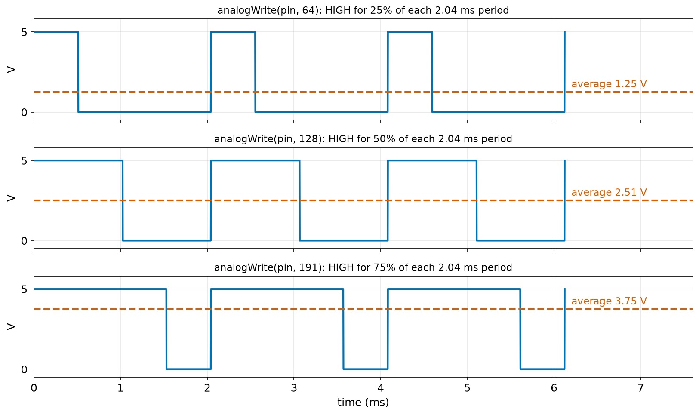
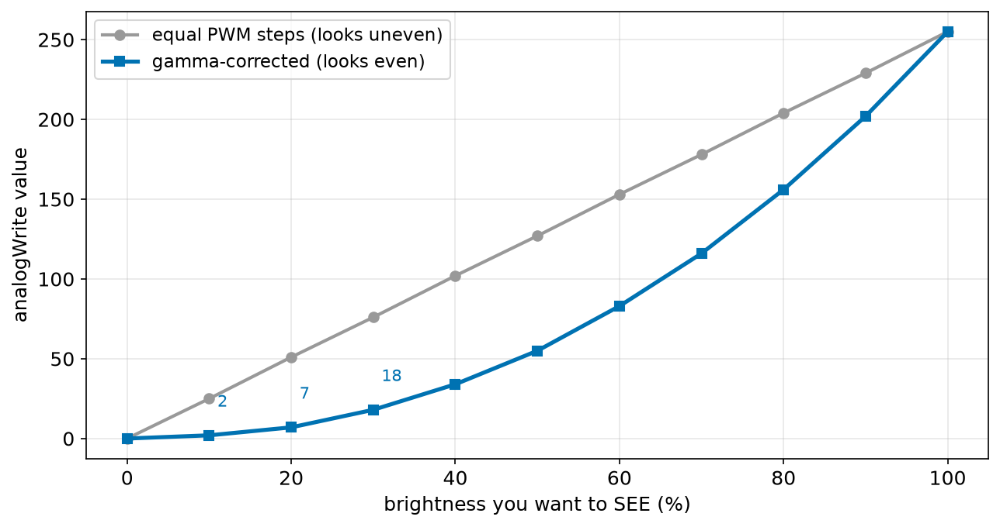
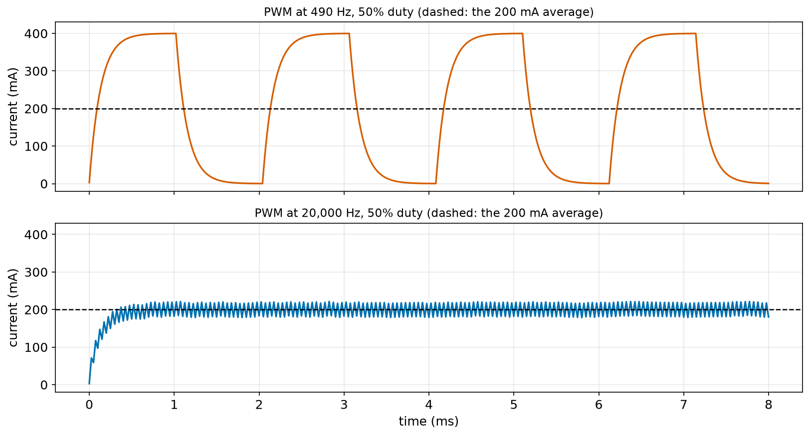
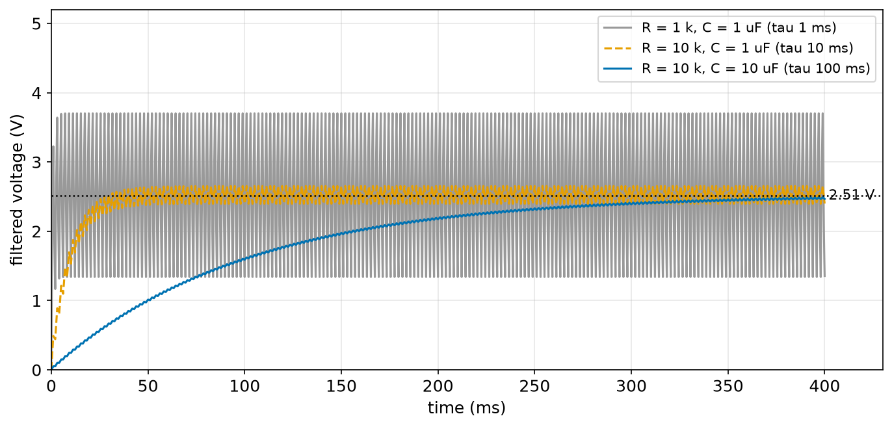
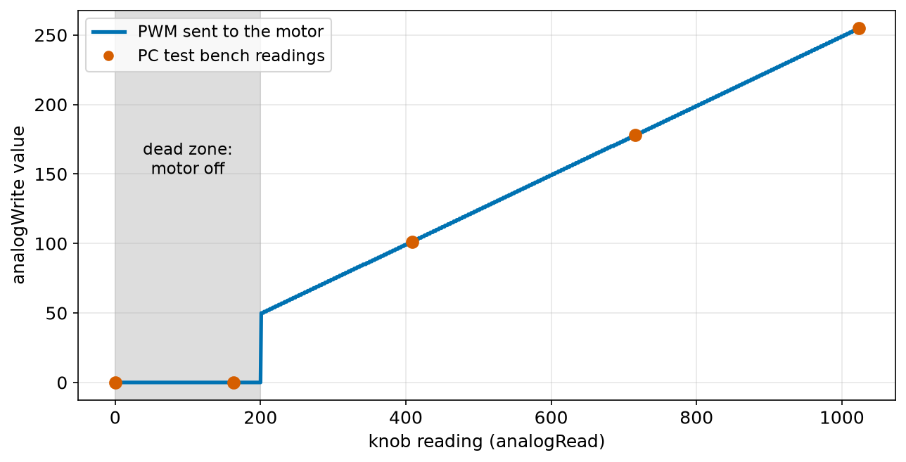
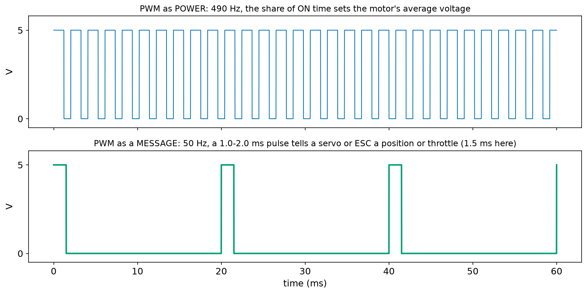

# Chapter 102 — PWM: "Fake" Analog Output

> **Part 6 · Chapter 102 of 749**
> **You need:** Chapter 37 (the duty cycle, first look), Chapter 43 (straight lines and `map`), Chapter 82 (LEDs), Chapter 84 (RC filters), Chapter 85 (inductors), Chapter 88 (MOSFETs), Chapter 90 (switching regulators), Chapter 98 (outputs and transistor switches) and Chapter 101 (`analogRead`).
> **You will make:** an LED that fades, a table of brightness values that the eye sees as even steps, a knob that sets a motor's speed, Rover's start-up beep, and models that show why motor drivers switch 20,000 times per second and how a resistor and capacitor turn PWM into a steady voltage.

---

## What you will learn

- How switching a pin on and off very fast can act like a voltage **between** 0 and 5 V.
- What the **duty cycle**, the **period** and the **frequency** of a PWM signal are.
- How `analogWrite` works, which pins can do it, and at which frequencies.
- Why equal PWM steps do not look like equal brightness steps, and how **gamma correction** fixes it.
- How PWM controls a motor's speed, and why the PWM **frequency** matters for motors.
- How to make a true steady voltage from PWM with an **RC filter**, and how `tone()` makes sounds.

---

## New words in this chapter

| Word | Simple meaning |
|---|---|
| **PWM** | Pulse-width modulation: switching a pin on and off fast, and changing how long it stays on in each cycle. |
| **period** | The time of one full on-and-off cycle. |
| **frequency** | How many cycles per second: 1 ÷ period. |
| **duty cycle** | The share of each period that the pin is HIGH, as a percentage. |
| **average voltage** | The voltage a slow thing (a motor, the eye, a filter) "feels": duty × 5 V. |
| **gamma correction** | Changing PWM values so that the eye sees even steps of brightness. |
| **dead zone** | A range of small commands that are too weak to do anything, so they are set to zero. |
| **ripple** | The small up-and-down left over when a pulsing signal is smoothed. |
| **tone** | A square wave at a chosen frequency, for a buzzer or speaker. |

---

## 102.1 The idea: switch fast, and let slow things average

A digital pin has only two levels: 0 V and 5 V. But many things we want to control need values **in between**: a dim LED, a motor at half speed, a fan running quietly. The Uno has no pin that can output 2.5 V. So we cheat.

Imagine switching a room's light on and off once per second. You see it flash. Now switch it on and off 500 times per second: your eye cannot follow, and the light simply looks **dimmer**. If it is on for half of every flash, it looks about half as bright as fully on. A motor is the same: it has weight and inductance (Chapter 85) and cannot speed up and slow down 500 times per second, so it settles at the speed that matches the **average** voltage.

📖 **New word: PWM** — **p**ulse-**w**idth **m**odulation: a signal that switches between LOW and HIGH at a fixed rate, where the **width** of each HIGH pulse is what we change ("modulate"). It was already pictured at the bottom of Chapter 5's Figure 5.5.

📖 **New word: period** — the time of one complete cycle: one HIGH part plus one LOW part.

📖 **New word: frequency** — how many cycles per second, in hertz (Hz): **frequency = 1 ÷ period**. A period of 2.04 ms is a frequency of 1 ÷ 0.00204 = 490 Hz.

📖 **New word: duty cycle** — the share of each period that the signal is HIGH, as a percentage (Chapter 37 met it first). HIGH for 0.51 ms of a 2.04 ms period is a duty cycle of 25%.

📖 **New word: average voltage** — what a slow thing "feels": the voltage averaged over a whole period.

🔢 **Average voltage = duty cycle × 5 V.** 25% → 1.25 V; 50% → 2.5 V; 75% → 3.75 V.



*Figure 102.1 — The voltage on a PWM pin for three `analogWrite` values, at 490 Hz. The red dashed line is the average.*

**How to read this picture:** Each panel shows three periods of 2.04 ms. The blue line is the real pin: always either 0 V or 5 V, never in between. Only the width of the HIGH part changes: about a quarter, a half and three quarters of each period. The red dashed line is what a motor or your eye would feel: 1.25 V, 2.51 V and 3.75 V.

🧠 **PWM is not a real analog voltage. It is a digital signal whose average is the voltage you want.** It works whenever the thing being driven is much slower than the switching: lamps and LEDs (seen by the eye), motors, heaters, and anything behind a filter.

---

## 102.2 `analogWrite`: PWM on the Uno

`analogWrite(pin, value)` starts PWM on a pin, with `value` from 0 to 255:

🔢 **duty cycle = value ÷ 255.** 0 means always LOW, 255 means always HIGH, 128 means 50.2%.

The program `pwm_average.py` (in the Code section) lists a few values:

```
PWM at 490 Hz: one period = 2.04 ms
 value    duty   on for  average
     0    0.0%  0.000 ms    0.00 V
     1    0.4%  0.008 ms    0.02 V
    64   25.1%  0.512 ms    1.25 V
   128   50.2%  1.024 ms    2.51 V
   191   74.9%  1.529 ms    3.75 V
   254   99.6%  2.033 ms    4.98 V
   255  100.0%  2.041 ms    5.00 V
```

Despite its name, `analogWrite` does not write an analog voltage: it starts a **digital** PWM signal, made by the chip's **timers** (Chapter 106) in hardware. Once started, it runs by itself: your sketch can do other things, or wait in `delay()`, and the PWM keeps going until the next `analogWrite` changes it.

Only six Uno pins can do PWM: the ones marked **~** (Chapter 95). Each pair belongs to one of the three timers:

| Pins | Timer | Frequency | Notes |
|---|---|---|---|
| 5, 6 | Timer0 | 980 Hz | Timer0 also runs `millis()` and `delay()`: never change its settings |
| 9, 10 | Timer1 | 490 Hz | the `Servo` library takes Timer1, so PWM on 9 and 10 stops when it is used |
| 3, 11 | Timer2 | 490 Hz | `tone()` takes Timer2 (section 102.7) |

⚠️ **Careful: `analogWrite` on a pin without ~ does not do PWM.** It sets the pin LOW for values below 128 and HIGH for 128 and above. The LED does not fade; it switches. Check the ~ before you wire.

💡 **Tip:** `analogWrite` sets the pin to an output by itself, but calling `pinMode(pin, OUTPUT)` in `setup()` makes your sketch clearer, and makes sure the pin is a definite LOW from the start.

The sketch `fade.ino` (in the Code section) fades an LED on pin 9 up and down in steps of 51. The PC test bench prints each change:

```
[   0.2000 s] pin 9 PWM 51/255 (20.0%)
[   0.4000 s] pin 9 PWM 102/255 (40.0%)
[   0.6000 s] pin 9 PWM 153/255 (60.0%)
[   0.8000 s] pin 9 PWM 204/255 (80.0%)
[   1.0000 s] pin 9 -> HIGH
[   1.2000 s] pin 9 PWM 204/255 (80.0%)
[   1.4000 s] pin 9 PWM 153/255 (60.0%)
[   1.6000 s] pin 9 PWM 102/255 (40.0%)
[   1.8000 s] pin 9 PWM 51/255 (20.0%)
[   2.0001 s] pin 9 -> LOW
```

Notice that 255 and 0 are not PWM at all: the pin is simply HIGH or LOW.

---

## 102.3 Brightness and the eye: gamma correction

Fade an LED with equal PWM steps, 0, 51, 102, 153, 204, 255, and watch it. Something is wrong: it gets bright very quickly and then hardly changes; the last three steps look almost the same. The PWM is right. The **eye** is the problem.

Our eyes are much more sensitive to changes in dim light than in bright light. (That is how we can see both in starlight and in sunshine, which is millions of times brighter.) Going from 1% to 2% power looks like a big jump; going from 80% to 90% looks small.

📖 **New word: gamma correction** — choosing PWM values so that the **seen** brightness goes up in even steps. The usual rule raises the wanted brightness (as a fraction) to a power of about 2.2:

🔢 **PWM = 255 × (wanted brightness)^2.2**. For 50% seen brightness: 255 × 0.5^2.2 = 255 × 0.218 = **55.6 → 55**, not 128.

The sketch `gamma.ino` prints the table:

```
level   linear PWM   corrected PWM
0%      0          0
10%      25          2
20%      51          7
30%      76          18
40%      102          34
50%      127          55
60%      153          83
70%      178          116
80%      204          156
90%      229          202
100%      255          255
```



*Figure 102.2 — The `analogWrite` value needed for each step of seen brightness: a straight line (grey) and the gamma-corrected curve (blue).*

**How to read this picture:** The horizontal axis is the brightness you want people to see. The grey straight line is the naive choice: equal steps of PWM. The blue curve is what the eye actually needs: tiny values at first (2, 7, 18 for the first three steps), then bigger and bigger steps. An LED driven along the blue curve fades smoothly from dark to bright.

---

## 102.4 Motors and PWM: the frequency matters

A motor driven by PWM through a MOSFET (Chapter 98) receives the battery voltage in pulses. Two things decide how it behaves.

**The average sets the speed.** The motor's own weight and the load cannot change speed within one period, so the motor runs at about the speed the average voltage would give. Double the duty cycle and the speed roughly doubles (above the small **dead zone** where it is too weak to turn, Application 1).

**The frequency sets how smooth it is.** A motor's coil is an inductor (Chapter 85): its current cannot jump, it rises and falls with a time constant **τ = L ÷ R**. For a small motor with R = 15 Ω and L = 2 mH, τ = 0.002 ÷ 15 = 0.13 ms. If the PWM period is much **longer** than τ, the current has time to rise all the way and fall all the way in every cycle: the motor gets a series of hard kicks. If the period is much **shorter** than τ, the current only wobbles a little around its average.

The program `pwm_motor.py` simulates the current in that motor, held still, at 50% duty from a 6 V battery:

```
motor time constant L/R = 0.133 ms; average current 200 mA
 PWM frequency    period   lowest  highest   ripple
        100 Hz  10.000 ms      0 mA    400 mA    400 mA
        490 Hz   2.041 ms      0 mA    400 mA    400 mA
        980 Hz   1.020 ms      8 mA    392 mA    383 mA
       4000 Hz   0.250 ms    113 mA    287 mA    175 mA
      20000 Hz   0.050 ms    181 mA    219 mA     37 mA
```

📖 **New word: ripple** — the up-and-down left over around the average when a pulsing signal is smoothed. Here: the difference between the highest and lowest current.



*Figure 102.3 — The current in the small motor during 8 ms of 50% PWM, at the Uno's 490 Hz (top) and at 20 kHz (bottom).*

**How to read this picture:** The dashed line is the average, 200 mA, the same in both. At 490 Hz (top), each 1 ms ON part is long enough for the current to rise almost to its full 400 mA, and each OFF part long enough for it to fall to zero: every cycle is a full kick. At 20 kHz (bottom), the current climbs to 200 mA in the first half millisecond and then only wiggles between about 181 and 219 mA.

Why does the ripple matter?

- **Noise.** Each kick makes the motor's parts move a tiny bit, 490 times per second: a clearly audible whine. 20 kHz is above what people can hear.
- **Heat.** For the same average, a current that swings 0–400 mA heats the motor's wires more than a steady 200 mA does (heat goes with current squared, Chapter 76).
- **Smoothness.** Small robots barely notice; precise ones (a camera gimbal, a drone) do.

That is why motor drivers usually switch at **15 to 25 kHz**. The Uno's `analogWrite` gives only 490 or 980 Hz; Chapter 106 shows how to change a timer to 20 kHz, and Rover's motor driver (the TB6612, Chapter 141) is happy with either.

⚠️ **Careful: higher frequency costs switching heat.** Every on-off switch wastes a little energy in the MOSFET while it changes state (Chapter 88). At 20 kHz it switches 40 times more often than at 490 Hz. For small motors this is still tiny; for big ones it is a real design choice.

---

## 102.5 Turning PWM into a real voltage: the RC filter

Sometimes you need a **true** steady voltage, not pulses: for example, as the "set speed" input of a motor controller that expects 0–5 V, or to make a test voltage for another ADC. A resistor and a capacitor do it (Chapter 84): the capacitor charges during the HIGH part and discharges during the LOW part, and if its time constant τ = R × C is much longer than the period, it settles at the average.

The program `rc_filter.py` filters `analogWrite(pin, 128)` with three different R and C:

```
R   1000 ohm, C    1 uF: tau    1.0 ms, average 2.51 V, ripple 2355.6 mV, reaches 95% in about     3 ms
R  10000 ohm, C    1 uF: tau   10.0 ms, average 2.51 V, ripple  254.9 mV, reaches 95% in about    30 ms
R  10000 ohm, C   10 uF: tau  100.0 ms, average 2.51 V, ripple   25.5 mV, reaches 95% in about   300 ms
```



*Figure 102.4 — The voltage on the capacitor for the first 400 ms, for the three filters.*

**How to read this picture:** All three climb towards the same average, 2.51 V (dotted). The grey one (τ = 1 ms) is quick but still swings by more than 2 V: hardly smoothed at all. The orange one (τ = 10 ms) settles in about 30 ms with a 0.25 V ripple. The blue one (τ = 100 ms) is very smooth (25 mV ripple) but takes about 300 ms to get there.

🧠 **Every filter trades smoothness against speed.** Ten times smoother costs ten times slower. (Chapter 97's moving average was the same trade, in software.)

---

## 102.6 `map` and whole numbers

Turning a knob reading (0–1,023) into a PWM value (0–255) is a straight line, and `map` does it:

```cpp
int pwm = map(knob, 0, 1023, 0, 255);
```

Remember Chapter 43's warning: `map` works in **whole numbers**. It drops the decimals before returning: `map(512, 0, 1023, 0, 5)` is 2, not 2.502. For PWM, where only whole values exist anyway, that is fine. For a result where decimals matter (volts, metres), do the sum with floats instead.

---

## 102.7 Sounds: `tone()`

📖 **New word: tone** — a square wave with a 50% duty cycle at a chosen **frequency**. On a small speaker or a passive buzzer (one without its own oscillator, unlike Chapter 98's active buzzer), the frequency is the pitch you hear: 440 Hz is the note A, 523 Hz is C.

```cpp
tone(pin, frequency);           // start, until noTone(pin)
tone(pin, frequency, ms);       // start, and stop by itself after ms milliseconds
noTone(pin);                    // stop
```

`tone()` works on **any** digital pin, but it borrows **Timer2**, the timer behind the PWM on pins 3 and 11. While a tone plays, `analogWrite` on pins 3 and 11 does not work properly. Chapter 95's pin planner warned about this: a buzzer and a motor speed on pin 3 or 11 do not mix.

`tone(pin, f, ms)` **does not wait**: it starts the sound and returns at once. To play notes one after another, wait yourself, as Rover's start-up beep does (in the Code section):

```
[   0.0000 s] pin 8 tone 523 Hz for 150 ms
[   0.2000 s] pin 8 tone 659 Hz for 150 ms
[   0.4000 s] pin 8 tone 784 Hz for 150 ms
```

Three rising notes, C, E and G, each 150 ms long with a 50 ms gap: "I am ready".

---

## Code

All sketch outputs come from the PC test bench with the Uno's 16-bit `int`. The bench prints every `analogWrite` that changes a pin, and every `tone()` call.

File `code/ch102/pwm_average.py`:

```python
# pwm_average.py - what analogWrite values mean: duty cycle, on-time, and the average voltage
V = 5.0
FREQ = 490.0                          # Hz: the PWM frequency on Uno pins 3, 9, 10 and 11
period_ms = 1000 / FREQ

print(f"PWM at {FREQ:.0f} Hz: one period = {period_ms:.2f} ms")
print(f"{'value':>6s} {'duty':>7s} {'on for':>8s} {'average':>8s}")
for value in [0, 1, 64, 128, 191, 254, 255]:
    duty = value / 255                # analogWrite's 0-255 is the share of each period that the pin is HIGH
    print(f"{value:6d} {duty * 100:6.1f}% {duty * period_ms:6.3f} ms {duty * V:7.2f} V")
```

| Line | Code | What it does (simple English) |
|---|---|---|
| 1 | `# pwm_average.py …` | A comment. |
| 2 | `V = 5.0` | The HIGH level. |
| 3 | `FREQ = 490.0` | The PWM frequency of pins 3, 9, 10 and 11. |
| 4 | `period_ms = 1000 / FREQ` | One period in ms: 2.04 ms. |
| 5 | (blank) | Spacing. |
| 6–7 | `print(…)` | Headings. |
| 8 | `for value in […]:` | Seven `analogWrite` values. |
| 9 | `duty = value / 255` | The duty cycle as a fraction. |
| 10 | `print(…)` | The value, the duty in %, the HIGH time per period, and the average voltage. |

The output is in section 102.2.

File `code/ch102/fade/fade.ino`:

```cpp
// fade.ino - fade an LED on pin 9 up and then down with PWM
const int LED_PIN = 9;                 // a PWM pin (marked ~ on the board)

void setup() {
  pinMode(LED_PIN, OUTPUT);
}

void loop() {
  for (int value = 0; value <= 255; value += 51) {    // 0, 51, 102, 153, 204, 255
    analogWrite(LED_PIN, value);       // HIGH for value/255 of every period
    delay(200);
  }
  for (int value = 204; value >= 51; value -= 51) {   // 204, 153, 102, 51: back down
    analogWrite(LED_PIN, value);
    delay(200);
  }
}
```

| Line | Code | What it does (simple English) |
|---|---|---|
| 1 | `// fade.ino - …` | A comment. |
| 2 | `const int LED_PIN = 9;` | An LED with a 220 Ω resistor on pin 9, a PWM pin. |
| 3 | (blank) | Spacing. |
| 4–6 | `void setup() { pinMode(LED_PIN, OUTPUT); }` | The pin is an output. |
| 7 | (blank) | Spacing. |
| 8 | `void loop() {` | Runs for ever. |
| 9 | `for (int value = 0; value <= 255; value += 51) {` | value = 0, 51, …, 255: six steps up (Chapter 97's `for` with a step of 51). |
| 10 | `analogWrite(LED_PIN, value);` | Start PWM at this duty. The hardware keeps it going. |
| 11 | `delay(200);` | Stay at this brightness for 0.2 s; the PWM continues during the delay. |
| 12 | `}` | End of the first `for`. |
| 13 | `for (int value = 204; value >= 51; value -= 51) {` | Back down: 204, 153, 102, 51. (0 comes next, at the start of the next `loop()`.) |
| 14–15 | `analogWrite(…); delay(200);` | The same. |
| 16 | `}` | End of the second `for`. |
| 17 | `}` | End of `loop`. |

The output is in section 102.2.

File `code/ch102/gamma/gamma.ino`:

```cpp
// gamma.ino - LED brightness that the eye sees as even steps: gamma-corrected PWM values
const float GAMMA = 2.2;               // how the eye responds to light (section 102.3)

void setup() {
  Serial.begin(115200);
  Serial.println("level   linear PWM   corrected PWM");
  for (int level = 0; level <= 10; level++) {
    int linear = level * 255 / 10;                                 // equal steps of PWM value
    int corrected = (int)(255 * pow(level / 10.0, GAMMA) + 0.5);   // equal steps of SEEN brightness
    Serial.print(level * 10);
    Serial.print("%      ");
    Serial.print(linear);
    Serial.print("          ");
    Serial.println(corrected);
  }
}

void loop() {
}
```

| Line | Code | What it does (simple English) |
|---|---|---|
| 1 | `// gamma.ino - …` | A comment. |
| 2 | `const float GAMMA = 2.2;` | The power from section 102.3. |
| 3 | (blank) | Spacing. |
| 4–6 | `void setup() { Serial.begin(115200); Serial.println(…);` | Start, and print the heading. |
| 7 | `for (int level = 0; level <= 10; level++) {` | Eleven brightness levels, 0 to 10 (0% to 100%). |
| 8 | `int linear = level * 255 / 10;` | The naive value: equal steps. 10 × 255 = 2,550 fits easily in an int. |
| 9 | `int corrected = (int)(255 * pow(level / 10.0, GAMMA) + 0.5);` | The gamma-corrected value: `pow(a, b)` is a to the power b (Python's `a ** b`). `+ 0.5` then the cast rounds to the nearest whole number (Chapter 96). |
| 10–14 | `Serial.print(level * 10); …` | Print the level in %, then the two values. |
| 15 | `}` | End of the `for`. |
| 16 | `}` | End of `setup`. |
| 17–19 | `void loop() { }` | Nothing to repeat. |

The output is in section 102.3.

File `code/ch102/startup_beep/startup_beep.ino`:

```cpp
// startup_beep.ino - Rover says "ready" with three rising notes on a passive buzzer on pin 8
const int BUZZER_PIN = 8;
const int NOTES[3] = {523, 659, 784};  // the notes C, E and G: frequencies in Hz

void setup() {
  for (int i = 0; i < 3; i++) {
    tone(BUZZER_PIN, NOTES[i], 150);   // a square wave at this frequency, for 150 ms
    delay(200);                        // tone() does not wait: wait for the note and a short gap
  }
}

void loop() {
}
```

| Line | Code | What it does (simple English) |
|---|---|---|
| 1 | `// startup_beep.ino - …` | A comment. |
| 2 | `const int BUZZER_PIN = 8;` | A passive buzzer (or small speaker with a 100 Ω resistor) between pin 8 and GND. Any pin works for `tone`. |
| 3 | `const int NOTES[3] = {523, 659, 784};` | Three note frequencies in an array (Chapter 97). |
| 4 | (blank) | Spacing. |
| 5 | `void setup() {` | Play once, at start-up. |
| 6 | `for (int i = 0; i < 3; i++) {` | Each note in turn. |
| 7 | `tone(BUZZER_PIN, NOTES[i], 150);` | Start the note; it stops by itself after 150 ms. |
| 8 | `delay(200);` | `tone` returned at once, so wait 200 ms: the 150 ms note plus a 50 ms gap. |
| 9 | `}` | End of the `for`. |
| 10 | `}` | End of `setup`. |
| 11–13 | `void loop() { }` | Silence afterwards. |

The output is in section 102.7.

---

## Small examples

**Example 1.** `analogWrite(6, 77)`: duty = 77 ÷ 255 = 30.2%, average 1.51 V, at 980 Hz (pin 6).

**Example 2.** For an average of 3.3 V: value = 3.3 ÷ 5 × 255 = 168.3 → 168.

**Example 3.** At 980 Hz, one period is 1 ÷ 980 = 1.02 ms; at 50% duty the pin is HIGH for 0.51 ms.

**Example 4.** `analogWrite(7, 200)` on pin 7 (no ~): the pin is simply HIGH (200 ≥ 128).

**Example 5.** Gamma for 25% seen brightness: 255 × 0.25^2.2 = 255 × 0.0474 = 12.1 → 12.

**Example 6.** A 12 V motor at 40% duty sees an average of 4.8 V.

**Example 7.** An RC filter with 4.7 kΩ and 22 µF: τ = 0.103 s; it settles in about 3τ = 0.31 s.

**Example 8.** `tone(8, 440)` plays the note A until `noTone(8)`; meanwhile `analogWrite(11, 100)` misbehaves.

---

## 🏭 Real robot applications

### Application 1 (worked in full) — 🤖 A knob that sets a motor's speed

**1. The real problem.** On the test bench, you want to try Rover's motor at any speed by turning a knob, without uploading a new sketch each time. Later the same code, with the knob replaced by a number from the control loop (Part 12), sets Rover's real wheel speeds. The motor needs far more current than a pin can give, and it should not hum uselessly when the knob is near zero.

**2. Why this theory.** Chapter 101: read the knob with `analogRead`. Section 102.6: `map` it to 0–255. Section 102.2: `analogWrite` on a ~ pin. Chapter 98: the pin drives a logic-level MOSFET, which carries the motor current, with a flyback diode across the motor (Chapter 86). Section 102.4: the average voltage sets the speed.

📖 **New word: dead zone** — a range of small commands that are too weak to make the motor turn. In it, the motor just hums and heats. It is better to send 0 there.

**3. The numbers.** The small motor of Chapter 87: 15 Ω, needs about 80 mA to start turning (Chapter 93), 6 V battery. Fully on it would take about 6 ÷ 15 = 0.4 A. So it starts at about 0.08 ÷ 0.4 = 20% duty: a PWM value of 0.2 × 255 = 51. We set the dead zone at 50. PWM on pin 5 (980 Hz).

**4. The maths.** PWM = knob × 255 ÷ 1,023 (whole numbers); if PWM < 50, PWM = 0. The knob at 2.0 V reads 2.0 × 1,024 ÷ 5 = 409 (Chapter 101), and 409 × 255 ÷ 1,023 = 101.9 → **101** = 39.6% duty → an average of 0.396 × 6 = 2.38 V on the motor.

**5. The code.** File `code/ch102/motor_speed/motor_speed.ino`:

```cpp
// motor_speed.ino - a knob sets a motor's speed: analogRead -> map -> PWM -> MOSFET -> motor
const int KNOB_PIN = A0;
const int MOTOR_PIN = 5;               // a PWM pin, driving the MOSFET's gate (Chapter 98)
const int DEAD_ZONE = 50;              // below about 20% the motor cannot start anyway (Chapter 93)

void setup() {
  Serial.begin(115200);
  pinMode(MOTOR_PIN, OUTPUT);
  analogWrite(MOTOR_PIN, 0);           // start with the motor stopped
}

void loop() {
  int knob = analogRead(KNOB_PIN);               // 0 to 1023
  int pwm = map(knob, 0, 1023, 0, 255);          // 0 to 255 (whole numbers only, Chapter 43)
  if (pwm < DEAD_ZONE) {
    pwm = 0;                                     // too little to turn: switch off instead of humming
  }
  analogWrite(MOTOR_PIN, pwm);
  Serial.print("knob ");
  Serial.print(knob);
  Serial.print(" -> PWM ");
  Serial.print(pwm);
  Serial.print(" = ");
  Serial.print(pwm * 100 / 255);
  Serial.println("%");
  delay(200);
}
```

| Line | Code | What it does (simple English) |
|---|---|---|
| 1 | `// motor_speed.ino - …` | A comment: the whole chain in one line. |
| 2 | `const int KNOB_PIN = A0;` | The knob (a 10 kΩ potentiometer, Chapter 101) on A0. |
| 3 | `const int MOTOR_PIN = 5;` | Pin 5: PWM at 980 Hz, to the MOSFET's gate through 220 Ω, with a 100 kΩ pull-down (Chapter 98). |
| 4 | `const int DEAD_ZONE = 50;` | PWM values below this are sent as 0. |
| 5 | (blank) | Spacing. |
| 6–10 | `void setup() { … analogWrite(MOTOR_PIN, 0); }` | Start Serial; make the pin an output; make sure the motor starts stopped. |
| 11 | (blank) | Spacing. |
| 12 | `void loop() {` | Five times per second. |
| 13 | `int knob = analogRead(KNOB_PIN);` | 0 to 1,023. |
| 14 | `int pwm = map(knob, 0, 1023, 0, 255);` | Scale it to the PWM range. |
| 15–17 | `if (pwm < DEAD_ZONE) { pwm = 0; }` | The dead zone. |
| 18 | `analogWrite(MOTOR_PIN, pwm);` | Set the motor's duty cycle. |
| 19–25 | `Serial.print("knob "); …` | Report the knob, the PWM value and the duty in %. `pwm * 100` is at most 25,500: it fits in an int. |
| 26 | `delay(200);` | Five updates per second. |
| 27 | `}` | End of `loop`. |

The test turns the knob in steps: 0, 0.8, 2.0, 3.5 and 5.0 V. Output:

```
knob 0 -> PWM 0 = 0%
knob 163 -> PWM 0 = 0%
knob 409 -> PWM 101 = 39%
knob 716 -> PWM 178 = 69%
knob 1023 -> PWM 255 = 100%
```



*Figure 102.5 — The PWM value sent to the motor for every knob reading, with the dead zone; red dots are the bench readings.*

**How to read this picture:** The horizontal axis is the knob's `analogRead` value; the vertical axis is the PWM value. In the grey band (knob below about 200), the output is held at 0: the motor stays off. Above it, the line jumps to about 50 and then rises straight to 255. The red dots are the five test points; the second one, 163, falls in the dead zone.

**6. The result.** The knob gives smooth control from 20% to 100%, and below that the motor is cleanly off instead of humming and heating. The pin's current is only what charges the MOSFET's gate; the motor's 0.4 A goes through the MOSFET. At 980 Hz the motor whines softly (section 102.4); for silent running, Chapter 106 moves the PWM to 20 kHz. And the motor runs one way only: a single MOSFET can only switch power on and off. To drive Rover's wheels **backwards** too, Chapter 139 uses four switches in an H-bridge.

**7. Going further.** Real motor speed control does not trust the duty cycle alone: the same PWM gives different speeds with a full or tired battery, on a smooth floor or on carpet. Rover measures the real wheel speed with its encoders (Chapter 123) and adjusts the PWM until the speed is right, many times per second: the PID control of Part 12. The PWM stays the motor's "muscle"; the control loop becomes its brain.

### Application 2 (worked in full) — 🏠 Indicator LEDs that look right and save power

**1. The real problem.** Chapter 98 gave Rover three status LEDs. Two problems remain. First, at full brightness in a dim room they are glaring; you want "on, but dim", and a smooth fade looks more polished than a sudden switch. Second, Chapter 82 noted that LEDs that are always on waste battery: about 12 mA each (Chapter 98). Can PWM fix both?

**2. Why this theory.** Section 102.3: the eye needs gamma-corrected values for even-looking steps. Section 102.1: the average current of a PWM-driven LED is duty × its full current, which is exactly the power saving Chapter 82 promised.

**3. The numbers.** One status LED: 12.2 mA when fully on (Chapter 98). We want it to look 30% as bright as full. Rover's three status LEDs, one on at a time, all day.

**4. The maths.** Gamma: PWM = 255 × 0.30^2.2 = 255 × 0.0707 = 18.0 → **18** (the table's 30% row). Duty = 18 ÷ 255 = 7.1%. Average current = 0.071 × 12.2 mA = **0.86 mA**, instead of 12.2 mA: the LED looks a third as bright but uses 1/14 of the current. Without gamma, "30%" would be PWM 76: 3.6 mA, and it would look almost as bright as fully on.

**5. The code.** The table comes from `gamma.ino` (in the Code section). To use it, write the corrected value to the LED's pin:

```cpp
analogWrite(GREEN_PIN, 18);      // "on, at 30% seen brightness": 7% duty, 0.86 mA average
```

and to fade smoothly, step through the corrected column of the table (2, 7, 18, 34, 55, …) instead of equal steps.

**6. The result.** A dim, gamma-corrected status LED is easy to see across a room indoors, does not dazzle, and draws under 1 mA on average instead of 12 mA. With three status LEDs on Rover, one always lit, that saves about 11 mA, around 2% of Rover's 0.53 A average draw (Chapter 89): small, but free. Products do this everywhere: a phone's notification LED, a router's status lights and a robot vacuum's ring of lights all dim by PWM, almost always gamma corrected.

**7. Going further.** Gamma 2.2 is an approximation. Lighting engineers use the CIE "lightness" curve, which is similar for bright levels and more careful near black. Very dim levels also show a limit of 8-bit PWM: the first steps (1, 2, 3 out of 255) are big jumps for the eye, so smooth fades to nearly black need more resolution: 10, 12 or 16 bits of PWM, which a 16-bit timer can give (Chapter 106).

### Application 3 — 🚁 PWM as a message: servos and drone ESCs

The word PWM is also used for something different: a signal where the pulse width is a **message**, not a power level. A hobby servo (Chapter 143) and a classic drone ESC (Chapter 620) expect one pulse every 20 ms (50 Hz), and the pulse's **width**, between 1.0 and 2.0 ms, is the command: 1.0 ms = fully left (or zero throttle), 1.5 ms = centre (or half), 2.0 ms = fully right (or full throttle). The duty cycle is only 5–10%, and the average voltage means nothing: the receiving chip measures each pulse's width with a timer. It is a completely different use of the same waveform, and confusing the two is a common beginner mistake: `analogWrite(pin, 128)` on a servo's signal wire sends a 490 Hz signal with 1 ms pulses, which the servo cannot understand. Servos are driven with the `Servo` library (which takes Timer1, section 102.2), and modern drones replaced ESC pulses with digital DShot commands (Chapter 91, Application 4).



*Figure 102.6 — Top: PWM as power, 490 Hz at 60% duty. Bottom: PWM as a message, a 1.5 ms pulse every 20 ms, which a servo reads as "go to the centre".*

**How to read this picture:** Both panels cover 60 ms. The top signal switches about 30 times; its duty cycle is the command, and a motor averages it. The bottom signal has only three short pulses; their width is the command, and a servo measures it with a timer. Same kind of waveform, completely different meaning.

### Application 4 — 🖨️ Slow PWM for heaters

A 3D printer's heated bed and hot end are heated by power resistors switched by MOSFETs. The firmware's temperature controller (a PID loop, Chapter 216) decides how much power each needs, and PWM delivers it. But heaters are **very** slow: a bed takes minutes to warm, so it averages over seconds, not milliseconds. Printer firmware therefore often switches the bed at a low frequency, from a few hertz down to under once per second ("slow PWM"), with the same average effect, far less switching heat in the MOSFET, and less electrical noise. The same idea is used for heaters in incubators and for the battery heaters of Mars rovers (Chapter 89, Application 5): the slower the thing being controlled, the slower the PWM can be.

### Application 5 — 🔌 The switching regulator is PWM too

The buck converter that will power Rover's Raspberry Pi (Chapter 90) is PWM in a box. A MOSFET switches the battery on and off, typically 500,000 times per second, into an inductor and a capacitor, which smooth the pulses into a steady voltage, exactly section 102.5's RC filter but with an inductor instead of a resistor, so that almost no energy is wasted. The output is the average: **V_out = duty × V_in**, so to make 5.1 V from Rover's 8.4 V battery, the regulator runs at about 5.1 ÷ 8.4 = 61% duty, and as the battery falls to 6.0 V it raises the duty to 85%, all by itself, many times per millisecond. Class-D audio amplifiers, electric-car motor inverters and LED lamp drivers all work the same way: digital switching, averaged by something slow.

---

## 🔧 Hands-on lab

### Lab 102.1 — Fade an LED, with and without gamma (hardware or Wokwi)

You need: an Uno (or Wokwi), an LED, a 220 Ω resistor.

1. Wire pin 9 → 220 Ω → LED → GND. Upload `fade.ino` and watch.
2. Change the steps to the gamma-corrected values: use an array `const int LEVELS[6] = {0, 7, 34, 83, 156, 255};` and a `for` loop over it, up and back down.
3. Move the LED to pin 7 (no ~) and run `fade.ino` again.

**What you should see:** In step 1, the LED jumps from off to quite bright at the first step, and the last three steps look nearly the same. In step 2, the steps look much more even: each one a similar visible jump. In step 3, the LED simply switches: off for 0 and 51 and 102, fully on for 153 and above (`analogWrite` on a non-PWM pin).

| If it does not work | Likely cause | Fix |
|---|---|---|
| The LED only switches on and off | It is not on a ~ pin | Use 3, 5, 6, 9, 10 or 11 |
| The LED never lights | LED backwards | Long leg towards the resistor and pin |
| Flicker when you move your eyes quickly | Normal: 490 Hz is near the limit some people notice in side vision | Fine for indicators; Chapter 106 can raise the frequency |

**Challenge:** Make a "breathing" LED like a sleeping laptop: a smooth, slow fade up and down over about 3 seconds, using the gamma formula with `pow` inside the loop for 50 steps.

### Lab 102.2 — A motor at any speed (hardware)

You need: a small DC motor, a logic-level N-MOSFET (e.g. AO3400 on a breakout, or IRLZ44N), a 1N4148 or 1N5819 diode, a 220 Ω and a 100 kΩ resistor, a 10 kΩ potentiometer, a 4 × AA battery pack, jumper wires.

1. Build Chapter 98's MOSFET switch (Figure 98.5): pin 5 → 220 Ω → gate, gate → 100 kΩ → GND, source → GND, drain → motor (−), motor (+) → battery (+). Put the diode across the motor, its stripe towards battery (+) (Chapter 86). Connect the battery's (−) to the Uno's GND.
2. Wire the potentiometer to A0 (Chapter 101). Upload `motor_speed.ino`.
3. Turn the knob slowly from zero. Note the knob reading at which the motor starts to turn.

**What you should see:** Nothing until the PWM passes 50 (the dead zone), then the motor starts and speeds up smoothly as you turn. Listen: at low speed you may hear a soft whine at the PWM frequency. Your motor may need more or less than 20% to start; set `DEAD_ZONE` to the PWM value where it really starts.

| If it does not work | Likely cause | Fix |
|---|---|---|
| The motor runs at full speed whatever the knob | The MOSFET is wired as drain–source swapped, or the gate floats | Check the pinout; keep the 100 kΩ pull-down |
| The MOSFET gets hot | Not a logic-level MOSFET: it is only half on at 5 V | Use a logic-level type (Chapter 98) |
| The Uno resets when the motor starts | Motor noise or a shared battery dip | Separate the motor's battery; add 100 µF across the motor supply; keep the diode |
| The motor never stops | The dead zone line was left out | Keep lines 15–17 |

**Challenge:** Measure the motor's average voltage with the multimeter at several PWM values. Is it duty × battery voltage? (Your meter averages the PWM by itself, Chapter 92.)

### Lab 102.3 — Choose a PWM frequency (simulation)

Copy `pwm_motor.py`.

1. Run it as it is and note the ripple at 490 and 20,000 Hz.
2. A bigger motor has more inductance. Change `L = 0.002` to `L = 0.010` (10 mH) and run it again.
3. For each motor, find the lowest frequency in the table with a ripple under 50 mA (a quarter of the average).

**What you should see:** For the 10 mH motor:

```
motor time constant L/R = 0.667 ms; average current 200 mA
 PWM frequency    period   lowest  highest   ripple
        100 Hz  10.000 ms      0 mA    400 mA    400 mA
        490 Hz   2.041 ms     71 mA    329 mA    258 mA
        980 Hz   1.020 ms    127 mA    273 mA    146 mA
       4000 Hz   0.250 ms    181 mA    219 mA     37 mA
      20000 Hz   0.050 ms    194 mA    201 mA      8 mA
```

Five times the inductance gives a five times longer time constant, so the same ripple is reached at a five times lower frequency: under 50 mA needs 20 kHz for the 2 mH motor, but only 4 kHz for the 10 mH one.

| If it does not work | Likely cause | Fix |
|---|---|---|
| The program runs for a long time | 5 frequencies × 60 periods × 2,000 steps | About ten seconds is normal |
| The ripple is the same for both motors | You changed a comment, not the value | Change the number on line 5 |

**Challenge:** Add a back-voltage to the model (a turning motor makes a voltage against the supply, Chapter 87): `v - R * i - 3.0` when ON and `-R * i - 3.0` when OFF, clamped so the current cannot go below zero (the diode). How does the ripple change?

---

## Common mistakes

⚠️ **`analogWrite` on a pin without ~.** It switches the pin fully on or off instead of PWM.

⚠️ **Thinking `analogWrite` makes a real voltage.** It makes pulses. A multimeter shows the average; another chip's ADC may see 0 V or 5 V.

⚠️ **Equal PWM steps for LED brightness.** The eye sees uneven steps; use gamma correction.

⚠️ **Driving a motor straight from a PWM pin.** Still only 20 mA from the pin. Use a MOSFET and a flyback diode.

⚠️ **Sending tiny PWM values to a motor.** It hums and heats without turning. Use a dead zone.

⚠️ **`tone()` together with PWM on pins 3 or 11.** They share Timer2.

⚠️ **Changing Timer0 to get a different PWM frequency on pins 5 and 6.** `millis()` and `delay()` go wrong (Chapter 106).

⚠️ **Treating a servo's signal as power PWM.** Servos need 1–2 ms pulses at 50 Hz: use the `Servo` library.

⚠️ **Expecting `tone(pin, f, ms)` to wait.** It returns at once; wait yourself, or the next note starts immediately.

---

## Practice

🏋️ **1.** What duty cycle and average voltage does `analogWrite(10, 200)` give? At what frequency?

🏋️ **2.** Which value gives an average of 1.0 V on a 5 V pin?

🏋️ **3.** What is the period of 980 Hz PWM? How long is the pin HIGH at value 64?

🏋️ **4.** Why does a motor run smoothly on 490 Hz PWM even though its supply is switched on and off?

🏋️ **5.** Work out the gamma-corrected PWM value for 60% seen brightness.

🏋️ **6.** A motor has R = 5 Ω and L = 1 mH. What is its time constant? Is 490 Hz PWM much longer or much shorter than it?

🏋️ **7.** You need a steady 2 V with a ripple under 50 mV from 490 Hz PWM. Using `rc_filter.py`'s results, which R and C would you choose, and how long will it take to settle?

🏋️ **8.** A buzzer plays with `tone(4, 1000)`, and the motor's speed is on pin 11. What goes wrong, and how do you fix it?

🏋️ **9.** A green status LED takes 11.4 mA fully on. What is its average current at gamma level 20% (PWM 7)?

🏋️ **10.** A buck converter makes 3.3 V from 12 V. What duty cycle does it run at?

🏋️ **11.** In `pwm_motor.py`, change the motor's inductance to 10 mH. What is the ripple at 490 Hz now, and which is the lowest frequency in the table with a ripple under 50 mA?

---

## Answers

**1.** 200 ÷ 255 = 78.4%; 0.784 × 5 = 3.92 V; 490 Hz (pin 10 is Timer1).

**2.** 1.0 ÷ 5 × 255 = 51.

**3.** 1 ÷ 980 = 1.02 ms. At 64: 64 ÷ 255 × 1.02 = 0.256 ms HIGH.

**4.** The motor's inductance smooths its current a little, and its rotating mass cannot speed up and slow down 490 times per second, so its speed follows the average voltage. (It may still whine and its current ripples: section 102.4.)

**5.** 255 × 0.6^2.2 = 255 × 0.325 = 82.9 → **83** (the table's 60% row).

**6.** τ = L ÷ R = 0.001 ÷ 5 = 0.2 ms. 490 Hz has a period of 2.04 ms, about ten times longer than τ: the current swings almost fully in every cycle.

**7.** 10 kΩ and 10 µF: 25.5 mV of ripple, under 50 mV. It reaches 95% in about 300 ms. (For 2 V, use `analogWrite(pin, 102)`: 102 ÷ 255 × 5 = 2.0 V.)

**8.** `tone()` takes Timer2, which also makes the PWM on pins 3 and 11, so the motor's speed goes wrong while the buzzer plays. Move the motor to pin 5, 6, 9 or 10 (or the buzzer's PWM-free beeping to a separate method).

**9.** 7 ÷ 255 × 11.4 = **0.31 mA**.

**10.** 3.3 ÷ 12 = **27.5%**.

**11.** The changed line: `L = 0.010   # henries`. Output:

```
motor time constant L/R = 0.667 ms; average current 200 mA
 PWM frequency    period   lowest  highest   ripple
        100 Hz  10.000 ms      0 mA    400 mA    400 mA
        490 Hz   2.041 ms     71 mA    329 mA    258 mA
        980 Hz   1.020 ms    127 mA    273 mA    146 mA
       4000 Hz   0.250 ms    181 mA    219 mA     37 mA
      20000 Hz   0.050 ms    194 mA    201 mA      8 mA
```

At 490 Hz the ripple is **258 mA** (down from 400 mA). The lowest frequency in the table with a ripple under 50 mA is **4,000 Hz** (37 mA). More inductance means more smoothing at every frequency.

---

## Summary

🧠 **PWM** switches a pin between 0 and 5 V at a fixed **frequency**; the **duty cycle** (HIGH share of each **period**) sets the **average voltage** = duty × 5 V. Slow things (eyes, motors, heaters, filters) feel the average.

🧠 `analogWrite(pin, 0–255)` sets duty = value ÷ 255, in hardware, on the **~ pins** only: 5 and 6 at 980 Hz, 3, 9, 10 and 11 at 490 Hz. Timer0 also runs `millis()`; Timer1 serves `Servo`; Timer2 serves `tone()`.

🧠 The eye is not linear: use **gamma correction** (PWM = 255 × brightness^2.2) for even-looking steps. Dim, gamma-corrected LEDs save most of their current.

🧠 Motors: the duty sets the speed (with a **dead zone** for tiny commands); the frequency sets the current **ripple**, the whine and the heat. Motor drivers use 15–25 kHz.

🧠 An **RC filter** turns PWM into a real steady voltage; more smoothing costs more delay.

🧠 `tone()` makes a 50% square wave at a chosen frequency on any pin, without waiting; it uses Timer2.

🧠 "PWM" also names **message** signals (1–2 ms pulses at 50 Hz for servos and ESCs), which are read by their width, not their average.

---

## Next chapter

Every sketch so far has used `delay()`, and Chapters 98–102 kept finding its price: a flashing light that freezes the robot, a loop that misses short presses, a logger that falls behind. Chapter 103, **Timing without `delay`: `millis()`**, removes it. You will learn to run many jobs at their own rates in one fast loop, to keep a control loop exactly on time, and to handle the day, after 49.7 days, when `millis()` wraps back to zero.
