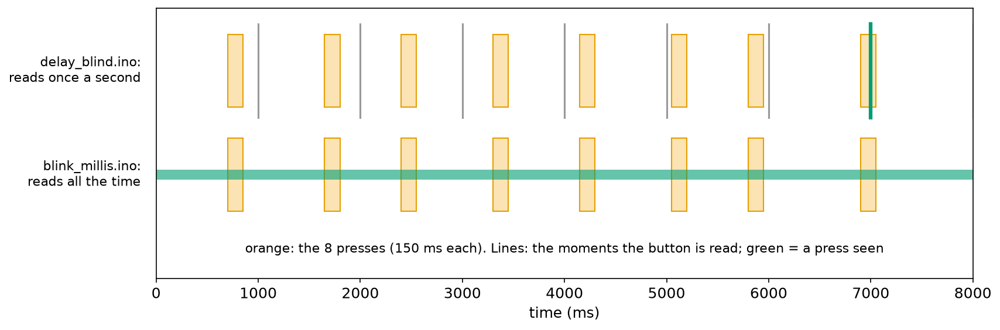
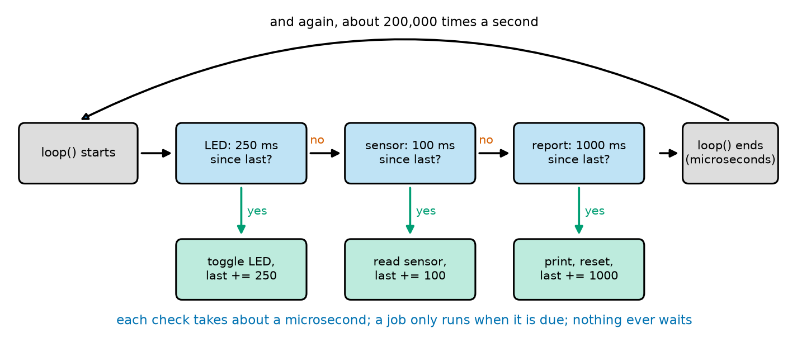
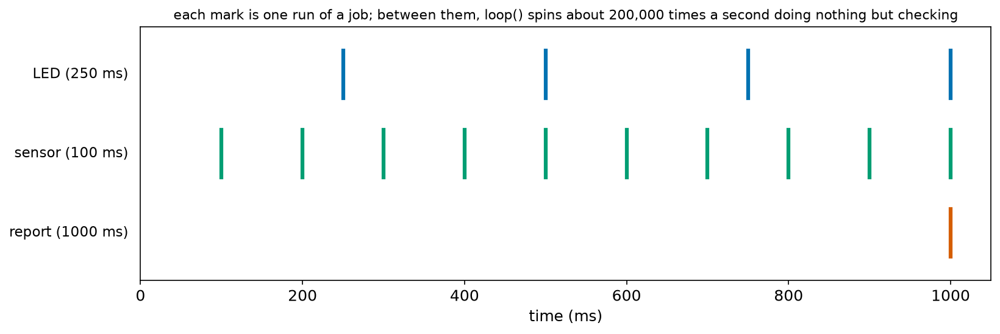
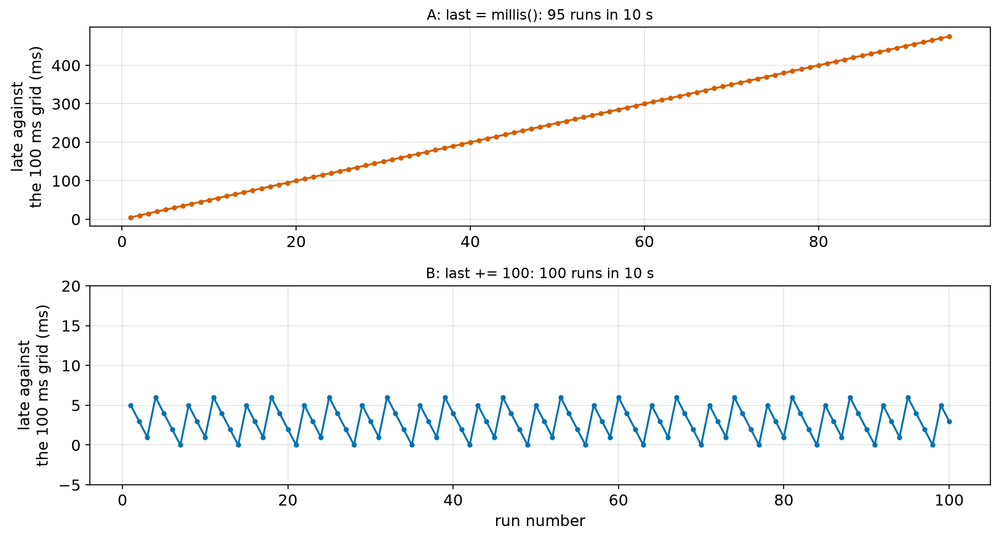
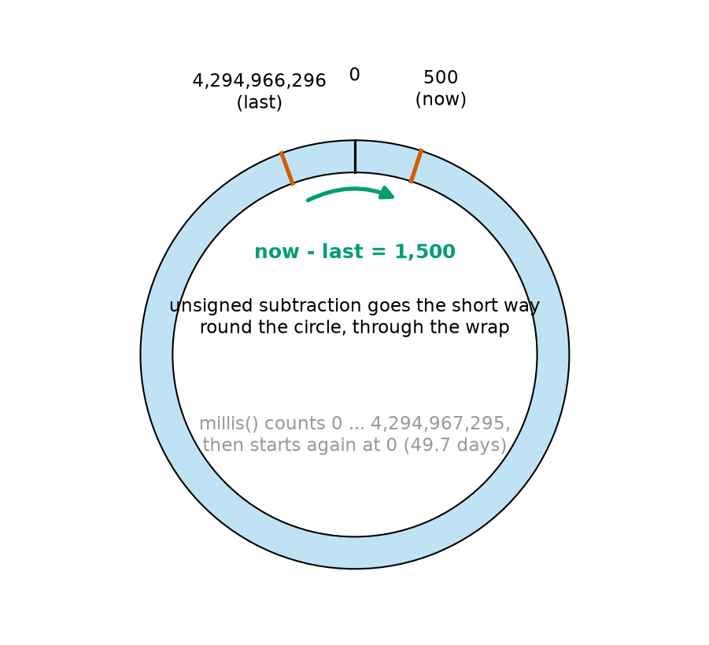
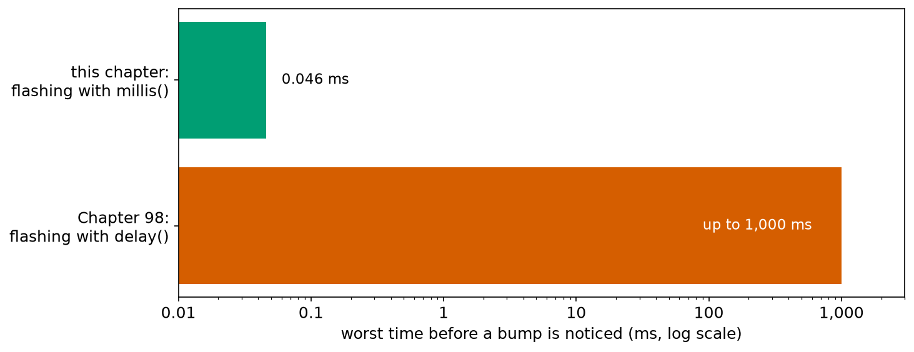
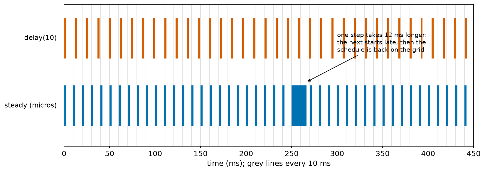

# Chapter 103 — Timing Without `delay`: `millis()`

> **Part 6 · Chapter 103 of 749**
> **You need:** Chapter 30 (timing a loop in Python, multi-rate timers), Chapter 54 (wrap-around of unsigned numbers), Chapter 96 (`unsigned long` and the 32.8-second bug), Chapter 98 (Rover's status lights), Chapter 99 (edges and polling) and Chapter 100 (printing).
> **You will make:** a blinking LED that no longer blinds the sketch to a button, a loop that runs three jobs at three rates, a test that shows how timers drift, a test across the moment `millis()` wraps back to zero after 49.7 days, Rover's flashing "go home" light that still notices a bump within a twentieth of a millisecond, and a control loop that runs exactly 100 times per second.

---

## What you will learn

- Why `delay()` makes a robot blind and deaf, and how much it costs.
- How `millis()` and `micros()` count time, and how to check "has enough time passed?" without waiting.
- How to run **many jobs at different rates** in one fast loop.
- Why `last += interval` keeps a schedule exact while `last = millis()` lets it **drift**.
- Why `millis() - last >= interval` keeps working when the clock **wraps** after 49.7 days, and `millis() >= due` does not.
- How to build a **steady control loop** and detect **overruns**.

---

## New words in this chapter

| Word | Simple meaning |
|---|---|
| **blocking** | A function that makes the program wait until it has finished (Chapter 100). |
| **non-blocking** | Code that checks, does a little if needed, and returns at once. |
| **elapsed time** | How much time has passed since a moment you remembered: now − then. |
| **interval** | The time between two runs of a repeated job. |
| **schedule** | The list of moments when a job is due. |
| **drift** | A schedule slowly falling behind, because small delays add up. |
| **wrap** | A counter going past its largest value and starting again from zero. |
| **period** | The time between the starts of two steps of a loop. |
| **overrun** | A step that is still running when the next one is due. |
| **jitter** | How much the start times of a repeated job wobble (Chapter 94). |

---

## 103.1 The price of `delay()`

Every chapter of this part has met the same problem. Chapter 98's status lights flashed red with `delay(100)`, and while they flashed the sketch could do nothing else. Chapter 99's slow loop missed seven presses out of eight. Chapter 100's logger fell behind. The cause each time was a function that **blocks**: it makes the program wait.

📖 **New word: blocking** — a function that does not return until its job is completely done. `delay(500)` blocks for half a second. During that time the CPU does nothing useful: it reads no sensor, checks no bumper, updates no motor.

Here is the heart of the sketch `delay_blind.ino`: blink the L LED once per second **and** watch a button.

```cpp
void loop() {
  digitalWrite(LED_PIN, HIGH);
  delay(500);                          // for half a second the sketch does nothing else
  digitalWrite(LED_PIN, LOW);
  delay(500);                          // and again
  int level = digitalRead(BUTTON_PIN);
  ...
}
```

| Line | Code | What it does (simple English) |
|---|---|---|
| 1 | `void loop() {` | Runs again and again. |
| 2 | `digitalWrite(LED_PIN, HIGH);` | LED on. |
| 3 | `delay(500);` | Wait half a second: the program is stuck here. |
| 4 | `digitalWrite(LED_PIN, LOW);` | LED off. |
| 5 | `delay(500);` | Stuck again. |
| 6 | `int level = digitalRead(BUTTON_PIN);` | The button is read here, once per pass: once per second. |
| 7 | `...` | Edge detection and printing, as in Chapter 99. |

The PC test bench presses the button 8 times, for 150 ms each, during 8 seconds. Output:

```
press seen at 7000 ms, total 1
```

One press out of eight. The button is read only once per second, and a press is seen only if it happens to be held down at that exact moment.

🧠 **While a sketch is inside `delay()`, the robot is blind and deaf.** A loop that must react quickly must never wait. Instead, it must **check the time** and move on.

---

## 103.2 Checking the time instead of waiting

`millis()` returns the number of milliseconds since the board started (Chapter 95), as an `unsigned long` (Chapter 96). It does not wait for anything: reading it takes about a microsecond.

📖 **New word: elapsed time** — how much time has passed since a moment you remembered: **now − then**. In code: `millis() - lastToggle`.

The idea is the same as Chapter 30's Python timer object: instead of "wait 500 ms, then toggle", the loop asks, on **every** pass, "have 500 ms passed since the last toggle?" If not, it does nothing and goes on at once. If yes, it toggles and remembers the time.

```cpp
if (millis() - lastToggle >= HALF_PERIOD_MS) {   // is it time to change the LED?
  lastToggle += HALF_PERIOD_MS;                  // the next change is due 500 ms after this one was due
  ledOn = !ledOn;
  digitalWrite(LED_PIN, ledOn);
}
```

📖 **New word: non-blocking** — code that checks something, does a little work if needed, and returns at once. A loop made only of non-blocking pieces goes round thousands of times per second, so it can look after many things "at the same time".

The sketch `blink_millis.ino` (in the Code section) does the same blinking this way, and reads the button on every pass. With the same 8 presses:

```
press seen at 700 ms, total 1
press seen at 1650 ms, total 2
press seen at 2400 ms, total 3
press seen at 3300 ms, total 4
press seen at 4150 ms, total 5
press seen at 5050 ms, total 6
press seen at 5800 ms, total 7
press seen at 6900 ms, total 8
```

All eight, each at the very millisecond it began.



*Figure 103.1 — The eight presses (orange boxes) and the moments each sketch reads the button.*

**How to read this picture:** Top row, `delay_blind.ino`: it reads the button once per second (the vertical lines). Only one line, at 7 s, falls inside a press (green); the other seven presses happen between readings. Bottom row, `blink_millis.ino`: it reads the button on every pass of `loop()`, so often that the readings merge into a solid green band: every press is seen.

💡 **Tip: `!` flips a `bool`.** `ledOn = !ledOn;` turns `true` into `false` and `false` into `true` (Chapter 97). Writing a `bool` to a pin works because `true` is HIGH and `false` is LOW (Chapter 98).

---

## 103.3 Many jobs, many rates

The same pattern works for any number of jobs. Each job gets its own **interval** and its own "last" variable.

📖 **New word: interval** — the time between two runs of a repeated job: 250 ms for the LED, 100 ms for a sensor, 1,000 ms for a report.

The sketch `multitask.ino` runs three jobs:

| Job | Interval | What it does |
|---|---|---|
| 1 | 250 ms | toggle the LED (two blinks per second) |
| 2 | 100 ms | read a sensor and add it to a sum |
| 3 | 1,000 ms | print the average of the readings and how many times `loop()` ran, then start counting again |

Output (3 seconds, 2.5 V on the sensor's pin):

```
1 s: 10 readings, average 512, loop ran 199797 times
2 s: 10 readings, average 512, loop ran 199719 times
3 s: 10 readings, average 512, loop ran 199718 times
```

Each second the sensor was read exactly 10 times, and the LED toggled 4 times, while `loop()` itself ran about **200,000 times per second**. (That is the bench's number; a real Uno runs a loop like this tens of thousands to a few hundred thousand times per second, depending on what is in it.) Almost every pass does nothing but three quick checks.



*Figure 103.2 — One pass of `loop()` in `multitask.ino`.*

**How to read this picture:** Follow the arrows from left to right. For each job, a blue box asks "has my interval passed?". On most passes the answer is "no", and the program goes straight on to the next question. Only when a job is due does it go down the green "yes" arrow, do its short piece of work, and move its "last" time on. Then `loop()` ends and the curved arrow starts it again.



*Figure 103.3 — The runs of the three jobs during the first second.*

**How to read this picture:** Each row is one job, and each mark is one run. The sensor (green) runs ten times, the LED (blue) four times, and the report (red) once, at 1,000 ms. They overlap freely: the program does not need to plan which job comes first, because each one only takes microseconds.

🧠 **The rule of a non-blocking loop: every job is short, and no job waits.** If a job needs to wait (for an echo, a reply, a motor to arrive), it remembers what it is waiting for, returns, and checks again on the next pass. Chapter 104 gives that idea a name and a shape: a state machine.

---

## 103.4 Drift: remember when the job was due, not when it ran

There are two ways to move a job's "last" time on:

```cpp
lastA = millis();        // A: the next run is due one interval after this run HAPPENED
lastB += INTERVAL;       // B: the next run is due one interval after this run was DUE
```

They sound the same. They are not. A job never runs at **exactly** its due time: it runs on the first pass of `loop()` after that time, which may be a few milliseconds late if `loop()` is busy. Version A starts its next interval from that late moment, so each lateness is **added** to the schedule. Version B starts from the due time, so a late run does not move the next one.

📖 **New word: drift** — a schedule slowly falling behind, because small delays add up and are never taken back.

The sketch `drift.ino` runs both versions of an "every 100 ms" job, in a loop that is busy for 7 ms on every pass (`delay(7)` pretends to be slow sensor reading). In 10 seconds each should run 100 times:

```
after 10 s: A ran 95 times, B ran 100 times (100 expected)
```



*Figure 103.4 — How late each run is, compared with an exact 100 ms grid. Top: version A. Bottom: version B. (Note the different vertical scales.)*

**How to read this picture:** Each dot is one run. In the top panel, every run of A is a few milliseconds late, and the lateness is never recovered: the dots climb steadily, until after 95 runs A is almost half a second behind, and it has lost five runs. In the bottom panel, B's runs are also each up to 6 ms late (they must wait for the next pass of the busy loop), but the lateness never grows: the dots stay between 0 and 6 ms, and B makes all 100 runs.

🔢 **Why 95?** With a 7 ms loop, A runs on average about 3.5 ms after it is due, and then waits a full 100 ms from that moment: its real interval is about 105 ms. In 10,000 ms: 10,000 ÷ 105 ≈ 95 runs.

This is also the drift Chapter 95 noticed in `hello_rover.ino`: each pass of its `delay`-based loop took 1.0001 s instead of 1.0000 s, because `digitalWrite` and `Serial.print` take time too. That is 0.1 ms per second: 0.36 s per hour, almost 9 seconds per day. Version B's `last += INTERVAL` would keep it exact.

🧠 **For a repeated job, write `last += INTERVAL`, not `last = millis()`.** The schedule then stays on the grid, however late single runs are.

⚠️ **Careful: catching up.** If the loop is ever blocked for longer than several intervals (a long `delay`, a slow print), version B is several intervals behind, and it will run the job several times in quick succession to catch up. For counting (encoder speeds, logs) that is what you want. For a job where catching up makes no sense (blinking an LED), you can skip the missed runs instead: `if (millis() - last >= 3 * INTERVAL) { last = millis(); }`.

---

## 103.5 When the clock wraps: 49.7 days

`millis()` is an `unsigned long`: 32 bits. Its biggest value is 4,294,967,295 ms, which is 49.7 days. One millisecond later it **wraps** back to 0 (Chapter 54 and Chapter 96's circle).

📖 **New word: wrap** — a counter going past its largest value and starting again from zero, like a car's trip counter.

A robot that runs for weeks, a greenhouse controller or a weather station will meet this moment. Does its timing survive? It depends entirely on **how** the check is written.

```cpp
if (millis() - lastSafe >= 1000)    // safe
if (millis() >= nextUnsafe)         // unsafe
```

The sketch `rollover.ino` runs both, as once-a-second jobs. The test file starts the bench's clock 3.5 seconds before the wrap. Output:

```
millis 4294964796: safe timer ran once; unsafe timer ran 1 times
millis 4294965796: safe timer ran once; unsafe timer ran 1 times
millis 4294966796: safe timer ran once; unsafe timer ran 1 times
millis 500: safe timer ran once; unsafe timer ran 124917 times
millis 1500: safe timer ran once; unsafe timer ran 0 times
millis 2500: safe timer ran once; unsafe timer ran 0 times
```

The safe timer runs once per second, straight through the wrap (from 4,294,966,796 to 500 is exactly 1,000 ms). The unsafe one goes mad: in the second around the wrap it runs **124,917 times**, and then it stops completely.

What happened? Just before the wrap, `nextUnsafe` became 4,294,967,796, which does not fit, so it wrapped to 500. Now `millis()` (about 4,294,967,000) is "greater than or equal to" 500, so the job runs; `nextUnsafe` becomes 1,500, still smaller than `millis()`, so it runs again, and again, on every pass, until `nextUnsafe` has been pushed more than 124 million milliseconds ahead. After the clock wraps to small numbers, that "due" time is 35 hours away. The job is silent for a day and a half.

Why is subtraction safe? Because unsigned subtraction itself wraps, in exactly the same way (Chapter 96).



*Figure 103.5 — The values of `millis()` on a circle. "now − last" goes the short way round, through the wrap.*

**How to read this picture:** The 4,294,967,296 values of an `unsigned long` are placed on a circle; 0 is at the top. `last` is just before the top (4,294,966,296), `now` just after it (500). Ordinary subtraction would give a huge negative number, but unsigned subtraction wraps too, and counts the short way round: 1,000 steps to reach 0 and 500 more, **1,500**. The answer is the true elapsed time.

🧠 **Always write `millis() - last >= interval`. Never write `millis() >= due` or `millis() > last + interval`.** The subtraction form is correct for any elapsed time shorter than 49.7 days, across the wrap and everywhere else.

💡 **Tip: `micros()`** works the same way, in microseconds: it wraps after 2³² µs = 71.6 **minutes**, so the subtraction rule matters even sooner. On the Uno, `micros()` counts in steps of 4 µs. Use it for short timings: measuring how long a function takes, or running a fast control loop (Application 2).

---

## 103.6 A loop on a fixed period

📖 **New word: period** — for a control loop, the time between the starts of two steps. A 100 Hz loop has a period of 10 ms.

A controller (Chapter 6's sense–think–act loop, Part 12's PID) works best when its steps are **exactly** evenly spaced: its maths assumes a fixed time step. The naive way to get 100 Hz is `delay(10)` after each step. But the step itself takes time too, so the real period is 10 ms **plus** the work. And Chapter 30 showed the cure in Python: wait until the next step is **due**, measured from the previous due time.

📖 **New word: overrun** — a step that is still running when the next step is already due. One overrun now and then is survivable; regular overruns mean the loop is too slow for its period.

📖 **New word: jitter** — how much the start times wobble (Chapter 94). A good loop has a jitter of a few microseconds.

Application 2 builds both loops and compares them.

---

## Code

All outputs come from the PC test bench with the Uno's 16-bit `int`. The bench's `millis()` and `micros()` take about 1 µs and 3 µs, like the Uno's, and they wrap like the Uno's.

File `code/ch103/blink_millis/blink_millis.ino`:

```cpp
// blink_millis.ino - blink WITHOUT delay(), so the loop can watch the button thousands of times a second
const int LED_PIN = 13;
const int BUTTON_PIN = 2;
const unsigned long HALF_PERIOD_MS = 500;   // the LED changes every 500 ms

unsigned long lastToggle = 0;          // when the LED last changed
bool ledOn = false;
int lastLevel = HIGH;
long presses = 0;

void setup() {
  Serial.begin(115200);
  pinMode(LED_PIN, OUTPUT);
  pinMode(BUTTON_PIN, INPUT_PULLUP);
}

void loop() {
  if (millis() - lastToggle >= HALF_PERIOD_MS) {   // is it time to change the LED?
    lastToggle += HALF_PERIOD_MS;                  // the next change is due 500 ms after this one was due
    ledOn = !ledOn;                                // ! turns true into false and false into true
    digitalWrite(LED_PIN, ledOn);
  }

  int level = digitalRead(BUTTON_PIN);             // this line now runs on every pass
  if (lastLevel == HIGH && level == LOW) {
    presses++;
    Serial.print("press seen at ");
    Serial.print(millis());
    Serial.print(" ms, total ");
    Serial.println(presses);
  }
  lastLevel = level;
}
```

| Line | Code | What it does (simple English) |
|---|---|---|
| 1 | `// blink_millis.ino - …` | A comment. |
| 2–3 | `const int LED_PIN = 13;`, `const int BUTTON_PIN = 2;` | The board's LED and a button on pin 2 (to GND). |
| 4 | `const unsigned long HALF_PERIOD_MS = 500;` | The LED changes every 500 ms. The same type as `millis()`. |
| 5 | (blank) | Spacing. |
| 6 | `unsigned long lastToggle = 0;` | When the LED last changed (its due time). A global: it must last between passes. |
| 7 | `bool ledOn = false;` | Whether the LED is on now. |
| 8–9 | `int lastLevel = HIGH;`, `long presses = 0;` | Chapter 99's edge detector and its count. |
| 10 | (blank) | Spacing. |
| 11–15 | `void setup() { … }` | Serial, the LED pin as output, the button with its pull-up. |
| 16 | (blank) | Spacing. |
| 17 | `void loop() {` | Runs thousands of times per second. |
| 18 | `if (millis() - lastToggle >= HALF_PERIOD_MS) {` | Elapsed time since the last change: 500 ms or more? Usually not, and the program skips to line 24 at once. |
| 19 | `lastToggle += HALF_PERIOD_MS;` | Move the schedule on by exactly one interval (section 103.4). |
| 20 | `ledOn = !ledOn;` | Flip the LED's state. |
| 21 | `digitalWrite(LED_PIN, ledOn);` | Show it. |
| 22 | `}` | End of the LED job. |
| 23 | (blank) | Spacing. |
| 24 | `int level = digitalRead(BUTTON_PIN);` | Read the button: on every pass now. |
| 25–31 | `if (lastLevel == HIGH && level == LOW) { … }` | A falling edge: count and report it, with the time. |
| 32 | `lastLevel = level;` | Remember for the next pass. |
| 33 | `}` | End of `loop`. |

(The test presses are clean; a real button also needs Chapter 99's debounce, which fits in this loop in the same non-blocking way.) The output is in section 103.2.

File `code/ch103/multitask/multitask.ino`:

```cpp
// multitask.ino - three jobs at three different rates in one loop, and none of them ever waits
const int LED_PIN = 13;
const int SENSOR_PIN = A0;
const unsigned long BLINK_MS = 250;    // job 1: change the LED every 250 ms (2 blinks a second)
const unsigned long SENSOR_MS = 100;   // job 2: read the sensor every 100 ms
const unsigned long REPORT_MS = 1000;  // job 3: report once a second

unsigned long lastBlink = 0;
unsigned long lastSensor = 0;
unsigned long lastReport = 0;
bool ledOn = false;
long sensorSum = 0;                    // readings added up since the last report
int sensorCount = 0;
long passes = 0;                       // passes of loop() since the last report

void setup() {
  Serial.begin(115200);
  pinMode(LED_PIN, OUTPUT);
}

void loop() {
  passes++;
  if (millis() - lastBlink >= BLINK_MS) {          // job 1
    lastBlink += BLINK_MS;
    ledOn = !ledOn;
    digitalWrite(LED_PIN, ledOn);
  }
  if (millis() - lastSensor >= SENSOR_MS) {        // job 2
    lastSensor += SENSOR_MS;
    sensorSum += analogRead(SENSOR_PIN);
    sensorCount++;
  }
  if (millis() - lastReport >= REPORT_MS) {        // job 3
    lastReport += REPORT_MS;
    Serial.print(millis() / 1000);
    Serial.print(" s: ");
    Serial.print(sensorCount);
    Serial.print(" readings, average ");
    Serial.print(sensorSum / sensorCount);
    Serial.print(", loop ran ");
    Serial.print(passes);
    Serial.println(" times");
    sensorSum = 0;
    sensorCount = 0;
    passes = 0;
  }
}
```

| Line | Code | What it does (simple English) |
|---|---|---|
| 1 | `// multitask.ino - …` | A comment. |
| 2–3 | `const int LED_PIN = 13;`, `const int SENSOR_PIN = A0;` | The pins. |
| 4–6 | `const unsigned long BLINK_MS = 250;` … | The three intervals. |
| 7 | (blank) | Spacing. |
| 8–10 | `unsigned long lastBlink = 0;` … | One "last" time per job. |
| 11 | `bool ledOn = false;` | The LED's state. |
| 12–13 | `long sensorSum = 0;`, `int sensorCount = 0;` | Readings collected since the last report. |
| 14 | `long passes = 0;` | How many times `loop()` has run since the last report: a measure of how fast it goes round. |
| 15 | (blank) | Spacing. |
| 16–19 | `void setup() { … }` | Serial and the LED pin. |
| 20 | (blank) | Spacing. |
| 21 | `void loop() {` | Each pass checks all three jobs. |
| 22 | `passes++;` | Count this pass. |
| 23–27 | `if (millis() - lastBlink >= BLINK_MS) { … }` | Job 1, due every 250 ms: flip the LED. |
| 28–32 | `if (millis() - lastSensor >= SENSOR_MS) { … }` | Job 2, due every 100 ms: one reading into the sum. |
| 33 | `if (millis() - lastReport >= REPORT_MS) {` | Job 3, due every second: |
| 34 | `lastReport += REPORT_MS;` | move its schedule on, |
| 35–42 | `Serial.print(millis() / 1000); …` | print the seconds, the number of readings, their average (`sum / count`, whole-number division), and the passes, |
| 43–45 | `sensorSum = 0; sensorCount = 0; passes = 0;` | and start counting again. |
| 46 | `}` | End of job 3. |
| 47 | `}` | End of `loop`. |

The output is in section 103.3.

File `code/ch103/drift/drift.ino`:

```cpp
// drift.ino - two "every 100 ms" jobs in a loop that is busy for 7 ms per pass:
// one remembers when it RAN (last = millis()), the other when it was DUE (last += 100)
const unsigned long INTERVAL = 100;

unsigned long lastA = 0;               // job A: last = millis()
unsigned long lastB = 0;               // job B: last += INTERVAL
long runsA = 0;
long runsB = 0;
bool reported = false;

void setup() {
  Serial.begin(115200);
}

void loop() {
  delay(7);                            // pretend the rest of the loop takes 7 ms (reading sensors, ...)
  if (millis() - lastA >= INTERVAL) {
    lastA = millis();                  // A: the next run is due 100 ms after this one RAN (late)
    runsA++;
  }
  if (millis() - lastB >= INTERVAL) {
    lastB += INTERVAL;                 // B: the next run is due 100 ms after this one was DUE
    runsB++;
  }
  if (!reported && millis() >= 10000) {     // after 10 s, report once (fine here: far from the wrap)
    reported = true;
    Serial.print("after 10 s: A ran ");
    Serial.print(runsA);
    Serial.print(" times, B ran ");
    Serial.print(runsB);
    Serial.println(" times (100 expected)");
  }
}
```

| Line | Code | What it does (simple English) |
|---|---|---|
| 1–2 | `// drift.ino - …` | Comments: what the two jobs do differently. |
| 3 | `const unsigned long INTERVAL = 100;` | Both jobs: every 100 ms. |
| 4 | (blank) | Spacing. |
| 5–6 | `unsigned long lastA = 0;`, `lastB = 0;` | Each job's "last" time. |
| 7–8 | `long runsA = 0;`, `long runsB = 0;` | How many times each has run. |
| 9 | `bool reported = false;` | So the report is printed only once. |
| 10 | (blank) | Spacing. |
| 11–13 | `void setup() { Serial.begin(115200); }` | Start. |
| 14 | (blank) | Spacing. |
| 15 | `void loop() {` | |
| 16 | `delay(7);` | The rest of the loop's work: each pass takes 7 ms. |
| 17–20 | `if (millis() - lastA >= INTERVAL) { lastA = millis(); runsA++; }` | Job A: the next interval starts from the (late) moment it ran. |
| 21–24 | `if (millis() - lastB >= INTERVAL) { lastB += INTERVAL; runsB++; }` | Job B: the next interval starts from the due time. |
| 25 | `if (!reported && millis() >= 10000) {` | Once, after 10 s. (`millis() >=` is safe here only because it is 10 seconds after power-on, far from the wrap.) |
| 26–31 | `reported = true; Serial.print(…) …` | Print both counts. |
| 32 | `}` | End of the `if`. |
| 33 | `}` | End of `loop`. |

The output is in section 103.4.

File `code/ch103/rollover/rollover.ino`:

```cpp
// rollover.ino - two once-a-second timers, across the moment millis() wraps from 4,294,967,295 back to 0
unsigned long lastSafe = 0;            // the safe way: subtract, then compare
unsigned long nextUnsafe = 0;          // the unsafe way: compare the time with a "due" time
long unsafeRuns = 0;

void setup() {
  Serial.begin(115200);
  lastSafe = millis();
  nextUnsafe = millis() + 1000;
}

void loop() {
  if (millis() >= nextUnsafe) {        // WRONG: fails when nextUnsafe has wrapped and millis() has not yet
    nextUnsafe += 1000;
    unsafeRuns++;
  }
  if (millis() - lastSafe >= 1000) {   // right, even across the wrap
    lastSafe += 1000;
    Serial.print("millis ");
    Serial.print(millis());
    Serial.print(": safe timer ran once; unsafe timer ran ");
    Serial.print(unsafeRuns);
    Serial.println(" times");
    unsafeRuns = 0;
  }
}
```

| Line | Code | What it does (simple English) |
|---|---|---|
| 1 | `// rollover.ino - …` | A comment. |
| 2 | `unsigned long lastSafe = 0;` | The safe timer's last due time. |
| 3 | `unsigned long nextUnsafe = 0;` | The unsafe timer's next due time. |
| 4 | `long unsafeRuns = 0;` | How often the unsafe job ran since the last report. |
| 5 | (blank) | Spacing. |
| 6–10 | `void setup() { … lastSafe = millis(); nextUnsafe = millis() + 1000; }` | Start both timers from now. |
| 11 | (blank) | Spacing. |
| 12 | `void loop() {` | |
| 13 | `if (millis() >= nextUnsafe) {` | The unsafe test: compares two points in time instead of measuring an elapsed time. |
| 14–15 | `nextUnsafe += 1000; unsafeRuns++;` | Move it on, count the run. |
| 16 | `}` | |
| 17 | `if (millis() - lastSafe >= 1000) {` | The safe test: elapsed time. |
| 18 | `lastSafe += 1000;` | Move the schedule on. |
| 19–24 | `Serial.print("millis "); …` | Report the time and how often the unsafe job ran in that second. |
| 25 | `}` | |
| 26 | `}` | End of `loop`. |

The test file starts the clock 3.5 s before the wrap with one line: `sim::now_ns = (4294967296ULL - 3500ULL) * 1000000ULL;` (the bench keeps time in nanoseconds). The output is in section 103.5.

---

## Small examples

**Example 1.** `last` = 1,000 and `millis()` = 1,620: elapsed time 620 ms; a 500 ms job is due.

**Example 2.** A job with `last += 250` that last ran 30 ms late still has its next due time on the 250 ms grid.

**Example 3.** `last` = 4,294,967,000 and `millis()` = 704: elapsed = 704 − 4,294,967,000, which wraps to 704 + 296 = **1,000** ms.

**Example 4.** `micros()` wraps every 2³² µs = 4,294.97 s = 71.6 minutes.

**Example 5.** A loop with `delay(20)` after 5 ms of work runs every 25 ms: 40 times per second, not 50.

**Example 6.** A 1 ms job checked in a loop that takes 0.01 ms per pass starts at most 0.01 ms late.

**Example 7.** A 100 Hz loop with 2.2 ms of work per step uses 22% of the CPU's time.

**Example 8.** To print once every 5 s: `if (millis() - lastPrint >= 5000) { lastPrint += 5000; … }`.

---

## 🏭 Real robot applications

### Application 1 (worked in full) — 🤖 Rover's warning light that does not blind it

**1. The real problem.** Chapter 98's battery lights flashed red five times per second when Rover had to go home, using `delay(100)`. Chapter 98 already pointed out the flaw: while the light flashes, the sketch does **nothing else**. Rover going home with a nearly empty battery is exactly when it should be most careful, yet its bumper is not being watched at all.

**2. Why this theory.** Section 103.2: replace each `delay` with a check of elapsed time. Section 103.3: two jobs in one loop, the light and the bumper, neither ever waiting. Section 103.4: `last += FLASH_MS` keeps the flashing even.

**3. The numbers.** Red light on pin 12: 100 ms on, 100 ms off. Bumper on pin 4 (`INPUT_PULLUP`, Chapter 99). In Chapter 98's version, a full red-flash sequence was one `for` loop lasting 1,000 ms, and the bumper could only have been read after it: a bump could wait up to **1 second** to be noticed. The test bumps at 1,234.567 ms and 2,345.678 ms.

**4. The maths.** In the new loop, one pass is a `millis()` check, a `digitalRead` and a compare: a few microseconds. So the worst delay before a bump is seen is one pass: a few microseconds, plus the 4 µs of `digitalRead`. At Rover's 0.3 m/s, 1 second of blindness is 0.3 m of driving into a wall; 50 µs is 0.015 mm.

**5. The code.** File `code/ch103/status_bumpers/status_bumpers.ino`:

```cpp
// status_bumpers.ino - Rover's red "go home" light flashes 5 times a second WHILE the bumper is watched
// (Chapter 98's version used delay() and was blind while it flashed)
const int RED_PIN = 12;
const int BUMPER_PIN = 4;
const unsigned long FLASH_MS = 100;    // red: 100 ms on, 100 ms off

unsigned long lastFlash = 0;
bool redOn = false;
int lastLevel = HIGH;

void setup() {
  Serial.begin(115200);
  pinMode(RED_PIN, OUTPUT);
  pinMode(BUMPER_PIN, INPUT_PULLUP);
}

void loop() {
  if (millis() - lastFlash >= FLASH_MS) {          // job 1: the flashing light
    lastFlash += FLASH_MS;
    redOn = !redOn;
    digitalWrite(RED_PIN, redOn);
  }
  int level = digitalRead(BUMPER_PIN);              // job 2: the bumper, on every pass
  if (lastLevel == HIGH && level == LOW) {
    Serial.print("bump at ");
    Serial.print(micros() / 1000.0, 3);             // the time in ms, with microseconds
    Serial.println(" ms: motors stop");
  }
  lastLevel = level;
}
```

| Line | Code | What it does (simple English) |
|---|---|---|
| 1–2 | `// status_bumpers.ino - …` | Comments. |
| 3–4 | `const int RED_PIN = 12;`, `const int BUMPER_PIN = 4;` | The pins from Chapters 98 and 99. |
| 5 | `const unsigned long FLASH_MS = 100;` | The flash's half-period. |
| 6 | (blank) | Spacing. |
| 7–9 | `unsigned long lastFlash = 0;` … | The light's schedule and state, and the bumper's last level. |
| 10 | (blank) | Spacing. |
| 11–15 | `void setup() { … }` | Serial, the light as output, the bumper with its pull-up. |
| 16 | (blank) | Spacing. |
| 17 | `void loop() {` | |
| 18–22 | `if (millis() - lastFlash >= FLASH_MS) { … }` | Job 1: flip the red light every 100 ms, on the grid. |
| 23 | `int level = digitalRead(BUMPER_PIN);` | Job 2: read the bumper on every pass. |
| 24–28 | `if (lastLevel == HIGH && level == LOW) { … }` | A new bump: report it, with the time in ms to 3 decimals (`micros() / 1000.0` is a float). On Rover, this is where the motors are stopped. |
| 29 | `lastLevel = level;` | Remember. |
| 30 | `}` | End of `loop`. |

Output:

```
bump at 1234.613 ms: motors stop
bump at 2345.723 ms: motors stop
```



*Figure 103.7 — The worst time before a bump is noticed while the red light flashes: Chapter 98's version and this one (log scale).*

**How to read this picture:** The horizontal axis is a log scale: each step is ten times the one before. The red bar (Chapter 98, `delay`-based flashing) reaches 1,000 ms. The green bar (this chapter) is 0.046 ms: more than 20,000 times shorter. Only a log scale can show both on one picture.

**6. The result.** Both bumps are noticed 46 µs after they happen (1,234.567 → 1,234.613 ms), in the middle of the flashing, and the light keeps its exact 5 Hz rhythm. The only change from Chapter 98 is the way the flashing waits. From now on, Rover's sketches use this shape: a fast `loop()` of short, non-blocking jobs, each on its own schedule.

**7. Going further.** Chapter 104 shows how to put whole behaviours (driving, backing up, turning, waiting at the start) into this shape as **states**, and Chapter 105 lets the bumper interrupt the program directly, so it is noticed within a microsecond even if some job is slow.

### Application 2 (worked in full) — 🤖 A control loop that really runs at 100 Hz

**1. The real problem.** Rover's wheel-speed controller (Part 12) must run 100 times per second, with a step every 10 ms, because its maths assumes a fixed time step. Each step reads the sensors (about 2.2 ms here). Now and then something takes much longer (here: twice in 5 seconds, 12 ms extra). We want: exactly 100 steps per second on average, each step starting as close to its due time as possible, and a count of any step that ran too long.

**2. Why this theory.** Section 103.4: schedule from the due time (`next += PERIOD`), not from when the work finished. Section 103.5: use the wrap-safe form. Section 103.6: detect overruns. Chapter 30 did the same in Python.

**3. The numbers.** Period: 10 ms = 10,000 µs (we use `micros()` for precision). Work: 20 `analogRead`s × 112 µs = 2.24 ms. The naive loop: work, then `delay(10)`.

**4. The maths.** Naive: each pass takes 2.24 + 10 = 12.24 ms, so the loop runs 1,000 ÷ 12.24 = **81.7 times per second**, and its time step is 12.24 ms, not the 10 ms the controller believes. Steady: each step starts at a due time 10,000 µs after the previous due time, so the average period is exactly 10 ms. When a step takes 2.24 + 12 = 14.24 ms, the next is 4.24 ms late (an overrun); the one after that is due 10 ms after **its** due time, which is back on the grid.

The wrap-safe "is it due yet?" test with micros needs one new trick: `(long)(micros() - nextStart) >= 0`. The subtraction gives the elapsed time since the due moment, as an unsigned number; the cast to `long` (signed, Chapter 96) makes "not yet due" (a small negative difference) come out negative instead of as a huge positive number.

**5. The code.** The naive version, `code/ch103/loop_delay/loop_delay.ino`, has the same `controlStep()` and this `loop()`:

```cpp
void loop() {
  controlStep();
  loops++;
  if (loops % 100 == 0) {              // every 100 steps, say when they finished
    Serial.print(loops);
    Serial.print(" steps done at ");
    Serial.print(millis());
    Serial.println(" ms");
  }
  delay(10);                           // "wait 10 ms" - but the work above took time too
}
```

| Line | Code | What it does (simple English) |
|---|---|---|
| 1 | `void loop() {` | |
| 2 | `controlStep();` | The work: about 2.2 ms. |
| 3 | `loops++;` | Count the step. |
| 4–9 | `if (loops % 100 == 0) { … }` | Every 100 steps, print when they finished. |
| 10 | `delay(10);` | Then wait 10 ms more. |
| 11 | `}` | |

The steady version, file `code/ch103/loop_steady/loop_steady.ino`:

```cpp
// loop_steady.ino - a real 100 Hz control loop: start each step exactly 10,000 us after the last one was DUE
const int SENSOR_PIN = A0;
const unsigned long PERIOD_US = 10000; // 10 ms = 100 steps per second

unsigned long nextStart = 0;           // when the next step is due, in micros()
long loops = 0;
int reading = 0;                       // the latest averaged sensor reading
long overruns = 0;                     // steps that finished after the next one was due
unsigned long worstLate = 0;           // the latest a step has started, in microseconds

void controlStep() {                   // the same work as loop_delay.ino: about 2.2 ms
  long sum = 0;
  for (int i = 0; i < 20; i++) {
    sum += analogRead(SENSOR_PIN);
  }
  reading = sum / 20;
  if (loops % 250 == 125) {
    delay(12);                         // twice in 5 s, something takes much longer (12 ms more)
  }
}

void setup() {
  Serial.begin(115200);
  nextStart = micros();
}

void loop() {
  if ((long)(micros() - nextStart) >= 0) {        // is the next step due yet? (safe across the wrap)
    unsigned long late = micros() - nextStart;    // how late this step starts
    if (late > worstLate) {
      worstLate = late;
    }
    nextStart += PERIOD_US;                       // the following step is due one period after THIS one was due
    controlStep();
    loops++;
    if ((long)(micros() - nextStart) >= 0) {      // already past the next start time: an overrun
      overruns++;
    }
    if (loops % 100 == 0) {
      Serial.print(loops);
      Serial.print(" steps done at ");
      Serial.print(millis());
      Serial.print(" ms; overruns ");
      Serial.print(overruns);
      Serial.print(", latest start ");
      Serial.print(worstLate);
      Serial.println(" us late");
    }
  }
}
```

| Line | Code | What it does (simple English) |
|---|---|---|
| 1 | `// loop_steady.ino - …` | A comment. |
| 2 | `const int SENSOR_PIN = A0;` | The sensor. |
| 3 | `const unsigned long PERIOD_US = 10000;` | The period in microseconds. |
| 4 | (blank) | Spacing. |
| 5 | `unsigned long nextStart = 0;` | When the next step is due, in `micros()` time. |
| 6–7 | `long loops = 0;`, `int reading = 0;` | Steps done, and the latest averaged reading (the controller would use it). |
| 8 | `long overruns = 0;` | Steps that ran past the next due time. |
| 9 | `unsigned long worstLate = 0;` | The largest start delay seen. |
| 10 | (blank) | Spacing. |
| 11 | `void controlStep() {` | One step's work. |
| 12–16 | `long sum = 0; for (…) { sum += analogRead(SENSOR_PIN); } reading = sum / 20;` | 20 readings averaged: about 2.2 ms. |
| 17–19 | `if (loops % 250 == 125) { delay(12); }` | Steps 125 and 375: pretend something slow happened (a long message, a slow sensor). |
| 20 | `}` | End of `controlStep`. |
| 21 | (blank) | Spacing. |
| 22–25 | `void setup() { Serial.begin(115200); nextStart = micros(); }` | The first step is due now. |
| 26 | (blank) | Spacing. |
| 27 | `void loop() {` | Spins until a step is due. |
| 28 | `if ((long)(micros() - nextStart) >= 0) {` | Due yet? (Section 5's trick: wrap-safe, and "not yet" comes out negative.) |
| 29 | `unsigned long late = micros() - nextStart;` | How late this step starts. |
| 30–32 | `if (late > worstLate) { worstLate = late; }` | Keep the largest. |
| 33 | `nextStart += PERIOD_US;` | The next step is due one period after **this** one was due: no drift. |
| 34 | `controlStep();` | Do the work. |
| 35 | `loops++;` | Count it. |
| 36–38 | `if ((long)(micros() - nextStart) >= 0) { overruns++; }` | Finished after the next step was already due? Then this step overran. |
| 39–48 | `if (loops % 100 == 0) { … }` | Every 100 steps: the time, the overruns and the worst lateness so far. |
| 49 | `}` | End of the "due" `if`. |
| 50 | `}` | End of `loop`. |

Output of the naive loop (5 seconds):

```
100 steps done at 1214 ms
200 steps done at 2438 ms
300 steps done at 3662 ms
400 steps done at 4887 ms
```

and of the steady loop:

```
100 steps done at 992 ms; overruns 0, latest start 7 us late
200 steps done at 1992 ms; overruns 1, latest start 4258 us late
300 steps done at 2992 ms; overruns 1, latest start 4258 us late
400 steps done at 3992 ms; overruns 2, latest start 4258 us late
500 steps done at 4992 ms; overruns 2, latest start 4258 us late
```



*Figure 103.6 — The first 450 ms of each loop: each coloured block is one step's work; the grey lines are a 10 ms grid.*

**How to read this picture:** Top row (`delay(10)`): each block starts 12.24 ms after the previous one, so the blocks slide further and further past the grey grid lines; by 450 ms the loop is about 80 ms behind. Bottom row (steady): every block starts on a grid line, except right after the one wide block at 250 ms (the slow step), whose follower starts late; the step after that is back on the grid.

**6. The result.** The naive loop makes 400 steps in 4.9 s: **81.7 steps per second**, and its controller would use the wrong time step. The steady loop makes exactly **500 steps in 5 s**, starts every normal step within 7 µs of its due time, and recovers by itself from both slow steps, reporting them as overruns (2) with a worst lateness of 4.26 ms. If overruns kept rising, that would be a clear warning that the work no longer fits in the period: the robot can report it, slow its loop, or do less per step.

**7. Going further.** This "due time + period" pattern is the heart of every real-time control loop, from Rover's wheels to an industrial arm's 1 kHz joint servo. Where even microseconds of jitter matter, the step is started by a **hardware timer interrupt** instead of by checking `micros()` (Chapter 106), and on bigger systems by a real-time operating system's scheduler (Chapter 526), which also handles the case where some jobs must always win over others.

### Application 3 — 🏭 The scan cycle of an industrial controller

Factory machines are often controlled by PLCs (programmable logic controllers): rugged industrial computers running a program in a fixed **scan cycle**. Every 10 ms (for example), the PLC reads all its inputs at once, runs the whole program once, then writes all its outputs at once: exactly the non-blocking, fixed-period loop of Application 2. PLC programs are written so that no part ever waits; a "timer" in a PLC program is a value that is checked on every scan, like `millis() - last`. The PLC also watches its own scan time: if a scan takes longer than a set limit (an overrun), a **watchdog** stops the machine in a safe state (Chapter 7), because a machine whose controller has slowed down unpredictably cannot be trusted.

### Application 4 — 💻 The 49.7-day crash

A famous real bug: early versions of Microsoft Windows (95 and 98) could stop working after running for 49.7 days without a restart. A counter of milliseconds since start-up, an unsigned 32-bit number exactly like `millis()`, wrapped, and some code compared times in an unsafe way. Hardly anyone noticed for years, because almost nobody left a home computer running for seven weeks, and that is exactly the danger: a robot, a pump controller or a weather station **does** run for months. Testing for 49.7 days is impractical, which is why the safe `millis() - last` form must be used everywhere from the start, and why `rollover.ino`'s test sets the clock forward instead of waiting.

### Application 5 — 🚁 A drone's task scheduler

A flight controller has dozens of jobs at different rates: read the gyroscope and run the attitude controller (hundreds to thousands of times per second), read the barometer (tens of times), read the GPS (5–10 times), check the battery (a few times), send telemetry (a few times), write the log. Autopilot software such as ArduPilot organises them in a **task table**: each task has a rate and a time budget, and a scheduler in the main loop runs each task when it is due, measures how long it took, and records any task that went over its budget, just like `multitask.ino` and `loop_steady.ino` together. The fastest, most important loop (the attitude controller) is started by the gyroscope itself, through an interrupt (Chapter 105), so the less urgent tasks can never make it late. Our own flight controller in Chapters 641–643 uses this same structure.

---

## 🔧 Hands-on lab

### Lab 103.1 — Blink without delay, and keep the button (hardware or Wokwi)

You need: an Uno (or Wokwi), a push button.

1. Wire the button between pin 2 and GND. Upload `delay_blind.ino`, open the Serial Monitor at 115200, and press the button quickly ten times.
2. Upload `blink_millis.ino` and do the same.
3. Change `HALF_PERIOD_MS` in `blink_millis.ino` to 100, then to 2000. Does the button still work in both?

**What you should see:** With `delay_blind.ino`, most quick presses are missed (only those that happen to be held at the end of a second are seen). With `blink_millis.ino`, every press is seen, at once, whatever the blink rate. Real buttons bounce (Chapter 99), so you may see an extra press now and then; adding Chapter 99's debounce fixes it without any `delay`.

| If it does not work | Likely cause | Fix |
|---|---|---|
| The LED does not blink in `blink_millis.ino` | `lastToggle = millis()` written in `setup()` and the wrong sign somewhere | Compare with the listing; line 18 must be `millis() - lastToggle >= HALF_PERIOD_MS` |
| The LED blinks irregularly | `lastToggle` declared inside `loop()` | It must be global (Chapter 96) |
| Presses counted twice | Contact bounce | Add Chapter 99's debounce |

**Challenge:** Add a second LED (pin 8) that blinks at a different rate (every 333 ms), with its own `last` variable. Both LEDs and the button should all work at once.

### Lab 103.2 — Add a fourth job (simulation or hardware)

Copy `multitask.ino`.

1. Add a job 4: every 2,000 ms, start a 50 ms beep with `tone(8, 1000, 50)` (Chapter 102) and print "beep at … ms". You need a new constant `BEEP_MS`, a new `lastBeep`, and a new `if` block.
2. Run it. Check that the readings and the report are unchanged.
3. Why is `tone(8, 1000, 50)` allowed in a non-blocking loop, while `tone(8, 1000); delay(50); noTone(8);` is not?

**What you should see:** See Practice 11's answer: beeps at 2,000 and 4,000 ms, the readings unchanged at 10 per second, and the loop count a little lower (it does a fourth check on every pass). For step 3: `tone(pin, f, ms)` starts the sound and returns at once, and a hardware timer stops it after 50 ms; the `delay(50)` version blocks for 50 ms every 2 seconds.

| If it does not work | Likely cause | Fix |
|---|---|---|
| Beeps once and never again | `lastBeep = BEEP_MS` instead of `+=` | Use `lastBeep += BEEP_MS;` |
| The beep never stops | `tone(8, 1000)` without a duration | Give the 50 ms duration |
| The motor or LED on pin 3 or 11 misbehaves while beeping | `tone()` uses Timer2 | Keep PWM off pins 3 and 11 (Chapter 102) |

**Challenge:** Make the beep job skip missed runs instead of catching up (section 103.4's tip). Test it by adding a `delay(5000)` once, at 3 s.

### Lab 103.3 — Survive day 49.7 (simulation)

1. Run `pc_tests/test_rollover.cpp` (from `code/ch103`: `python ../common/arduino_sim/simrun.py pc_tests/test_rollover.cpp`) and compare with section 103.5.
2. In `rollover.ino`, change the unsafe test on line 13 to the safe form, using a `lastUnsafe` variable that starts at `millis()` and moves on with `+= 1000`. Run it again.
3. Look through your own sketches from this part for `millis() >=`, `millis() >` or `millis() + …` in a comparison, and fix them. (Chapter 100's `log_csv.ino` has one!)

**What you should see:** After step 2, both timers report "ran once" every second, straight through the wrap. In step 3, `log_csv.ino` line 13 compares `millis() >= nextLine`: it would flood its log at day 49.7. The safe form there is `if (millis() - lastLine >= PERIOD_MS) { lastLine += PERIOD_MS; … }`.

| If it does not work | Likely cause | Fix |
|---|---|---|
| The test runs but prints nothing | The clock was not set forward | The test's `sim::now_ns = …` line must come before `sim::run_ms` |
| Still a flood after your fix | The comparison still adds to `millis()` | The only safe shape is `millis() - last >= interval` |

**Challenge:** Make a `micros()` version of the test, starting 3.5 s before `micros()` wraps (2³² µs ≈ 71.6 minutes), with a 1,000,000 µs timer.

---

## Common mistakes

⚠️ **Using `delay()` in a loop that must also react.** The robot is blind while it waits.

⚠️ **`last = millis()` for a repeated job.** The schedule drifts. Use `last += interval`.

⚠️ **`millis() >= due` or `millis() > last + interval`.** It breaks at the wrap after 49.7 days. Use `millis() - last >= interval`.

⚠️ **Keeping times in `int` or `long`.** Use `unsigned long` (Chapter 96).

⚠️ **Declaring a "last" variable inside `loop()`.** It is reset on every pass; the job runs every time or never.

⚠️ **Long jobs inside a non-blocking loop.** One slow job (a big print at 9600 baud, a long `for` loop) makes every other job late. Keep each job short.

⚠️ **A control loop paced by `delay(period)`.** The real period is the delay plus the work.

⚠️ **Ignoring overruns.** Count them; a rising count means the loop no longer fits its period.

⚠️ **Forgetting that `micros()` wraps after 71.6 minutes.** The subtraction rule matters even sooner for `micros()`.

---

## Practice

🏋️ **1.** `last` = 52,000 and `millis()` = 52,480. Is a 500 ms job due? How much longer must it wait?

🏋️ **2.** Rewrite this without `delay`: `digitalWrite(8, HIGH); delay(200); digitalWrite(8, LOW); delay(800);` (a short flash once per second). Hint: two different waiting times.

🏋️ **3.** A job uses `last = millis()` with a 50 ms interval in a loop whose passes take 4 ms. Roughly how many times does it run in 10 seconds?

🏋️ **4.** `last` = 4,294,966,000 and `millis()` = 300. What is `millis() - last`?

🏋️ **5.** Why does `if (millis() >= next)` fail near the wrap, while `if (millis() - last >= interval)` does not?

🏋️ **6.** A loop does 3 ms of work and then `delay(5)`. How many times per second does it run?

🏋️ **7.** In `loop_steady.ino`, a step takes 25 ms instead of 2.2 ms. How many steps will start late, and how is that shown in the output?

🏋️ **8.** What is the largest elapsed time `millis() - last` can measure correctly?

🏋️ **9.** A sketch must read a sensor every 20 ms and send a report every 500 ms. Write the two `if` blocks.

🏋️ **10.** Why is `tone(8, 1000, 50)` non-blocking but `delay(50)` blocking?

🏋️ **11.** Add a fourth job to `multitask.ino`: every 2,000 ms, `tone(8, 1000, 50)` and print "beep at … ms". Run it for 4.1 s on the PC test bench.

---

## Answers

**1.** Elapsed: 52,480 − 52,000 = 480 ms. Not due; it must wait 20 ms more.

**2.**

```cpp
unsigned long lastChange = 0;
bool on = false;

void loop() {
  unsigned long wait = on ? 200 : 800;          // on for 200 ms, off for 800 ms
  if (millis() - lastChange >= wait) {
    lastChange += wait;
    on = !on;
    digitalWrite(8, on);
  }
}
```

(The `? :` chooses between two values, Chapter 100: 200 if `on` is true, 800 otherwise.)

**3.** Each run is on average about 2 ms late (half a pass), so the real interval is about 52 ms: 10,000 ÷ 52 ≈ **192** runs instead of 200.

**4.** 300 − 4,294,966,000 wraps to 300 + (4,294,967,296 − 4,294,966,000) = 300 + 1,296 = **1,596** ms.

**5.** Near the wrap, `next` wraps to a small number while `millis()` is still huge, so `millis() >= next` is true when it should be false (and later the opposite). Subtraction wraps in the same way as the clock, so `millis() - last` is always the true elapsed time.

**6.** Each pass takes 3 + 5 = 8 ms: 1,000 ÷ 8 = **125** times per second (not 200).

**7.** The 25 ms step ends about 15 ms after the next step was due, so that next step starts 15 ms late; it then also ends after **its** follower's due time, so it is counted as an overrun too. The step after that starts about 7 ms late and ends on time, and the loop is back on the grid. On the PC test bench (one 25 ms step at step 50): `100 steps done at 992 ms; overruns 2, latest start 15257 us late`. So: **two** overruns, two late starts, and still 100 steps in the first second.

**8.** 4,294,967,295 ms, just under 49.7 days.

**9.**

```cpp
if (millis() - lastSensor >= 20) {
  lastSensor += 20;
  // read the sensor
}
if (millis() - lastReport >= 500) {
  lastReport += 500;
  // send the report
}
```

**10.** `tone(8, 1000, 50)` starts the sound and returns at once; Timer2 switches the pin and stops it after 50 ms by itself. `delay(50)` keeps the program inside it for 50 ms.

**11.** Add `const unsigned long BEEP_MS = 2000;`, `const int BUZZER_PIN = 8;` and `unsigned long lastBeep = 0;`, and this block before job 3:

```cpp
  if (millis() - lastBeep >= BEEP_MS) {            // job 4
    lastBeep += BEEP_MS;
    tone(BUZZER_PIN, 1000, 50);                    // starts the beep and returns at once
    Serial.print("beep at ");
    Serial.print(millis());
    Serial.println(" ms");
  }
```

PC test bench output:

```
1 s: 10 readings, average 512, loop ran 166498 times
beep at 2000 ms
2 s: 10 readings, average 512, loop ran 166432 times
3 s: 10 readings, average 512, loop ran 166389 times
beep at 4000 ms
4 s: 10 readings, average 512, loop ran 166432 times
```

The beeps come exactly every 2 s, the other jobs are untouched, and the loop goes round a little less often (about 166,000 instead of 200,000 times per second) because each pass now makes four checks instead of three.

---

## Summary

🧠 `delay()` **blocks**: while it waits, the robot sees and does nothing. Fast loops never wait.

🧠 The **non-blocking** pattern: on every pass, `if (millis() - last >= interval) { last += interval; do the job; }`. Any number of jobs, each with its own interval and its own "last".

🧠 `last += interval` keeps the schedule on the grid; `last = millis()` lets it **drift** (95 runs instead of 100 in the test).

🧠 `millis()` **wraps** after 49.7 days (`micros()` after 71.6 minutes). `millis() - last >= interval` survives the wrap; `millis() >= due` fails, badly.

🧠 A steady control loop schedules each step from the previous **due** time, uses `(long)(micros() - next) >= 0`, and counts **overruns**.

🧠 Keep every job short; a slow job makes all the others late.

---

## Next chapter

A non-blocking loop can do many things at once, but "what should Rover be doing right now?" still needs organising: waiting at the start, driving, backing up after a bump, turning, going home. Chapter 104, **State machines**, gives each behaviour a name, writes the rules for moving between them, and turns Chapter 99's bumpers, Chapter 97's start button and this chapter's timers into one clean, testable robot program.
