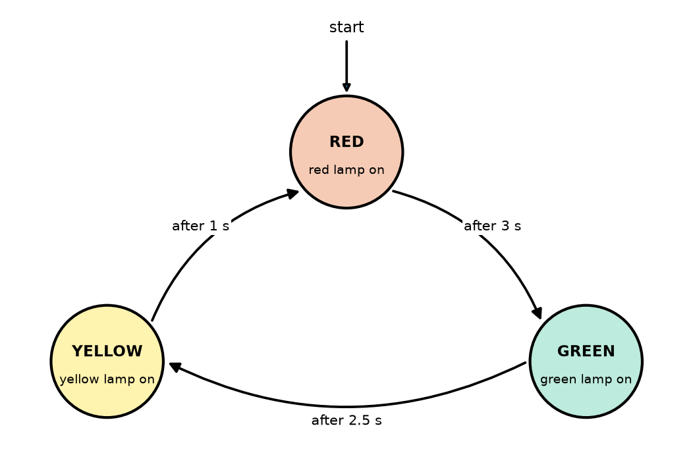
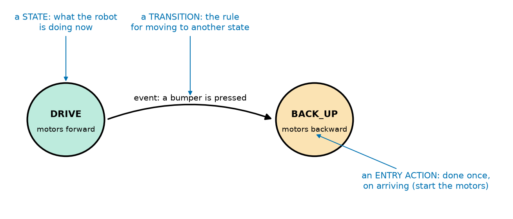
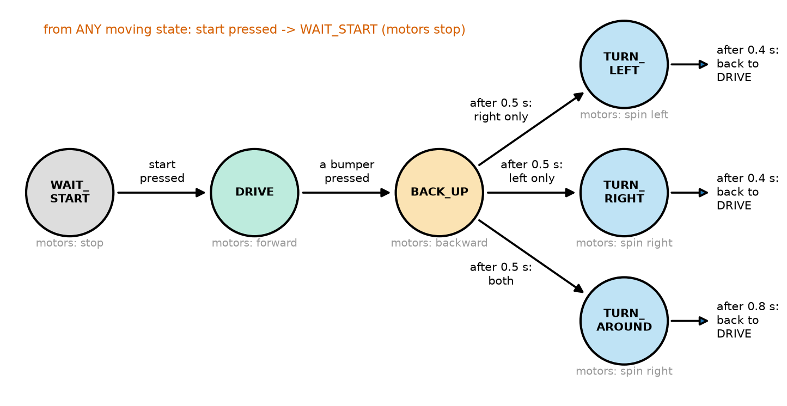
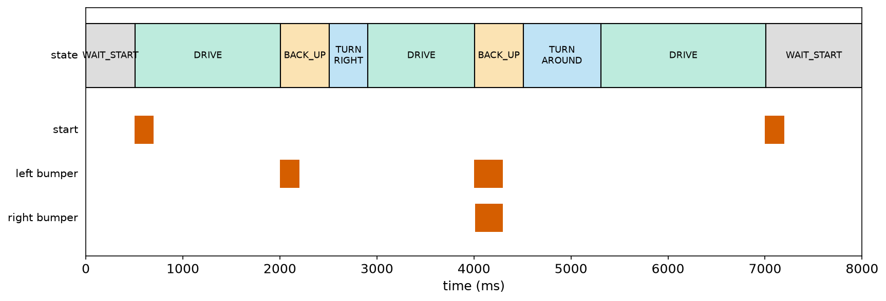
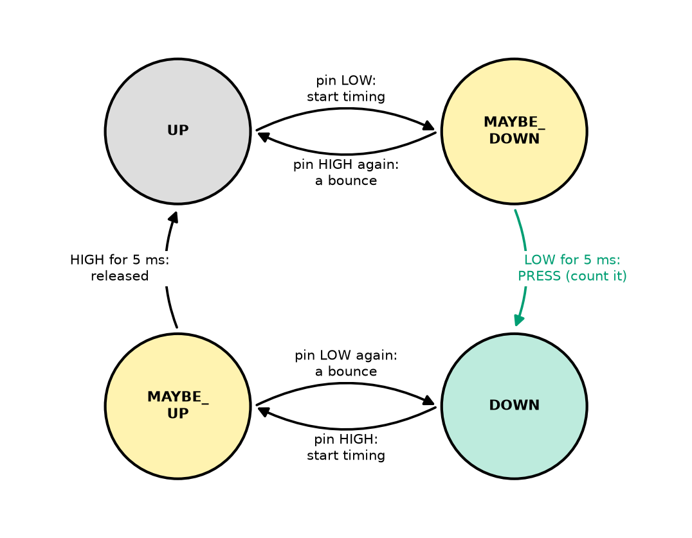

# Chapter 104 — State Machines

> **Part 6 · Chapter 104 of 749**
> **You need:** Chapter 10 (behaviours with priorities), Chapter 23 (the dispatch table), Chapter 83 (debouncing, first look), Chapter 97 (`switch`, arrays, the start button with a timeout), Chapter 99 (debounced bumpers and their "both" problem) and Chapter 103 (non-blocking timing).
> **You will make:** a traffic light written as a state machine, Rover's first complete behaviour (wait for the start button, drive, back up after a bump, then turn away from the side that was hit, or turn around), and the debounce of Chapter 99 rebuilt as a tiny four-state machine.

---

## What you will learn

- What a **state machine** is: **states**, **transitions**, **events** and **actions**.
- How to draw one before writing any code, and why the drawing matters.
- How to write it in C++ with an **`enum`**, a `switch`, and one function that changes state.
- How to give each state its own **time** without ever waiting.
- How to handle rules that apply in **every** state, such as an emergency stop.
- How to test a state machine by following every arrow, and how to grow it without breaking it.

---

## New words in this chapter

| Word | Simple meaning |
|---|---|
| **state** | One situation the machine can be in, with its own behaviour: "driving", "backing up". |
| **state machine** | A program organised as a set of states and the rules for moving between them. |
| **transition** | A move from one state to another. |
| **event** | Something that happens and may cause a transition: a button press, a timer running out. |
| **condition** | A test that must be true for a transition to happen. |
| **entry action** | Something done once, at the moment a state is entered. |
| **state diagram** | A drawing of the states (circles) and transitions (arrows). |
| **initial state** | The state the machine starts in. |
| **enum** | A C++ type whose values are a list of names you choose. |
| **global transition** | A transition that can happen from any state, such as "stop". |

---

## 104.1 Robots do one thing at a time, and switch

Watch a robot vacuum. It drives straight, bumps, backs up, turns, drives again; when its battery is low it stops cleaning and heads for its dock; on the dock it charges; when it is full it sits and waits. At every moment it is doing **one** thing, and certain events make it switch to another: a bump, a timer, a low battery.

The same is true of a traffic light (red, then green, then yellow), a washing machine (fill, wash, rinse, spin), and Rover. Chapter 103 showed how to run many **jobs** at once without waiting. This chapter organises **what the robot is doing**, which changes over time.

📖 **New word: state** — one situation the machine can be in, with its own behaviour. A traffic light has three states: RED, GREEN and YELLOW. In each, different lamps are lit, and a different time must pass before it changes.

📖 **New word: state machine** — a program built from a set of states and the rules for moving between them. At any moment the machine is in exactly **one** state. (The full name is "finite-state machine", FSM, because the number of states is fixed and countable.)

📖 **New word: transition** — a move from one state to another.

📖 **New word: event** — something that happens and may cause a transition: a button is pressed, a bumper closes, a time runs out, a battery reading falls below a limit.

📖 **New word: state diagram** — a drawing of a state machine: each state is a circle, each transition an arrow labelled with the event that causes it.



*Figure 104.1 — The state diagram of a simple traffic light.*

**How to read this picture:** Each circle is a state, with what is true in it (which lamp is on). Each curved arrow is a transition, and its label is the event that causes it: here, always a time running out. The arrow marked "start" shows the **initial state**: the light starts on RED. Follow the arrows round: RED for 3 s, GREEN for 2.5 s, YELLOW for 1 s, and back to RED.

📖 **New word: initial state** — the state the machine is in when it starts.

🧠 **Draw the state diagram first.** It shows every situation and every way out of it, on one page. Most mistakes (a state with no way out, an event nobody handles) are obvious on paper and hard to see in code.

---

## 104.2 The parts of a state machine



*Figure 104.2 — Two states of Rover's behaviour and the transition between them.*

**How to read this picture:** The circles are states (DRIVE, BACK_UP); the small text under each name says what the robot does there. The arrow is a transition, and its label is the event that causes it (a bumper pressed). The blue notes name each part.

📖 **New word: condition** — a test that must be true for a transition to happen. "After 0.5 s **and** only the left bumper was hit" is an event (time is up) with a condition (left only).

📖 **New word: entry action** — something done **once**, at the moment a state is entered: switch the lamps, start the motors backwards, remember the time. Doing it once, on entry, instead of on every pass of `loop()`, keeps the program fast and the behaviour clear.

The whole machine is described by one table, the **transition table**: for each state, which events lead where.

| State | Event (and condition) | Next state |
|---|---|---|
| RED | 3 s have passed | GREEN |
| GREEN | 2.5 s have passed | YELLOW |
| YELLOW | 1 s has passed | RED |

---

## 104.3 Writing a state machine in C++

Four pieces turn the drawing into code.

**1. Name the states with an `enum`.**

```cpp
enum Light { RED, GREEN, YELLOW };
Light state = RED;
```

📖 **New word: enum** — short for **enumeration**: a new type whose only values are the names in the list. Inside, C++ numbers them 0, 1, 2, …, but you never need to know that: you write `RED`, not `0`. A variable of type `Light` can only sensibly hold `RED`, `GREEN` or `YELLOW`, and a `switch` on it reads like the diagram.

**2. Remember when the state began.** `unsigned long stateStart;` so that "time in this state" is `millis() - stateStart` (Chapter 103).

**3. Change state in one place only.** A function `enterState(next)` sets the new state, remembers the time, does the entry action, and prints the change. Because every transition goes through it, the printout is a complete record of what the machine did: the best debugging tool a state machine has.

**4. In `loop()`, a `switch` on the state.** Each `case` checks only the events that matter **in that state**, and calls `enterState` when one happens. Nothing waits: if no event has happened, the case does nothing, and `loop()` goes round again.

The sketch `traffic_light.ino` (in the Code section) has exactly these four pieces. Output:

```
0 ms: RED
3000 ms: GREEN
5500 ms: YELLOW
6500 ms: RED
9500 ms: GREEN
12000 ms: YELLOW
```

Every change happens at exactly the right time, and between changes the loop is free for other jobs.

💡 **Tip: a list of names for printing.** `const char *NAMES[] = {"RED", "GREEN", "YELLOW"};` is an array of pieces of text (`const char *` is C++'s type for a fixed piece of text). Because the enum's values are 0, 1, 2 in order, `NAMES[state]` is the name of the current state. Keep the two lists in the same order.

---

## 104.4 Time inside a state

Many states end after a time: the robot backs up for 0.5 s, then turns. With a state machine this needs no `delay` at all: the state's `case` simply checks `millis() - stateStart >= BACK_UP_MS` on every pass, and leaves when it is true. While Rover backs up, the loop keeps reading its sensors, which is how the "both bumpers" problem of Chapter 99 gets solved (section 104.6).

⚠️ **Careful: here `stateStart = millis()`, not `+=`.** Chapter 103 said `last += interval` for repeated jobs, to avoid drift. A state's timer is different: it measures how long we have been in **this** state, which began at the moment of the transition. So `enterState` uses `stateStart = millis()`. (A traffic light that must keep exact time for hours can use `stateStart += DURATION[state]` in its timed transitions instead.)

---

## 104.5 Rules for every state

Some events must be handled the same way **whatever** the machine is doing. Pressing Rover's start button while it moves must stop it, whether it is driving, backing up or turning. Writing that test into every `case` is repetitive, and one forgotten copy is a safety bug.

📖 **New word: global transition** — a transition that applies from any state (or any of a group of states). Check it **before** the `switch`:

```cpp
if (startNew && state != WAIT_START) {   // in ANY moving state, the start button means "stop now"
  enterState(WAIT_START);
  return;
}
```

`return` leaves `loop()` at once, so the `switch` does not also act on the same pass.

🧠 **Put safety rules before the `switch`, so they win over everything else.** This is Chapter 10's idea of behaviours with priorities: the most important rule is asked first. The same place later holds "battery empty", "emergency stop" and "tilted over".

---

## 104.6 Rover's first behaviour

Here is Rover's first complete behaviour, drawn before it is written.



*Figure 104.3 — Rover's state diagram: six states, with what the motors do in each.*

**How to read this picture:** Start at WAIT_START (motors stopped). The start button moves Rover to DRIVE. Any bumper press moves it to BACK_UP. After 0.5 s of backing up, Rover chooses one of three turns depending on which bumpers were hit: only the right one, turn left; only the left one, turn right; both, turn around. After the turn's time (0.4 s, or 0.8 s to turn around), it drives again. The red line at the top is the global transition: from any moving state, the start button stops Rover.

Notice what BACK_UP solves. In Chapter 99, a "both bumpers" bump gave **two** decisions 10 ms apart, because the two switches never close at exactly the same instant. Here, Rover does not decide the turn when the first bumper closes: it starts backing up (which is right in every case) and keeps listening. If the second bumper closes during the back-up, it is added. Only at the end of BACK_UP does Rover choose the turn, with all the information. One state, and the problem is gone. Application 1 tests it.

---

## 104.7 Testing a state machine

A state machine is easy to test, because its behaviour is a list of arrows:

1. **Follow every arrow at least once.** Make a list from the transition table, and write a test (a sequence of pretend inputs) that takes each one.
2. **Try every event in every state**, including the ones that should do nothing: what does Rover do if a bumper is pressed while it is waiting at the start? (Nothing: WAIT_START ignores bumpers.) What if the start button is pressed while it is turning? (It stops: the global transition.)
3. **Read the printout of transitions**, and compare it with the diagram.

The PC test bench is ideal for this: Application 1's test file presses the start button, bumps the left side, bumps both sides 10 ms apart, and presses the start button again, all with bouncing contacts, and the printout shows every transition with its time.

💡 **Tip: states, not flags.** A beginner's version of Rover would have `bool driving, backingUp, turning, waiting;` and many `if`s that check combinations of them. Sooner or later two flags are true at once ("driving" and "backing up"?) and the robot does something nobody planned. With an `enum`, the machine is in exactly one state, always. If you find yourself adding a flag that changes what the robot is doing, it should probably be a state.

---

## Code

All outputs come from the PC test bench with the Uno's 16-bit `int`.

File `code/ch104/traffic_light/traffic_light.ino`:

```cpp
// traffic_light.ino - a traffic light as a state machine: each state has its own lights and its own time
const int RED_PIN = 10;
const int YELLOW_PIN = 11;
const int GREEN_PIN = 12;

enum Light { RED, GREEN, YELLOW };                 // the three states, as names
const char *NAMES[] = {"RED", "GREEN", "YELLOW"};  // their names as text, for printing
const unsigned long DURATION[] = {3000, 2500, 1000};   // how long each state lasts, in ms

Light state = RED;
unsigned long stateStart = 0;          // when we entered the current state

void enterState(Light next) {          // the only place where the state changes
  state = next;
  stateStart = millis();
  digitalWrite(RED_PIN, state == RED);           // entry action: show this state's lights
  digitalWrite(YELLOW_PIN, state == YELLOW);
  digitalWrite(GREEN_PIN, state == GREEN);
  Serial.print(millis());
  Serial.print(" ms: ");
  Serial.println(NAMES[state]);
}

void setup() {
  Serial.begin(115200);
  pinMode(RED_PIN, OUTPUT);
  pinMode(YELLOW_PIN, OUTPUT);
  pinMode(GREEN_PIN, OUTPUT);
  enterState(RED);
}

void loop() {
  if (millis() - stateStart < DURATION[state]) {
    return;                            // not time to change yet: leave loop() at once
  }
  switch (state) {                     // time is up: which state comes next?
    case RED:
      enterState(GREEN);
      break;
    case GREEN:
      enterState(YELLOW);
      break;
    case YELLOW:
      enterState(RED);
      break;
  }
}
```

| Line | Code | What it does (simple English) |
|---|---|---|
| 1 | `// traffic_light.ino - …` | A comment. |
| 2–4 | `const int RED_PIN = 10;` … | Three LEDs (each with 220 Ω, Chapter 98). |
| 5 | (blank) | Spacing. |
| 6 | `enum Light { RED, GREEN, YELLOW };` | A new type, `Light`, whose values are the three states. |
| 7 | `const char *NAMES[] = {…};` | The states' names as text, in the same order. |
| 8 | `const unsigned long DURATION[] = {…};` | How long each state lasts, in the same order: `DURATION[GREEN]` is 2,500. |
| 9 | (blank) | Spacing. |
| 10 | `Light state = RED;` | The current state. |
| 11 | `unsigned long stateStart = 0;` | When the current state began. |
| 12 | (blank) | Spacing. |
| 13 | `void enterState(Light next) {` | The only function that changes the state. |
| 14 | `state = next;` | The new state. |
| 15 | `stateStart = millis();` | Its start time. |
| 16–18 | `digitalWrite(RED_PIN, state == RED);` … | The entry action: each lamp is on only if it matches the state. `state == RED` is `true` (HIGH) or `false` (LOW). |
| 19–21 | `Serial.print(millis()); …` | Record the transition. |
| 22 | `}` | End of `enterState`. |
| 23 | (blank) | Spacing. |
| 24–30 | `void setup() { … enterState(RED); }` | Pins as outputs, then enter the initial state. |
| 31 | (blank) | Spacing. |
| 32 | `void loop() {` | |
| 33 | `if (millis() - stateStart < DURATION[state]) {` | Has this state's time run out? Not yet: |
| 34 | `return;` | leave `loop()` at once (it will run again immediately). |
| 35 | `}` | |
| 36 | `switch (state) {` | Time is up: choose the next state from the current one. |
| 37–45 | `case RED: enterState(GREEN); break;` … | The transition table, one `case` per row. |
| 46 | `}` | End of the `switch`. |
| 47 | `}` | End of `loop`. |

The output is in section 104.3.

---

## Small examples

**Example 1.** `enum Mode { MANUAL, AUTO, OFF };` — `MANUAL` is 0, `AUTO` 1, `OFF` 2.

**Example 2.** A door: states CLOSED, OPENING, OPEN, CLOSING. Events: button, "fully open" switch, timer, "fully closed" switch.

**Example 3.** In the traffic light, `DURATION[YELLOW]` is 1,000.

**Example 4.** Time in state: `stateStart` = 4,007 and `millis()` = 4,400: 393 ms; BACK_UP (500 ms) continues.

**Example 5.** A machine with 4 states, each with 2 ways out, has 8 transitions: at least 8 test cases.

**Example 6.** `case TURN_LEFT: case TURN_RIGHT:` with no code between them lets two states share the same code: an intentional fall-through (Chapter 97). Comment it.

**Example 7.** A global transition placed **after** the `switch` would let the `switch` act first on the same pass: a moving state could start a new action just before being stopped.

**Example 8.** Two flags `driving` and `turning` can be true at the same time by mistake; one `enum` variable cannot hold two states.

---

## 🏭 Real robot applications

### Application 1 (worked in full) — 🤖 Rover's first complete behaviour

**1. The real problem.** Rover must wait at the start until its button is pressed, then drive; when it bumps into something it must back up and turn away from the obstacle; it must turn around if the obstacle is straight ahead; and the start button must stop it at any moment. Chapter 97 had the start button, Chapter 99 the bumpers, Chapter 103 the non-blocking timing; now they must work together, with no `delay` anywhere, and Chapter 99's "two decisions for one bump" must not happen.

**2. Why this theory.** Sections 104.3–104.6: an `enum` of six states, one `enterState` function, a `switch` with one `case` per state, timed states measured with `millis() - stateStart`, and a global transition for the stop rule.

**3. The numbers.** Start button on pin 2, left bumper on pin 4, right bumper on pin 7 (all to GND, `INPUT_PULLUP`, debounced with Chapter 99's 5 ms). Back up for 500 ms; a 90° turn takes 400 ms (Rover's spin speed; Chapter 282 measures it); turning around takes 800 ms. The test: start at 0.5 s; left bump at 2.0 s; both bumpers at 4.0 s, the right one 10 ms after the left; start again at 7.0 s. Every contact bounces.

**4. The maths.** Each press is seen about 7 ms after contact (2.5 ms of bounce plus 5 ms of debounce, Chapter 99). Expected transitions: 507 ms DRIVE; 2,007 BACK_UP; 2,507 TURN_RIGHT; 2,907 DRIVE; 4,007 BACK_UP (the right bumper arrives during it, at 4,017); 4,507 TURN_AROUND; 5,307 DRIVE; 7,007 WAIT_START.

**5. The code.** File `code/ch104/rover_behaviour/rover_behaviour.ino`:

```cpp
// rover_behaviour.ino - Rover's first behaviour as a state machine:
// wait for the start button, drive, and after a bump: back up, then turn away from the side that was hit
const int N = 3;
const int PIN[N] = {2, 4, 7};          // [0] start button, [1] left bumper, [2] right bumper (all to GND)
const unsigned long DEBOUNCE_MS = 5;
const unsigned long BACK_UP_MS = 500;
const unsigned long TURN_MS = 400;     // a 90-degree turn; turning around takes twice as long

enum State { WAIT_START, DRIVE, BACK_UP, TURN_LEFT, TURN_RIGHT, TURN_AROUND };
const char *NAMES[] = {"WAIT_START", "DRIVE", "BACK_UP", "TURN_LEFT", "TURN_RIGHT", "TURN_AROUND"};
const char *MOTORS[] = {"stop", "forward", "backward", "spin left", "spin right", "spin right"};

State state = WAIT_START;
unsigned long stateStart = 0;
bool leftHit = false;                  // which bumpers were hit during this bump
bool rightHit = false;

int lastReading[N] = {HIGH, HIGH, HIGH};
unsigned long lastChange[N] = {0, 0, 0};
int stableLevel[N] = {HIGH, HIGH, HIGH};

bool newPress(int i) {                 // Chapter 99's debounce: true only at the moment of a real press
  int reading = digitalRead(PIN[i]);
  if (reading != lastReading[i]) {
    lastChange[i] = millis();
    lastReading[i] = reading;
  }
  if (millis() - lastChange[i] >= DEBOUNCE_MS && reading != stableLevel[i]) {
    stableLevel[i] = reading;
    return stableLevel[i] == LOW;
  }
  return false;
}

void enterState(State next) {
  state = next;
  stateStart = millis();
  Serial.print(millis());
  Serial.print(" ms: ");
  Serial.print(NAMES[state]);
  Serial.print("   motors: ");
  Serial.println(MOTORS[state]);
}

void setup() {
  Serial.begin(115200);
  for (int i = 0; i < N; i++) {
    pinMode(PIN[i], INPUT_PULLUP);
  }
  enterState(WAIT_START);
}

void loop() {
  bool startNew = newPress(0);         // check every input on every pass (Chapter 99)
  bool leftNew = newPress(1);
  bool rightNew = newPress(2);
  unsigned long inState = millis() - stateStart;

  if (startNew && state != WAIT_START) {   // in ANY moving state, the start button means "stop now"
    enterState(WAIT_START);
    return;
  }

  switch (state) {
    case WAIT_START:
      if (startNew) {
        enterState(DRIVE);
      }
      break;
    case DRIVE:
      if (leftNew || rightNew) {
        leftHit = leftNew;
        rightHit = rightNew;
        enterState(BACK_UP);
      }
      break;
    case BACK_UP:
      if (leftNew) {
        leftHit = true;                // the other bumper may close a moment later
      }
      if (rightNew) {
        rightHit = true;
      }
      if (inState >= BACK_UP_MS) {
        if (leftHit && rightHit) {
          enterState(TURN_AROUND);
        } else if (leftHit) {
          enterState(TURN_RIGHT);      // hit on the left: turn away, to the right
        } else {
          enterState(TURN_LEFT);
        }
      }
      break;
    case TURN_LEFT:
    case TURN_RIGHT:
      if (inState >= TURN_MS) {
        enterState(DRIVE);
      }
      break;
    case TURN_AROUND:
      if (inState >= 2 * TURN_MS) {
        enterState(DRIVE);
      }
      break;
  }
}
```

| Line | Code | What it does (simple English) |
|---|---|---|
| 1–2 | `// rover_behaviour.ino - …` | Comments: the behaviour in two lines. |
| 3–4 | `const int N = 3;`, `const int PIN[N] = {2, 4, 7};` | The three inputs, as in Chapter 99's bumper sketch. |
| 5–7 | `DEBOUNCE_MS`, `BACK_UP_MS`, `TURN_MS` | The three times. |
| 8 | (blank) | Spacing. |
| 9 | `enum State { … };` | The six states of Figure 104.3. |
| 10–11 | `const char *NAMES[] …`, `const char *MOTORS[] …` | For each state, its name and what the motors do, for the printout. (On the real Rover, `enterState` will set the motor driver's pins here; Chapter 139.) |
| 12 | (blank) | Spacing. |
| 13–14 | `State state = WAIT_START;`, `unsigned long stateStart = 0;` | The current state and when it began. |
| 15–16 | `bool leftHit = false;`, `bool rightHit = false;` | Which bumpers have been hit during the current bump: the information BACK_UP collects. |
| 17 | (blank) | Spacing. |
| 18–20 | `int lastReading[N] …` | Chapter 99's debounce variables, one per input. |
| 21 | (blank) | Spacing. |
| 22–33 | `bool newPress(int i) { … }` | Chapter 99's debounce function, unchanged. |
| 34 | (blank) | Spacing. |
| 35–43 | `void enterState(State next) { … }` | Change state, remember the time, print the new state and its motor action. |
| 44 | (blank) | Spacing. |
| 45–51 | `void setup() { … enterState(WAIT_START); }` | Inputs with pull-ups; enter the initial state. |
| 52 | (blank) | Spacing. |
| 53 | `void loop() {` | |
| 54–56 | `bool startNew = newPress(0);` … | Debounce all three inputs on every pass, whatever the state (Chapter 99: a debouncer must see every pass). |
| 57 | `unsigned long inState = millis() - stateStart;` | How long we have been in this state. |
| 58 | (blank) | Spacing. |
| 59–62 | `if (startNew && state != WAIT_START) { enterState(WAIT_START); return; }` | The global transition: from any moving state, the start button stops Rover. |
| 63 | (blank) | Spacing. |
| 64 | `switch (state) {` | One `case` per state. |
| 65–69 | `case WAIT_START: if (startNew) { enterState(DRIVE); }` | Waiting: only the start button matters. Bumpers are ignored here. |
| 70–76 | `case DRIVE: if (leftNew \|\| rightNew) { … enterState(BACK_UP); }` | Driving: a bump starts backing up, and records which side(s). |
| 77–83 | `case BACK_UP: if (leftNew) { leftHit = true; } …` | While backing up, a bumper that closes late is still recorded. |
| 84–92 | `if (inState >= BACK_UP_MS) { … }` | After 0.5 s, choose the turn with everything we know: both → around, left → right, otherwise left. |
| 93 | `break;` | |
| 94–99 | `case TURN_LEFT: case TURN_RIGHT: if (inState >= TURN_MS) { enterState(DRIVE); }` | Both 90° turns share one piece of code (an intentional fall-through: `case TURN_LEFT:` has no code of its own). |
| 100–104 | `case TURN_AROUND: if (inState >= 2 * TURN_MS) { … }` | Turning around takes twice as long. |
| 105 | `}` | End of the `switch`. |
| 106 | `}` | End of `loop`. |

Output (8 seconds, bouncing contacts):

```
0 ms: WAIT_START   motors: stop
507 ms: DRIVE   motors: forward
2007 ms: BACK_UP   motors: backward
2507 ms: TURN_RIGHT   motors: spin right
2907 ms: DRIVE   motors: forward
4007 ms: BACK_UP   motors: backward
4507 ms: TURN_AROUND   motors: spin right
5307 ms: DRIVE   motors: forward
7007 ms: WAIT_START   motors: stop
```



*Figure 104.4 — The state over time (top) and the three inputs (bottom).*

**How to read this picture:** The coloured bands on top show which state Rover was in, from left to right. The red blocks below show when each input was pressed. Each change of state lines up with a press (7 ms after it, too small to see at this scale) or with the end of a timed state. At 4 s both bumpers are pressed, the right one a moment later; there is only one BACK_UP, followed by TURN_AROUND.

**6. The result.** Every transition matches the plan of step 4 exactly. The left bump gives a right turn; the "both" bump gives a single, correct decision (turn around), because the decision waits until the end of BACK_UP; and the start button stops Rover from DRIVE in 7 ms. No `delay` anywhere: all inputs are debounced on every pass, so a bump during a turn would also be noticed (and Practice 6 asks what Rover does then). This sketch is the skeleton of every Rover behaviour to come: line following, wall following and maze solving (Part 15) are bigger state machines of exactly this shape.

**7. Going further.** As robots grow, their state machines grow too, and two tools keep them manageable. **Hierarchical** state machines put states inside states (a "MOVING" state containing DRIVE, BACK_UP and the turns, with one global "stop" arrow on MOVING). **Behaviour trees**, used in many robot and video-game systems and in ROS 2's navigation (Chapter 608), build behaviour from small reusable pieces with priorities, an idea that grew from the layered behaviours of Chapter 10.

### Application 2 (worked in full) — 🤖 Debouncing as a state machine

**1. The real problem.** Chapter 83 promised that the debounce would come back inside a state machine. Chapter 99's debounce used three variables and two `if`s; it works, but it is hard to see **why** it works. Written as a state machine, the logic becomes a picture, and adding features (a long press, a double press) becomes adding states.

**2. Why this theory.** A button, seen through bounce, is in one of four situations: firmly free, perhaps being pressed, firmly pressed, perhaps being released. Those are states; the pin's level and the time are events.

**3. The numbers.** Debounce time 5 ms. The test: the same five bouncing presses as Chapter 99's `test_debounce.cpp` (each bounces 7 times in 3 ms when pressed and when released).

**4. The maths.** The rules, as a transition table:

| State | Event | Next state | Action |
|---|---|---|---|
| UP | pin LOW | MAYBE_DOWN | remember the time |
| MAYBE_DOWN | pin HIGH | UP | (it was a bounce) |
| MAYBE_DOWN | LOW for 5 ms | DOWN | count a press |
| DOWN | pin HIGH | MAYBE_UP | remember the time |
| MAYBE_UP | pin LOW | DOWN | (a bounce) |
| MAYBE_UP | HIGH for 5 ms | UP | |



*Figure 104.5 — The four states of a debounced button.*

**How to read this picture:** Start at UP (top left). When the pin goes LOW, the machine moves right to MAYBE_DOWN and starts timing. A bounce (pin HIGH again) sends it back to UP; the next LOW starts the timer again from zero. Only if the pin stays LOW for 5 ms does it go down to DOWN, and that green arrow is where the press is counted. Releasing works the same way along the bottom and left.

**5. The code.** File `code/ch104/debounce_fsm/debounce_fsm.ino`:

```cpp
// debounce_fsm.ino - Chapter 99's debounce, written as a small state machine with four states
const int BUTTON_PIN = 2;
const unsigned long DEBOUNCE_MS = 5;

enum ButtonState { UP, MAYBE_DOWN, DOWN, MAYBE_UP };
ButtonState bstate = UP;
unsigned long changeTime = 0;          // when we entered MAYBE_DOWN or MAYBE_UP
long presses = 0;
unsigned long lastReport = 0;

void updateButton() {
  int level = digitalRead(BUTTON_PIN);
  switch (bstate) {
    case UP:                                       // free, and believed free
      if (level == LOW) {
        bstate = MAYBE_DOWN;
        changeTime = millis();
      }
      break;
    case MAYBE_DOWN:                               // looks pressed: is it real?
      if (level == HIGH) {
        bstate = UP;                               // it was a bounce
      } else if (millis() - changeTime >= DEBOUNCE_MS) {
        bstate = DOWN;                             // steady for 5 ms: a real press
        presses++;
      }
      break;
    case DOWN:                                     // pressed, and believed pressed
      if (level == HIGH) {
        bstate = MAYBE_UP;
        changeTime = millis();
      }
      break;
    case MAYBE_UP:                                 // looks released: is it real?
      if (level == LOW) {
        bstate = DOWN;
      } else if (millis() - changeTime >= DEBOUNCE_MS) {
        bstate = UP;
      }
      break;
  }
}

void setup() {
  Serial.begin(115200);
  pinMode(BUTTON_PIN, INPUT_PULLUP);
}

void loop() {
  updateButton();
  if (millis() - lastReport >= 1000) {
    lastReport += 1000;
    Serial.print("presses counted: ");
    Serial.println(presses);
  }
}
```

| Line | Code | What it does (simple English) |
|---|---|---|
| 1 | `// debounce_fsm.ino - …` | A comment. |
| 2–3 | `const int BUTTON_PIN = 2;`, `DEBOUNCE_MS = 5;` | The pin and the debounce time. |
| 4 | (blank) | Spacing. |
| 5 | `enum ButtonState { UP, MAYBE_DOWN, DOWN, MAYBE_UP };` | The four states of Figure 104.5. |
| 6 | `ButtonState bstate = UP;` | The button's state; it starts free. |
| 7 | `unsigned long changeTime = 0;` | When the current "maybe" began. |
| 8–9 | `long presses = 0;`, `unsigned long lastReport = 0;` | The count, and the report timer. |
| 10 | (blank) | Spacing. |
| 11 | `void updateButton() {` | One step of the machine; called on every pass. |
| 12 | `int level = digitalRead(BUTTON_PIN);` | The raw level. |
| 13 | `switch (bstate) {` | |
| 14–19 | `case UP: if (level == LOW) { … }` | Free: a LOW starts a "maybe pressed", and the timer. |
| 20–27 | `case MAYBE_DOWN: …` | A HIGH means a bounce: back to UP. LOW for 5 ms: a real press, counted. |
| 28–33 | `case DOWN: if (level == HIGH) { … }` | Pressed: a HIGH starts a "maybe released". |
| 34–40 | `case MAYBE_UP: …` | A LOW means a bounce: back to DOWN. HIGH for 5 ms: released. |
| 41 | `}` | End of the `switch`. |
| 42 | `}` | End of `updateButton`. |
| 43 | (blank) | Spacing. |
| 44–47 | `void setup() { … }` | Serial and the pull-up. |
| 48 | (blank) | Spacing. |
| 49–56 | `void loop() { updateButton(); … }` | Step the machine on every pass; report once per second. |

Output (5 seconds):

```
presses counted: 1
presses counted: 2
presses counted: 4
presses counted: 5
presses counted: 5
```

**6. The result.** Exactly the count of Chapter 99's debounce: 5 presses for 5, out of 70 bouncing edges. The logic now matches a picture, and every arrow can be checked against it. Growing it is easy: a **long press** (held for 1 s, for example "reset") is one more state, HELD, reached from DOWN after 1,000 ms; a **double click** is a state "waiting for a second press" with a 300 ms timeout. In Chapter 99's three-variable version, each of these would mean more tangled `if`s.

**7. Going further.** Libraries for buttons (Chapter 110) are usually exactly this machine inside a class, so one object handles one button and a sketch can have as many as it likes. Chapter 105 shows the other way to catch edges, interrupts, and why they still need debouncing.

### Application 3 — 🏠 A robot vacuum finds its dock

When a robot vacuum's battery is low, a state machine takes it home. SEARCH: drive along walls, listening for the dock's infrared beacon. APPROACH: steer towards the beacon, using its left and right infrared receivers to stay centred. ALIGN: slow down and turn until both receivers see the beacon equally. DOCK: creep forwards until the charging contacts touch, which the robot detects as charging current. CHARGING, then FULL. Every state has a timeout and a way back: if APPROACH loses the beacon for 3 seconds, return to SEARCH; if DOCK does not feel current within 5 seconds, back up and try ALIGN again, at most three times before reporting an error. Without the timeouts and retries, a robot stuck against the side of its dock would push there until its battery died, which early robot vacuums sometimes did.

### Application 4 — 🏭 Sequences in factory machines

Factory machines are full of state machines, because most of their work is a fixed **sequence**: a bottle-capping station waits for a bottle (a light barrier), clamps it, lowers the capping head, turns until the torque reaches a set value, lifts, unclamps, and signals "done". The standard languages for industrial controllers (IEC 61131-3) even include a graphical one, the Sequential Function Chart, which is a state diagram that runs: steps (states), transitions with conditions, and actions on entering each step. Engineers draw the chart, and the controller executes it. Because the chart is the program, a maintenance technician can look at the screen, see which step the stopped machine is waiting in, and see which condition is missing ("waiting for: clamp closed sensor"): the printout of `enterState`, made visible.

### Application 5 — 🚁 A drone's arming and flight modes

A drone's flight controller is wrapped in a safety state machine. DISARMED: the motors cannot spin whatever the sticks do. ARMING is allowed only if the pre-flight checks pass (sensors calibrated, battery above a limit, GPS good enough for the chosen mode) and the pilot holds a stick gesture for a moment; then ARMED. On top of that sit the **flight modes**, another state machine: MANUAL, STABILIZE, POSITION HOLD, MISSION, RETURN TO LAUNCH, LAND. Global transitions handle failures from any mode: radio signal lost for more than a set time → RETURN TO LAUNCH; battery critical → LAND; a crash detected → DISARM at once. Autopilots such as PX4 and ArduPilot (Chapter 649) document these state machines in detail, because a pilot must be able to predict exactly what the aircraft will do in each situation. That predictability, every state and every arrow known in advance, is the main reason robots are built from state machines.

---

## 🔧 Hands-on lab

### Lab 104.1 — A traffic light with a night mode (hardware or Wokwi)

You need: an Uno (or Wokwi), red, yellow and green LEDs with 220 Ω resistors, a switch or a jumper wire.

1. Wire the LEDs to pins 10 (red), 11 (yellow) and 12 (green). Upload `traffic_light.ino` and check the times against section 104.3's output.
2. Add a fourth state, `NIGHT`, in which the yellow LED flashes (500 ms on, 500 ms off) and the others are off. Draw the new state diagram first.
3. Add a switch on pin 2 (to GND, `INPUT_PULLUP`). Global transition: while the switch is closed, go to NIGHT from any state; when it opens, go from NIGHT to RED.

**What you should see:** Normal cycling while the switch is open; flashing yellow while it is closed; and back to RED (the safe start) when it opens. If your NIGHT state flashes by toggling the LED with a timer inside the state (Chapter 103), the rest of the program stays responsive.

| If it does not work | Likely cause | Fix |
|---|---|---|
| The lights never change | `stateStart` is not set in `enterState` | Every transition must go through `enterState` |
| NIGHT flashes once and stops | The flash timer is not moved on with `+=` | Use Chapter 103's pattern inside the NIGHT case |
| The printout shows the wrong names | `NAMES` is not in the same order as the `enum` | Add `"NIGHT"` at the same position as `NIGHT` |

**Challenge:** In real traffic lights, red and yellow are shown together for a moment before green in some countries. Add a RED_YELLOW state of 0.8 s between RED and GREEN.

### Lab 104.2 — Send Rover home (simulation)

Copy `rover_behaviour.ino` and `pc_tests/test_rover_behaviour.cpp`.

1. Add a state `GO_HOME` (motors: "towards the dock") to the `enum`, `NAMES` and `MOTORS`.
2. Add an input: pin 8, `INPUT_PULLUP`, which a battery monitor (Chapter 101) pulls LOW when the battery is low.
3. In DRIVE, before checking the bumpers: if pin 8 is LOW, `enterState(GO_HOME)`. In GO_HOME, do nothing (the global stop rule still works).
4. In the test, add `sim::din[8] = [](double t) { return t < 6.0 ? HIGH : LOW; };` and run it.

**What you should see:** Practice 11's output: everything as before until 6,000 ms, then `GO_HOME   motors: towards the dock`, and at 7,007 ms the start button stops it.

| If it does not work | Likely cause | Fix |
|---|---|---|
| `'GO_HOME' was not declared` | Missing from the `enum` | Add it at the end of the list |
| The printout shows the wrong name for GO_HOME | Not added to `NAMES` and `MOTORS`, or in the wrong place | Add at the end of both, matching the `enum` |
| GO_HOME never happens | The check is in WAIT_START, or pin 8 has no pull-up | Put it in DRIVE; add `pinMode(8, INPUT_PULLUP)` |

**Challenge:** Should a bump in GO_HOME still make Rover back up and turn? Change the diagram so that it does, and then returns to GO_HOME instead of DRIVE. (You need to remember where to go back to: one more variable.)

### Lab 104.3 — Test every arrow (simulation)

1. Make a list of all the arrows in Figure 104.3, including the global stop from each moving state. How many are there?
2. The test of Application 1 takes some of them. Which arrows does it **not** take?
3. Write a second test file that takes some of the missing ones: for example, a right-only bump (which leads to TURN_LEFT), and a start press during that turn.

**What you should see:** Figure 104.3 has 8 normal arrows plus 5 global ones (from DRIVE, BACK_UP and each of the three TURN states): 13 in all. Application 1's test takes 7 of the normal arrows (all but BACK_UP → TURN_LEFT and TURN_LEFT → DRIVE) and only one global arrow (from DRIVE). With the start button at 0.5 s and 2.7 s and only the right bumper at 2.0 s, the bench prints:

```
0 ms: WAIT_START   motors: stop
507 ms: DRIVE   motors: forward
2007 ms: BACK_UP   motors: backward
2507 ms: TURN_LEFT   motors: spin left
2707 ms: WAIT_START   motors: stop
```

That takes BACK_UP → TURN_LEFT and the global stop from TURN_LEFT.

| If it does not work | Likely cause | Fix |
|---|---|---|
| The bump does nothing | It came while Rover was in WAIT_START | Press start first; bumpers are ignored while waiting |
| Two presses on one pin overlap | The press list's times overlap | Each `{down, up}` must end before the next begins |

**Challenge:** Write the transition table as an array in the sketch, and a function that checks, on every `enterState`, that the transition is in the table (and prints "BAD TRANSITION" if not). This is how safety-critical code catches impossible moves.

---

## Common mistakes

⚠️ **Changing the state in many places.** Use one `enterState` function, so every change is timed and recorded.

⚠️ **Doing the entry action on every pass.** Starting the motors again thousands of times per second wastes time; do it once, on entry.

⚠️ **Using `delay` inside a state.** The machine stops listening. Time states with `millis() - stateStart`.

⚠️ **Forgetting a way out.** A state with no transition out is a trap: every state needs at least one arrow out (often a timeout).

⚠️ **Handling a safety event in only some states.** Put it before the `switch` as a global transition.

⚠️ **Many `bool` flags instead of states.** Two flags that should never both be true eventually are.

⚠️ **`NAMES` out of order with the `enum`.** The printout lies.

⚠️ **Not reading inputs in every state.** A debouncer that is only called in some states misses edges and gets confused.

⚠️ **Writing code before drawing the diagram.** Missing arrows are easy to see on paper.

---

## Practice

🏋️ **1.** Name the states of a microwave oven (door, buttons, heating, finished beep), and the events between them.

🏋️ **2.** Write the `enum` and the `NAMES` array for a door with states CLOSED, OPENING, OPEN and CLOSING.

🏋️ **3.** In `traffic_light.ino`, what does `DURATION[state]` give while the state is GREEN?

🏋️ **4.** Why does `enterState` use `stateStart = millis()`, while Chapter 103's repeated jobs use `last += interval`?

🏋️ **5.** What does `rover_behaviour.ino` do if a bumper is pressed while Rover is in WAIT_START? Why is that sensible?

🏋️ **6.** A bump happens while Rover is turning right (TURN_RIGHT). What does the program do with it? Is that what you want?

🏋️ **7.** Why is the global stop rule placed before the `switch`, and why does it end with `return`?

🏋️ **8.** In the debounce machine, the pin goes LOW, HIGH, LOW within 1 ms, then stays LOW. Trace the states.

🏋️ **9.** How many transitions does the debounce machine of Figure 104.5 have?

🏋️ **10.** Replace `bool driving; bool turning;` in a beginner's sketch with an `enum`. Why is it safer?

🏋️ **11.** Add a `GO_HOME` state to `rover_behaviour.ino`, entered from DRIVE when pin 8 is LOW (Lab 104.2). Run it with the battery becoming low at 6.0 s.

---

## Answers

**1.** For example: IDLE (door closed, nothing set); DOOR_OPEN; SET (time entered); HEATING; PAUSED (door opened while heating); DONE (beeping). Events: door opened/closed, number keys, Start, timer reached zero, Stop.

**2.**

```cpp
enum Door { CLOSED, OPENING, OPEN, CLOSING };
const char *NAMES[] = {"CLOSED", "OPENING", "OPEN", "CLOSING"};
```

**3.** 2,500 (GREEN is the second value of the `enum`, number 1, and `DURATION[1]` is 2,500).

**4.** A state's time is "how long since **this** state began", which is the moment of the transition. A repeated job's time is a schedule that must not drift, so it moves on by exact intervals.

**5.** Nothing: WAIT_START only looks at the start button. Sensible, because a robot standing still that is pushed by someone should not start backing up by itself.

**6.** `newPress` still debounces it and returns `true` once, but the TURN_RIGHT `case` does not look at `leftNew` or `rightNew`, so the bump is ignored and Rover finishes its turn, then drives on (and will bump again). For a gentle robot that may be acceptable; a better design adds an arrow from the TURN states to BACK_UP on a bump.

**7.** So that it wins over every state's own rules on the same pass. Without `return`, the `switch` would run next for the new state on the same pass, or (if the rule came after the `switch`) the old state could act first.

**8.** UP → (LOW) MAYBE_DOWN, timer starts → (HIGH) UP → (LOW) MAYBE_DOWN, timer starts again → after 5 ms of LOW: DOWN, press counted.

**9.** Six arrows (Figure 104.5).

**10.** `enum Mode { WAITING, DRIVING, TURNING }; Mode mode = WAITING;` One variable holds exactly one value, so "driving and turning at once" cannot happen by mistake, and a `switch` on it shows every situation clearly.

**11.** The changes are listed in Lab 104.2. PC test bench output:

```
0 ms: WAIT_START   motors: stop
507 ms: DRIVE   motors: forward
2007 ms: BACK_UP   motors: backward
2507 ms: TURN_RIGHT   motors: spin right
2907 ms: DRIVE   motors: forward
4007 ms: BACK_UP   motors: backward
4507 ms: TURN_AROUND   motors: spin right
5307 ms: DRIVE   motors: forward
6000 ms: GO_HOME   motors: towards the dock
7007 ms: WAIT_START   motors: stop
```

At 6,000 ms, the first pass of DRIVE after pin 8 goes LOW enters GO_HOME; the start button (a global transition) still stops Rover at 7,007 ms.

---

## Summary

🧠 A **state machine** is in exactly one **state** at a time; **events** (with **conditions**) cause **transitions**; **entry actions** happen once, on arrival. Draw the **state diagram** and the transition table first.

🧠 In C++: an **`enum`** of states, a `stateStart` time, one **`enterState`** function for every change (which also prints it), and a `switch` in `loop()` with one `case` per state.

🧠 Timed states use `millis() - stateStart`; nothing ever waits, so inputs are read on every pass.

🧠 **Global transitions** (stop, emergency, battery empty) go **before** the `switch` and end with `return`.

🧠 A state can wait for more information before deciding: BACK_UP collects both bumpers and makes **one** decision.

🧠 Test by following **every arrow**, and every event in every state. Prefer states to piles of `bool` flags.

---

## Next chapter

Rover now polls its inputs thousands of times per second, which is plenty for buttons and bumpers. But some signals are faster still: a wheel encoder at full speed changes every few hundred microseconds, and one missed edge is a lost count for ever. Chapter 105, **Interrupts**, lets the hardware itself call a function the instant a pin changes, whatever the loop is doing. You will learn how to write the short functions that interrupts run, why variables they share need `volatile`, and how to read a 4-byte count safely.
