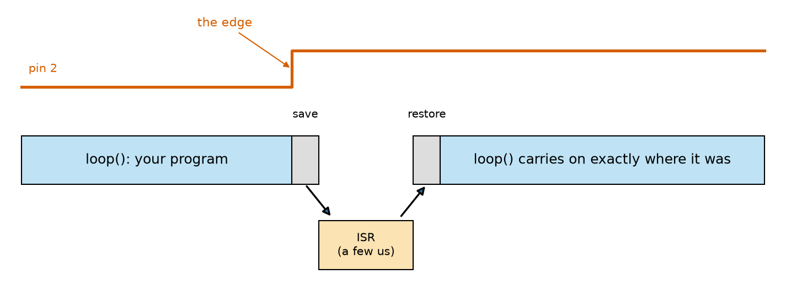
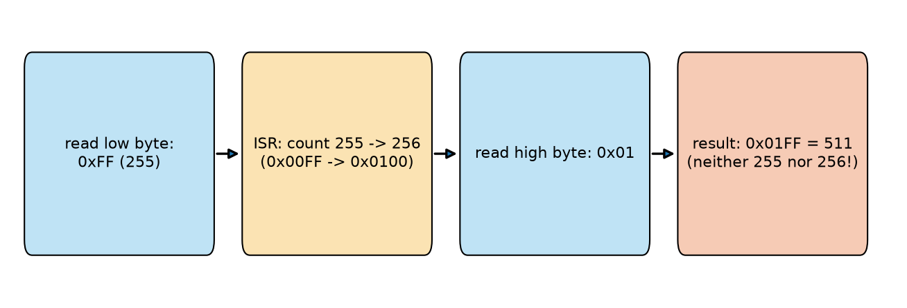
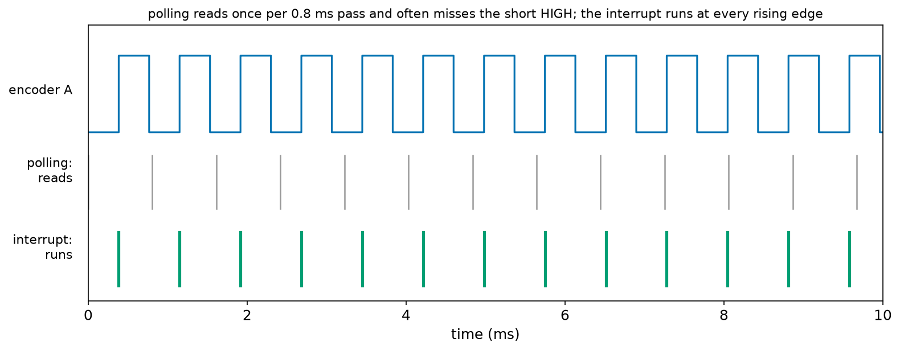
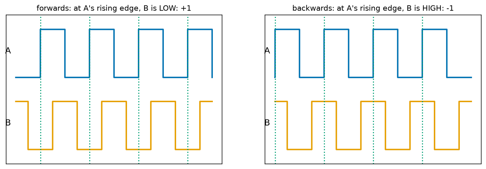
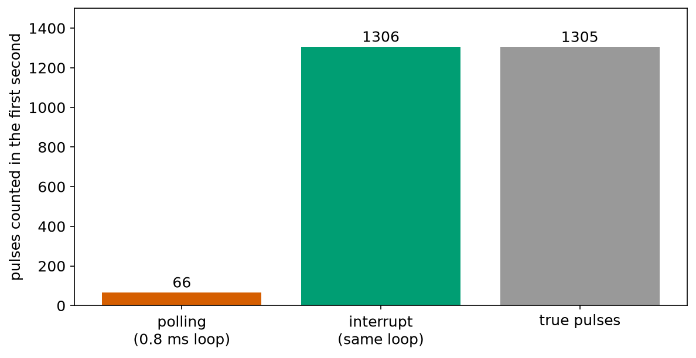
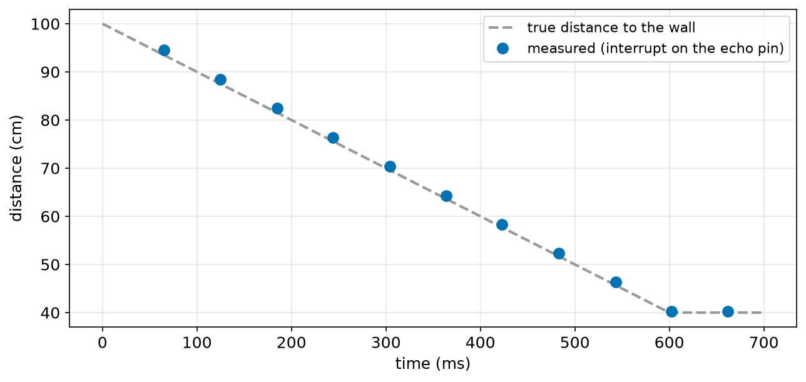

# Chapter 105 — Interrupts

> **Part 6 · Chapter 105 of 749**
> **You need:** Chapter 47 (Rover's encoder: 540 pulses per turn), Chapter 94 (Rover's CPU budget, the 11.9% spent waiting for echoes), Chapter 96 (`long` and multi-byte types), Chapter 99 (edges, bounce and polling), Chapter 103 (non-blocking loops) and Chapter 104 (state machines).
> **You will make:** an interrupt that counts edges even while the loop sleeps, a side-by-side test in which polling counts 66 encoder pulses per second and an interrupt counts all 1,305, a quadrature counter that follows Rover's wheel forwards and backwards, a model of the "torn read" bug, and an ultrasonic distance sensor that never makes the loop wait.

---

## What you will learn

- What an **interrupt** is, and how it differs from polling.
- How to use `attachInterrupt` on the Uno's pins 2 and 3, with `RISING`, `FALLING` or `CHANGE`.
- The rules for an **interrupt service routine** (ISR): short, no waiting, no printing.
- Why variables shared with an ISR must be **`volatile`**, and how to read them **atomically**.
- How interrupts count a wheel encoder, and find its **direction** from a second channel.
- How to time an ultrasonic echo with an interrupt instead of waiting for it.
- When **not** to use interrupts.

---

## New words in this chapter

| Word | Simple meaning |
|---|---|
| **interrupt** | A signal that makes the CPU pause its program, run a special function, and then carry on. |
| **ISR** | Interrupt service routine: the function that runs when the interrupt happens. |
| **latency** | The delay between the event and the start of the ISR. |
| **volatile** | A word that tells the compiler "this variable can change at any moment; always read it from memory". |
| **atomic** | Done in one piece, which nothing can interrupt halfway. |
| **critical section** | A few lines run with interrupts paused, so shared data cannot change during them. |
| **quadrature** | Two signals a quarter of a cycle apart, whose order tells the direction of movement. |
| **flag** | A `bool` that one part of a program sets to tell another part "something happened". |

---

## 105.1 Polling and interrupts

Imagine waiting for a parcel. You can walk to the door every few minutes and look (**polling**): simple, but you may miss a delivery person who knocks and leaves between two looks, and you waste time walking. Or you can install a **doorbell**: you carry on with your work, and when the bell rings you go to the door at once, deal with the parcel, and return to exactly what you were doing.

Chapters 99 and 103 polled: `loop()` read each pin on every pass. That works when `loop()` is fast and the events last long enough. Chapter 99 showed its limit: a loop that takes 200 ms per pass misses short presses, and Chapter 99's Application 5 warned that Rover's encoders change faster than a busy loop can look.

📖 **New word: interrupt** — a signal from the hardware that makes the CPU **pause** its program in the middle of whatever it is doing, run a special function, and then carry on exactly where it stopped. It is the doorbell.

📖 **New word: ISR** — the **i**nterrupt **s**ervice **r**outine: the function that runs when the interrupt happens.



*Figure 105.1 — An edge on pin 2 interrupts the program, the ISR runs, and the program carries on.*

**How to read this picture:** Time runs left to right. The red line is pin 2; when it rises (the edge), the CPU finishes its current instruction, saves where it was (grey "save"), jumps down to the ISR (orange), runs it, restores everything (grey "restore") and goes back up into `loop()` exactly where it left off. The program does not need to know it was interrupted, except that the ISR has changed some variable.

📖 **New word: latency** — the delay between the edge and the start of the ISR. On the Uno it is a few microseconds (the hardware needs a few clock ticks, and the Arduino software adds a little before calling your function). Compare that with polling, whose delay is up to one whole pass of `loop()`.

---

## 105.2 `attachInterrupt`

On the Uno, two pins have their own interrupt hardware: **pin 2** (interrupt 0) and **pin 3** (interrupt 1). You connect a function to one of them like this:

```cpp
attachInterrupt(digitalPinToInterrupt(2), onPulse, RISING);
```

- `digitalPinToInterrupt(2)` turns the pin number into the interrupt number (0 for pin 2). Always use it, so the sketch works on other boards too.
- `onPulse` is the name of your ISR: a function with no parameters and no return value (`void onPulse()`).
- The last value says which edges trigger it:

| Mode | Triggers on |
|---|---|
| `RISING` | LOW → HIGH |
| `FALLING` | HIGH → LOW |
| `CHANGE` | both |

`detachInterrupt(digitalPinToInterrupt(2))` disconnects it again.

The sketch `button_isr.ino` (in the Code section) counts the falling edges of a button with an ISR, while `loop()` spends almost all its time inside `delay(1000)`. With Chapter 99's five bouncing presses:

```
falling edges counted: 7
falling edges counted: 14
falling edges counted: 25
falling edges counted: 35
falling edges counted: 35
```

Two lessons in one output. First: the interrupt saw **every** edge, even though `loop()` was asleep in `delay()` for the whole run. Second: it saw every **bounce** too: 35 edges for 5 presses, exactly like Chapter 99's raw counter. An interrupt reacts to the hardware's edges, real or not.

🧠 **Interrupts are for fast, clean signals: encoders, echoes, sensors that say "data ready".** Buttons and bumpers are slow and bouncy; Chapter 99's polling with debounce (or Chapter 104's debounce machine) handles them better. Using an interrupt for a button usually means debouncing inside the ISR, which is awkward and easy to get wrong.

💡 **Tip: other pins can interrupt too.** The ATmega328P also has **pin change** interrupts on every pin, grouped by port (Chapter 98's ports B, C and D): one ISR per group of pins, which must find out itself which pin changed. Libraries such as encoder libraries use them when pins 2 and 3 are taken (Chapter 110).

---

## 105.3 The rules for an ISR

While an ISR runs, the rest of the program is stopped, and on the Uno **other interrupts are paused too**. So:

1. **Keep it short.** Count, store a time, set a flag: a few microseconds. Do the real work in `loop()`.
2. **Never wait.** No `delay()` (it needs interrupts to count time, and they are paused; it would wait for ever).
3. **No printing.** `Serial.print` may need to wait for room in the buffer (Chapter 100), and it is slow.
4. **`millis()` does not move during an ISR.** You may read it (or `micros()`) to note when the ISR ran, but its value stays frozen until the ISR ends.
5. **Variables shared with `loop()` must be `volatile`**, and read safely (sections 105.4 and 105.5).

📖 **New word: flag** — a `bool` that one part of a program sets to say "something happened", and another part checks and clears. The ISR sets the flag in microseconds; `loop()` notices it on its next pass and does the slow work. The ultrasonic sketch of Application 2 uses an `echoReady` flag.

---

## 105.4 `volatile`

The compiler (Chapter 95) is clever. If it sees a loop that reads a variable again and again, and nothing **in that loop** changes it, it may keep a copy in a CPU register (Chapter 94) and never read memory again: much faster. But an ISR **can** change the variable at any moment, behind the loop's back, and the loop would never see it.

📖 **New word: volatile** — a word placed before a variable's type, `volatile long count;`, that tells the compiler: "this can change at any moment by itself; read it from memory every time, and write it to memory every time". Every variable that an ISR changes and `loop()` reads (or the other way round) must be `volatile`.

⚠️ **Careful: forgetting `volatile` gives bugs that come and go.** The program may work perfectly with optimisation settings one day and fail with a small change the next. Mark every shared variable `volatile`, always.

---

## 105.5 Reading safely: atomic copies

`volatile` makes the compiler read the variable every time. It does not make the reading **safe**. Chapter 94: the Uno's CPU handles **one byte** at a time. A `long` is 4 bytes, an `int` 2: reading one takes several instructions, one byte after another. If the interrupt fires **between** those instructions and changes the variable, the program gets some bytes of the old value and some of the new one: a number that never existed.

📖 **New word: atomic** — done in one piece, which nothing can interrupt in the middle. Reading a single byte is atomic on the Uno; reading a `long` is not.

The program `torn_read.py` models a 2-byte count read low byte first, with the interrupt adding 1 between the two bytes:

```
true before true after  program reads
        100        101            100
        254        255            254
        255        256            511   <- WRONG
        511        512            767   <- WRONG
       1023       1024           1279   <- WRONG
      32767      32768          33023   <- WRONG
```



*Figure 105.2 — The four steps that turn a count of 255 or 256 into 511.*

**How to read this picture:** Follow the boxes. The program reads the low byte while the count is 255 (0x00FF): 0xFF. The ISR runs and makes the count 256 (0x0100). The program reads the high byte: now 0x01. Put together: 0x01FF = 511. Most of the time an interrupt between the bytes does no harm (the high byte does not change), which is exactly why this bug is so rare and so hard to find: it only strikes when the count crosses a multiple of 256 at the wrong instant.

📖 **New word: critical section** — a few lines run with interrupts paused, so shared data cannot change during them. The fix for torn reads:

```cpp
noInterrupts();          // pause interrupts (an edge now waits; it is not lost)
long copy = count;       // copy all 4 bytes in one piece
interrupts();            // resume; a waiting interrupt runs now
```

Then use `copy`, never `count`, for the rest of the calculation. Keep the critical section as short as possible: while interrupts are paused, the hardware remembers **one** waiting edge per interrupt; a second edge in that time would be lost.

🧠 **Every shared variable: `volatile`. Every multi-byte read (or change) of it in `loop()`: inside `noInterrupts()` / `interrupts()`.**

---

## 105.6 Interrupts count what polling misses

Application 1 puts Rover's wheel encoder (1,305 pulses per second at 0.5 m/s, Chapter 94) on pin 2, and gives `loop()` 0.8 ms of other work per pass. The polling sketch counts **66** pulses in the first second; the interrupt sketch counts **1,306** (the true 1,305, plus one that fell at the edge of the window).



*Figure 105.3 — The first 10 ms: the encoder signal (top), the moments the polling loop reads it (middle), and the moments the ISR runs (bottom).*

**How to read this picture:** Each blue pulse is HIGH for only 0.38 ms. The polling loop reads once every 0.8 ms (grey lines): most readings fall in a LOW part, and a rising edge is counted only when one reading is LOW and the next is HIGH, which rarely happens in the right order. The green lines, one at every rising edge, are the ISR: it never misses one.

---

## 105.7 Direction from two channels: quadrature

One channel tells you **how much** the wheel turned, but not **which way**. Rover's encoders have two channels, A and B, made so that B is a quarter of a pulse behind A when the wheel turns forwards, and a quarter ahead when it turns backwards.

📖 **New word: quadrature** — two square waves a quarter of a cycle (90°) apart. "Quad" means four: each cycle has four edges, in an order that tells the direction.

The simplest decoder: an ISR on A's rising edge looks at B. Forwards, B is still LOW at that moment (+1); backwards, B is already HIGH (−1).



*Figure 105.4 — Channels A and B turning forwards (left) and backwards (right). The dotted lines are A's rising edges.*

**How to read this picture:** In both panels, look along each green dotted line (a rising edge of A) down to the orange B. On the left, B is LOW at every one of them: forwards, +1. On the right, B is HIGH at every one: backwards, −1. Chapter 123 decodes all four edges for four times the resolution, and measures speed.

---

## Code

All outputs come from the PC test bench with the Uno's 16-bit `int`. The bench checks the interrupt pins every microsecond and calls the ISR at the right moment, with interrupts paused while it runs.

File `code/ch105/button_isr/button_isr.ino`:

```cpp
// button_isr.ino - count a button's falling edges with an interrupt: the hardware calls a function at each one
const int BUTTON_PIN = 2;              // on the Uno, only pins 2 and 3 have their own interrupts
volatile long edges = 0;               // changed inside the interrupt: it must be volatile

void onFall() {                        // the interrupt service routine (ISR): keep it very short
  edges++;
}

void setup() {
  Serial.begin(115200);
  pinMode(BUTTON_PIN, INPUT_PULLUP);
  attachInterrupt(digitalPinToInterrupt(BUTTON_PIN), onFall, FALLING);
}

void loop() {
  delay(1000);                         // the loop may even sleep: the interrupt still counts every edge
  noInterrupts();                      // copy the 4-byte count with interrupts paused (section 105.5)
  long copy = edges;
  interrupts();
  Serial.print("falling edges counted: ");
  Serial.println(copy);
}
```

| Line | Code | What it does (simple English) |
|---|---|---|
| 1 | `// button_isr.ino - …` | A comment. |
| 2 | `const int BUTTON_PIN = 2;` | An interrupt pin. |
| 3 | `volatile long edges = 0;` | The count, shared with the ISR: `volatile`. |
| 4 | (blank) | Spacing. |
| 5–7 | `void onFall() { edges++; }` | The ISR: one line, under a microsecond of work. |
| 8 | (blank) | Spacing. |
| 9–13 | `void setup() { … attachInterrupt(…, onFall, FALLING); }` | Pull-up on; connect `onFall` to every falling edge of pin 2. |
| 14 | (blank) | Spacing. |
| 15 | `void loop() {` | |
| 16 | `delay(1000);` | Sleep a whole second: the ISR keeps counting anyway. |
| 17–19 | `noInterrupts(); long copy = edges; interrupts();` | A safe copy (section 105.5). |
| 20–21 | `Serial.print(…); Serial.println(copy);` | Report the copy. |
| 22 | `}` | End of `loop`. |

The output is in section 105.2.

File `code/ch105/torn_read.py`:

```python
# torn_read.py - why reading a 2-byte count while an interrupt changes it can give nonsense
# The Uno's CPU works on one byte at a time (Chapter 94), so it reads a 16-bit count in two steps:
# first the low byte, then the high byte. Here an interrupt adds 1 to the count BETWEEN the two steps.
def torn_read(count):
    low = count & 0xFF                 # step 1: read the low byte (the last 8 bits)
    count = count + 1                  # ... the interrupt runs here and adds one pulse ...
    high = count >> 8                  # step 2: read the high byte (the first 8 bits)
    return high * 256 + low, count     # what the main program believes, and the true count now


print(f"{'true before':>11s} {'true after':>10s} {'program reads':>14s}")
for before in [100, 254, 255, 511, 1023, 32767]:
    seen, after = torn_read(before)
    flag = "" if seen in (before, after) else "   <- WRONG"
    print(f"{before:11d} {after:10d} {seen:14d}{flag}")
```

| Line | Code | What it does (simple English) |
|---|---|---|
| 1–3 | `# torn_read.py …` | Comments: the model. |
| 4 | `def torn_read(count):` | Read a count in two steps, with an interrupt between them. |
| 5 | `low = count & 0xFF` | `&` keeps only the bits that are 1 in both numbers (Chapter 106 uses it a lot); with `0xFF` (255, eight 1s) it keeps the low byte. |
| 6 | `count = count + 1` | The interrupt adds a pulse in the middle of the read. |
| 7 | `high = count >> 8` | `>>` shifts the bits right: `>> 8` drops the low byte, leaving the high byte. |
| 8 | `return high * 256 + low, count` | Put the two bytes together as the program would; also return the true count. |
| 9–10 | (blank) | Spacing. |
| 11 | `print(…)` | The heading. |
| 12 | `for before in […]:` | Six starting values. |
| 13 | `seen, after = torn_read(before)` | Do the torn read. |
| 14 | `flag = …` | It is right only if it equals the count before or after the interrupt. |
| 15 | `print(…)` | One row. |

The output is in section 105.5.

---

## Small examples

**Example 1.** `attachInterrupt(digitalPinToInterrupt(3), onEcho, CHANGE);` calls `onEcho` at every edge of pin 3.

**Example 2.** A 1,305 Hz encoder with `RISING` gives 1,305 interrupts per second; with `CHANGE`, 2,610.

**Example 3.** An ISR of 5 µs at 2,610 interrupts per second uses 2,610 × 5 = 13,050 µs per second: 1.3% of the CPU.

**Example 4.** A `byte` shared with an ISR is read atomically (one byte); it still needs `volatile`.

**Example 5.** Reading `count` (a `long`) twice in one expression, `count - lastCount`, without a copy can use two different values of `count`.

**Example 6.** Echo width 2,900 µs ÷ 58 µs per cm = 50 cm.

**Example 7.** A polling loop that takes 0.8 ms per pass cannot reliably see pulses shorter than 0.8 ms.

**Example 8.** Position 2,609 pulses × 0.383 mm = 1,000 mm.

---

## 🏭 Real robot applications

### Application 1 (worked in full) — 🤖 Counting Rover's wheel encoders

**1. The real problem.** Rover's odometry (Chapter 288) depends on counting every encoder pulse. At 0.5 m/s each wheel gives 1,305 pulses per second, each HIGH for only 0.38 ms. Meanwhile `loop()` has real work: reading sensors, running the control loop, sending messages; say 0.8 ms per pass. Can polling keep up? And how does Rover know which way the wheel turns, when it backs up after a bump (Chapter 104)?

**2. Why this theory.** Section 105.6: an ISR runs at every edge, whatever `loop()` is doing. Section 105.7: channel B at A's rising edge gives the direction. Sections 105.4–105.5: `volatile`, and a safe copy of the 4-byte position.

**3. The numbers.** Pulses per second = 0.5 m/s ÷ 0.207 m per turn × 540 = 1,305 (Chapters 16, 47, 94). Pulse length 1 ÷ 1,305 = 0.766 ms, HIGH for half: 0.383 ms. Distance per pulse: 207 mm ÷ 540 = 0.383 mm. The quadrature test: forwards for 2 s (2,610 pulses = 1,000 mm), then backwards at 650 pulses per second for 1 s.

**4. The maths.** Polling sees a rising edge only if one reading falls in a LOW part and the next in a HIGH part. With readings 0.8 ms apart and pulses 0.766 ms long, consecutive readings land almost at the same phase of the pulse, drifting slowly; most pairs are LOW–LOW, HIGH–HIGH or HIGH–LOW. Only about one pulse in twenty is caught. The ISR runs at every edge: 1,305 per second, about 1.3% of the CPU at a few microseconds each. Expected final position: 2,610 − 650 = 1,960 pulses = 751 mm.

**5. The code.** File `code/ch105/encoder_poll/encoder_poll.ino` (polling):

```cpp
// encoder_poll.ino - count a wheel encoder's pulses by POLLING, in a loop that also has other work to do
const int ENC_A = 2;                   // the encoder's channel A

long count = 0;
int lastA = LOW;
unsigned long lastReport = 0;

void setup() {
  Serial.begin(115200);
  pinMode(ENC_A, INPUT_PULLUP);
}

void loop() {
  int a = digitalRead(ENC_A);
  if (lastA == LOW && a == HIGH) {     // a rising edge: one pulse
    count++;
  }
  lastA = a;
  delayMicroseconds(800);              // the rest of Rover's work in each pass: sensors, control, messages
  if (millis() - lastReport >= 1000) {
    lastReport += 1000;
    Serial.print("pulses counted: ");
    Serial.println(count);
  }
}
```

| Line | Code | What it does (simple English) |
|---|---|---|
| 1–6 | comments, `ENC_A`, `count`, `lastA`, `lastReport` | Chapter 99's edge detector. |
| 7 | (blank) | Spacing. |
| 8–11 | `void setup() { … }` | Serial and the input. |
| 12 | (blank) | Spacing. |
| 13–18 | `void loop() { int a = digitalRead(ENC_A); if (…) { count++; } lastA = a;` | Poll once per pass. |
| 19 | `delayMicroseconds(800);` | Stands in for the rest of the robot's work. |
| 20–24 | `if (millis() - lastReport >= 1000) { … }` | Report once per second (Chapter 103). |
| 25 | `}` | End of `loop`. |

File `code/ch105/encoder_isr/encoder_isr.ino` (interrupt, same other work):

```cpp
// encoder_isr.ino - count the same pulses with an INTERRUPT, in a loop with exactly the same other work
const int ENC_A = 2;

volatile long count = 0;               // shared with the ISR
unsigned long lastReport = 0;

void onPulse() {                       // runs at every rising edge, whatever loop() is doing
  count++;
}

void setup() {
  Serial.begin(115200);
  pinMode(ENC_A, INPUT_PULLUP);
  attachInterrupt(digitalPinToInterrupt(ENC_A), onPulse, RISING);
}

void loop() {
  delayMicroseconds(800);              // the same other work as in encoder_poll.ino
  if (millis() - lastReport >= 1000) {
    lastReport += 1000;
    noInterrupts();
    long copy = count;                 // a safe copy of the 4-byte count
    interrupts();
    Serial.print("pulses counted: ");
    Serial.println(copy);
  }
}
```

| Line | Code | What it does (simple English) |
|---|---|---|
| 1–2 | comment, `const int ENC_A = 2;` | Channel A on interrupt pin 2. |
| 3 | (blank) | Spacing. |
| 4 | `volatile long count = 0;` | Shared with the ISR. |
| 5 | `unsigned long lastReport = 0;` | Report timer. |
| 6 | (blank) | Spacing. |
| 7–9 | `void onPulse() { count++; }` | The ISR. |
| 10 | (blank) | Spacing. |
| 11–15 | `void setup() { … attachInterrupt(…, onPulse, RISING); }` | Count every rising edge. |
| 16 | (blank) | Spacing. |
| 17–18 | `void loop() { delayMicroseconds(800);` | The same other work. |
| 19–26 | `if (…) { lastReport += 1000; noInterrupts(); long copy = count; interrupts(); … }` | Once a second: copy safely and report. |
| 27 | `}` | End of `loop`. |

And the direction decoder, file `code/ch105/quadrature/quadrature.ino`:

```cpp
// quadrature.ino - count Rover's wheel position, forwards AND backwards, from an encoder's two channels
const int ENC_A = 2;                   // channel A: on an interrupt pin
const int ENC_B = 4;                   // channel B: any digital pin
const float MM_PER_PULSE = 207.0 / 540;   // one wheel turn = 207 mm = 540 pulses (Chapters 16 and 47)

volatile long position = 0;            // in pulses: forwards adds, backwards subtracts
unsigned long lastReport = 0;

void onA() {                           // at each rising edge of A, B tells us the direction
  if (digitalRead(ENC_B) == LOW) {
    position++;                        // B still LOW: A is ahead of B, the wheel turns forwards
  } else {
    position--;                        // B already HIGH: B is ahead, the wheel turns backwards
  }
}

void setup() {
  Serial.begin(115200);
  pinMode(ENC_A, INPUT_PULLUP);
  pinMode(ENC_B, INPUT_PULLUP);
  attachInterrupt(digitalPinToInterrupt(ENC_A), onA, RISING);
}

void loop() {
  if (millis() - lastReport >= 500) {
    lastReport += 500;
    noInterrupts();
    long p = position;
    interrupts();
    Serial.print(millis());
    Serial.print(" ms: position ");
    Serial.print(p);
    Serial.print(" pulses = ");
    Serial.print(p * MM_PER_PULSE, 1);
    Serial.println(" mm");
  }
}
```

| Line | Code | What it does (simple English) |
|---|---|---|
| 1 | comment | |
| 2–3 | `ENC_A = 2`, `ENC_B = 4` | A must be on an interrupt pin; B can be on any pin (Rover's pin plan, Figure 95.8). |
| 4 | `const float MM_PER_PULSE = 207.0 / 540;` | 0.383 mm per pulse. |
| 5 | (blank) | |
| 6 | `volatile long position = 0;` | Signed: it can go negative if Rover backs up past its start. |
| 7 | `unsigned long lastReport = 0;` | |
| 8 | (blank) | |
| 9 | `void onA() {` | The ISR, on A's rising edges. |
| 10–14 | `if (digitalRead(ENC_B) == LOW) { position++; } else { position--; }` | Read B to choose the direction. `digitalRead` takes about 4 µs: fine in an ISR. |
| 15 | `}` | |
| 16 | (blank) | |
| 17–22 | `void setup() { … }` | Both channels with pull-ups; the ISR on A. |
| 23 | (blank) | |
| 24 | `void loop() {` | |
| 25–29 | `if (millis() - lastReport >= 500) { … long p = position; … }` | Every 0.5 s, a safe copy. |
| 30–35 | `Serial.print(millis()); …` | The position in pulses and in millimetres (Chapter 96: count in integers, convert at the end). |
| 36 | `}` | |
| 37 | `}` | End of `loop`. |

Output, polling (3 seconds):

```
pulses counted: 66
pulses counted: 132
pulses counted: 198
```

Interrupt, same loop:

```
pulses counted: 1306
pulses counted: 2610
pulses counted: 3915
```

Quadrature, forwards 2 s then backwards 1 s:

```
500 ms: position 653 pulses = 250.3 mm
1000 ms: position 1305 pulses = 500.3 mm
1500 ms: position 1958 pulses = 750.6 mm
2000 ms: position 2609 pulses = 1000.1 mm
2500 ms: position 2284 pulses = 875.5 mm
3000 ms: position 1959 pulses = 751.0 mm
```



*Figure 105.5 — Polling against an interrupt, with the same 0.8 ms of other work per pass.*

**How to read this picture:** The grey bar is the truth, 1,305 pulses. The green bar (interrupt) matches it. The red bar (polling) is a small fraction of it: 66.

**6. The result.** Polling counted 66 pulses per second out of 1,305: Rover would think it had driven 5% of the real distance. The interrupt counted every pulse while `loop()` did exactly the same work. The quadrature decoder followed the wheel forwards to 1,000 mm and back to 751 mm, matching the expected 1,960 pulses (the one-pulse differences are just where each half-second report fell). Interrupts are how Rover's encoders are counted from now on: Rover's pin plan put channel A of each wheel on pins 2 and 3 for exactly this reason (Chapter 95).

**7. Going further.** At higher speeds even an ISR per edge is a lot of work: a motor encoder with 1,000 pulses per turn at 6,000 rpm gives 100,000 edges per second, more than an Uno can handle. Bigger microcontrollers (such as the STM32 in drone and robot controllers) have **hardware quadrature counters** inside their timers: they count every edge and keep the direction with no CPU work at all, and the program just reads the count (Chapter 123).

### Application 2 (worked in full) — 🤖 Ultrasonic distance without waiting

**1. The real problem.** An ultrasonic sensor (Chapter 119) measures distance by sending a short burst of sound and timing its echo: after a trigger pulse, its echo pin goes HIGH for as long as the sound took to reach the wall and come back. The Arduino's `pulseIn()` measures that by **waiting**, in a loop, for the whole echo: 5.8 ms for a wall 1 m away, up to about 25 ms for far walls. Chapter 94 found that this waiting was the biggest single cost in Rover's CPU budget: 11.9%, and during it nothing else runs.

**2. Why this theory.** An ISR on the echo pin with `CHANGE` can note `micros()` when the echo starts and again when it ends. `loop()` triggers the sensor and then simply carries on; when the ISR sets a `echoReady` flag (section 105.3), `loop()` collects the result.

**3. The numbers.** Sound: 343 m/s, so 1 cm there and back takes 2 × 0.01 ÷ 343 = 58.3 µs: **distance (cm) = echo width (µs) ÷ 58**. One measurement every 60 ms (the sensor's makers advise at least 60 ms, so old echoes have died away). The test: a pretend sensor whose wall comes from 100 cm to 40 cm over 0.6 s.

**4. The maths.** At 94 cm, the echo is 94 × 58.3 = 5,480 µs. With `pulseIn`, that is 5.5 ms of every 60 ms spent waiting (9%). With the ISR, the CPU spends only the trigger pulse (10 µs) and two short ISRs (a few µs each) per measurement: well under 0.1%.

**5. The code.** File `code/ch105/ultrasonic_isr/ultrasonic_isr.ino`:

```cpp
// ultrasonic_isr.ino - measure distance with an ultrasonic sensor WITHOUT waiting for the echo:
// an interrupt on the echo pin notes when the echo starts and ends; loop() never waits
const int TRIG_PIN = 9;
const int ECHO_PIN = 3;                // an interrupt pin
const unsigned long PING_MS = 60;      // one measurement every 60 ms

volatile unsigned long echoStart = 0;
volatile unsigned long echoWidth = 0;  // how long the echo pin was HIGH, in microseconds
volatile bool echoReady = false;       // set by the ISR when a new width is ready
unsigned long lastPing = 0;
long passes = 0;                       // passes of loop() between pings: how free the loop is

void onEcho() {                        // runs at every change of the echo pin
  if (digitalRead(ECHO_PIN) == HIGH) {
    echoStart = micros();              // the echo pulse begins
  } else {
    echoWidth = micros() - echoStart;  // the echo pulse ends: its width is the sound's travel time
    echoReady = true;
  }
}

void setup() {
  Serial.begin(115200);
  pinMode(TRIG_PIN, OUTPUT);
  pinMode(ECHO_PIN, INPUT);
  attachInterrupt(digitalPinToInterrupt(ECHO_PIN), onEcho, CHANGE);
}

void loop() {
  passes++;
  if (millis() - lastPing >= PING_MS) {          // time for a new measurement
    lastPing += PING_MS;
    digitalWrite(TRIG_PIN, HIGH);                // a 10 us trigger pulse starts the sensor
    delayMicroseconds(10);
    digitalWrite(TRIG_PIN, LOW);
  }
  if (echoReady) {                               // the ISR has a new answer
    noInterrupts();
    unsigned long width = echoWidth;
    echoReady = false;
    interrupts();
    Serial.print(millis());
    Serial.print(" ms: ");
    Serial.print(width / 58.0, 1);               // 58 us of echo per cm (Chapter 119)
    Serial.print(" cm   (loop ran ");
    Serial.print(passes);
    Serial.println(" times since the last answer)");
    passes = 0;
  }
}
```

| Line | Code | What it does (simple English) |
|---|---|---|
| 1–2 | comments | |
| 3–5 | `TRIG_PIN = 9`, `ECHO_PIN = 3`, `PING_MS = 60` | Trigger on any pin; echo on interrupt pin 3. |
| 6 | (blank) | |
| 7–9 | `volatile unsigned long echoStart …`, `echoWidth …`, `volatile bool echoReady …` | Shared with the ISR: all `volatile`. |
| 10–11 | `unsigned long lastPing = 0;`, `long passes = 0;` | The ping schedule, and a count of free passes. |
| 12 | (blank) | |
| 13 | `void onEcho() {` | Runs at both edges of the echo. |
| 14–15 | `if (digitalRead(ECHO_PIN) == HIGH) { echoStart = micros(); }` | Rising edge: note the start. |
| 16–18 | `else { echoWidth = micros() - echoStart; echoReady = true; }` | Falling edge: the width, and the flag. |
| 19–20 | `}` | |
| 21–26 | `void setup() { … attachInterrupt(…, onEcho, CHANGE); }` | Trigger as output; ISR on both edges of the echo. |
| 27 | (blank) | |
| 28–29 | `void loop() { passes++;` | Count every pass. |
| 30–35 | `if (millis() - lastPing >= PING_MS) { … }` | Every 60 ms: a 10 µs trigger pulse (the only short wait). |
| 36 | `if (echoReady) {` | A new answer from the ISR? |
| 37–40 | `noInterrupts(); unsigned long width = echoWidth; echoReady = false; interrupts();` | Copy the width and clear the flag, together, safely. |
| 41–47 | `Serial.print(…)…` | Print the distance (width ÷ 58) and how many times the loop ran freely meanwhile. |
| 48 | `passes = 0;` | Start counting again. |
| 49–50 | `}` `}` | |

The test file models the sensor with the bench's "tick hook": a small function that runs at every simulated microsecond, watches pin 9 for the end of a trigger pulse, and then drives pin 3 HIGH for the right echo time. Output:

```
65 ms: 94.5 cm   (loop ran 21976 times since the last answer)
125 ms: 88.5 cm   (loop ran 19768 times since the last answer)
185 ms: 82.4 cm   (loop ran 19766 times since the last answer)
244 ms: 76.4 cm   (loop ran 19766 times since the last answer)
304 ms: 70.4 cm   (loop ran 19765 times since the last answer)
364 ms: 64.3 cm   (loop ran 19766 times since the last answer)
423 ms: 58.3 cm   (loop ran 19766 times since the last answer)
483 ms: 52.3 cm   (loop ran 19765 times since the last answer)
543 ms: 46.3 cm   (loop ran 19767 times since the last answer)
602 ms: 40.2 cm   (loop ran 19765 times since the last answer)
662 ms: 40.2 cm   (loop ran 19882 times since the last answer)
```



*Figure 105.6 — The true distance to the wall (grey dashes) and the measurements (blue dots).*

**How to read this picture:** The wall approaches at 1 m/s until 0.6 s, then stays at 40 cm. Each dot is one answer, reported about 5 ms after its trigger at 60, 120, 180 … ms (the time for the echo to return). Every dot sits on the line within about half a centimetre.

**6. The result.** Every measurement is right, and between answers the loop ran freely almost 20,000 times: during each echo it could read bumpers, run a control loop, or print. The 11.9% of Rover's CPU that Chapter 94 found was spent waiting for echoes falls to almost nothing. This sketch becomes part of Rover's sensing in Part 7.

**7. Going further.** With two or three ultrasonic sensors, each echo needs its own ISR, and the Uno has only two external interrupt pins; pin change interrupts (section 105.2) or a library such as NewPing handle more. Sensors must also be fired one after another, not together, so that one sensor's sound does not arrive as another's echo (Chapter 119).

### Application 3 — 🚁 A drone's loop starts with a "data ready" interrupt

A flight controller's most important loop (read the gyroscope, run the rate controller, update the motors, Chapter 94's 8 kHz loop) is not started by a timer or by polling. The gyroscope chip itself has a "data ready" output pin: every time it has a new measurement, it pulses the pin, and that edge triggers an interrupt on the flight controller. So the loop runs exactly when fresh data exists, never reading the same sample twice and never missing one, and the gyroscope's own precise clock sets the rhythm. Everything slower (GPS, telemetry, logging) runs in the main program between these interrupts, in a scheduler like Chapter 103's Application 5. Our own flight controller does the same in Chapter 641.

### Application 4 — 🏭 Capturing the exact position with a touch probe

CNC machines and some robot arms measure parts with a **touch probe**: a stylus that closes a switch the instant it touches the surface. The machine moves the probe slowly towards the part and must know the axis position at the exact moment of contact. Polling in a 1 ms loop at 100 mm/min would be up to 1.7 µm late; a fast machine probing at 1,000 mm/min would be 17 µm late, too much for precise work. So the probe signal is wired to an interrupt (or, in industrial controllers, directly to the encoder hardware, which "latches" the position in hardware within a fraction of a microsecond). The ISR only copies the position counter; the motion is then stopped calmly, and the latched value is the measurement.

### Application 5 — 🛑 Emergency stops: interrupt plus hardware

Should an emergency stop button be read with an interrupt? It reacts within microseconds, which is tempting. But section 105.2's lesson applies: a mechanical button bounces, and a noise spike from a motor can cause a false interrupt. Real machines therefore treat the e-stop in **hardware**: the button's normally closed contacts (Chapter 99, Application 3) cut the motors' power directly through a safety relay, whatever the software does. The microcontroller also watches the button, polled or through an interrupt that only sets a flag, so it can stop cleanly, record what happened and refuse to restart. The interrupt makes the software react fast; the hardware makes the stop certain even if the software has crashed.

---

## 🔧 Hands-on lab

### Lab 105.1 — An interrupt counts bounces (hardware or Wokwi)

You need: an Uno (or Wokwi), a push button between pin 2 and GND.

1. Upload `button_isr.ino`, open the Serial Monitor at 115200, and press the button 5 times, firmly.
2. Note the count. Press 5 times more, lightly and quickly.
3. Add a 100 nF capacitor between pin 2 and GND (Chapter 91's hardware debounce) and repeat.

**What you should see:** In step 1, more than 5 edges (often 6 to 20, depending on the button): every bounce triggers the ISR, even while `loop()` sleeps in `delay`. Light presses often bounce more. With the capacitor, the count gets much closer to the number of presses, because the capacitor smooths the chatter before the pin sees it. (Wokwi's buttons bounce too, unless you switch bouncing off in the part's settings.)

| If it does not work | Likely cause | Fix |
|---|---|---|
| The count never changes | Button on a pin without an external interrupt | Use pin 2 or 3 |
| The count rises without pressing | No pull-up: the pin floats | Keep `INPUT_PULLUP` |
| Compile error at `attachInterrupt` | The ISR has parameters or returns a value | It must be `void onFall()` |

**Challenge:** Debounce inside the ISR: ignore any falling edge that comes less than 50 ms after the last accepted one (`millis()` can be read in an ISR). Then press and hold the button for a second and release it: does the release's bounce count as a new press? Why is Chapter 104's debounce machine, polled from `loop()`, a better tool for buttons?

### Lab 105.2 — Where does polling break? (simulation)

Copy `encoder_poll.ino` and `pc_tests/test_encoder_poll.cpp`.

1. Change the loop's other work from `delayMicroseconds(800)` to 200, 100 and 20, and run each.
2. For each, compare the count with the true 1,305 per second.
3. Run `encoder_isr.ino` with the same changes.

**What you should see:** The polling count rises towards 1,305 as the loop gets faster; it becomes reliable only when each pass is well under half a pulse (0.38 ms). Even then, it depends on the other work never getting longer, which on a real robot it sometimes does. The interrupt counts 1,305 every time, whatever the loop does.

| If it does not work | Likely cause | Fix |
|---|---|---|
| The count is far too high | `lastA` declared inside `loop()`, so it is LOW at every pass | It must be global |
| The interrupt version counts double | The mode is `CHANGE` | Use `RISING` (or expect double) |

**Challenge:** Change the test's encoder to 6,000 pulses per second (Rover at about 2.3 m/s). Does the ISR version still count them all on the bench? Work out how much CPU time 6,000 interrupts per second would take on a real Uno at 5 µs each.

### Lab 105.3 — An ultrasonic sensor in Wokwi (simulation or hardware)

You need: Wokwi (the HC-SR04 part has a slider for the distance) or a real HC-SR04, jumper wires.

1. Wire VCC to 5V, GND to GND, Trig to pin 9, Echo to pin 3.
2. Upload `ultrasonic_isr.ino` and open the Serial Monitor.
3. Move the distance slider (or your hand) and watch the readings.

**What you should see:** A distance about 16 times per second (every 60 ms), following the slider within a centimetre or so, and the loop running thousands of times between answers. With a real sensor, soft or angled surfaces sometimes give no echo or a wrong one; no answer means `echoReady` simply stays false.

| If it does not work | Likely cause | Fix |
|---|---|---|
| No readings at all | Echo not on pin 3, or Trig and Echo swapped | Echo must be on an interrupt pin |
| Readings far too large | Several sensors firing together, or pings too fast | One sensor, 60 ms between pings |
| Readings stuck at the same value | The ISR's falling-edge branch never runs | Mode must be `CHANGE` |

**Challenge:** Add Chapter 104's Rover state machine: in DRIVE, if the distance is under 20 cm, go to BACK_UP, as if the bumper had been pressed, but before touching anything.

---

## Common mistakes

⚠️ **A long ISR.** Printing, `delay`, or heavy maths in an ISR stops everything else. Count, note the time, set a flag; do the rest in `loop()`.

⚠️ **Forgetting `volatile`.** `loop()` may never see the ISR's changes.

⚠️ **Reading a multi-byte shared variable without pausing interrupts.** Torn reads, rarely and at random.

⚠️ **Leaving interrupts paused for long.** Only one waiting edge per interrupt is remembered; more are lost, and `millis()` stops counting.

⚠️ **Using pins other than 2 and 3 for `attachInterrupt` on an Uno.** They have no external interrupt.

⚠️ **Using interrupts for bouncy switches.** Each bounce is an interrupt. Poll and debounce instead.

⚠️ **Calling `delay()` inside an ISR.** It never ends.

⚠️ **Using `count` twice in a calculation instead of a single copy.** It may change between the two uses.

⚠️ **Forgetting `digitalPinToInterrupt`.** `attachInterrupt(2, …)` means interrupt 2, which on an Uno does not exist.

---

## Practice

🏋️ **1.** Give two differences between polling a pin and using an interrupt on it.

🏋️ **2.** Which Uno pins can use `attachInterrupt`? Write the line that calls `onTick` at every falling edge of pin 3.

🏋️ **3.** Why must an ISR be short? Name three things it must not do.

🏋️ **4.** What does `volatile` tell the compiler? Which variables need it?

🏋️ **5.** A 2-byte count is 511 and an interrupt adds 1 while the program reads it, low byte first. What can the program read?

🏋️ **6.** Write the three lines that copy a shared `volatile long ticks` safely into a local variable.

🏋️ **7.** An encoder gives 3,000 pulses per second and each ISR takes 6 µs. What share of the CPU do the interrupts use?

🏋️ **8.** At A's rising edge, B is HIGH. Which way is the wheel turning (with this chapter's wiring)?

🏋️ **9.** An echo lasts 1,160 µs. How far is the wall?

🏋️ **10.** Why is an interrupt a poor choice for a mechanical push button?

🏋️ **11.** Change `encoder_isr.ino` to count **both** edges of channel A (`CHANGE`), and run it on the PC test bench. What does it count per second, and what does that do to Rover's distance resolution?

---

## Answers

**1.** Polling reads the pin only when the program gets to it (once per pass), so it can be late or miss short events; an interrupt runs within microseconds of every edge, whatever the program is doing. Polling is simple and safe; interrupts need `volatile` and atomic reads.

**2.** Pins 2 and 3. `attachInterrupt(digitalPinToInterrupt(3), onTick, FALLING);`

**3.** While it runs, the main program and other interrupts wait. It must not call `delay()`, print with `Serial`, or wait for anything (and should not do long calculations).

**4.** That the variable can change at any moment outside the normal flow, so it must be read from and written to memory every time. Every variable shared between an ISR and the rest of the program.

**5.** 511 = 0x01FF. Low byte read: 0xFF. The count becomes 512 = 0x0200. High byte read: 0x02. Result: 0x02FF = **767** (neither 511 nor 512).

**6.**

```cpp
noInterrupts();
long t = ticks;
interrupts();
```

**7.** 3,000 × 6 µs = 18,000 µs per second = **1.8%**.

**8.** Backwards (B is ahead of A).

**9.** 1,160 ÷ 58 = **20 cm**.

**10.** Its contacts bounce, so one press gives several interrupts; and it is slow, so polling every few milliseconds sees it easily. Polling with a debounce is simpler and correct.

**11.** Change `RISING` to `CHANGE` on line 14. PC test bench output:

```
pulses counted: 2611
pulses counted: 5220
pulses counted: 7830
```

About 2,610 per second: twice as many, because each pulse has a rising and a falling edge. Each count is now 207 ÷ 1,080 = 0.19 mm of wheel travel instead of 0.38 mm: double the resolution, for twice the interrupts. (It no longer gives the direction by itself; Chapter 123's full quadrature decoder uses all four edges of A and B.)

---

## Summary

🧠 An **interrupt** pauses the program at an edge, runs an **ISR**, and resumes exactly where it was: a doorbell instead of looking at the door. **Latency** is a few microseconds.

🧠 `attachInterrupt(digitalPinToInterrupt(pin), isr, RISING / FALLING / CHANGE)`, on the Uno's **pins 2 and 3**.

🧠 ISRs are short: count, note `micros()`, set a **flag**. No `delay`, no printing; `millis()` stands still inside them.

🧠 Shared variables are **`volatile`**, and multi-byte ones are copied in a **critical section** (`noInterrupts()` … `interrupts()`) to avoid **torn reads**.

🧠 Interrupts count what polling misses: 1,305 encoder pulses per second against 66 with a busy loop. **Quadrature** channel B at A's edge gives the direction.

🧠 An ISR on an ultrasonic echo measures distance without waiting, freeing almost all the CPU.

🧠 Bouncy switches are better polled and debounced; interrupts are for fast, clean signals.

---

## Next chapter

`millis()`, PWM and `tone()` all come from the same hidden hardware: the chip's three **timers**. Chapter 106, **Hardware timers**, opens them up: how a timer counts clock ticks through a prescaler, how compare-match interrupts start a control loop with microsecond precision, how to move Rover's motor PWM to a silent 20 kHz, and why changing the wrong timer breaks `millis()`.
