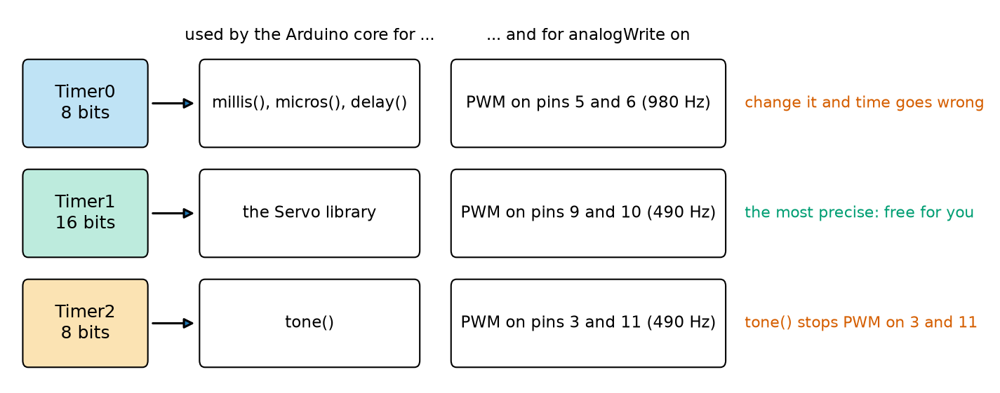
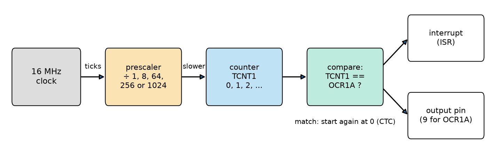
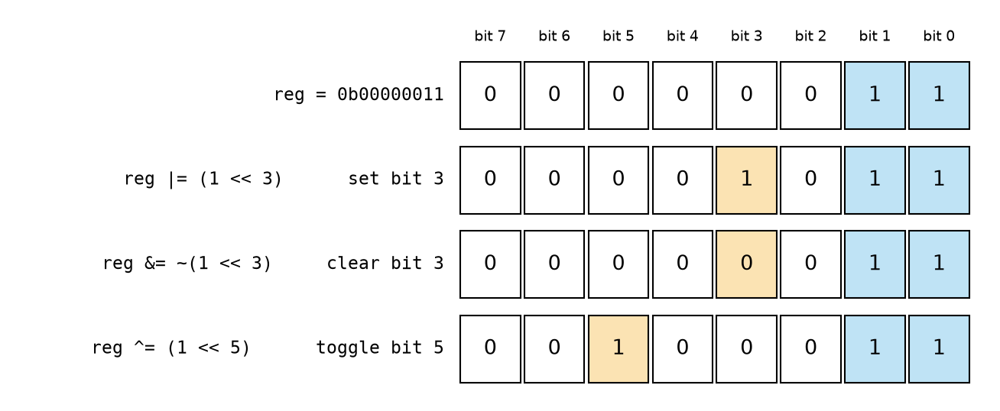
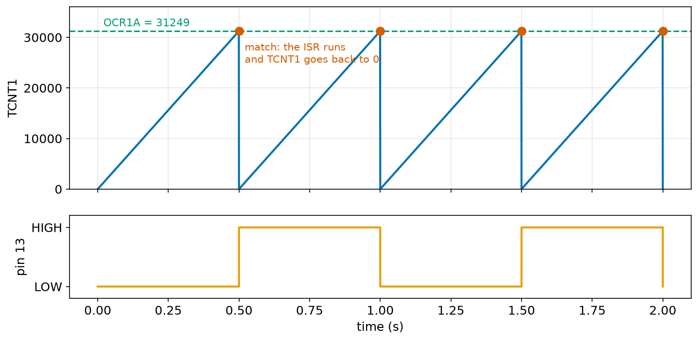
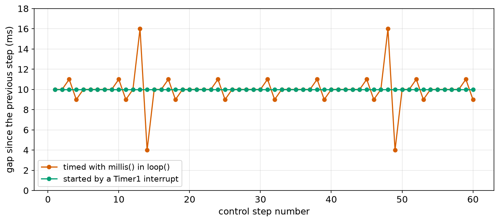
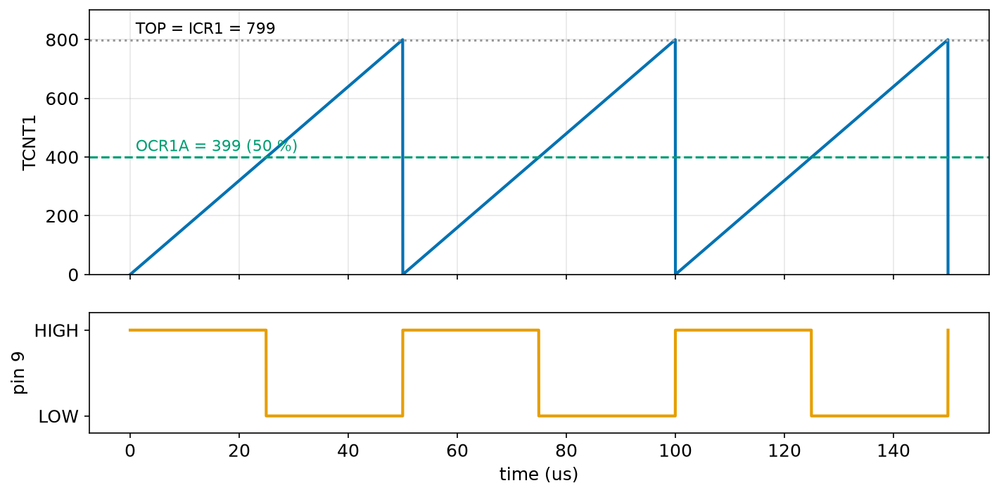

# Chapter 106 — Hardware timers

> **Part 6 · Chapter 106 of 749**
> **You need:** Chapter 94 (the 16 MHz clock), Chapter 97 (`&&`, `||`, and the warning about single `&` and `|`), Chapter 98 (ports and registers: DDR, PORT, PIN), Chapter 102 (PWM, `analogWrite`, `tone()`), Chapter 103 (`millis()` timing) and Chapter 105 (interrupts, `volatile`, atomic copies).
> **You will make:** a table of the bit operators on a register, a pin that switches 30 times faster than with `digitalWrite`, an LED that blinks from a timer with `loop()` doing nothing, Rover's 100 Hz control step with exactly 10,000 µs between steps, a silent 20 kHz motor PWM, and a demonstration of what breaks when you change the wrong timer.

---

## What you will learn

- What a hardware **timer** is, and which of the Uno's three timers the Arduino functions already use.
- How a **prescaler** and a **compare value** set a timer's frequency, and how to choose them.
- The **bit operators** `|`, `&`, `~`, `^`, `<<`, and how to set, clear, toggle and test one bit of a register.
- How to write a pin through its port register, and why that is so much faster.
- How a timer in **CTC mode** calls an interrupt at an exact rate: the heart of a steady control loop.
- How **fast PWM** mode makes a 20 kHz motor signal.
- Why changing Timer0 breaks `millis()` and `delay()`.

---

## New words in this chapter

| Word | Simple meaning |
|---|---|
| **timer** (hardware timer) | A counter inside the chip that counts clock ticks by itself, without the CPU. |
| **prescaler** | A divider in front of a timer: it lets through only one tick in 8, 64, 256 or 1,024. |
| **TOP** | The highest number a timer counts to before starting again from 0. |
| **compare match** | The moment the timer's count equals a value you chose (in an OCR register). |
| **CTC** | Clear Timer on Compare: a mode where the timer goes back to 0 at each compare match. |
| **bit mask** | A number with 1s only in the bits you want to change or test. |
| **jitter** | How much the time between steps that should be equal changes from step to step. |
| **datasheet** | The manufacturer's full description of a chip: every register and every bit. |

---

## 106.1 A counter that counts by itself

You already use timers every day without seeing them. `millis()` needs something that counts time while your program does other things. `analogWrite` (Chapter 102) needs something that switches a pin on and off thousands of times per second while your program runs. `tone()` needs something that makes a square wave at a musical frequency. None of these use the CPU to count: they use **hardware timers**.

📖 **New word: timer** — a counter inside the microcontroller, made of hardware, that adds 1 at every tick of a clock, all by itself. The CPU can read the count, set the number it counts to, and ask to be interrupted when it gets there. While the timer counts, the CPU is free.

The ATmega328P has three:



*Figure 106.1 — Timer0, Timer1 and Timer2, what the Arduino core uses each for, and which PWM pins each drives.*

**How to read this picture:** Read each row from left to right. Timer0 (8 bits: it counts 0 to 255) runs `millis()`, `micros()` and `delay()`, and also makes the PWM on pins 5 and 6. Timer1 (16 bits: 0 to 65,535) makes the PWM on pins 9 and 10, and the Servo library takes it over (Chapter 143). Timer2 (8 bits) makes the PWM on pins 3 and 11, and `tone()` takes it over: that is why, in Chapter 102, `tone()` stopped the PWM on pin 3 and 11. The red and green notes on the right say which timers are safe to change.

🧠 **Timer1 is the one to use for your own work** (unless you need the Servo library). Never change Timer0: `millis()` depends on it (section 106.7).

---

## 106.2 Inside a timer: prescaler, counter, compare



*Figure 106.2 — The 16 MHz clock goes through the prescaler into the counter; a comparator watches the count.*

**How to read this picture:** Follow the arrows. The clock gives 16 million ticks per second. The **prescaler** lets only some of them through. The **counter** (Timer1's is called `TCNT1`) adds 1 at each tick that gets through. The **comparator** checks, at every count, whether `TCNT1` equals the number in `OCR1A` ("output compare register A"). When it does, two things can happen, if you ask for them: an interrupt (an ISR runs, as in Chapter 105), and a change on an output pin.

📖 **New word: prescaler** — a divider in front of the counter. With prescaler 1, the counter adds 1 every clock tick (every 62.5 ns); with prescaler 8, every 8 ticks (0.5 µs); then 64 (4 µs), 256 (16 µs) or 1,024 (64 µs). Timer2 also offers 32 and 128.

📖 **New word: compare match** — the moment the count equals the compare value.

📖 **New word: TOP** — the highest count before the counter starts again at 0.

📖 **New word: CTC** — **C**lear **T**imer on **C**ompare: a mode in which TOP is `OCR1A`. The counter goes 0, 1, 2, … `OCR1A`, then back to 0, over and over, with a compare match (and an interrupt, if enabled) once per cycle.

Each cycle has `TOP + 1` counts (0 to TOP), each lasting `prescaler` clock ticks, so:

**frequency = 16,000,000 ÷ (prescaler × (TOP + 1))**

and, turned around, **TOP = 16,000,000 ÷ (prescaler × frequency) − 1**. TOP must fit in the timer: at most 65,535 for Timer1 and 255 for the 8-bit timers. The program `timer_calc.py` (in the Code section) tries each prescaler, smallest first, and keeps the first that fits:

```
     wanted |   Timer1: prescaler, TOP, actual |   Timer2: prescaler, TOP, actual
     0.2 Hz |                     does not fit |                     does not fit
       1 Hz |        256, 62499,      1.000 Hz |                     does not fit
       2 Hz |        256, 31249,      2.000 Hz |                     does not fit
     100 Hz |          8, 19999,    100.000 Hz |       1024,   155,    100.160 Hz
     250 Hz |          1, 63999,    250.000 Hz |        256,   249,    250.000 Hz
    1000 Hz |          1, 15999,   1000.000 Hz |         64,   249,   1000.000 Hz
   20000 Hz |          1,   799,  20000.000 Hz |          8,    99,  20000.000 Hz
   38000 Hz |          1,   420,  38004.751 Hz |          8,    52,  37735.849 Hz
```

Three things to notice. Timer1, with 16 bits, reaches down to about 0.24 Hz (16,000,000 ÷ 1,024 ÷ 65,536); the 8-bit timers stop at about 61 Hz. Some frequencies are exact, others only close: 100 Hz from Timer2 is really 100.16 Hz, because TOP must be a whole number. And the smallest prescaler that fits gives the finest steps, which is why the program tries them in that order. Other choices also work: for 100 Hz, prescaler 64 with TOP 2,499 is just as exact.

💡 **Tip: the 38 kHz row** is the frequency that infrared remote controls and many infrared obstacle sensors flash at (Chapter 118); a timer makes it exactly, in hardware.

---

## 106.3 Bits and registers

A timer is set up by writing its **registers** (Chapter 98: small memory locations that control hardware). Timer1 has, among others:

| Register | What it holds |
|---|---|
| `TCCR1A`, `TCCR1B` | Timer/Counter Control Registers: the mode bits (`WGM10`–`WGM13`), the prescaler bits (`CS10`–`CS12`), and what the output pins do (`COM1A1`, `COM1A0`, …) |
| `TCNT1` | The count itself |
| `OCR1A`, `OCR1B` | The two compare values |
| `ICR1` | Another register that can be used as TOP |
| `TIMSK1` | Timer Interrupt Mask: which interrupts are switched on (`OCIE1A` for a compare match with A, `TOIE1` for overflow) |

📖 **New word: datasheet** — the chip maker's full description of the chip. The ATmega328P datasheet has about 30 pages on Timer1 alone, with a table for every bit. Names like `WGM12` and `CS11` come from there, and the Arduino software knows them all: each is just the number of a bit. `CS11` is 1, `WGM12` is 3, `COM1A1` is 7.

Each control register is 8 bits, and each bit (or small group of bits) is a separate switch. To change one switch without disturbing the others, C++ (and Python) have the **bit operators**. Chapter 97 warned that the single `&` and `|` are not "and" and "or" for conditions: here is what they really do. Each works on every bit of its numbers separately:

| Operator | Name | Each result bit is 1 when … | Example |
|---|---|---|---|
| `a \| b` | OR | either bit is 1 | `0b0011 \| 0b1000` = `0b1011` |
| `a & b` | AND | both bits are 1 | `0b1011 & 0b1000` = `0b1000` |
| `~a` | NOT | the bit was 0 (it flips every bit) | `~0b00001000` = `0b11110111` |
| `a ^ b` | XOR | exactly one of the bits is 1 | `0b0011 ^ 0b0001` = `0b0010` |
| `1 << n` | shift left | (a 1 moved n places to the left) | `1 << 3` = `0b00001000` = 8 |

📖 **New word: bit mask** — a number with 1s in just the bits you want to work on. `(1 << 3)` is the mask for bit 3.

With these, four patterns do everything (`reg` is any register):

| Job | Code | Why it works |
|---|---|---|
| set bit n | `reg \|= (1 << n);` | OR with 1 makes that bit 1; OR with 0 leaves the others alone |
| clear bit n | `reg &= ~(1 << n);` | `~` makes a mask with a 0 only at bit n; AND with 0 makes it 0, AND with 1 leaves the others |
| toggle bit n | `reg ^= (1 << n);` | XOR with 1 flips that bit; XOR with 0 leaves the others |
| test bit n | `if (reg & (1 << n))` | the result is not 0 only if bit n is 1 |

`bits.py` shows each step on one byte:

```
start                                  00000011  (3)
reg = 0                                00000000  (0)
reg |= (1 << 3)                        00001000  (8)
reg |= (1 << 1) | (1 << 0)             00001011  (11)
is bit 3 set?  reg & (1 << 3)          yes
reg &= ~(1 << 3)                       00000011  (3)
is bit 3 set?  reg & (1 << 3)          no
reg ^= (1 << 5)                        00100011  (35)
reg ^= (1 << 5)                        00000011  (3)
reg & 0b00000111   (keep bits 0-2)     00000011  (3)
reg = (reg & 0b11111000) | 0b001       00000001  (1)
```



*Figure 106.3 — The same byte after setting bit 3, clearing it again, and toggling bit 5.*

**How to read this picture:** Each row is the register after the code on its left. Bit 0 is on the right, as in the binary numbers of Chapter 96. The orange box in each row is the bit that line touched; all the others, including the two 1s on the right (blue), are unchanged. That is the whole point: one switch changes, the rest stay as they were.

Two more useful forms. `(1 << CS11) | (1 << CS10)` builds a mask with two bits at once. And the last line of the output changes **a group** of bits: `reg & 0b11111000` clears bits 0 to 2 (keeping the rest), and `| 0b001` puts a new value in them. That is how a sketch changes a prescaler without touching the mode bits beside it.

⚠️ **Careful: `reg = (1 << n)` is not "set bit n".** It sets bit n **and clears all the others**. Use `=` only when you mean to write the whole register (as in setting up a timer from scratch); use `|=` and `&= ~` to change single bits.

🔢 **The same operators on the pins.** Chapter 98 showed that pin 13 is bit 5 of port B. So `PORTB |= (1 << PB5);` makes pin 13 HIGH, and `PORTB &= ~(1 << PB5);` makes it LOW, where `PB5` is just the number 5. Chapter 98 promised this is much faster than `digitalWrite`, which must look up the port and bit from the pin number and check whether the pin is doing PWM. The sketch `port_speed.ino` times 1,000 pulses each way on the PC test bench:

```
digitalWrite:  1000 pulses in 8003 us
PORTB:         1000 pulses in 253 us
```

About 4 µs per `digitalWrite`, against 2 clock ticks (0.125 µs) per register write: about 30 times faster. (The bench counts only the pin operations and the two `micros()` calls; on a real Uno the `for` loop itself adds a few ticks per pass. Chapter 98 gave 50 to 80 ticks for `digitalWrite` on a real Uno.)

🧠 **Use `digitalWrite` almost always:** it is clear, works on every board, and is fast enough for Rover. Use the registers inside ISRs and in the few places where every microsecond counts, and write a comment saying which pin each bit is.

---

## 106.4 A timer that calls you: CTC with an interrupt

Now the timer can be set up. The sketch `timer1_blink.ino` makes Timer1 call an ISR twice per second, and the ISR toggles the LED. From the table: 2 Hz needs prescaler 256 and TOP 31,249. The ISR is written with `ISR(TIMER1_COMPA_vect)`, the name the chip uses for "Timer1 compare match A". Unlike `attachInterrupt` (Chapter 105), there is no function to call: the name itself connects the ISR to the interrupt.



*Figure 106.4 — Timer1's count (top) climbs to OCR1A = 31,249 in 0.5 s and starts again at 0; at each match the ISR toggles pin 13 (bottom).*

**How to read this picture:** The blue line is `TCNT1`. It rises steadily (one count every 16 µs, with prescaler 256), reaches the green dashed line (`OCR1A`) at exactly 0.5 s, and drops back to 0. Each red dot is a compare match: the ISR runs there, and the orange line below changes. Nothing in `loop()` is involved.

PC test bench output, with every change of pin 13 printed, while `loop()` spends the whole time in `delay(3000)`:

```
[   0.5000 s] pin 13 -> HIGH
[   1.0000 s] pin 13 -> LOW
[   1.5000 s] pin 13 -> HIGH
[   2.0000 s] pin 13 -> LOW
[   2.5000 s] pin 13 -> HIGH
[   3.0000 s] pin 13 -> LOW
```

Every change exactly on the half second, to the tenth of a millisecond the bench prints. The ISR uses one more register trick: writing a 1 to a bit of a `PIN` register **toggles** that pin (a feature of this chip), so `PINB = (1 << PB5);` flips pin 13 in one instruction.

---

## Code

All outputs come from the PC test bench. For this chapter the bench simulates the registers of the ports and of Timer0, Timer1 and Timer2: each timer counts the 16 MHz clock through its prescaler, in normal, CTC and fast PWM modes, and calls its ISRs (`avr_regs.h`). On a real Uno these registers are built in; nothing needs including.

File `code/ch106/bits.py`:

```python
# bits.py - the bit operators on one 8-bit register, step by step, the way Chapter 106's sketches use them
# (Python has the same operators as C++: | & ~ ^ << >>)
def show(code, value):
    print(f"{code:<38s} {value & 0xFF:08b}  ({value & 0xFF})")


reg = 0b00000011                          # TCCR1B as the Arduino core leaves it: prescaler 64
show("start", reg)
reg = 0
show("reg = 0", reg)
reg |= (1 << 3)                           # set bit 3 (WGM12: CTC mode)
show("reg |= (1 << 3)", reg)
reg |= (1 << 1) | (1 << 0)                # set bits 1 and 0 together (CS11, CS10: prescaler 64)
show("reg |= (1 << 1) | (1 << 0)", reg)
print(f"{'is bit 3 set?  reg & (1 << 3)':<38s} {'yes' if reg & (1 << 3) else 'no'}")
reg &= ~(1 << 3)                          # clear bit 3 (~ turns every 0 into 1 and every 1 into 0)
show("reg &= ~(1 << 3)", reg)
print(f"{'is bit 3 set?  reg & (1 << 3)':<38s} {'yes' if reg & (1 << 3) else 'no'}")
reg ^= (1 << 5)                           # toggle bit 5
show("reg ^= (1 << 5)", reg)
reg ^= (1 << 5)                           # toggle it again
show("reg ^= (1 << 5)", reg)
show("reg & 0b00000111   (keep bits 0-2)", reg & 0b00000111)
reg = (reg & 0b11111000) | 0b001          # change only bits 0-2: prescaler 1
show("reg = (reg & 0b11111000) | 0b001", reg)
```

| Line | Code | What it does (simple English) |
|---|---|---|
| 1–2 | comments | Python has the same bit operators as C++. |
| 3–4 | `def show(code, value): print(…)` | Print a label, the value as 8 binary digits (`:08b`), and in decimal. `& 0xFF` keeps 8 bits, as a real register would. |
| 5–6 | (blank) | Spacing. |
| 7–8 | `reg = 0b00000011`, `show(…)` | A pretend `TCCR1B`, as the Arduino core leaves it. `0b` starts a binary number. |
| 9–10 | `reg = 0` | Write the whole register: everything off. |
| 11–12 | `reg \|= (1 << 3)` | Set bit 3. |
| 13–14 | `reg \|= (1 << 1) \| (1 << 0)` | Set bits 1 and 0 together. |
| 15 | `print(… 'yes' if reg & (1 << 3) else 'no')` | Test bit 3. |
| 16–17 | `reg &= ~(1 << 3)` | Clear bit 3. |
| 18 | `print(…)` | Test it again. |
| 19–22 | `reg ^= (1 << 5)` twice | Toggle bit 5 on, then off again. |
| 23 | `show(…, reg & 0b00000111)` | Keep only bits 0–2 (the prescaler bits), to read them. |
| 24–25 | `reg = (reg & 0b11111000) \| 0b001` | Change only bits 0–2. |

⚠️ **Careful: Python's `~` gives a negative number** (`~8` is −9), because Python's integers have no fixed number of bits. That is why `show` uses `& 0xFF`. In C++, assigning the result to an 8-bit register keeps just the 8 bits you expect.

File `code/ch106/timer_calc.py`:

```python
# timer_calc.py - choose a prescaler and TOP for a timer interrupt frequency (CTC mode)
# frequency = 16,000,000 / (prescaler x (TOP + 1)); TOP must fit in the timer: 65,535 (Timer1) or 255 (Timer2)
CLOCK = 16_000_000
TIMER1 = (16, [1, 8, 64, 256, 1024])
TIMER2 = (8, [1, 8, 32, 64, 128, 256, 1024])


def choose(freq, timer):
    bits, prescalers = timer
    limit = 2 ** bits - 1
    for n in prescalers:                  # the smallest prescaler that fits gives the finest steps
        top = round(CLOCK / (n * freq)) - 1
        if 0 <= top <= limit:
            actual = CLOCK / (n * (top + 1))
            return n, top, actual
    return None                           # too slow even with the biggest prescaler


print(f"{'wanted':>11s} | {'Timer1: prescaler, TOP, actual':>32s} | {'Timer2: prescaler, TOP, actual':>32s}")
for f in [0.2, 1, 2, 100, 250, 1000, 20000, 38000]:
    cells = []
    for timer in (TIMER1, TIMER2):
        c = choose(f, timer)
        cells.append("does not fit" if c is None else f"{c[0]:5d}, {c[1]:5d}, {c[2]:10.3f} Hz")
    print(f"{f:8g} Hz | {cells[0]:>32s} | {cells[1]:>32s}")
```

| Line | Code | What it does (simple English) |
|---|---|---|
| 1–2 | comments | The formula. |
| 3 | `CLOCK = 16_000_000` | The Uno's clock (`_` only makes the number easier to read). |
| 4–5 | `TIMER1 = (16, […])`, `TIMER2 = (8, […])` | Each timer's bits and prescalers, as a tuple (Chapter 22). |
| 6–7 | (blank) | Spacing. |
| 8 | `def choose(freq, timer):` | Find settings for one frequency on one timer. |
| 9–10 | `bits, prescalers = timer`, `limit = 2 ** bits - 1` | Unpack; the biggest TOP: 65,535 or 255. |
| 11 | `for n in prescalers:` | Smallest first. |
| 12 | `top = round(CLOCK / (n * freq)) - 1` | The formula turned around, rounded to a whole number. |
| 13–15 | `if 0 <= top <= limit: … return n, top, actual` | It fits: also work out the frequency really produced. |
| 16 | `return None` | Nothing fits. |
| 17–18 | (blank) | Spacing. |
| 19 | `print(…)` | The heading. |
| 20–25 | `for f in […]: … print(…)` | One row per frequency, one cell per timer. |

File `code/ch106/port_speed/port_speed.ino`:

```cpp
// port_speed.ino - how long do 1000 pulses on pin 13 take with digitalWrite, and with the port register?
void setup() {
  Serial.begin(115200);
  pinMode(13, OUTPUT);

  unsigned long t0 = micros();
  for (int i = 0; i < 1000; i++) {
    digitalWrite(13, HIGH);
    digitalWrite(13, LOW);
  }
  unsigned long t1 = micros();
  for (int i = 0; i < 1000; i++) {
    PORTB |= (1 << PB5);               // pin 13 is bit 5 of port B (Chapter 98): set it  -> HIGH
    PORTB &= ~(1 << PB5);              // clear it -> LOW
  }
  unsigned long t2 = micros();

  Serial.print("digitalWrite:  1000 pulses in ");
  Serial.print(t1 - t0);
  Serial.println(" us");
  Serial.print("PORTB:         1000 pulses in ");
  Serial.print(t2 - t1);
  Serial.println(" us");
}

void loop() {
}
```

| Line | Code | What it does (simple English) |
|---|---|---|
| 1 | comment | |
| 2–4 | `void setup() { Serial.begin(…); pinMode(13, OUTPUT);` | Everything runs once, in `setup`. |
| 5 | (blank) | |
| 6 | `unsigned long t0 = micros();` | Start time. |
| 7–10 | `for (…) { digitalWrite(13, HIGH); digitalWrite(13, LOW); }` | 1,000 pulses the usual way. |
| 11 | `unsigned long t1 = micros();` | |
| 12–15 | `for (…) { PORTB \|= (1 << PB5); PORTB &= ~(1 << PB5); }` | 1,000 pulses through the register: set bit 5, clear bit 5. |
| 16 | `unsigned long t2 = micros();` | |
| 17 | (blank) | |
| 18–23 | `Serial.print(…)` … | The two times. |
| 24 | `}` | End of `setup`. |
| 25–27 | `void loop() { }` | Nothing to repeat. |

File `code/ch106/timer1_blink/timer1_blink.ino`:

```cpp
// timer1_blink.ino - blink the LED from a Timer1 interrupt: exact timing, and loop() is completely free
ISR(TIMER1_COMPA_vect) {               // runs every time Timer1's count reaches OCR1A
  PINB = (1 << PB5);                   // writing 1 to a PIN bit toggles that pin: pin 13 (PB5)
}

void setup() {
  pinMode(LED_BUILTIN, OUTPUT);
  noInterrupts();                      // no interrupts while we set the timer up
  TCCR1A = 0;                          // clear the Arduino core's settings for Timer1
  TCCR1B = 0;
  TCNT1 = 0;                           // start counting from 0
  OCR1A = 31249;                       // 16,000,000 / 256 / 2 - 1: two compare matches per second
  TCCR1B = (1 << WGM12) | (1 << CS12); // CTC mode (count to OCR1A, then back to 0), prescaler 256
  TIMSK1 = (1 << OCIE1A);              // call the ISR at each compare match
  interrupts();
}

void loop() {
  delay(3000);                         // loop() may do anything, even wait: the blinking does not change
}
```

| Line | Code | What it does (simple English) |
|---|---|---|
| 1 | comment | |
| 2 | `ISR(TIMER1_COMPA_vect) {` | The ISR for Timer1's compare match A. `vect` stands for "vector", the chip's word for an interrupt's entry in its table. |
| 3 | `PINB = (1 << PB5);` | Toggle pin 13. |
| 4 | `}` | |
| 5 | (blank) | |
| 6–7 | `void setup() { pinMode(LED_BUILTIN, OUTPUT);` | |
| 8 | `noInterrupts();` | Set up with interrupts paused, so nothing fires half-way. |
| 9–10 | `TCCR1A = 0; TCCR1B = 0;` | The Arduino core set Timer1 up for `analogWrite`; start from nothing. |
| 11 | `TCNT1 = 0;` | Count from 0. |
| 12 | `OCR1A = 31249;` | TOP for 2 Hz with prescaler 256. |
| 13 | `TCCR1B = (1 << WGM12) \| (1 << CS12);` | Bit WGM12 alone means CTC mode with TOP = `OCR1A`; bit CS12 alone means prescaler 256. Writing the prescaler bits **starts** the timer. |
| 14 | `TIMSK1 = (1 << OCIE1A);` | Switch on the compare match A interrupt. |
| 15 | `interrupts();` | Go. |
| 16 | `}` | |
| 17 | (blank) | |
| 18–20 | `void loop() { delay(3000); }` | Nothing important: the timer does the work. |

The output is in section 106.4.

---

## Small examples

**Example 1.** `TCCR1B |= (1 << CS10);` sets bit 0 of `TCCR1B` and leaves the other seven bits as they were.

**Example 2.** `1 << 7` = 128 = `0b10000000`.

**Example 3.** `0b10110000 & 0b11110000` = `0b10110000`; `0b10110000 & 0b00001111` = 0.

**Example 4.** `~0b11110000` (8 bits) = `0b00001111`.

**Example 5.** Prescaler 64, TOP 249: 16,000,000 ÷ (64 × 250) = 1,000 Hz: one interrupt per millisecond.

**Example 6.** Prescaler 1024 on Timer1: one count every 64 µs; the 16-bit counter fills in 65,536 × 64 µs = 4.19 s.

**Example 7.** 20 kHz PWM with prescaler 1: TOP = 16,000,000 ÷ 20,000 − 1 = 799, so there are 800 duty steps.

**Example 8.** `if (TIMSK1 & (1 << OCIE1A))` is true when the compare A interrupt is switched on.

---

## 🏭 Real robot applications

### Application 1 (worked in full) — 🤖 A steady 100 Hz control loop for Rover

**1. The real problem.** Rover's wheel speed controller (Chapter 216) runs 100 times per second: read the encoder count (Chapter 105), work out the speed, adjust the motor PWM. Its maths assumes the steps are **exactly** 10 ms apart: the speed is "pulses ÷ 0.010 s", and the controller's settings are tuned for that period. Chapter 103 timed such loops with `millis()`. That works well while every other job in `loop()` is quick. But Rover also has slower jobs: reading several sensors, sending a message to the Raspberry Pi. Say one job takes 6 ms, every 35 ms. What happens to the 10 ms steps?

**2. Why this theory.** A timer in CTC mode with an interrupt starts each step when the hardware count reaches TOP, whatever `loop()` is doing (section 106.4). The step's own work is short (tens of microseconds), so it can run inside the ISR.

📖 **New word: jitter** — how much the time between steps that should be equal changes from step to step. A steady clock has none; a loop timed by a busy program has some.

**3. The numbers.** 100 Hz: prescaler 8, TOP = 16,000,000 ÷ (8 × 100) − 1 = 19,999 (`timer_calc.py`). The slow job: 6 ms, every 35 ms. Each step records `micros()` when it starts, and keeps the smallest and largest gap since the last report.

**4. The maths.** With `millis()`: a step that falls due while the slow job runs must wait for it to finish, up to 6 ms late. Because Chapter 103's pattern adds exactly 10 ms to the due time, the next step is then early, to catch up. So we expect gaps from about 10 − 6 = 4 ms to 10 + 6 = 16 ms. With the timer: the gap is set by the clock's crystal (Chapter 94), 20,000 counts of 0.5 µs: 10,000 µs.

**5. The code.** File `code/ch106/tick_millis/tick_millis.ino` (the Chapter 103 way):

```cpp
// tick_millis.ino - Rover's 100 Hz control step timed with millis() (Chapter 103), in a loop with a slow job
const unsigned long STEP_MS = 10;      // 100 control steps per second

unsigned long lastStep = 0;
unsigned long lastSlow = 0;
unsigned long lastReport = 0;
unsigned long prevStart = 0;           // when the previous control step started, in microseconds
unsigned long minGap = 4000000000UL;
unsigned long maxGap = 0;
long steps = 0;

void controlStep() {                   // the time-critical work: read the encoders, set the motors (Chapter 216)
  unsigned long now = micros();
  if (steps > 0) {
    unsigned long gap = now - prevStart;
    if (gap < minGap) minGap = gap;
    if (gap > maxGap) maxGap = gap;
  }
  prevStart = now;
  steps++;
}

void setup() {
  Serial.begin(115200);
}

void loop() {
  if (millis() - lastStep >= STEP_MS) {
    lastStep += STEP_MS;
    controlStep();
  }
  if (millis() - lastSlow >= 35) {     // a slow job every 35 ms: sensors and messages that take 6 ms
    lastSlow += 35;
    delayMicroseconds(6000);
  }
  if (millis() - lastReport >= 1000) {
    lastReport += 1000;
    Serial.print("steps: ");
    Serial.print(steps);
    Serial.print("   gap between steps: ");
    Serial.print(minGap);
    Serial.print(" to ");
    Serial.print(maxGap);
    Serial.println(" us");
    minGap = 4000000000UL;
    maxGap = 0;
  }
}
```

| Line | Code | What it does (simple English) |
|---|---|---|
| 1–2 | comment, `STEP_MS = 10` | 10 ms per step. |
| 3 | (blank) | |
| 4–6 | `lastStep`, `lastSlow`, `lastReport` | Chapter 103's timers for the three jobs. |
| 7–10 | `prevStart`, `minGap`, `maxGap`, `steps` | Measurements. `minGap` starts huge, so the first real gap is smaller. |
| 11 | (blank) | |
| 12 | `void controlStep() {` | Stands in for the real control step. |
| 13 | `unsigned long now = micros();` | When this step started. |
| 14–18 | `if (steps > 0) { gap = now - prevStart; … }` | From the second step on, keep the smallest and largest gap. |
| 19–20 | `prevStart = now; steps++;` | |
| 21 | `}` | |
| 22–26 | `void setup() { Serial.begin(115200); }` | |
| 27–31 | `if (millis() - lastStep >= STEP_MS) { lastStep += STEP_MS; controlStep(); }` | Chapter 103's steady pattern. |
| 32–35 | `if (millis() - lastSlow >= 35) { … delayMicroseconds(6000); }` | The slow job: 6 ms of work every 35 ms. |
| 36–47 | `if (millis() - lastReport >= 1000) { … }` | Once a second, print the count and the gap range, then start a new range. |
| 48 | `}` | End of `loop`. |

File `code/ch106/tick_timer/tick_timer.ino` (the timer way):

```cpp
// tick_timer.ino - the same 100 Hz control step started by a Timer1 interrupt, with the same slow job
volatile unsigned long prevStart = 0;  // all shared with the ISR: volatile (Chapter 105)
volatile unsigned long minGap = 4000000000UL;
volatile unsigned long maxGap = 0;
volatile long steps = 0;
unsigned long lastSlow = 0;
unsigned long lastReport = 0;

void controlStep() {                   // exactly the same work as in tick_millis.ino
  unsigned long now = micros();
  if (steps > 0) {
    unsigned long gap = now - prevStart;
    if (gap < minGap) minGap = gap;
    if (gap > maxGap) maxGap = gap;
  }
  prevStart = now;
  steps++;
}

ISR(TIMER1_COMPA_vect) {               // 100 times per second, whatever loop() is doing
  controlStep();
}

void setup() {
  Serial.begin(115200);
  noInterrupts();
  TCCR1A = 0;
  TCCR1B = 0;
  TCNT1 = 0;
  OCR1A = 19999;                       // 16,000,000 / 8 / 100 - 1 (timer_calc.py)
  TCCR1B = (1 << WGM12) | (1 << CS11); // CTC mode, prescaler 8
  TIMSK1 = (1 << OCIE1A);
  interrupts();
}

void loop() {
  if (millis() - lastSlow >= 35) {     // the same slow job
    lastSlow += 35;
    delayMicroseconds(6000);
  }
  if (millis() - lastReport >= 1000) {
    lastReport += 1000;
    noInterrupts();                    // copy the shared values in one piece
    long s = steps;
    unsigned long lo = minGap;
    unsigned long hi = maxGap;
    minGap = 4000000000UL;
    maxGap = 0;
    interrupts();
    Serial.print("steps: ");
    Serial.print(s);
    Serial.print("   gap between steps: ");
    Serial.print(lo);
    Serial.print(" to ");
    Serial.print(hi);
    Serial.println(" us");
  }
}
```

| Line | Code | What it does (simple English) |
|---|---|---|
| 1 | comment | |
| 2–5 | `volatile …` | Everything the ISR changes is `volatile` (Chapter 105). |
| 6–7 | `lastSlow`, `lastReport` | Only `loop()` uses these. |
| 8 | (blank) | |
| 9–18 | `void controlStep() { … }` | The same step as before. It calls `micros()`, which is allowed in an ISR (Chapter 105, rule 4). |
| 19 | (blank) | |
| 20–22 | `ISR(TIMER1_COMPA_vect) { controlStep(); }` | The timer starts each step. |
| 23 | (blank) | |
| 24–34 | `void setup() { … OCR1A = 19999; TCCR1B = (1 << WGM12) \| (1 << CS11); TIMSK1 = (1 << OCIE1A); … }` | As in `timer1_blink.ino`, but TOP 19,999 and prescaler 8 (bit CS11 alone): 100 Hz. |
| 35 | (blank) | |
| 36–40 | `void loop() { if (millis() - lastSlow >= 35) { … } }` | The same slow job. |
| 41–49 | `if (…) { lastReport += 1000; noInterrupts(); … interrupts(); }` | Copy the 4-byte shared values and reset the range, all in one critical section (Chapter 105). |
| 50–58 | `Serial.print(…)` … | Print the copies. |

Output with `millis()`:

```
steps: 100   gap between steps: 3998 to 16003 us
steps: 199   gap between steps: 3998 to 16003 us
steps: 300   gap between steps: 3998 to 16003 us
```

Output with the timer:

```
steps: 100   gap between steps: 10000 to 10000 us
steps: 200   gap between steps: 10000 to 10000 us
steps: 300   gap between steps: 10000 to 10000 us
```



*Figure 106.5 — The gap before each of the first 60 control steps, logged on the PC test bench.*

**How to read this picture:** The green line (timer) is flat at 10 ms: every step exactly on time. The red line (`millis()`) wobbles by 1 ms (when the slow job delays a step by a little) and twice jumps to 16 ms followed by 4 ms. Those are the moments when the slow job and a step fall due in the same millisecond: the loop checks the step first, a microsecond too early, then starts the slow job, and the step must wait the full 6 ms. Then the catch-up step comes only 4 ms later.

**6. The result.** With `millis()`, steps were 4 to 16 ms apart, although the **average** was right (300 steps in 3 seconds; 199 at the second report only because one step was waiting at the moment of reporting). A speed worked out as "pulses ÷ 0.010 s" over a 16 ms gap would read 60% too fast, and the next one, over 4 ms, 60% too slow: the controller would push the motor up and down for no reason. With the timer, every gap was 10,000 µs, and `loop()` did exactly the same slow work. This is the structure Rover's control loop uses from Chapter 216 on.

**7. Going further.** Even the timer has a little jitter on a real Uno: if another ISR is running (the `millis()` one, a serial one, an encoder one) when the compare match comes, the timer ISR waits for it to finish, a few microseconds. And if the step's work grows long, it blocks everything else. Bigger controllers have priority levels for interrupts (ARM chips), and real-time operating systems (Chapter 526) run each job as a task with its own priority, started by a timer like this one. Chapter 103's `millis()` pattern is still the right tool for everything slow: status LEDs, reports, battery checks.

### Application 2 (worked in full) — 🤖 Silent motors: 20 kHz PWM

**1. The real problem.** Chapter 102 showed that `analogWrite` gives 490 Hz on pin 9, and that a motor driven at 490 Hz **whines**: the coils vibrate at the PWM frequency, right in the middle of human hearing. Drivers like the TB6612 (Chapter 141) accept PWM up to 100 kHz. At 20 kHz the sound is above what people can hear, and the motor current is smoother too. Chapter 102 promised to make it.

**2. Why this theory.** Timer1's **fast PWM** mode with TOP in `ICR1`: the counter counts 0 to TOP over and over; the hardware sets pin 9 HIGH when the count starts at 0 and LOW at the compare match with `OCR1A`. TOP sets the frequency, `OCR1A` the duty cycle. All of it in hardware: no CPU time at all.

**3. The numbers.** 20,000 Hz with prescaler 1: TOP = 16,000,000 ÷ 20,000 − 1 = 799, so `ICR1 = 799`. The pin is HIGH while the count is 0 to `OCR1A`: that is `OCR1A + 1` counts out of 800. Duty = (`OCR1A` + 1) ÷ 800. For 50%: `OCR1A` = 399.

**4. The maths.** The code computes `OCR1A = 799 × percent ÷ 100` in whole numbers. 25%: 199 (200 of 800 counts = 25.0%). 50%: 399. 75%: 599. 100%: 799 (all 800 counts: always HIGH). 0% would still give one count HIGH in 800 (a 62.5 ns spike each period), so for 0 the code disconnects the timer from the pin and holds it LOW. Resolution: 800 steps, finer than `analogWrite`'s 256.



*Figure 106.6 — Timer1's count (top) and pin 9 (bottom), with ICR1 = 799 and OCR1A = 399.*

**How to read this picture:** The count rises from 0 to 799 in 50 µs (800 counts of 62.5 ns), then starts again: one PWM period. Pin 9 goes HIGH each time the count starts at 0 and LOW when it passes the green dashed line (`OCR1A` = 399): HIGH for half of every period. Raise the green line and the HIGH part gets longer; the period stays 50 µs.

**5. The code.** File `code/ch106/pwm20k/pwm20k.ino`:

```cpp
// pwm20k.ino - 20 kHz PWM on pin 9 from Timer1: a motor drive you cannot hear (Chapter 102 promised it)
const int MOTOR_PIN = 9;               // OC1A: the pin Timer1's output A drives
const unsigned int TOP = 799;          // 16,000,000 / (1 x (799 + 1)) = 20,000 Hz
const int SPEEDS[] = {0, 25, 50, 75, 100};
int step = 0;
unsigned long lastChange = 0;

void setMotor(int percent) {           // 0 to 100 %
  if (percent <= 0) {
    TCCR1A &= ~(1 << COM1A1);          // disconnect the timer from the pin ...
    digitalWrite(MOTOR_PIN, LOW);      // ... and hold it LOW: really off
  } else {
    OCR1A = (unsigned long)TOP * percent / 100;   // the pin is HIGH while the count is up to OCR1A
    TCCR1A |= (1 << COM1A1);           // connect the timer to the pin again
  }
}

void setup() {
  Serial.begin(115200);
  pinMode(MOTOR_PIN, OUTPUT);
  TCCR1A = (1 << WGM11);               // fast PWM with TOP = ICR1 (mode 14) ...
  TCCR1B = (1 << WGM13) | (1 << WGM12) | (1 << CS10);   // ... and prescaler 1: 16 MHz
  ICR1 = TOP;
  setMotor(SPEEDS[0]);
}

void loop() {
  if (millis() - lastChange >= 200) {  // a new speed every 0.2 s
    lastChange += 200;
    step = (step + 1) % 5;
    setMotor(SPEEDS[step]);
    Serial.print("set ");
    Serial.print(SPEEDS[step]);
    Serial.println(" %");
  }
}
```

| Line | Code | What it does (simple English) |
|---|---|---|
| 1 | comment | |
| 2 | `const int MOTOR_PIN = 9;` | Timer1's output A is wired to pin 9 inside the chip (called OC1A). It cannot be moved to another pin. |
| 3 | `const unsigned int TOP = 799;` | 20 kHz. `unsigned int` (16 bits on the Uno) fits 799. |
| 4–6 | `SPEEDS[]`, `step`, `lastChange` | A test sequence: 0, 25, 50, 75, 100%. |
| 7 | (blank) | |
| 8 | `void setMotor(int percent) {` | One function for every speed change. |
| 9–11 | `if (percent <= 0) { TCCR1A &= ~(1 << COM1A1); digitalWrite(MOTOR_PIN, LOW); }` | Clear bit COM1A1: the timer stops driving pin 9; then hold it LOW like any pin. |
| 12–14 | `else { OCR1A = (unsigned long)TOP * percent / 100; TCCR1A \|= (1 << COM1A1); }` | The compare value (multiplied as `unsigned long` so that 799 × 100 cannot overflow 16 bits, Chapter 96), and set bit COM1A1: the timer drives pin 9 again. |
| 15–16 | `}` `}` | |
| 17 | (blank) | |
| 18–20 | `void setup() { Serial.begin(…); pinMode(MOTOR_PIN, OUTPUT);` | The timer can drive the pin only if it is an output. |
| 21 | `TCCR1A = (1 << WGM11);` | First part of the mode number. |
| 22 | `TCCR1B = (1 << WGM13) \| (1 << WGM12) \| (1 << CS10);` | Bits WGM13, WGM12 and WGM11 together mean mode 14: fast PWM, TOP = `ICR1`. CS10 alone: prescaler 1. |
| 23 | `ICR1 = TOP;` | 20 kHz. |
| 24–25 | `setMotor(SPEEDS[0]); }` | Start stopped. |
| 26 | (blank) | |
| 27–36 | `void loop() { if (millis() - lastChange >= 200) { … } }` | Every 0.2 s, the next speed, and say so. |

The test file adds a "logic analyser" on pin 9: it counts, at every timer count, whether the pin is HIGH and how many times it rises. Output (the indented lines come from the test):

```
   pin 9 measured: 0 Hz, HIGH 0.0% of the time
set 25 %
   pin 9 measured: 20000 Hz, HIGH 25.0% of the time
set 50 %
   pin 9 measured: 20000 Hz, HIGH 50.0% of the time
set 75 %
   pin 9 measured: 20000 Hz, HIGH 75.0% of the time
set 100 %
   pin 9 measured: 0 Hz, HIGH 100.0% of the time
set 0 %
```

**6. The result.** Exactly 20,000 Hz at every speed, with the duty cycle exactly as asked. At 0% and 100% there are no pulses at all ("0 Hz"): the pin is simply LOW or HIGH, which is right for "stopped" and "full speed". The motor no longer whines, and the CPU spends no time on any of it: the sketch only writes `OCR1A` when the speed changes.

**7. Going further.** Three things to remember. First, after this setup `analogWrite(9, …)` and `analogWrite(10, …)` no longer work as before (they expect the core's settings), and the Servo library would take Timer1 back. Second, pin 10 (OC1B, compare value `OCR1B`) gets the same 20 kHz for free: set bit `COM1B1` and Rover's second motor runs from the same timer. Third, faster PWM means the driver's transistors switch more often, so they lose a little more energy as heat at each switch (Chapter 140); 15–25 kHz is the usual balance between silence and losses.

### Application 3 — 🚁 Servo and ESC pulses come from a timer too

Hobby servos and the electronic speed controllers (ESCs) of drones and RC planes do not use ordinary PWM. They expect a pulse every 20 ms (50 Hz) whose **width**, 1.0 to 2.0 ms, sets the position or the throttle (Chapters 143 and 146). The width must be precise: 1 µs of error is 0.1% of throttle. The Arduino Servo library makes these pulses with Timer1 in a compare-match interrupt scheme: set the pin HIGH, set `OCR1A` to fire when the pulse should end, set the pin LOW in the ISR, then move on to the next servo. This is why the Servo library and Application 2's 20 kHz PWM cannot share Timer1, and why `analogWrite` on pins 9 and 10 stops working when a servo is attached. Flight controllers use hardware timer outputs directly, and newer ESC protocols (DShot) send digital numbers instead of pulse widths, also generated by timers.

### Application 4 — 🏭 Step pulses for stepper motors and 3D printers

A stepper motor (Chapter 144) moves one small step for each pulse on its driver's STEP pin. A 3D printer or CNC machine moves smoothly only if the pulses come at exactly the right moments: 10,000 steps per second at full speed, and with the gaps getting gradually shorter during acceleration. Firmware such as GRBL (for CNC machines on an Uno) and Marlin (for 3D printers) does it with a timer compare interrupt: the ISR sends one step pulse and then writes a new `OCR1A` value for the next gap. Speeding up means making `OCR1A` smaller each time. `loop()` meanwhile reads G-code commands from the serial port and plans the next moves. If these step pulses were timed from `loop()`, every serial character would make the motor stutter, and the print would show it.

### Application 5 — 🛑 The watchdog timer: a timer that resets a stuck robot

Every microcontroller in an industrial robot has a **watchdog timer**: a separate timer, with its own small clock, that counts down all the time. The program must "feed" it (reset its count) regularly, for example at the end of every pass of `loop()`. If the program hangs (an endless loop, a sensor that never answers, a crash) the watchdog is not fed, reaches zero, and **resets the whole chip**, which restarts in a safe state with the motors off. On the Uno it is set up with the `<avr/wdt.h>` library: `wdt_enable(WDTO_250MS);` in `setup()` and `wdt_reset();` in `loop()` give a reset if a pass ever takes longer than 250 ms. (The PC test bench does not simulate the watchdog, so there is no bench output for it.) Chapter 664 uses watchdogs as one layer of a robot's failsafes; a hardware watchdog works even when the software is completely lost.

---

## 106.7 Do not touch Timer0

Chapter 102 warned against changing Timer0 to get a different PWM frequency on pins 5 and 6. Here is why. The Arduino core sets Timer0 to prescaler 64. It overflows every 256 × 64 ÷ 16,000,000 = 1.024 ms, and its overflow ISR adds that time to the count `millis()` returns. If a sketch changes the prescaler to 1 (for 62.5 kHz PWM on pins 5 and 6), Timer0 overflows 64 times as often, and the ISR, which still adds 1.024 ms each time, makes the time run 64 times too fast. The sketch `break_millis.ino` (Lab 106.3) does exactly that, and the bench prints the true time in brackets:

```
[   0.0000 s] Timer0 as the Arduino core sets it (prescaler 64):
[   1.0003 s] 1000
[   2.0003 s] 2000
[   3.0003 s] 3000
[   3.0004 s] after changing Timer0's prescaler to 1:
[   3.0162 s] 4013
[   3.0318 s] 5015
[   3.0475 s] 6017
```

After the change, `delay(1000)` lasts 15.6 ms of real time (1,000 ÷ 64), and `millis()` believes a whole second has passed. (The extra 13 to 17 ms are the fraction of a millisecond that printing each line really took, counted 64 times too fast.) Every library that uses `millis()` or `delay()` breaks with it. On a real Uno there is a second cost the bench does not show: the overflow ISR now runs every 16 µs instead of every 1,024 µs and takes several microseconds each time, eating a large share of the CPU.

🧠 **Need a different PWM frequency? Use Timer1 (pins 9 and 10) or Timer2 (pins 3 and 11). Never Timer0.**

---

## 🔧 Hands-on lab

### Lab 106.1 — Blink from a timer (hardware or Wokwi)

You need: an Uno (or Wokwi). The built-in LED on pin 13.

1. Upload `timer1_blink.ino`. The LED should change every half second.
2. Change `OCR1A` to 6249. Predict the new rate before you upload it.
3. Put a long job in `loop()`: `for (long i = 0; i < 300000; i++) { }` followed by `Serial.println("busy")`. Does the LED's rhythm change?

**What you should see:** Step 1: half a second on, half a second off (two toggles per second make one full blink per second). Step 2: 16,000,000 ÷ (256 × 6,250) = 10 toggles per second: 5 blinks per second. Step 3: the rhythm stays perfectly steady whatever `loop()` does.

| If it does not work | Likely cause | Fix |
|---|---|---|
| The LED never changes | `TIMSK1` not set, or `interrupts()` missing | Check lines 14 and 15 |
| It blinks at a strange rate | `TCCR1A` not cleared: still in the core's PWM mode | Keep `TCCR1A = 0;` |
| Compile error about `ISR` | Misspelt vector name | It is exactly `TIMER1_COMPA_vect` |

**Challenge:** Use `TIMER1_COMPB_vect` and `OCR1B` as well, in the same CTC cycle, to toggle a second LED (pin 12, bit `PB4`) a quarter of a second after the first. Both ISRs run once per cycle, at different counts.

### Lab 106.2 — Watch a 20 kHz signal (Wokwi or hardware)

You need: Wokwi with its **logic analyser** part (or an oscilloscope), or a real Uno with a TB6612 motor driver and a small DC motor (Chapter 141).

1. Upload `pwm20k.ino`. In Wokwi, connect logic analyser channel D0 to pin 9 and run the simulation for a second, then look at the recording (Wokwi opens it in a waveform viewer).
2. Measure the period and the HIGH time at each speed.
3. With a real motor: first run Chapter 102's `analogWrite(9, 128)` and listen; then `pwm20k.ino` at 50%.

**What you should see:** A period of 50 µs (20 kHz), HIGH for 12.5, 25 and 37.5 µs at 25, 50 and 75%. A real motor whines at 490 Hz and goes nearly silent at 20 kHz (you may still hear the gears).

| If it does not work | Likely cause | Fix |
|---|---|---|
| Pin 9 stays LOW | `pinMode(9, OUTPUT)` missing, or COM1A1 not set | The timer drives the pin only when both are set |
| 490 Hz instead of 20 kHz | `analogWrite(9, …)` called after the setup | Use `setMotor` only |
| Duty stuck at 100% | `OCR1A` bigger than `ICR1` | Keep `OCR1A` ≤ `TOP` |

**Challenge:** Add Rover's second motor on pin 10 (OC1B): set bit `COM1B1` in `TCCR1A` and write `OCR1B`. Make a `setMotors(left, right)` function.

### Lab 106.3 — Break `millis()`, then fix it (simulation)

Copy `break_millis.ino` and `pc_tests/test_break_millis.cpp`.

1. Run the test and compare `millis()` with the time in brackets.
2. Change `0b001` to `0b010` (prescaler 8). Predict, then run.
3. Instead of Timer0, change Timer2 to prescaler 1 with `TCCR2B = (TCCR2B & 0b11111000) | 0b001;` and run again.

**What you should see:** Step 1 as in section 106.7. Step 2: time runs 8 times too fast (`delay(1000)` lasts 125 ms). Step 3: `millis()` is correct again; Timer2's PWM on pins 3 and 11 is now at 31 kHz (in its phase-correct mode, the count goes up and down, so the frequency is halved: 16,000,000 ÷ 510).

| If it does not work | Likely cause | Fix |
|---|---|---|
| No change at all | `=` instead of `\|`, or the mask wrong | Check the bits with `bits.py` |
| Time stops completely | Prescaler bits 000: Timer0 stopped | Never write 0 to the CS bits of Timer0 |

**Challenge:** Write a function `void setTimer2Prescaler(byte bits)` that changes only bits 0–2 of `TCCR2B`, and test it with `bits.py`'s method.

---

## Common mistakes

⚠️ **Changing Timer0.** `millis()`, `micros()` and `delay()` all go wrong, and every library that uses them.

⚠️ **Not clearing `TCCR1A` and `TCCR1B` first.** The Arduino core already set Timer1 up for `analogWrite`; old mode bits mix with yours.

⚠️ **`=` where `|=` was meant.** `TCCR1B = (1 << CS10);` also clears the mode bits.

⚠️ **TOP too big for the timer.** 100 Hz needs TOP 19,999 with prescaler 8: fine in 16-bit Timer1, impossible in 8-bit Timer2 (which needs prescaler 1024 and gives 100.16 Hz).

⚠️ **Forgetting the "+ 1".** The counter counts 0 to TOP: TOP + 1 counts. `OCR1A = 20000` gives 99.995 Hz, not 100.

⚠️ **Using the Servo library and Timer1 at the same time.** One of them loses.

⚠️ **A long ISR on a fast timer.** At 20 kHz an interrupt every 50 µs leaves little time for anything; use the hardware PWM output instead of toggling pins in an ISR.

⚠️ **Writing a register-level sketch and moving it to another board.** These registers belong to the ATmega328P; an ESP32 or a Raspberry Pi Pico has different timers with different names.

---

## Practice

🏋️ **1.** Which Uno timer runs `millis()`? Which does `tone()` use? Which is 16 bits?

🏋️ **2.** Work out the frequency of a CTC interrupt with prescaler 64 and TOP 4,999.

🏋️ **3.** Find a prescaler and TOP for 50 Hz on Timer1.

🏋️ **4.** `reg` is `0b01010000`. Give its value after `reg |= (1 << 1);`, then after `reg &= ~(1 << 6);`, then after `reg ^= (1 << 4);`.

🏋️ **5.** Write one line that makes pin 8 HIGH using the port register (pin 8 is bit 0 of port B), and one that makes it LOW.

🏋️ **6.** Why is `TCCR1B = (1 << CS11);` a problem in the middle of a sketch that already set Timer1 to CTC mode?

🏋️ **7.** With `ICR1 = 799` and prescaler 1 in fast PWM mode, what `OCR1A` gives a 30% duty cycle? What frequency is the signal?

🏋️ **8.** A 100 Hz control loop timed with `millis()` has gaps from 4 to 16 ms. If the speed is calculated as "pulses ÷ 0.010 s", how wrong is it over a 16 ms gap?

🏋️ **9.** A sketch changes Timer0's prescaler from 64 to 256. How long does `delay(1000)` really last?

🏋️ **10.** Give two reasons why Timer1 is usually the one to use for your own timing.

🏋️ **11.** Change `tick_timer.ino` so Rover's control step runs at 250 Hz, keeping prescaler 8. Work out the new `OCR1A`, then run it on the PC test bench.

---

## Answers

**1.** Timer0 runs `millis()`; `tone()` uses Timer2; Timer1 is 16 bits.

**2.** 16,000,000 ÷ (64 × 5,000) = **50 Hz**.

**3.** Prescaler 8: TOP = 16,000,000 ÷ (8 × 50) − 1 = **39,999**, which fits in 16 bits. (Prescaler 1 would need 319,999: too big. Prescaler 64 with TOP 4,999 also works, as in answer 2.)

**4.** `0b01010010`, then `0b00010010`, then `0b00000010`.

**5.** `PORTB |= (1 << PB0);` and `PORTB &= ~(1 << PB0);` (`PB0` is 0).

**6.** `=` writes the whole register: it clears WGM12, so the timer leaves CTC mode (and counts to 65,535 instead of OCR1A). Use `TCCR1B = (TCCR1B & 0b11111000) | (1 << CS11);` to change only the prescaler bits.

**7.** Duty = (`OCR1A` + 1) ÷ 800 = 0.30, so `OCR1A` = 239 (or `799 × 30 / 100` = 239 as in `setMotor`). The frequency stays **20,000 Hz**.

**8.** The pulses counted over 16 ms are 1.6 times those of 10 ms: the speed reads **60% too high** (and 60% too low over the 4 ms gap that follows).

**9.** Timer0 runs 4 times slower, so time counts 4 times slower: `delay(1000)` lasts **4 seconds**.

**10.** It is 16 bits (long periods with fine steps), and the Arduino core uses it only for PWM on pins 9 and 10 (and the Servo library, if you add it); changing it does not break `millis()`.

**11.** TOP = 16,000,000 ÷ (8 × 250) − 1 = **7,999**. Change line 30 to `OCR1A = 7999;`. PC test bench output:

```
steps: 250   gap between steps: 4000 to 4000 us
steps: 500   gap between steps: 4000 to 4000 us
steps: 750   gap between steps: 4000 to 4000 us
```

250 steps per second, exactly 4 ms apart, with the same slow job still running in `loop()`.

---

## Summary

🧠 A **timer** is a hardware counter that counts clock ticks by itself. Timer0 (8 bits) runs `millis()` and PWM on 5 and 6; Timer1 (16 bits) runs PWM on 9 and 10 and the Servo library; Timer2 (8 bits) runs PWM on 3 and 11 and `tone()`.

🧠 **frequency = 16,000,000 ÷ (prescaler × (TOP + 1))**. TOP ≤ 65,535 (Timer1) or 255 (Timers 0 and 2).

🧠 Bit operators change single switches in a register: **set** `|= (1 << n)`, **clear** `&= ~(1 << n)`, **toggle** `^= (1 << n)`, **test** `& (1 << n)`. Port registers switch pins about 30 times faster than `digitalWrite`.

🧠 **CTC mode** plus `ISR(TIMER1_COMPA_vect)` runs code at an exact rate: Rover's 100 Hz step had exactly 10,000 µs gaps, against 4 to 16 ms with `millis()` and a slow job.

🧠 **Fast PWM** with TOP in `ICR1` makes PWM at any frequency on pins 9 and 10, such as 20 kHz for silent motors, with no CPU time.

🧠 **Never change Timer0**: time runs at the wrong speed.

---

## Next chapter

Timers make signals; the next three chapters send **data**. Chapter 107, **UART serial communication**, opens up the serial port you have been using since Chapter 100: what one byte looks like on the wire, start and stop bits, why both ends need the same baud rate, how the Uno's single hardware UART is shared with the USB connection on pins 0 and 1, and how Rover's Arduino and Raspberry Pi talk to each other through it.
