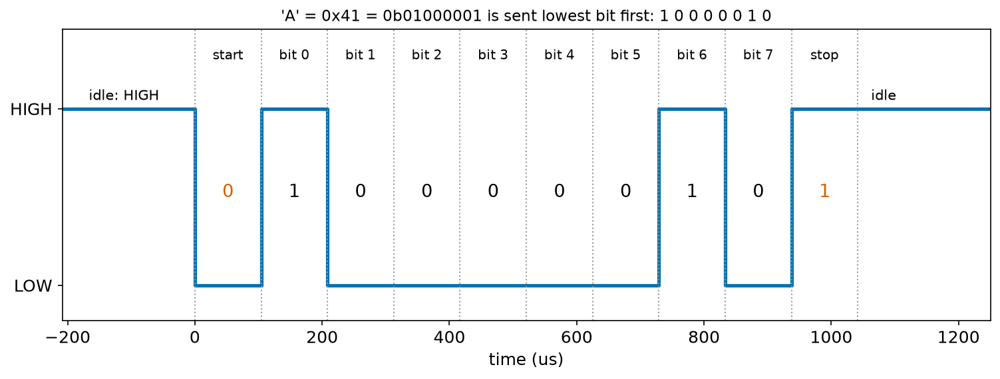
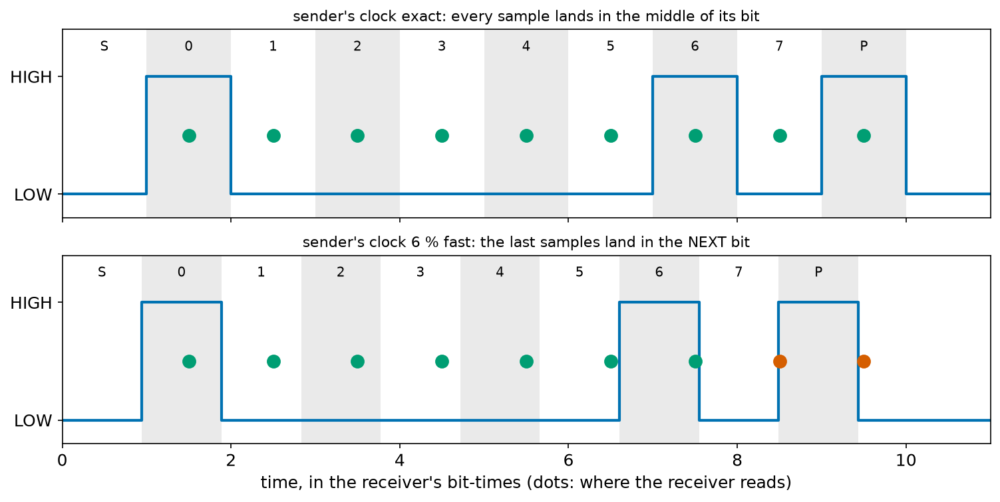
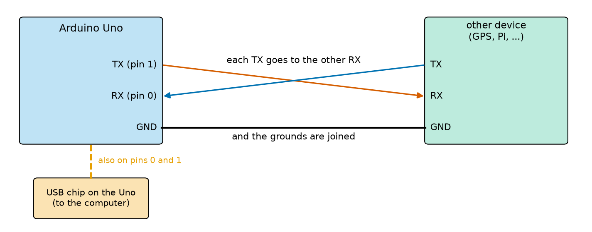
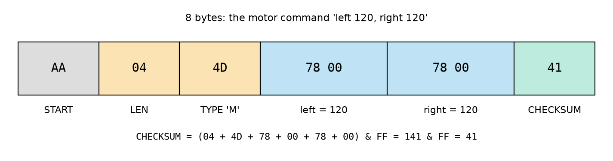
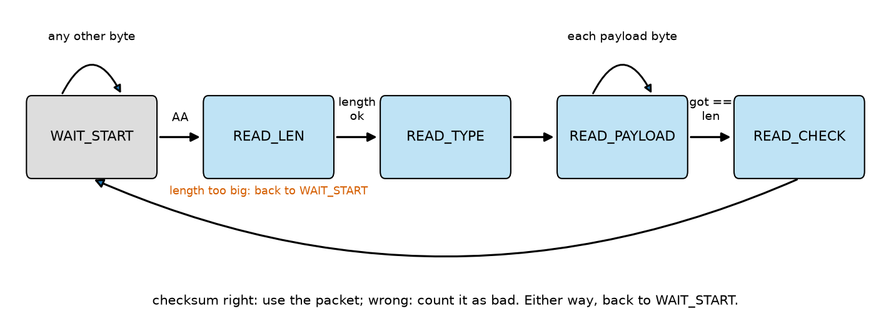
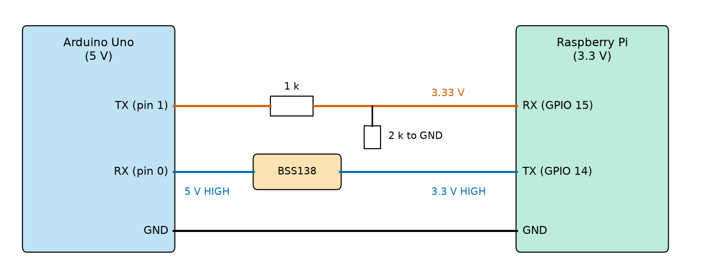

# Chapter 107 — Communication part 1: UART

> **Part 6 · Chapter 107 of 749**
> **You need:** Chapter 91 (logic levels and level shifting between 5 V and 3.3 V), Chapter 95 (Example 6: 10 bits per character), Chapter 96 (bytes, `int16_t`, hexadecimal), Chapter 100 (the serial monitor, buffers, baud rate), Chapter 104 (state machines) and Chapter 106 (bit operators).
> **You will make:** a bit-by-bit picture of one character on the wire, a model of what a receiver sees when the two clocks disagree, a table of the baud rates a 16 MHz Uno can make exactly, a GPS sentence checker, and Rover's Arduino side of a binary link with the Raspberry Pi: packets, checksums, a state-machine receiver and a failsafe.

---

## What you will learn

- What **UART** serial communication is, and what one character looks like on the wire: **start bit**, data bits (lowest first), **stop bit**.
- How the **baud rate** sets the time of each bit, and why both ends must agree to within a few percent.
- How to wire two UART devices: **TX to RX**, RX to TX, and a common ground; and why pins 0 and 1 are shared with USB.
- Why a 5 V Uno and a 3.3 V Raspberry Pi need level shifting on the wires between them.
- How to send numbers as **binary packets** with a **checksum**, and receive them reliably with a state machine.
- Why a robot needs a **failsafe** when the messages stop.

---

## New words in this chapter

| Word | Simple meaning |
|---|---|
| **UART** | Universal Asynchronous Receiver-Transmitter: the hardware that sends and receives serial characters. |
| **asynchronous** | Without a shared clock wire: each side keeps time with its own clock. |
| **start bit / stop bit** | The LOW bit that marks the start of a character, and the HIGH bit that ends it. |
| **frame** | One character on the wire: start bit, data bits, stop bit. |
| **framing error** | The receiver finds LOW where the stop bit should be HIGH: the character is damaged. |
| **packet** | A group of bytes with a fixed shape: a start marker, a length, the data and a check. |
| **checksum** | A number worked out from a packet's bytes and sent with it, so the receiver can spot damage. |
| **failsafe** | What a machine does automatically when something fails, such as stopping when commands stop arriving. |

---

## 107.1 One wire, one bit at a time

Since Chapter 100 you have sent text between the Uno and the computer with `Serial.print` and `Serial.read`. Underneath, each character travels as a pattern of HIGH and LOW on a single wire. The part of the chip that makes the pattern, and reads it at the other end, is the **UART**.

📖 **New word: UART** — **U**niversal **A**synchronous **R**eceiver-**T**ransmitter: the hardware that turns a byte into a timed series of bits on a wire (the transmitter, **TX**) and turns the bits on another wire back into a byte (the receiver, **RX**). The Uno's ATmega328P has one; the Raspberry Pi has several; nearly every microcontroller, GPS module and radio has at least one.

📖 **New word: asynchronous** — "not together in time". There is no clock wire: the receiver does not get a tick telling it when each bit starts. Both sides simply agree beforehand how long a bit lasts (the **baud rate**), and each keeps time with its own clock.

The line **rests HIGH** when nothing is being sent. To send a character, the transmitter makes a **frame**:

1. the **start bit**: LOW for one bit-time. This falling edge tells the receiver "a character starts now";
2. the 8 **data bits**, lowest bit first;
3. the **stop bit**: HIGH for one bit-time, which also leaves the line resting HIGH, ready for the next start bit.

📖 **New word: start bit / stop bit** — the LOW bit that begins every frame and the HIGH bit that ends it. They carry no data; they let the receiver find where each character begins.

📖 **New word: frame** — one character on the wire: 1 start bit + 8 data bits + 1 stop bit = **10 bits**. This is the "8N1" setting you will see on serial tools: 8 data bits, No parity bit, 1 stop bit. It is why Chapter 95's Example 6 counted 10 bits per character.

The program `uart_frame.py` lists the frame for the letter `A` (code 65 = 0x41 = `0b01000001`):

```
'A' = 0x41 = 0b01000001, sent at 9600 baud: each bit lasts 104.2 us
   start: 0 LOW  from    0.0 to  104.2 us
   bit 0: 1 HIGH from  104.2 to  208.3 us
   bit 1: 0 LOW  from  208.3 to  312.5 us
   bit 2: 0 LOW  from  312.5 to  416.7 us
   bit 3: 0 LOW  from  416.7 to  520.8 us
   bit 4: 0 LOW  from  520.8 to  625.0 us
   bit 5: 0 LOW  from  625.0 to  729.2 us
   bit 6: 1 HIGH from  729.2 to  833.3 us
   bit 7: 0 LOW  from  833.3 to  937.5 us
    stop: 1 HIGH from  937.5 to 1041.7 us
at   9600 baud: one character takes  1041.7 us; at most   960 characters per second
at 115200 baud: one character takes    86.8 us; at most 11520 characters per second
```



*Figure 107.1 — The letter 'A' on the TX wire at 9600 baud.*

**How to read this picture:** Time runs left to right. The line rests HIGH. The fall at 0 µs is the start bit (red 0). Then come the data bits, each 104 µs wide, **lowest bit first**: bit 0 is 1, bits 1 to 5 are 0, bit 6 is 1, bit 7 is 0. Read right to left, bit 7 to bit 0, they make `01000001` = 0x41. The stop bit (red 1) is HIGH, and the line stays HIGH until the next start bit.

🔢 **Baud rate.** "Baud" counts symbols per second; for a UART each symbol is one bit, so 9600 baud is 9,600 bits per second, and a bit lasts 1 ÷ 9,600 = 104.2 µs. At 115,200 baud a bit lasts 8.68 µs, and a whole character 86.8 µs. Since each character takes 10 bits, the most characters per second is the baud rate ÷ 10.

---

## 107.2 Two clocks that must agree

The receiver waits for the start bit's falling edge. Then, using its own clock, it reads the line in the **middle** of each bit: at 1.5 bit-times after the edge for bit 0, 2.5 for bit 1, and so on, up to 9.5 for the stop bit. Reading in the middle gives the most room for error.

But the two clocks are never perfectly equal. If the sender's bits are a little shorter than the receiver expects, each reading lands a little later in the sender's stream, and the error adds up over the frame. The program `uart_decode.py` sends "AB" back to back from a sender whose clock is off by a few percent, and decodes the first byte:

```
sender's clock   first byte read   stop bit
    +0 %         0x41 (right)      OK
    +2 %         0x41 (right)      OK
    +4 %         0x41 (right)      OK
    +5 %         0x41 (right)      OK
    +6 %         0xC1 (WRONG)      missing: framing error
    -4 %         0x41 (right)      OK
    -6 %         0xC1 (WRONG)      missing: framing error
```



*Figure 107.2 — The receiver's reading moments (dots) on the sender's bits, with exact clocks (top) and with the sender 6% fast (bottom).*

**How to read this picture:** The shaded bands are the sender's bits: S (start), 0 to 7, P (stop). The dots are where the receiver reads, 1.5, 2.5 … 9.5 of its own bit-times after the start edge. On top, every dot sits in the middle of its band (green). Below, the sender's bands are 6% narrower, so the dots drift right; the last two (red) land one band too far. The reading for "bit 7" really reads the stop bit (a 1: so 0x41 becomes 0xC1), and the reading for "stop" lands on the next character's start bit (a 0: a framing error).

📖 **New word: framing error** — the receiver reads LOW where the stop bit should be. The UART flags it; the character is wrong.

The last reading, at 9.5 bit-times, must stay inside the right bit: the clocks can differ by up to about 0.5 ÷ 9.5 = 5% in total. Real UARTs leave less room than this model (they read each bit three times near the middle and need the start edge to be found precisely), so the practical rule is: **keep the total difference under about 2%**.

Where do clock differences come from? Partly from the clocks themselves (a crystal is accurate to 0.01%; the Pi's and the PC's are fine). But mostly from **division**. The Uno's UART makes its bit time by dividing its 16 MHz clock by a whole number, so most baud rates come out slightly wrong. `baud_error.py` works them out (the Arduino software uses the "double speed" mode, which divides by 8 instead of 16 and usually comes closer):

```
    baud |    normal: UBRR, real, error |  double speed: UBRR, real, error
    9600 |  103,      9615,  +0.2 %   |  207,      9615,  +0.2 %
   19200 |   51,     19231,  +0.2 %   |  103,     19231,  +0.2 %
   57600 |   16,     58824,  +2.1 %   |   34,     57143,  -0.8 %
  115200 |    8,    111111,  -3.5 %   |   16,    117647,  +2.1 %
  250000 |    3,    250000,  +0.0 %   |    7,    250000,  +0.0 %
  500000 |    1,    500000,  +0.0 %   |    3,    500000,  +0.0 %
 1000000 |    0,   1000000,  +0.0 %   |    1,   1000000,  +0.0 %
```

So the popular 115,200 baud is really 117,647 on a 16 MHz Uno: 2.1% fast. Talking to a PC or a Pi with an exact clock, that uses all of the 2% budget, and it usually works, but with no margin left. Rates that divide 16 MHz exactly (250,000, 500,000, 1,000,000) have no error at all, which is why 3D printers and many robot boards use 250,000. Chapter 532 goes deeper: how the UART reads each bit, parity bits, and long-distance versions such as RS-485.

🧠 **A UART link needs: the same baud rate, the same frame format (8N1), and clocks within about 2% of each other.**

---

## 107.3 Wiring: cross over, and share ground

A UART link has two wires for data, one for each direction, plus ground:



*Figure 107.3 — Each TX goes to the other side's RX, and the grounds are joined. The Uno's USB chip also uses pins 0 and 1.*

**How to read this picture:** The red wire carries the Uno's transmissions from its TX (pin 1) to the other device's RX. The blue wire carries the other device's transmissions to the Uno's RX (pin 0). The wires cross: **TX always goes to RX**. The black ground wire gives both sides the same 0 V reference (Chapter 74): without it "HIGH" and "LOW" mean nothing. At the bottom, in orange: the Uno's USB chip (the one that talks to your computer) is also connected to pins 0 and 1.

Two consequences of that last point:

1. **Something connected to pin 0 can block uploads.** The computer uploads new sketches through the same RX pin. If another device is driving pin 0 at the same time, the upload fails. Unplug its TX wire while uploading.
2. **The Serial Monitor and the other device share one port.** Whatever the sketch prints goes both to the computer and to the device on pin 1. That is fine for debugging a link (you see what is sent), but a sketch cannot talk to the computer and to a GPS separately on the one hardware UART.

When a sketch needs a second serial port, there are two choices. The **SoftwareSerial** library makes a UART in software on any two pins; it works up to about 38,400 baud, but it cannot send and receive at the same time, and it pauses interrupts while it sends each character (Chapter 105), which can upset other timing. The better choice is a board with more hardware UARTs: the Arduino Mega has four, the ESP32 three. Chapter 110 looks inside SoftwareSerial as an example of a library.

⚠️ **Careful: TX to TX does nothing.** Two outputs connected together just fight; neither side receives anything. If a link is silent, swap the two data wires first.

---

## 107.4 Bytes, not text: packets

`Serial.print(120)` sends three characters, `'1'`, `'2'`, `'0'`, and the receiver must turn them back into a number, as Chapter 100's command parser did. Text is easy to read and debug. But for a robot sending many numbers many times per second, **binary** is smaller and faster: the number 120 fits in one byte, and an `int16_t` in two, whatever its value (Chapter 96).

Binary raises three new questions, which text answered with spaces and newlines:

- **Where does a message start?** If the receiver starts listening in the middle of a message, or one byte is lost, it must find the start again.
- **How long is it?** Different messages carry different amounts of data.
- **Did it arrive undamaged?** A motor's electrical noise can flip a bit. A flipped bit in a motor command could send Rover the wrong way.

📖 **New word: packet** — a group of bytes with a fixed shape that answers those three questions. Rover's link uses:

| Byte | Name | Meaning |
|---|---|---|
| 1 | START | always `0xAA` (`10101010`): "a packet begins here" |
| 2 | LEN | how many data bytes follow the type |
| 3 | TYPE | what the packet is: `'M'` for a motor command, `'S'` for a status reply |
| 4 … | payload | LEN data bytes |
| last | CHECKSUM | (LEN + TYPE + all the payload bytes), keeping only the low 8 bits |

📖 **New word: checksum** — a number worked out from the packet's bytes by the sender, and sent with them. The receiver does the same sum on what it received. If the two disagree, something was damaged on the way, and the packet is thrown away.



*Figure 107.4 — The 8 bytes of the command "left 120, right 120", in hexadecimal.*

**How to read this picture:** Left to right as they are sent. `AA` marks the start. `04`: four data bytes follow the type. `4D` is the letter `M`. Then each `int16_t` as two bytes, **low byte first**: 120 is 0x0078, so `78 00`. The last byte, `41`, is the checksum: 0x04 + 0x4D + 0x78 + 0x78 = 0x141, and keeping the low 8 bits (`& 0xFF`, Chapter 106) gives 0x41.

`make_packet.py` builds packets the way Rover's Raspberry Pi will (Chapter 111 sends them for real):

```
M  120  120  ->  AA 04 4D 78 00 78 00 41   checksum right: True
M  200  -80  ->  AA 04 4D C8 00 B0 FF C8   checksum right: True
M   50   50  ->  AA 04 4D 32 00 32 00 B5   checksum right: True
one bit flipped: AA 04 4D 36 00 32 00 B5   checksum right: False
```

Note −80: as a 16-bit two's complement number it is 0xFFB0 (Chapter 96), sent as `B0 FF`. And in the last line, one flipped bit (0x32 → 0x36, so 50 would have become 54) changes the sum, and the checksum no longer matches: the packet is caught.

A simple sum like this catches every single flipped bit, and most other damage. It can miss some combinations (two errors that cancel out, or two bytes swapped). More serious links use a **CRC** (cyclic redundancy check), a cleverer calculation that catches nearly everything; CAN bus has one built into the hardware (Chapter 538).

### Receiving: a state machine

The receiver gets one byte at a time, whenever they arrive, and must not wait for a whole packet (Chapter 103: never block the loop). So it remembers **where it is in the packet** between bytes: a state machine, exactly as in Chapter 104.



*Figure 107.5 — Five states, one step per byte received.*

**How to read this picture:** Start at WAIT_START (grey). Any byte other than `AA` is ignored: the self-loop. `AA` moves to READ_LEN; a sensible length moves to READ_TYPE; then READ_PAYLOAD collects one byte per arrival until it has LEN of them; READ_CHECK compares the last byte with the sum. Whatever the result, the big arrow returns to WAIT_START for the next packet. If the "length" is impossible (more than the payload buffer holds), the `AA` was not a real start (perhaps a data byte that happened to be 0xAA), and the receiver goes straight back to looking.

This is how the receiver **resynchronises**: after junk or a damaged packet, it simply skips bytes until it finds the next `AA`, and the checksum rejects any false start that slips through.

---

## Code

Outputs of the sketch come from the PC test bench, which plays the Raspberry Pi: it sends bytes to the sketch at the real speed of 115,200 baud, and decodes every byte the sketch sends back.

File `code/ch107/uart_frame.py`:

```python
# uart_frame.py - the bits a UART sends for one character, and when they are sent
def frame(byte):
    bits = [0]                                    # the start bit: always 0 (LOW)
    bits += [(byte >> k) & 1 for k in range(8)]   # 8 data bits, lowest bit FIRST
    bits += [1]                                   # the stop bit: always 1 (HIGH)
    return bits


BAUD = 9600
t_bit = 1e6 / BAUD                                # microseconds per bit
names = ["start"] + [f"bit {k}" for k in range(8)] + ["stop"]
print(f"'A' = 0x41 = 0b01000001, sent at {BAUD} baud: each bit lasts {t_bit:.1f} us")
for k, (name, b) in enumerate(zip(names, frame(ord("A")))):
    level = "HIGH" if b else "LOW"
    print(f"  {name:>6s}: {b} {level:4s} from {k * t_bit:6.1f} to {(k + 1) * t_bit:6.1f} us")
for baud in (9600, 115200):
    char_us = 10 * 1e6 / baud
    print(f"at {baud:6d} baud: one character takes {char_us:7.1f} us; at most {baud // 10:5d} characters per second")
```

| Line | Code | What it does (simple English) |
|---|---|---|
| 1 | comment | |
| 2 | `def frame(byte):` | Make the list of 10 bits for one byte. |
| 3 | `bits = [0]` | The start bit. |
| 4 | `bits += [(byte >> k) & 1 for k in range(8)]` | Bit k of the byte: shift it to the right end (`>> k`), keep only that bit (`& 1`). k goes 0 to 7: lowest bit first. |
| 5–6 | `bits += [1]`, `return bits` | The stop bit. |
| 7–8 | (blank) | |
| 9–11 | `BAUD = 9600`, `t_bit = 1e6 / BAUD`, `names = …` | Bit time in µs; a name for each of the 10 bits. |
| 12 | `print(…)` | The heading. |
| 13 | `for k, (name, b) in enumerate(zip(names, frame(ord("A")))):` | `ord("A")` is 65. `zip` pairs each name with its bit; `enumerate` numbers them (Chapter 21). |
| 14–15 | `level = …`, `print(…)` | One row: name, bit, level, start and end times. |
| 16–18 | `for baud in (9600, 115200): …` | Time per character and characters per second at two speeds. `//` divides and drops the remainder. |

File `code/ch107/uart_decode.py`:

```python
# uart_decode.py - a receiver reads each bit in its middle, timed by ITS OWN clock.
# What happens when the sender's clock is a few percent fast or slow?
def frame(byte):
    return [0] + [(byte >> k) & 1 for k in range(8)] + [1]


def sender(text, error):
    """The line level at time t (in the receiver's bit-times), for a sender whose clock is off by error."""
    bits = []
    for ch in text:
        bits += frame(ord(ch))                    # characters sent back to back, with no gap
    def line(t):
        k = int(t * (1 + error))                  # which of the sender's bits is on the line at time t
        return bits[k] if k < len(bits) else 1    # after the last stop bit the line rests HIGH
    return line


def receive_first(line):
    # the start bit's falling edge is at t = 0: data bit k is read at k + 1.5, the stop bit at 9.5
    value = 0
    for k in range(8):
        value |= line(k + 1.5) << k
    return value, line(9.5) == 1


print("sender's clock   first byte read   stop bit")
for error in [0.0, 0.02, 0.04, 0.05, 0.06, -0.04, -0.06]:
    value, stop_ok = receive_first(sender("AB", error))
    verdict = "right" if value == ord("A") else "WRONG"
    print(f"{error * 100:+6.0f} %         0x{value:02X} ({verdict})      {'OK' if stop_ok else 'missing: framing error'}")
```

| Line | Code | What it does (simple English) |
|---|---|---|
| 1–2 | comments | |
| 3–4 | `def frame(byte): …` | The same 10 bits as before, in one line. |
| 5–6 | (blank) | |
| 7 | `def sender(text, error):` | Build a pretend wire for a sender whose clock is off by `error` (0.06 = 6% fast). |
| 8 | `"""…"""` | A docstring (Chapter 23). |
| 9–11 | `bits = []`, `for ch in text: bits += frame(ord(ch))` | All the frames, one after another. |
| 12 | `def line(t):` | A function defined **inside** another function. New here: it can still use `bits` and `error` after `sender` has finished, so each wire it returns remembers its own bits and its own clock error. |
| 13 | `k = int(t * (1 + error))` | A fast sender has packed more of its bits into the same time: bit number = time × (1 + error). |
| 14 | `return bits[k] if k < len(bits) else 1` | The level then; HIGH after the end. |
| 15 | `return line` | Give back the wire. |
| 16–17 | (blank) | |
| 18 | `def receive_first(line):` | The receiver, decoding one byte. |
| 19–22 | `value = 0`, `for k in range(8): value \|= line(k + 1.5) << k` | Read bit k in the middle of where it should be, and put it into place k with `<<` and `\|=` (Chapter 106). |
| 23 | `return value, line(9.5) == 1` | The byte, and whether the stop bit was HIGH. |
| 24–25 | (blank) | |
| 26–30 | `print(…)`, `for error in […]: …` | One row per clock error. |

File `code/ch107/baud_error.py`:

```python
# baud_error.py - which baud rates can a 16 MHz Uno make exactly?
# The UART divides the clock by 16 x (UBRR + 1), or by 8 x (UBRR + 1) in "double speed" mode (U2X),
# and UBRR must be a whole number, so most baud rates come out slightly wrong.
CLOCK = 16_000_000


def actual(baud, divider):
    ubrr = round(CLOCK / (divider * baud)) - 1
    real = CLOCK / (divider * (ubrr + 1))
    return ubrr, real, (real - baud) / baud * 100


print(f"{'baud':>8s} | {'normal: UBRR, real, error':>28s} | {'double speed: UBRR, real, error':>32s}")
for baud in [9600, 19200, 57600, 115200, 250000, 500000, 1000000]:
    n = actual(baud, 16)
    d = actual(baud, 8)
    print(f"{baud:8d} | {n[0]:4d}, {n[1]:9.0f}, {n[2]:+5.1f} %   | {d[0]:4d}, {d[1]:9.0f}, {d[2]:+5.1f} %")
```

| Line | Code | What it does (simple English) |
|---|---|---|
| 1–3 | comments | UBRR is the UART's divider register, like a timer's TOP (Chapter 106). |
| 4 | `CLOCK = 16_000_000` | |
| 5–6 | (blank) | |
| 7 | `def actual(baud, divider):` | |
| 8 | `ubrr = round(CLOCK / (divider * baud)) - 1` | The nearest whole-number setting. |
| 9 | `real = CLOCK / (divider * (ubrr + 1))` | The baud rate it really gives. |
| 10 | `return ubrr, real, (real - baud) / baud * 100` | And the error in percent. |
| 11–12 | (blank) | |
| 13–17 | `print(…)`, `for baud in […]: …` | One row per baud rate, both modes. |

File `code/ch107/make_packet.py`:

```python
# make_packet.py - build and check Rover's link packets, as the Raspberry Pi side does (Chapter 111 sends them)
# packet: START (0xAA), LEN, TYPE, LEN payload bytes, CHECKSUM = (LEN + TYPE + payload) & 0xFF
START = 0xAA


def packet(ptype, payload):
    body = [len(payload), ptype] + list(payload)
    return bytes([START] + body + [sum(body) & 0xFF])


def int16_bytes(v):
    v &= 0xFFFF                                   # two's complement, 16 bits (Chapter 96)
    return [v & 0xFF, v >> 8]                     # low byte first: the order the Uno uses


def motor(left, right):
    return packet(ord("M"), int16_bytes(left) + int16_bytes(right))


def check(p):
    """True if p is a complete packet whose checksum is right."""
    if len(p) < 4 or p[0] != START or len(p) != p[1] + 4:
        return False
    return sum(p[1:-1]) & 0xFF == p[-1]


for left, right in [(120, 120), (200, -80)]:
    p = motor(left, right)
    print(f"M {left:4d} {right:4d}  ->  {p.hex(' ').upper()}   checksum right: {check(p)}")
bad = bytearray(motor(50, 50))
print(f"M   50   50  ->  {bytes(bad).hex(' ').upper()}   checksum right: {check(bad)}")
bad[3] ^= 0b00000100                              # noise flips one bit of the payload
print(f"one bit flipped: {bytes(bad).hex(' ').upper()}   checksum right: {check(bad)}")
```

| Line | Code | What it does (simple English) |
|---|---|---|
| 1–3 | comments, `START = 0xAA` | |
| 4–5 | (blank) | |
| 6–8 | `def packet(ptype, payload): body = …; return bytes(…)` | LEN, TYPE and payload; then START in front and the checksum behind. `bytes(…)` turns a list of numbers 0–255 into Python's type for raw bytes. |
| 9–10 | (blank) | |
| 11–13 | `def int16_bytes(v): v &= 0xFFFF; return [v & 0xFF, v >> 8]` | `& 0xFFFF` turns −80 into its 16-bit pattern 0xFFB0 (65,456). Then the low byte, then the high byte. |
| 14–15 | (blank) | |
| 16–17 | `def motor(left, right): …` | A motor packet: type `M`, four payload bytes. |
| 18–19 | (blank) | |
| 20–24 | `def check(p): …` | The right start byte, the right total length (LEN + 4 bytes of framing), and the sum of everything between START and the checksum must match the checksum. `p[1:-1]` is a slice (Chapter 21): from the second byte to just before the last. |
| 25–26 | (blank) | |
| 27–29 | `for left, right in […]: …` | Build two packets and print them in hex. `p.hex(' ')` writes each byte as two hex digits with spaces. |
| 30–31 | `bad = bytearray(motor(50, 50))`, `print(…)` | A `bytearray` is like `bytes` but can be changed. |
| 32–33 | `bad[3] ^= 0b00000100`, `print(…)` | Flip bit 2 of the first payload byte with XOR (Chapter 106), and check again. |

---

## Small examples

**Example 1.** At 9600 baud, 50 characters take 50 × 10 ÷ 9,600 = 52 ms.

**Example 2.** The byte 0x55 = `01010101` is sent as start 0, then 1 0 1 0 1 0 1 0, then stop 1: a perfect square wave, handy for measuring the baud rate with an oscilloscope.

**Example 3.** At 250,000 baud a bit lasts exactly 4 µs, and the Uno's error is 0%.

**Example 4.** The `int16_t` −1 is 0xFFFF and is sent as `FF FF`; 256 is 0x0100, sent as `00 01`.

**Example 5.** Checksum of a packet with LEN 2, TYPE 0x50, payload 0x10 0x20: 0x02 + 0x50 + 0x10 + 0x20 = 0x82.

**Example 6.** A 20-byte packet at 115,200 baud takes 20 × 86.8 µs = 1.7 ms to arrive.

**Example 7.** Sending "1500" as text takes 4 bytes; as an `int16_t`, 2 bytes.

**Example 8.** A GPS sending 5 sentences of 70 characters every second at 9600 baud uses 350 ÷ 960 = 36% of the link.

---

## 🏭 Real robot applications

### Application 1 (worked in full) — 🤖 Rover's Arduino–Raspberry Pi link

**1. The real problem.** From stage 7 on, Rover has two computers (Chapter 5): the Raspberry Pi does the thinking (camera, maps, planning) and the Arduino does the real-time work (encoders, motor PWM, bumpers). The Pi must tell the Arduino how fast to drive each wheel, many times per second, and the Arduino must answer with what it is doing. The link must survive electrical noise from the motors, must recover from junk (such as the bytes a Pi prints while booting), and must stop Rover safely if the Pi crashes or the cable comes loose.

**2. Why this theory.** A UART (section 107.1) at 115,200 baud. Binary packets with a start byte, a length and a checksum (section 107.4) carry two `int16_t` speeds compactly. A state-machine receiver (Chapter 104) handles one byte at a time without blocking. And a **failsafe** covers the case where packets stop.

📖 **New word: failsafe** — what a machine does automatically when something fails, chosen so that the failure is safe. For a robot whose commands stop arriving, the safe thing is to stop the motors.

**3. The numbers.** A motor packet is 8 bytes: 8 × 86.8 µs = 0.69 ms on the wire. The Pi sends one every 50 ms in normal driving (20 per second, using 1.4% of the link). The failsafe time is 500 ms: ten missed packets in a row, long enough to ignore a single lost packet, short enough that Rover at 0.5 m/s travels at most 25 cm before stopping. Wiring, from Chapter 91: Uno TX → 1 kΩ/2 kΩ divider → Pi RX (3.33 V); Pi TX → BSS138 shifter → Uno RX (a full 5 V HIGH); grounds joined.



*Figure 107.6 — The two data wires with their level shifting (Chapter 91), and the ground.*

**How to read this picture:** Red: the Uno's 5 V TX goes through the 1 kΩ resistor, and the 2 kΩ resistor to ground makes it 3.33 V at the Pi's RX (GPIO 15), safely below the Pi's 3.6 V limit. Blue: the Pi's 3.3 V TX (GPIO 14) goes through one channel of a BSS138 board, which gives the Uno a full 5 V HIGH. Black: the common ground.

**4. The maths.** The test plays the Pi: two good commands, one with a flipped bit (its checksum must fail, so no reply), some junk followed by a good command (the receiver must resynchronise), and then silence. Expected: replies at about 100.7, 300.7 and 701 ms (after each good packet has fully arrived: 8 bytes = 0.69 ms, plus 5 junk bytes = 0.43 ms more for the last); the bad counter at 1; and a failsafe stop 500 ms after the last good packet, at about 1,201 ms.

**5. The code.** File `code/ch107/rover_link/rover_link.ino`:

```cpp
// rover_link.ino - Rover's Arduino side of its link with the Raspberry Pi: binary packets with a checksum
// packet: START (0xAA), LEN, TYPE, LEN payload bytes, CHECKSUM = (LEN + TYPE + payload bytes) & 0xFF
const byte START = 0xAA;
const byte TYPE_MOTOR = 'M';           // Pi -> Arduino: int16 left, int16 right (-255 to 255)
const byte TYPE_STATUS = 'S';          // Arduino -> Pi: int16 left, int16 right, good count, bad count
const unsigned long FAILSAFE_MS = 500; // no good command for this long: stop the motors

enum State { WAIT_START, READ_LEN, READ_TYPE, READ_PAYLOAD, READ_CHECK };
State state = WAIT_START;
byte len = 0;
byte type = 0;
byte got = 0;                          // payload bytes received so far
byte sum = 0;                          // checksum worked out so far
byte payload[16];

int16_t leftCmd = 0;
int16_t rightCmd = 0;
byte goodCount = 0;
byte badCount = 0;
unsigned long lastGood = 0;
bool stopped = true;

void sendStatus() {
  byte p[6];
  p[0] = leftCmd & 0xFF;               // low byte first
  p[1] = (leftCmd >> 8) & 0xFF;
  p[2] = rightCmd & 0xFF;
  p[3] = (rightCmd >> 8) & 0xFF;
  p[4] = goodCount;
  p[5] = badCount;
  byte check = 6 + TYPE_STATUS;
  for (int i = 0; i < 6; i++) {
    check += p[i];                     // a byte keeps only the low 8 bits: the "& 0xFF" happens by itself
  }
  Serial.write(START);
  Serial.write(6);
  Serial.write(TYPE_STATUS);
  Serial.write(p, 6);
  Serial.write(check);
}

void handlePacket() {
  if (type == TYPE_MOTOR && len == 4) {
    leftCmd = payload[0] | (payload[1] << 8);
    rightCmd = payload[2] | (payload[3] << 8);
    goodCount++;
    lastGood = millis();
    stopped = false;
    // setMotors(leftCmd, rightCmd);   the motor driver comes in Chapter 141
    sendStatus();
  } else {
    badCount++;                        // a type we do not know, or the wrong length
  }
}

void readLink() {                      // a state machine (Chapter 104), fed one byte at a time
  while (Serial.available() > 0) {
    byte b = Serial.read();
    switch (state) {
      case WAIT_START:
        if (b == START) state = READ_LEN;
        break;
      case READ_LEN:
        if (b > sizeof(payload)) {     // impossible length: this was not a real start byte
          badCount++;
          state = WAIT_START;
        } else {
          len = b;
          sum = b;
          state = READ_TYPE;
        }
        break;
      case READ_TYPE:
        type = b;
        sum += b;
        got = 0;
        state = (len > 0) ? READ_PAYLOAD : READ_CHECK;
        break;
      case READ_PAYLOAD:
        payload[got] = b;
        got++;
        sum += b;
        if (got == len) state = READ_CHECK;
        break;
      case READ_CHECK:
        if (b == sum) {
          handlePacket();
        } else {
          badCount++;                  // damaged on the way: ignore the whole packet
        }
        state = WAIT_START;
        break;
    }
  }
}

void setup() {
  Serial.begin(115200);
}

void loop() {
  readLink();
  if (!stopped && millis() - lastGood >= FAILSAFE_MS) {   // the Pi has gone quiet: stop safely
    leftCmd = 0;
    rightCmd = 0;
    stopped = true;
    // setMotors(0, 0);
    sendStatus();
  }
}
```

| Line | Code | What it does (simple English) |
|---|---|---|
| 1–2 | comments | The packet format. |
| 3–6 | `START`, `TYPE_MOTOR`, `TYPE_STATUS`, `FAILSAFE_MS` | `'M'` is the character's code, 0x4D. |
| 7 | (blank) | |
| 8–9 | `enum State { … }; State state = WAIT_START;` | The five states of Figure 107.5 (Chapter 104). |
| 10–14 | `len`, `type`, `got`, `sum`, `payload[16]` | What the receiver has gathered so far. Room for up to 16 payload bytes. |
| 15 | (blank) | |
| 16–21 | `leftCmd`, `rightCmd`, `goodCount`, `badCount`, `lastGood`, `stopped` | The robot's state. `int16_t` is exactly 16 bits on every board (Chapter 96). |
| 22 | (blank) | |
| 23 | `void sendStatus() {` | Build and send an `S` packet. |
| 24–28 | `byte p[6]; p[0] = leftCmd & 0xFF; p[1] = (leftCmd >> 8) & 0xFF; …` | Split each `int16_t` into low byte (`& 0xFF`) and high byte (`>> 8`, Chapter 106). |
| 29–30 | `p[4] = goodCount; p[5] = badCount;` | Two counters, so the Pi can see the link's health. |
| 31–34 | `byte check = 6 + TYPE_STATUS; for (…) { check += p[i]; }` | The checksum. A `byte` holds only 8 bits, so it wraps past 255 by itself: the same as `& 0xFF`. |
| 35–39 | `Serial.write(START); … Serial.write(p, 6); Serial.write(check);` | `Serial.write` sends raw bytes, unlike `print`, which sends text. `write(p, 6)` sends 6 bytes from the array. |
| 40 | `}` | |
| 41 | (blank) | |
| 42–43 | `void handlePacket() { if (type == TYPE_MOTOR && len == 4) {` | Only a motor packet of the right length is used. |
| 44–45 | `leftCmd = payload[0] \| (payload[1] << 8); …` | Rebuild each number: the high byte shifted up 8 places, OR the low byte. Stored in an `int16_t`, 0xFFB0 becomes −80 again. |
| 46–50 | `goodCount++; lastGood = millis(); stopped = false; … sendStatus();` | Count it, note when it came (for the failsafe), drive, reply. |
| 51–54 | `} else { badCount++; } }` | |
| 55 | (blank) | |
| 56–58 | `void readLink() { while (Serial.available() > 0) { byte b = Serial.read();` | Handle every byte that has arrived, then return: `loop()` never waits. |
| 59–62 | `case WAIT_START: if (b == START) state = READ_LEN;` | Skip everything until `AA`. |
| 63–72 | `case READ_LEN: if (b > sizeof(payload)) { … } else { len = b; sum = b; state = READ_TYPE; }` | `sizeof(payload)` is 16. A longer "length" means a false start. The sum starts with LEN. |
| 73–78 | `case READ_TYPE: type = b; sum += b; got = 0; state = (len > 0) ? READ_PAYLOAD : READ_CHECK;` | `? :` picks one of two values (Chapter 97): a packet with no payload goes straight to the check. |
| 79–84 | `case READ_PAYLOAD: payload[got] = b; got++; sum += b; if (got == len) state = READ_CHECK;` | Collect payload bytes. |
| 85–92 | `case READ_CHECK: if (b == sum) { handlePacket(); } else { badCount++; } state = WAIT_START;` | Use the packet only if the checksum matches. |
| 93–95 | `}` `}` `}` | End of `switch`, `while`, function. |
| 96–99 | `void setup() { Serial.begin(115200); }` | |
| 100–102 | `void loop() { readLink();` | |
| 103 | `if (!stopped && millis() - lastGood >= FAILSAFE_MS) {` | Commands stopped coming? (Chapter 103's timing.) `stopped` makes this happen once, not on every pass. |
| 104–108 | `leftCmd = 0; rightCmd = 0; stopped = true; … sendStatus();` | Stop, and tell the Pi why the wheels stopped. |
| 109–110 | `}` `}` | |

Output (the test prints what it sends, and decodes the Arduino's replies):

```
[ 100.00 ms] Pi -> Arduino: M 120 120                  AA 04 4D 78 00 78 00 41
[ 100.75 ms] Arduino -> Pi: S left  120 right  120   good 1 bad 0   (checksum right)
[ 300.00 ms] Pi -> Arduino: M 200 -80                  AA 04 4D C8 00 B0 FF C8
[ 300.75 ms] Arduino -> Pi: S left  200 right  -80   good 2 bad 0   (checksum right)
[ 500.00 ms] Pi -> Arduino: M 50 50, one bit flipped   AA 04 4D 36 00 32 00 B5
[ 700.00 ms] Pi -> Arduino: junk, then M 60 60         68 65 6C 6C 6F AA 04 4D 3C 00 3C 00 C9
[ 701.18 ms] Arduino -> Pi: S left   60 right   60   good 3 bad 1   (checksum right)
[1201.05 ms] Arduino -> Pi: S left    0 right    0   good 3 bad 1   (checksum right)
```

**6. The result.** Every good command arrived intact, −80 included, and was answered 0.75 ms after it was sent. The damaged command was rejected (no reply at 500 ms; "bad 1" in the next reply): Rover never drove at the wrong speed. The five junk bytes ("hello") were skipped, and the packet after them was found. And when the Pi went quiet, the Arduino stopped the motors 500 ms after the last good command, and said so. The Pi side, with pyserial, comes in Chapter 111; it can send exactly these packets over the USB cable or over the two wires of Figure 107.6, because both end at the same UART.

**7. Going further.** Real links add a few things. A **sequence number** in each packet lets the receiver notice a lost packet. A **CRC** instead of a sum catches more kinds of damage. An **escape** scheme (or a format such as COBS) guarantees that the start byte never appears inside the data, so resynchronising is instant. And the receiver often answers every command with an acknowledgement, so the sender can repeat what was lost. ROS 2's micro-ROS (Chapter 578) does all of this for you over a UART, and Chapter 532 studies serial links in depth.

### Application 2 (worked in full) — 🚁 Reading a drone's GPS

**1. The real problem.** Almost every GPS module used on drones and outdoor robots (Chapter 130) talks over a UART, usually at 9600 baud. Once or several times per second it sends a set of text lines called **NMEA sentences**. A flight controller must pick out the position from them, and it must never act on a damaged sentence: a wrong digit in the latitude could move the drone's idea of its position by kilometres.

**2. Why this theory.** NMEA sentences are text packets (section 107.4): `$` marks the start, commas separate the fields, `*` and two hex digits give a checksum, and a newline ends the line. The checksum is the **XOR** (Chapter 106) of every character between `$` and `*`.

**3. The numbers.** A GGA sentence ("fix data") has the time, latitude, longitude, fix quality, number of satellites, and altitude. The example below is the standard example sentence found in NMEA references: time 12:35:19, latitude `4807.038,N`, longitude `01131.000,E`, 8 satellites, 545.4 m. Positions are written as degrees and minutes: `4807.038` is 48° 07.038′.

**4. The maths.** Decimal degrees = degrees + minutes ÷ 60: 48 + 7.038 ÷ 60 = 48.11730°, and 11 + 31.000 ÷ 60 = 11.51667°. XOR checksum: start at 0, XOR each character's code in turn. XOR is used because it is fast and every flipped bit in any character flips the same bit of the result.

**5. The code.** File `code/ch107/nmea.py` (run here on the PC; the same steps run on a flight controller or a Pi):

```python
# nmea.py - check and read a GPS module's NMEA sentences, the text a GPS sends over its UART at 9600 baud
# A sentence: $ ... * two hex digits. The digits are the XOR of every character between $ and *.
def checksum_ok(line):
    if not line.startswith("$") or "*" not in line:
        return False
    body, given = line[1:].split("*", 1)
    x = 0
    for ch in body:
        x ^= ord(ch)                              # XOR (Chapter 106): each bit flips when a character has a 1 there
    return f"{x:02X}" == given.strip().upper()


def degrees(value, hemisphere):
    """NMEA gives ddmm.mmmm (degrees and minutes); turn it into decimal degrees."""
    dot = value.index(".")
    d = float(value[:dot - 2])
    m = float(value[dot - 2:])
    sign = -1 if hemisphere in "SW" else 1
    return sign * (d + m / 60)


def read_gga(line):
    f = line.split("*")[0].split(",")
    return {"time": f[1], "lat": degrees(f[2], f[3]), "lon": degrees(f[4], f[5]),
            "fix": int(f[6]), "satellites": int(f[7]), "altitude_m": float(f[9])}


lines = [
    "$GPGGA,123519,4807.038,N,01131.000,E,1,08,0.9,545.4,M,46.9,M,,*47",
    "$GPGGA,123519,4807.038,N,01131.000,E,1,08,0.9,545.4,M,46.9,M,,*47".replace("4807", "4817"),
    "$GPGGA,123520,4807.0",                       # cut short: the rest was lost
]
for line in lines:
    if checksum_ok(line):
        g = read_gga(line)
        print(f"OK   {g['time']}: {g['lat']:.5f}, {g['lon']:.5f}, fix {g['fix']}, "
              f"{g['satellites']} satellites, {g['altitude_m']} m")
    else:
        print(f"BAD  ignored: {line[:40]}...")
```

| Line | Code | What it does (simple English) |
|---|---|---|
| 1–2 | comments | |
| 3–5 | `def checksum_ok(line): if not line.startswith("$") or "*" not in line: return False` | No start or no checksum: reject at once. |
| 6 | `body, given = line[1:].split("*", 1)` | Split into the part between `$` and `*`, and the two digits after it. |
| 7–9 | `x = 0; for ch in body: x ^= ord(ch)` | XOR every character's code. |
| 10 | `return f"{x:02X}" == given.strip().upper()` | Compare as two upper-case hex digits. `strip()` removes the line ending. |
| 11–12 | (blank) | |
| 13–19 | `def degrees(value, hemisphere): …` | The two digits before the dot and everything after are minutes; the rest are degrees. South and West are negative. |
| 20–21 | (blank) | |
| 22–25 | `def read_gga(line): f = …split(","); return {…}` | Split into fields and pick out the ones we need, into a dictionary (Chapter 22). Field 6 is the fix quality (0 = no fix), field 7 the satellites, field 9 the altitude. |
| 26–27 | (blank) | |
| 28–32 | `lines = [ … ]` | A good sentence; the same with one digit changed (as noise would); and one cut short. |
| 33–39 | `for line in lines: if checksum_ok(line): … else: …` | Use only sentences whose checksum is right. |

Output:

```
OK   123519: 48.11730, 11.51667, fix 1, 8 satellites, 545.4 m
BAD  ignored: $GPGGA,123519,4817.038,N,01131.000,E,1,0...
BAD  ignored: $GPGGA,123520,4807.0...
```

**6. The result.** The good sentence gave the position, 8 satellites and the altitude. The sentence with one wrong digit (which would have put the drone about 18 km further north: 10 minutes of latitude) was caught by its checksum and ignored, as was the sentence cut short. A flight controller simply waits for the next good one, a fraction of a second later.

**7. Going further.** Modern GPS modules can also send a binary protocol (u-blox's UBX) with packets very like Rover's: two start bytes, a class and ID, a length, the payload, and a two-byte checksum. They can run at 115,200 baud or faster and send 10 positions per second, which flight controllers prefer. Chapter 426 fuses GPS with the IMU and odometry.

### Application 3 — 🚁 Radio receivers: SBUS and CRSF

The radio receiver in a drone or RC plane passes the pilot's stick positions to the flight controller over a UART. Two common formats: **SBUS** sends 25-byte packets at 100,000 baud with 16 channels packed as 11-bit numbers, using an inverted signal (HIGH and LOW swapped) and 2 stop bits; **CRSF** sends packets with a length, a type and a CRC at 420,000 baud. Both include a failsafe flag, set by the receiver when it loses the radio link, and a flight controller that sees the flag (or simply stops getting packets) switches to its failsafe action: hover, land or return home (Chapter 640). The structure is Application 1's: start marker, length, data, check, and a timeout.

### Application 4 — 🏭 RS-485 and Modbus in factories

A plain UART signal (0 V and 5 V on one wire) works over a few metres at most: on a factory floor, motors and long cables add so much noise that bits flip. Industry uses **RS-485**: the same UART frames, but sent as the **difference** between two twisted wires, with a transceiver chip at each end. Noise affects both wires equally and cancels out, so links of over a kilometre work, and up to 32 devices can share one pair of wires. On top of RS-485, the **Modbus RTU** protocol, from 1979 and still everywhere, sends packets with a device address, a function code, data and a CRC: a temperature controller, a motor drive or a conveyor's counter all answer such packets (Chapter 543). An Arduino with a 1-euro RS-485 module can talk to industrial equipment.

### Application 5 — 🤖 Smart servos on one wire

Robot arms and walking robots often use **smart servos** (such as Dynamixel or the cheaper serial bus servos): each servo has its own microcontroller, an ID number, and a UART. All servos are daisy-chained on one data wire, used in both directions in turn (**half duplex**). The controller sends a packet "servo 5: go to position 2048", with a start marker, the ID, a length, an instruction, the data and a checksum (Dynamixel's first protocol even uses a sum, as Rover's link does), and servo 5 answers with its position, temperature and load. Twenty servos, one wire. Chapter 543 builds such a chain.

---

## 🔧 Hands-on lab

### Lab 107.1 — See the bits (Wokwi)

You need: Wokwi with an Uno and the **logic analyser** part.

1. Connect logic analyser channel D0 to the Uno's pin 1 (TX).
2. Upload a sketch with `Serial.begin(9600);` in `setup()` and `Serial.write('A'); delay(10);` in `loop()`.
3. Run for a second, stop, and open the recording. Zoom in on one character.

**What you should see:** The line resting HIGH, then a frame exactly like Figure 107.1: start bit, `1 0 0 0 0 0 1 0`, stop bit, each 104 µs wide. Change the baud rate to 115200 and each bit shrinks to 8.7 µs.

| If it does not work | Likely cause | Fix |
|---|---|---|
| The line is flat | Analyser on pin 0 (RX) | Pin 1 is TX |
| Bits look like `0 1 0 0 0 0 0 1` | Reading left to right as a normal number | The first data bit is bit 0: read them right to left |
| Several characters run together | The delay is too short | Use `delay(10)` to separate them |

**Challenge:** Send `0x55` and measure the baud rate from the square wave. Then send `'a'` (0x61) and predict the frame before looking.

### Lab 107.2 — Break the link on purpose (simulation)

Copy `rover_link.ino` and `pc_tests/test_rover_link.cpp`.

1. Run the test and check the output against Application 1.
2. In the test's `main()`, make the Pi send a good `M` packet every 400 ms up to 2 s (more calls to `pi_sends`), and run until 3 s. Does the failsafe ever trigger?
3. In the sketch, change `if (b == sum)` on line 86 to `if (true)`, so every packet is used, and run again.
4. Put it back. In the test, change the junk to `{'h', 0xAA, 200, 'l', 'o'}`: a false start byte followed by an impossible length.

**What you should see:** Step 2: no failsafe while packets come every 400 ms, then one, 500 ms after the last. Step 3: the damaged packet is used: Rover would have driven at 54 instead of 50, and in a worse case (a flipped bit in the high byte) at a speed hundreds off. Step 4: the receiver rejects the false start at READ_LEN and still finds the real packet; the reply at 701.18 ms says `good 3 bad 2`.

| If it does not work | Likely cause | Fix |
|---|---|---|
| No replies at all | `Serial.begin` baud different from what the test assumes | Keep 115200 |
| Replies show huge numbers | High and low bytes swapped | Low byte first on both sides |
| Failsafe repeats every pass | `stopped` not set to true | Line 106 |

**Challenge:** Add a third packet type, `'P'` (ping) with no payload: the Arduino answers with an `S` packet without changing the motors. Test it with LEN 0.

### Lab 107.3 — Arduino to Raspberry Pi (hardware)

You need: an Uno, a Raspberry Pi with its serial port enabled (`raspi-config` → Interface options → Serial port: no login shell, hardware enabled), a 1 kΩ and a 2 kΩ resistor, a BSS138 level-shifter board, jumper wires.

1. Wire as in Figure 107.6. Check the divider with a multimeter: with the Uno's TX resting HIGH, the Pi's RX pin should read about 3.3 V. **Never connect the Uno's TX directly to the Pi.**
2. Upload a sketch that prints `"hello from the Uno"` once per second at 115200 (disconnect the Pi's TX wire from pin 0 while uploading).
3. On the Pi, run `cat /dev/serial0` after setting the speed with `stty -F /dev/serial0 115200`.

**What you should see:** The message once per second on the Pi. If you see garbage, the baud rates differ. Chapter 111 replaces `cat` with a Python program that sends and receives Rover's packets.

| If it does not work | Likely cause | Fix |
|---|---|---|
| Nothing at all | TX to TX, or no common ground | Swap the data wires; connect GND |
| Upload fails | The Pi drives the Uno's RX | Unplug that wire while uploading |
| Garbage characters | Different baud rates, or the Pi's console still uses the port | Check `stty`; disable the serial login shell |

**Challenge:** Make the Uno echo back every byte it receives, and type into `screen /dev/serial0 115200` on the Pi.

---

## Common mistakes

⚠️ **TX to TX.** The data wires must cross: TX to RX.

⚠️ **No common ground.** Without it the link may work on the bench and fail on the robot.

⚠️ **A 5 V TX straight into a 3.3 V RX.** It can damage the Pi (Chapter 91). Use a divider or a shifter.

⚠️ **Different baud rates at the two ends.** The result is garbage, not an error message.

⚠️ **A device on pins 0 and 1 while uploading.** The upload fails, or the device receives the new program as junk.

⚠️ **`print` where `write` was meant.** `Serial.print(120)` sends three characters; `Serial.write(120)` sends one byte with the value 120.

⚠️ **Mixing up the byte order.** Both ends must agree: low byte first (as here) or high byte first.

⚠️ **No checksum and no failsafe.** Noise and lost links happen on every robot eventually.

⚠️ **Waiting for a whole packet with a blocking read.** The loop stops; use a state machine fed one byte at a time.

---

## Practice

🏋️ **1.** What are the 10 bits of the frame for the byte 0x35 (`00110101`), in the order they are sent?

🏋️ **2.** How long does one bit last at 57,600 baud? How many characters per second can be sent at most?

🏋️ **3.** Why does the line rest HIGH between characters, and how does the receiver know a character is starting?

🏋️ **4.** A sender's clock is 3% fast and the receiver's 2% slow. Is the link likely to work? Why?

🏋️ **5.** Why do some robot boards use 250,000 baud rather than 115,200?

🏋️ **6.** List the three wires needed between two UART devices, and say where each goes.

🏋️ **7.** Write the bytes of Rover's motor packet for left = 300, right = −1.

🏋️ **8.** A received packet is `AA 04 4D 78 00 78 00 40`. What does the receiver do with it, and why?

🏋️ **9.** Rover drives at 0.5 m/s and the failsafe time is 500 ms. How far can it go after its last command? What failsafe time would limit this to 10 cm?

🏋️ **10.** Name one advantage of text messages and one advantage of binary packets.

🏋️ **11.** Change the test of `rover_link.ino` so the Pi sends `M 100 100` every 200 ms from 100 ms to 900 ms, and then stops. Run it: when does the failsafe stop the motors, and what are the counters then?

---

## Answers

**1.** Start 0; then bits 0 to 7: 1 0 1 0 1 1 0 0; then stop 1. In full: `0 1 0 1 0 1 1 0 0 1`.

**2.** 1 ÷ 57,600 = **17.4 µs**; 57,600 ÷ 10 = **5,760 characters per second**.

**3.** HIGH is the resting ("idle") level. Each character begins with a start bit, which is LOW, so the falling edge from HIGH to LOW tells the receiver exactly when the character starts.

**4.** The clocks differ by 3 + 2 = **5% in total**: at the very edge of what the model allows, and well beyond the practical 2%. It will probably give framing errors.

**5.** 16 MHz ÷ 250,000 is a whole number (64), so the Uno makes it **exactly** (0% error); 115,200 comes out 2.1% fast.

**6.** TX of each to RX of the other (two wires), and ground to ground.

**7.** 300 = 0x012C → `2C 01`; −1 = 0xFFFF → `FF FF`. Checksum: 0x04 + 0x4D + 0x2C + 0x01 + 0xFF + 0xFF = 0x27C → 0x7C. Packet: **`AA 04 4D 2C 01 FF FF 7C`**.

**8.** It is the packet of Figure 107.4, but the checksum byte is `40` instead of `41`. The sums disagree, so the receiver **ignores it** and adds 1 to `badCount`. (Either the checksum byte itself or another byte was damaged; the receiver cannot tell which, so it trusts none of it.)

**9.** 0.5 m/s × 0.5 s = **0.25 m**. For 10 cm: 0.1 ÷ 0.5 = **200 ms** (then the Pi must send commands more often than every 200 ms, say every 50 ms).

**10.** Text can be read by a person and typed in the Serial Monitor; binary is smaller and faster, has fixed sizes, and needs no conversion of numbers to and from digits.

**11.** Replace the `pi_sends` calls in `main()` with a loop: `for (int t = 100; t <= 900; t += 200) pi_sends(t, "M 100 100", motor(100, 100));` and then `sim::run_ms(1500 - sim::t() * 1000);`. PC test bench output:

```
[ 100.00 ms] Pi -> Arduino: M 100 100                  AA 04 4D 64 00 64 00 19
[ 100.75 ms] Arduino -> Pi: S left  100 right  100   good 1 bad 0   (checksum right)
[ 300.00 ms] Pi -> Arduino: M 100 100                  AA 04 4D 64 00 64 00 19
[ 300.75 ms] Arduino -> Pi: S left  100 right  100   good 2 bad 0   (checksum right)
[ 500.00 ms] Pi -> Arduino: M 100 100                  AA 04 4D 64 00 64 00 19
[ 500.75 ms] Arduino -> Pi: S left  100 right  100   good 3 bad 0   (checksum right)
[ 700.00 ms] Pi -> Arduino: M 100 100                  AA 04 4D 64 00 64 00 19
[ 700.75 ms] Arduino -> Pi: S left  100 right  100   good 4 bad 0   (checksum right)
[ 900.00 ms] Pi -> Arduino: M 100 100                  AA 04 4D 64 00 64 00 19
[ 900.75 ms] Arduino -> Pi: S left  100 right  100   good 5 bad 0   (checksum right)
[1400.05 ms] Arduino -> Pi: S left    0 right    0   good 5 bad 0   (checksum right)
```

The failsafe stops the motors at about **1,400 ms**, 500 ms after the last command arrived, with **5 good and 0 bad** packets. While the commands kept coming every 200 ms, it never triggered.

---

## Summary

🧠 A **UART** sends each byte as a **frame** of 10 bits on one wire: a LOW **start bit**, 8 data bits **lowest first**, a HIGH **stop bit**. The line rests HIGH.

🧠 The **baud rate** sets the bit time (104 µs at 9600, 8.7 µs at 115,200). There is no clock wire, so both ends must use the same rate, with clocks within about **2%**. A 16 MHz Uno makes 115,200 2.1% fast and 250,000 exactly.

🧠 Wiring: **TX to RX**, RX to TX, **common ground**. A 5 V TX needs a divider before a 3.3 V RX. The Uno's pins 0 and 1 are shared with USB.

🧠 Binary **packets** need a start marker, a length and a **checksum**. A state machine receives them one byte at a time and resynchronises after junk.

🧠 A **failsafe** stops the robot when good commands stop arriving.

---

## Next chapter

A UART connects two devices. But Rover's IMU, its I/O expander for the bumpers and status LEDs, and many other sensors all want to talk to the Uno at once, and it has only one UART. Chapter 108, **I2C**, shows a bus where two wires, SDA and SCL, connect dozens of chips, each with its own address; how the clock wire removes the need for matching baud rates; why I2C needs pull-up resistors; and how to read a 16-bit acceleration from Rover's IMU, one register at a time.
