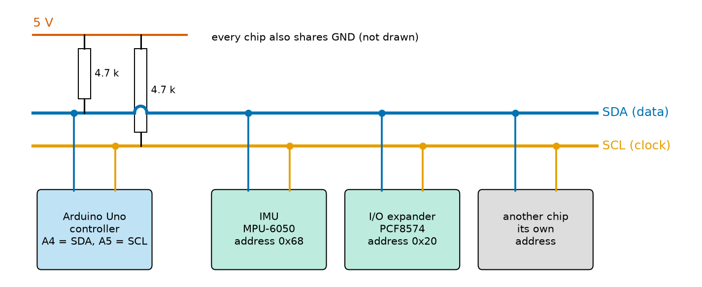
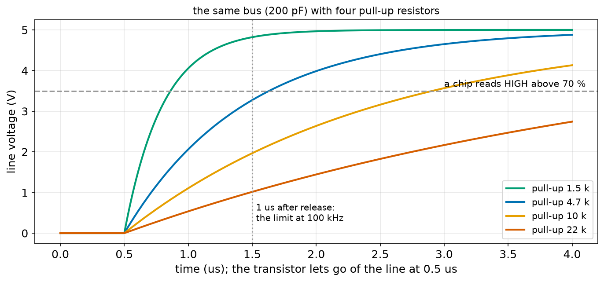
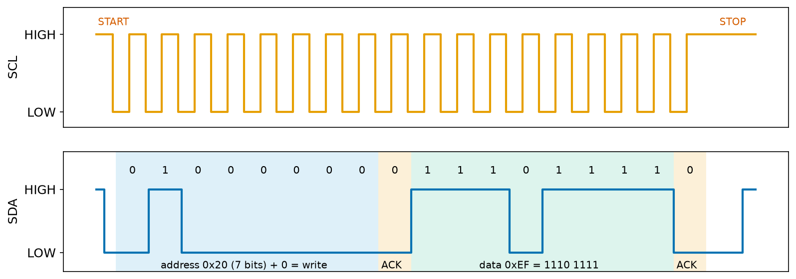
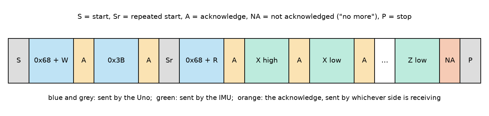
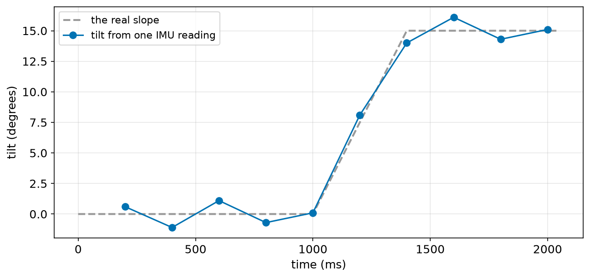
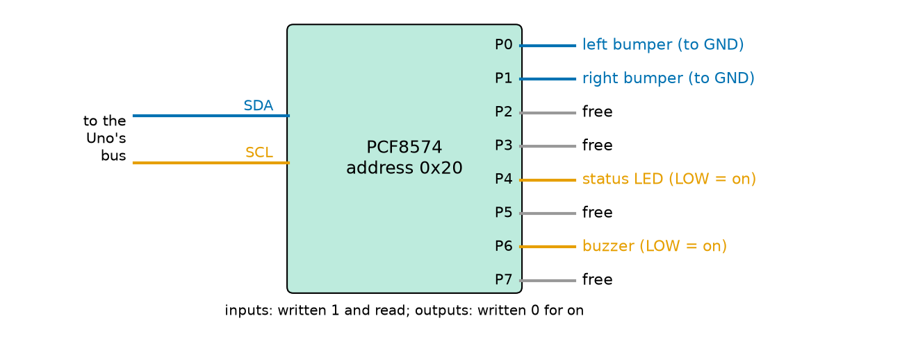

# Chapter 108 — Communication part 2: I2C

> **Part 6 · Chapter 108 of 749**
> **You need:** Chapter 47 (angles, `atan2`), Chapter 83 (pull-up resistors), Chapter 84 (RC time constants), Chapter 91 (logic levels and the BSS138 level shifter), Chapter 95 (Rover's pin plan: the I/O expander), Chapter 96 (`int16_t`, two's complement), Chapter 99 (polling inputs), Chapter 106 (bit operators) and Chapter 107 (UART, packets).
> **You will make:** a scanner that finds every chip on the bus, a table of how long each transaction takes, a pull-up resistor calculator, Rover's tilt meter from its IMU, and Rover's bumpers, status LED and buzzer moved onto an I/O expander, as Chapter 95 planned.

---

## What you will learn

- What a **bus** is, and how **I2C** connects many chips with two wires, **SDA** and **SCL**.
- How each chip is chosen by its **address**, and how a chip says "I am here" with an **acknowledge** bit.
- Why I2C lines are **open drain** and need **pull-up resistors**, and how to choose them.
- What one **transaction** looks like on the wires: start, address, data, stop.
- How to write and read a chip's **registers** with the `Wire` library.
- How to join two bytes into a signed `int16_t` that works on every board.
- How an I/O expander gives the Uno 8 more pins over the same two wires.

---

## New words in this chapter

| Word | Simple meaning |
|---|---|
| **bus** | A set of shared wires that several chips use to talk, one at a time. |
| **I2C** | Inter-Integrated Circuit: a bus with a data wire (SDA) and a clock wire (SCL). |
| **controller / target** | The chip that starts every conversation and makes the clock / a chip that answers when its address is called. |
| **address** | A 7-bit number that identifies one target on the bus. |
| **acknowledge (ACK)** | A bit the receiver sends after each byte to say "got it". |
| **open drain** | An output that can only pull a line LOW; a resistor pulls it HIGH. |
| **register** (of a chip) | A numbered byte inside a sensor chip, holding a setting or a measurement. |
| **I/O expander** | A chip that adds input and output pins, controlled over a bus. |

---

## 108.1 Two wires, many chips

A UART (Chapter 107) connects exactly two devices, and the Uno has only one. But Rover needs to talk to an IMU, an I/O expander for its bumpers, and later perhaps a display, a battery monitor, and more distance sensors. Giving each its own wires would use up the Uno's pins (Chapter 95 was already 4 pins short). The answer is a **bus**.

📖 **New word: bus** — a set of shared wires that several chips are all connected to, like a party telephone line. Only one may "speak" at a time, and each message says who it is for.

📖 **New word: I2C** — **I**nter-**I**ntegrated **C**ircuit (said "I-squared-C" or "I-two-C"), invented by Philips in 1982 for the chips inside a television. It has two wires:

- **SDA** (serial data): the bits themselves, in both directions;
- **SCL** (serial clock): a clock that says when each bit is ready.

On the Uno, SDA is pin **A4** and SCL is pin **A5** (Chapter 95's pin plan reserved them).



*Figure 108.1 — The Uno and three other chips on the same two wires, with one pull-up resistor per wire.*

**How to read this picture:** The blue line (SDA) and the orange line (SCL) run past every chip. Each chip connects one pin to each line (the dots). At the top left, two 4.7 kΩ resistors connect the lines to 5 V: section 108.2 explains why. Each chip below has an **address** written on it. Every chip also needs ground and power, not drawn.

📖 **New words: controller and target** — the **controller** starts every conversation and makes the clock on SCL: here, the Uno. The **targets** only answer when they are called. (Older documents say "master" and "slave"; the I2C standard now uses "controller" and "target".)

📖 **New word: address** — a 7-bit number (0 to 127) that identifies one target. The Uno's IMU, an MPU-6050, is at **0x68**; the I/O expander, a PCF8574, at **0x20**. Each chip type has a fixed address or a small choice of addresses (chosen with pins on the chip: the MPU-6050 can be 0x68 or 0x69, the PCF8574 anything from 0x20 to 0x27). Two chips with the same address on one bus would both answer at once, so that must be avoided.

🔢 **Why a clock wire helps.** A UART has no clock, so both sides must agree on the speed in advance, within 2% (Chapter 107). In I2C, the controller sends a clock pulse for every bit, and the target simply reads the data when SCL goes HIGH. There is no baud rate to match: the controller can even pause in the middle of a byte. Standard speed is **100 kHz** (100,000 bits per second); "fast mode" is **400 kHz**.

---

## 108.2 Open drain and pull-up resistors

If two chips on a bus drove the same wire at once, one HIGH and one LOW, a large current would flow from one output into the other (Chapter 91), possibly damaging both. I2C avoids this completely.

📖 **New word: open drain** — an output that can **only pull the line LOW** (with a transistor to ground) or **let go** of it. No chip ever drives an I2C line HIGH. Instead, one **pull-up resistor** per line (Chapter 83) pulls it gently HIGH whenever nobody is pulling it LOW.

So the rule on the bus is: **the line is LOW if anyone pulls it LOW, and HIGH only when everyone lets go.** Two chips can never fight; at worst, both pull LOW, which is harmless. This is also what lets a target answer: it pulls SDA LOW at the right moment to say "yes" (the acknowledge, section 108.3), while the controller has let go.

The cost is speed. Pulling LOW is quick (a transistor), but going HIGH depends on the resistor charging the **capacitance** of the wires and chip pins (Chapter 84): the line rises along an RC curve.



*Figure 108.2 — The same 200 pF bus released at 0.5 µs, with four pull-up values.*

**How to read this picture:** At 0.5 µs the chip lets go. Each curve rises toward 5 V; a chip reads HIGH above the grey dashed line (70%). The standard allows the line 1 µs to get from 30% to 70% at 100 kHz (dotted line: 1 µs after release is roughly where that limit falls). 1.5 kΩ (green) is up almost at once; 4.7 kΩ (blue) gets there just after 1.6 µs; 10 kΩ and 22 kΩ are far too slow for this bus.

Smaller resistors give faster edges, but there is a limit the other way: a chip must be able to pull the line LOW against the resistor. The standard asks chips to sink 3 mA while holding the line at 0.4 V or less. `i2c_pullup.py` puts both rules together:

```
at 5.0 V the pull-up must be at least 1533 ohm (3 mA through it at 0.4 V)
 bus capacitance | 4.7 k: rise time | largest R for 100 kHz | largest R for 400 kHz
           50 pF |           199 ns |               23.6 k |                7.1 k
          100 pF |           398 ns |               11.8 k |                3.5 k
          200 pF |           796 ns |                5.9 k |                1.8 k
          400 pF |         1593 ns |                3.0 k |                0.9 k
```

A small bus (a few chips, short wires: 50 to 100 pF) works with anything from 1.5 kΩ to over 10 kΩ at 100 kHz; **4.7 kΩ** is the usual choice and suits both speeds up to about 100 pF. A long bus (400 pF is the standard's maximum) cannot run at 400 kHz at all: the resistor it would need (0.9 kΩ) is below the 1.53 kΩ minimum.

💡 **Tip: many sensor boards already have pull-ups.** Most breakout boards (a chip on a small board with pins) include 4.7 kΩ or 10 kΩ pull-ups. With several such boards on one bus, the resistors are in parallel (Chapter 79): three 4.7 kΩ boards give 1.6 kΩ, close to the minimum. If a bus with many boards misbehaves, remove some pull-ups.

⚠️ **Careful: 5 V and 3.3 V chips on one bus.** The pull-ups decide the HIGH voltage: pull-ups to 5 V put 5 V on the pins of a 3.3 V chip (Chapter 91's danger). Use a two-way MOSFET level shifter (the BSS138 board of Chapter 91, which is exactly the circuit I2C needs), or a chip and breakout board that accept 5 V.

---

## 108.3 One transaction on the wires

Every I2C conversation, called a **transaction**, has the same shape:

1. **START**: the controller pulls SDA LOW **while SCL is HIGH**. Normally SDA changes only while SCL is LOW, so this special event tells every chip "a transaction begins".
2. **Address byte**: the 7-bit address, then one more bit: **0 = write** (the controller will send data) or **1 = read** (the target will send data). Bits go **highest first** (the opposite of a UART).
3. **ACK**: the 9th clock pulse. The controller lets go of SDA; the target with that address pulls it LOW to say "I am here". If nobody does, SDA stays HIGH: a "not acknowledged" (NACK), meaning no chip has that address.
4. **Data bytes**, each followed by an ACK from whichever side is receiving.
5. **STOP**: SDA goes HIGH **while SCL is HIGH**. The bus is free.

📖 **New word: acknowledge (ACK)** — the 9th bit after every byte, pulled LOW by the receiver to say "got it". So each byte costs 9 clock pulses.



*Figure 108.3 — The Uno writes the byte 0xEF to the I/O expander at address 0x20.*

**How to read this picture:** Top: SCL, one pulse per bit, made by the Uno. Bottom: SDA, with the bit values written above. At the far left, SDA falls while SCL is still HIGH: START. The blue band is the address byte: `0100000` (0x20) and then `0` for "write". The orange band is the ACK: the expander pulls SDA LOW. The green band is the data byte `11101111` (0xEF). Another ACK from the expander. At the far right, SDA rises while SCL is HIGH: STOP. In all, 20 clock periods: 0.2 ms at 100 kHz.

`i2c_timing.py` counts bits (1 for the start, 9 per byte, 1 for the stop) for each of Rover's transactions:

```
transaction                             bits   100 kHz   400 kHz
scanner: is anyone at this address?       11    0.11 ms    0.03 ms
expander: read 8 pins                     20    0.20 ms    0.05 ms
expander: write 8 pins                    20    0.20 ms    0.05 ms
IMU: read 6 acceleration bytes            85    0.85 ms    0.21 ms
IMU: read all 14 bytes                   157    1.57 ms    0.39 ms
most complete IMU readings per second: 636 at 100 kHz, 2547 at 400 kHz
```

The `Wire` library waits while a transaction runs, so these times are time the sketch spends waiting. Reading the IMU's 14 bytes 100 times per second at 100 kHz costs 157 ms out of every second: 16%. At 400 kHz (`Wire.setClock(400000);`, if all chips on the bus support it) the same costs 4%. Chapter 109's SPI is faster still, which is why drones read their IMUs over SPI.

---

## 108.4 Registers: talking to a sensor chip

A sensor chip is like a small cupboard of numbered drawers.

📖 **New word: register** (of a chip) — a numbered byte inside the chip. Some hold settings you write (the measuring range, power on or off), others hold measurements you read. The MPU-6050 has about 100: register `0x75` holds the chip's ID (0x68), `0x6B` controls its power, and `0x3B` to `0x48` hold the latest measurements: acceleration X, Y, Z, temperature, and rotation X, Y, Z, two bytes each. The **datasheet** (Chapter 106) and its "register map" list them all.

**Writing a register**: one write transaction with two data bytes: the register number, then the value.

```cpp
Wire.beginTransmission(0x68);    // START, address 0x68 + write
Wire.write(0x6B);                // register number
Wire.write(0);                   // value
Wire.endTransmission();          // send it all, then STOP; returns 0 if every byte was acknowledged
```

**Reading registers**: first a write of just the register number (setting the chip's "pointer"), then, without letting go of the bus, a read:



*Figure 108.4 — Reading the IMU's acceleration: write the register number, repeated start, read.*

**How to read this picture:** Left to right in time. The Uno sends START, the address with "write", and the register number 0x3B. Then, instead of STOP, a **repeated start** (Sr): a new START without a STOP, so no other controller can take the bus in between. The address again, now with "read". The IMU sends X high, X low, Y high … Z low, and the Uno acknowledges each one, except the last, which gets "not acknowledged" (NA) to say "that is enough". Then STOP. The chip moves its pointer on by one after each byte, so one transaction reads six registers in a row.

In code:

```cpp
Wire.beginTransmission(0x68);
Wire.write(0x3B);                // point at ACCEL_XOUT_H
Wire.endTransmission(false);     // false: no STOP, a repeated start follows
Wire.requestFrom(0x68, 6);       // read 6 bytes; they wait in Wire's buffer
byte b = Wire.read();            // take them out one at a time
```

### Two bytes into one number

Each MPU-6050 measurement is a signed 16-bit number sent **high byte first**: the opposite order from Rover's link packets (Chapter 107). There is no rule; every chip's datasheet says which. Joining them:

```cpp
byte high = Wire.read();
byte low = Wire.read();
int16_t value = (int16_t)((high << 8) | low);
```

Chapter 96 (Application 5) warned about this. Two traps:

- **Use `int16_t`, not `int`.** On the Uno, `int` is 16 bits, so `(high << 8) | low` with high = 0xFE already is negative. On a 32-bit board (an ESP32, a Pico), `int` is 32 bits, and 0xFECE is just the positive number 65,230. With `int16_t` the code is right on every board. Lab 108.2 shows what goes wrong.
- **Read the two bytes in separate statements.** `(Wire.read() << 8) | Wire.read()` looks shorter, but C++ does not promise which of the two `read()` calls runs first: the bytes may come out swapped.

---

## Code

All outputs of sketches come from the PC test bench. For this chapter the bench has an I2C bus with simulated chips: a PCF8574 expander and an MPU-6050 IMU that behave like the real ones (addresses, registers, power-on sleep, byte order), and each transaction takes the time its bits take at the bus speed.

File `code/ch108/i2c_scan/i2c_scan.ino`:

```cpp
// i2c_scan.ino - ask every I2C address "is anyone there?" and list the chips that answer
#include <Wire.h>

void setup() {
  Serial.begin(115200);
  Wire.begin();                        // join the bus as the controller (pins A4 = SDA, A5 = SCL)
  Serial.println("scanning addresses 1 to 126 ...");
  int found = 0;
  for (int address = 1; address < 127; address++) {
    Wire.beginTransmission(address);
    byte result = Wire.endTransmission();   // 0: a chip answered (acknowledged) its address
    if (result == 0) {
      Serial.print("  chip found at 0x");
      if (address < 16) Serial.print("0");
      Serial.println(address, HEX);
      found++;
    }
  }
  Serial.print(found);
  Serial.print(" chip(s) found; the scan took ");
  Serial.print(millis());
  Serial.println(" ms");
}

void loop() {
}
```

| Line | Code | What it does (simple English) |
|---|---|---|
| 1 | comment | |
| 2 | `#include <Wire.h>` | The I2C library, part of the Arduino software (Chapter 110 looks inside libraries). |
| 3 | (blank) | |
| 4–5 | `void setup() { Serial.begin(115200);` | Everything happens once. |
| 6 | `Wire.begin();` | Start the Uno's I2C hardware as the controller. |
| 7–8 | `Serial.println(…); int found = 0;` | |
| 9 | `for (int address = 1; address < 127; address++) {` | Every possible address (0 and 127 are reserved). |
| 10–11 | `Wire.beginTransmission(address); byte result = Wire.endTransmission();` | A transaction with no data: just START, the address, and STOP. `endTransmission` returns 0 if a chip acknowledged, 2 if nobody did. |
| 12–17 | `if (result == 0) { … Serial.println(address, HEX); found++; }` | Print the address in hex, with a leading 0 below 16. |
| 18 | `}` | |
| 19–22 | `Serial.print(found); …` | How many, and how long it took. |
| 23–26 | `}`, `void loop() { }` | |

Output, with the IMU and the expander on the bus:

```
scanning addresses 1 to 126 ...
  chip found at 0x20
  chip found at 0x68
2 chip(s) found; the scan took 14 ms
```

126 addresses × 11 bits ÷ 100,000 bits per second = 14 ms. On a real Uno a scan takes a little longer, because the library adds some time around each transaction.

💡 **Tip: always scan first.** When an I2C sensor does not work, the scanner answers the first question: is the chip there at all, and at which address? If it is missing, the problem is wiring, power or pull-ups, not your code.

File `code/ch108/i2c_timing.py`:

```python
# i2c_timing.py - how long do Rover's I2C transactions take at 100 kHz and 400 kHz?
# Each byte on the bus is 9 clock pulses (8 bits + the acknowledge bit); add about 1 for the start
# and 1 for the stop. A register read is a write (address + register number) and then a read.
def bits(nbytes):
    return 1 + 9 * nbytes + 1                     # start + bytes + stop


jobs = [
    ("scanner: is anyone at this address?", bits(1)),
    ("expander: read 8 pins", bits(1 + 1)),
    ("expander: write 8 pins", bits(1 + 1)),
    ("IMU: read 6 acceleration bytes", bits(1 + 1) + bits(1 + 6)),
    ("IMU: read all 14 bytes", bits(1 + 1) + bits(1 + 14)),
]
print(f"{'transaction':<38s} {'bits':>5s} {'100 kHz':>9s} {'400 kHz':>9s}")
for name, n in jobs:
    print(f"{name:<38s} {n:5d} {n / 100:7.2f} ms {n / 400:7.2f} ms")
n14 = jobs[-1][1]
print(f"most complete IMU readings per second: {100_000 // n14} at 100 kHz, {400_000 // n14} at 400 kHz")
```

| Line | Code | What it does (simple English) |
|---|---|---|
| 1–3 | comments | The counting rule. |
| 4–5 | `def bits(nbytes): return 1 + 9 * nbytes + 1` | Bits for one transaction carrying `nbytes` bytes, the address byte included. |
| 6–7 | (blank) | |
| 8–14 | `jobs = [ … ]` | Each job: a name and its bit count. A register read is two transactions: address + register number, then address + the data. |
| 15–17 | `print(…)`, `for name, n in jobs: …` | At 100 kHz each bit is 10 µs, so `n / 100` is in milliseconds; at 400 kHz, `n / 400`. |
| 18–19 | `n14 = jobs[-1][1]`, `print(…)` | `[-1]` is the last job (Chapter 21); how many fit in one second. |

File `code/ch108/i2c_pullup.py`:

```python
# i2c_pullup.py - choose the I2C pull-up resistors
# A chip pulls a line LOW with a transistor; only the pull-up resistor pulls it HIGH again, charging
# the bus's capacitance (wires + chip pins). The rise from 30 % to 70 % of the supply takes
# about 0.85 x R x C (Chapter 84), and the I2C standard allows at most 1000 ns at 100 kHz and
# 300 ns at 400 kHz. The resistor must also not be so small that a chip cannot pull it LOW:
# chips must sink 3 mA while holding the line at 0.4 V or less.
V = 5.0
R_MIN = (V - 0.4) / 0.003                         # smallest pull-up allowed at 5 V
print(f"at {V} V the pull-up must be at least {R_MIN:.0f} ohm (3 mA through it at 0.4 V)")
print(f"{'bus capacitance':>16s} | {'4.7 k: rise time':>16s} | {'largest R for 100 kHz':>21s} | {'largest R for 400 kHz':>21s}")
for c_pf in [50, 100, 200, 400]:
    c = c_pf * 1e-12
    rise_47k = 0.8473 * 4700 * c * 1e9            # nanoseconds
    r100 = 1000e-9 / (0.8473 * c)
    r400 = 300e-9 / (0.8473 * c)
    print(f"{c_pf:13d} pF | {rise_47k:13.0f} ns | {r100 / 1000:18.1f} k | {r400 / 1000:18.1f} k")
```

| Line | Code | What it does (simple English) |
|---|---|---|
| 1–6 | comments | The two rules. 0.8473 = ln(0.7 ÷ 0.3), the 30%-to-70% part of an RC rise (Chapter 91 used the same number). |
| 7–9 | `V = 5.0`, `R_MIN = (V - 0.4) / 0.003`, `print(…)` | Ohm's law (Chapter 74): the resistor has 4.6 V across it and may carry at most 3 mA. |
| 10 | `print(…)` | The heading. |
| 11–12 | `for c_pf in […]: c = c_pf * 1e-12` | Four bus sizes, converted from picofarads to farads. |
| 13 | `rise_47k = 0.8473 * 4700 * c * 1e9` | The rise time with 4.7 kΩ, in nanoseconds. |
| 14–15 | `r100 = …`, `r400 = …` | The biggest resistor that still meets each speed's limit: R = time ÷ (0.8473 × C). |
| 16 | `print(…)` | One row. |

---

## Small examples

**Example 1.** Address 0x68 with "read" is the byte `0x68 << 1 | 1` = 0xD1 on the wire.

**Example 2.** One I2C byte at 100 kHz: 9 bits × 10 µs = 90 µs.

**Example 3.** A temperature register holding 0xFF 0x38 (high byte first) is the `int16_t` −200.

**Example 4.** At ±2 g, the raw reading 8,192 is 8,192 ÷ 16,384 = 0.5 g.

**Example 5.** Three breakout boards with 10 kΩ pull-ups each give 10 ÷ 3 = 3.3 kΩ in total.

**Example 6.** A PCF8574 reads `0b11111101` with all pins written 1: pin P1 is LOW, so the right bumper is pressed.

**Example 7.** Writing `0b11101111` to the PCF8574 makes P4 LOW: Rover's status LED turns on.

**Example 8.** Two chips with address 0x68 cannot share a bus; set the second MPU-6050's AD0 pin HIGH to make it 0x69.

---

## 🏭 Real robot applications

### Application 1 (worked in full) — 🤖 Rover's tilt from its IMU

**1. The real problem.** Rover must know when it is on a slope: going up a steep ramp it needs more motor power, and on a slope too steep it could tip over or slide, so it should stop and back down. Its IMU (an MPU-6050, Chapters 124 to 127) measures acceleration in three directions. When Rover is still or moving steadily, the only acceleration it feels is gravity, and how gravity divides between the axes gives the tilt.

**2. Why this theory.** The IMU is an I2C target at 0x68 (section 108.1). Its measurements are registers, read with a register-pointer write and a repeated start (section 108.4), and each is a signed 16-bit number, high byte first. The chip **starts asleep**: register `0x6B` (PWR_MGMT_1) must be set to 0 to wake it.

**3. The numbers.** At the ±2 g range, 16,384 counts = 1 g. With the IMU's X axis pointing forward and Z up, on the flat X reads about 0 and Z about 16,384. Tilted nose-up by θ, gravity gives X = sin θ and Z = cos θ (in g). The test drives Rover up onto a 15° ramp between 1.0 and 1.4 s, and adds the vibration of driving: ±0.02 g at 37 Hz on X. One reading of 6 bytes takes 0.85 ms at 100 kHz (section 108.3).

**4. The maths.** tilt = atan2(X, Z) (Chapter 47), in degrees. atan2 uses the ratio, so the units (counts or g) do not matter. At 15°: X = sin 15° × 16,384 = 4,240, Z = cos 15° × 16,384 = 15,826. The vibration's ±0.02 g on X is ±328 counts: on the flat, atan2(328, 16,384) = ±1.1°.

**5. The code.** File `code/ch108/imu_tilt/imu_tilt.ino`:

```cpp
// imu_tilt.ino - read Rover's IMU (an MPU-6050) over I2C and work out how far Rover is tilted
#include <Wire.h>
const int IMU = 0x68;                  // the MPU-6050's address (its AD0 pin connected to GND)
const float COUNTS_PER_G = 16384.0;    // at the +-2 g range: 16,384 counts = 1 g
unsigned long lastRead = 0;

void writeRegister(byte reg, byte value) {
  Wire.beginTransmission(IMU);
  Wire.write(reg);                     // which register ...
  Wire.write(value);                   // ... and what to put in it
  Wire.endTransmission();
}

byte readRegister(byte reg) {
  Wire.beginTransmission(IMU);
  Wire.write(reg);                     // point at the register ...
  Wire.endTransmission(false);         // ... keep the bus (a "repeated start" follows) ...
  Wire.requestFrom(IMU, 1);            // ... and read one byte from it
  return Wire.read();
}

int16_t read16() {                     // two bytes, HIGH byte first, joined into one signed 16-bit number
  byte high = Wire.read();
  byte low = Wire.read();
  return (int16_t)((high << 8) | low);
}

void setup() {
  Serial.begin(115200);
  Wire.begin();
  Serial.print("WHO_AM_I = 0x");
  Serial.println(readRegister(0x75), HEX);   // the chip's ID: 0x68 for an MPU-6050
  writeRegister(0x6B, 0);              // PWR_MGMT_1 = 0: wake up (the chip starts asleep)
}

void loop() {
  if (millis() - lastRead >= 200) {
    lastRead += 200;
    Wire.beginTransmission(IMU);
    Wire.write(0x3B);                  // ACCEL_XOUT_H: the first of the six acceleration bytes
    Wire.endTransmission(false);
    Wire.requestFrom(IMU, 6);          // X high, X low, Y high, Y low, Z high, Z low
    int16_t ax = read16();
    int16_t ay = read16();
    int16_t az = read16();
    float tilt = atan2(ax, az) * 180.0 / PI;   // nose up is positive (Chapter 47)
    Serial.print(millis());
    Serial.print(" ms: x ");
    Serial.print(ax);
    Serial.print("  y ");
    Serial.print(ay);
    Serial.print("  z ");
    Serial.print(az);
    Serial.print("  ->  x ");
    Serial.print(ax / COUNTS_PER_G, 3);
    Serial.print(" g, z ");
    Serial.print(az / COUNTS_PER_G, 3);
    Serial.print(" g, tilt ");
    Serial.print(tilt, 1);
    Serial.println(" deg");
  }
}
```

| Line | Code | What it does (simple English) |
|---|---|---|
| 1–2 | comment, `#include <Wire.h>` | |
| 3–5 | `IMU = 0x68`, `COUNTS_PER_G = 16384.0`, `lastRead` | The address, the scale, and a timer. |
| 6 | (blank) | |
| 7–12 | `void writeRegister(byte reg, byte value) { … }` | Section 108.4's register write, as a function. |
| 13 | (blank) | |
| 14–20 | `byte readRegister(byte reg) { … Wire.endTransmission(false); Wire.requestFrom(IMU, 1); return Wire.read(); }` | Point at a register, repeated start, read one byte. |
| 21 | (blank) | |
| 22–26 | `int16_t read16() { byte high = Wire.read(); byte low = Wire.read(); return (int16_t)((high << 8) \| low); }` | Two bytes from Wire's buffer, in two separate statements, joined high-first, as a 16-bit signed number. |
| 27 | (blank) | |
| 28–30 | `void setup() { Serial.begin(115200); Wire.begin();` | |
| 31–32 | `Serial.print("WHO_AM_I = 0x"); Serial.println(readRegister(0x75), HEX);` | Read the ID register: a good first check that the right chip answers. |
| 33 | `writeRegister(0x6B, 0);` | Wake the chip. |
| 34 | `}` | |
| 35 | (blank) | |
| 36–38 | `void loop() { if (millis() - lastRead >= 200) { lastRead += 200;` | Five readings per second (Chapter 103). |
| 39–42 | `Wire.beginTransmission(IMU); Wire.write(0x3B); Wire.endTransmission(false); Wire.requestFrom(IMU, 6);` | Point at 0x3B and read six bytes in one go (Figure 108.4). |
| 43–45 | `int16_t ax = read16(); …` | X, Y, Z in the order the chip sends them. |
| 46 | `float tilt = atan2(ax, az) * 180.0 / PI;` | Radians to degrees. |
| 47–60 | `Serial.print(…)` … | The raw numbers, the same in g, and the tilt. |
| 61–62 | `}` `}` | |

Output:

```
WHO_AM_I = 0x68
200 ms: x 180  y 0  z 16384  ->  x 0.011 g, z 1.000 g, tilt 0.6 deg
400 ms: x -306  y 0  z 16384  ->  x -0.019 g, z 1.000 g, tilt -1.1 deg
600 ms: x 316  y 0  z 16384  ->  x 0.019 g, z 1.000 g, tilt 1.1 deg
800 ms: x -205  y 0  z 16384  ->  x -0.013 g, z 1.000 g, tilt -0.7 deg
1000 ms: x 18  y 0  z 16384  ->  x 0.001 g, z 1.000 g, tilt 0.1 deg
1200 ms: x 2321  y 0  z 16244  ->  x 0.142 g, z 0.991 g, tilt 8.1 deg
1400 ms: x 3934  y 0  z 15826  ->  x 0.240 g, z 0.966 g, tilt 14.0 deg
1600 ms: x 4557  y 0  z 15826  ->  x 0.278 g, z 0.966 g, tilt 16.1 deg
1800 ms: x 4036  y 0  z 15826  ->  x 0.246 g, z 0.966 g, tilt 14.3 deg
2000 ms: x 4256  y 0  z 15826  ->  x 0.260 g, z 0.966 g, tilt 15.1 deg
```



*Figure 108.5 — The real slope (grey dashes) and the tilt from each single IMU reading (blue).*

**How to read this picture:** Until 1,000 ms Rover is on the flat, but the dots wobble between −1.1° and +1.1°: that is the driving vibration, which the accelerometer cannot tell apart from a tilt. Between 1,000 and 1,400 ms the dots climb with the ramp. On the ramp they wobble around 15° by the same ±1°.

**6. The result.** The chip answered with its ID, woke up, and gave a tilt that followed the ramp: 0° on the flat, 15° on the ramp, both within about a degree. The negative readings, such as −306, came out right because `read16` builds an `int16_t`. The wobble is real: a single accelerometer reading also measures every bump and vibration. A simple average of the last few readings (Chapter 97's moving average) would reduce it; Chapter 127 combines the accelerometer with the gyroscope, which is not disturbed by vibration in the same way, to get a steady and fast tilt.

**7. Going further.** Two more things a real tilt meter needs. While Rover **accelerates**, the accelerometer feels that too, and the tilt would be wrong by atan(a ÷ g): accelerating at 1 m/s² looks like a 5.8° slope. And the chip has settings worth using: a built-in low-pass filter (register 0x1A) and a "data ready" interrupt pin (Chapter 105), so the Uno reads exactly when a new measurement exists, as a flight controller does.

### Application 2 (worked in full) — 🤖 Rover's bumpers on an I/O expander

**1. The real problem.** Chapter 95's pin plan was 4 pins short, and its solution was to move the two bumpers and the status LED (and later the buzzer) to an **I/O expander** on the I2C bus, which the IMU already uses. Now we build it: Rover must still notice a bumper press quickly, keep its status LED on, and sound the buzzer while a bumper is pressed.

📖 **New word: I/O expander** — a chip that adds input and output pins, controlled over a bus. The PCF8574 has 8 pins, P0 to P7, and costs very little.

**2. Why this theory.** The PCF8574 is the simplest possible I2C chip: it has no registers. Writing one byte sets all 8 pins; reading one byte gives all 8 pins. Its pins are "quasi-bidirectional": writing **0** pulls a pin LOW strongly (it can sink about 25 mA, enough for an LED); writing **1** leaves the pin HIGH through a weak internal pull-up (about 100 µA), so the pin can be **read**, and a switch to ground can pull it LOW. So: inputs must always be written as 1, and outputs are active LOW (a LED from 5 V through a resistor into the pin lights when the pin is 0).



*Figure 108.6 — What each of the PCF8574's pins does on Rover.*

**How to read this picture:** The chip is on the Uno's bus (left). On the right: P0 and P1 are the bumpers (blue), switches to ground, read as inputs. P4 is the status LED and P6 the buzzer (orange), outputs that are on when LOW. The grey pins are free for later.

**3. The numbers.** Poll every 10 ms (Chapter 99: fast enough for a bumper). Each poll is one 1-byte read: 20 bits, 0.2 ms at 100 kHz (section 108.3), so polling costs 2% of the time. The test presses the left bumper from 300 to 800 ms, both bumpers from 1,000 to 1,200 ms, and the right one alone until 1,500 ms, with Chapter 99's 3 ms of bounce on every press and release.

**4. The maths.** The sketch keeps a copy of what it last wrote in a variable `outputs`. To turn an output on: clear its bit (`outputs &= ~(1 << bit)`); off: set it (`outputs |= (1 << bit)`); then write the whole byte (Chapter 106). The bumper bits are never cleared, so they stay readable. Reading: bit k of the byte read is LOW when pin k is LOW, so "pressed" is `!(pins & (1 << k))`.

**5. The code.** File `code/ch108/rover_expander/rover_expander.ino`:

```cpp
// rover_expander.ino - Rover's bumpers, status LED and buzzer on a PCF8574 I/O expander (I2C address 0x20)
#include <Wire.h>
const int EXPANDER = 0x20;
const byte LEFT_BUMPER = 0;            // P0: switch to GND, so LOW when pressed
const byte RIGHT_BUMPER = 1;           // P1: the same
const byte STATUS_LED = 4;             // P4: LED from 5 V through a resistor to the pin, so LOW = on
const byte BUZZER = 6;                 // P6: a buzzer module whose input is active LOW
byte outputs = 0xFF;                   // what we last wrote: 1 = HIGH (off, or an input), 0 = LOW (on)
byte lastBumpers = 0;
unsigned long lastPoll = 0;

void writeExpander() {
  Wire.beginTransmission(EXPANDER);
  Wire.write(outputs);                 // one byte sets all 8 pins at once
  Wire.endTransmission();
}

byte readExpander() {
  Wire.requestFrom(EXPANDER, 1);       // one byte gives all 8 pins at once
  return Wire.read();
}

void setOutput(byte bit, bool on) {    // "on" means LOW for these active-LOW parts
  if (on) {
    outputs &= ~(1 << bit);
  } else {
    outputs |= (1 << bit);
  }
  writeExpander();
}

void setup() {
  Serial.begin(115200);
  Wire.begin();
  writeExpander();                     // all HIGH: LED and buzzer off, bumper pins ready to be read
  setOutput(STATUS_LED, true);         // status LED on: "Rover is ready"
}

void loop() {
  if (millis() - lastPoll >= 10) {     // poll the bumpers 100 times per second (Chapter 99)
    lastPoll += 10;
    byte pins = readExpander();
    byte bumpers = 0;
    if (!(pins & (1 << LEFT_BUMPER))) bumpers |= 1;    // LOW = pressed
    if (!(pins & (1 << RIGHT_BUMPER))) bumpers |= 2;
    if (bumpers != lastBumpers) {
      lastBumpers = bumpers;
      setOutput(BUZZER, bumpers != 0);
      Serial.print(millis());
      Serial.print(" ms: bumpers ");
      Serial.print(bumpers & 1 ? "L" : "-");
      Serial.print(bumpers & 2 ? "R" : "-");
      Serial.println(bumpers ? "  buzzer on" : "  buzzer off");
    }
  }
}
```

| Line | Code | What it does (simple English) |
|---|---|---|
| 1–2 | comment, `#include <Wire.h>` | |
| 3–7 | `EXPANDER = 0x20`, pin numbers | Bit numbers on the expander, not Uno pins. |
| 8 | `byte outputs = 0xFF;` | The byte we keep writing. Start: all HIGH (all off, all inputs readable). |
| 9–10 | `lastBumpers`, `lastPoll` | For edge detection (Chapter 99) and timing. |
| 11 | (blank) | |
| 12–16 | `void writeExpander() { … Wire.write(outputs); … }` | One write transaction, one data byte. |
| 17 | (blank) | |
| 18–21 | `byte readExpander() { Wire.requestFrom(EXPANDER, 1); return Wire.read(); }` | A read with no register number: this chip has none. |
| 22 | (blank) | |
| 23–30 | `void setOutput(byte bit, bool on) { if (on) { outputs &= ~(1 << bit); } else { outputs \|= (1 << bit); } writeExpander(); }` | Change one bit of the copy, then send the whole byte (Chapter 106's clear and set). |
| 31 | (blank) | |
| 32–37 | `void setup() { … writeExpander(); setOutput(STATUS_LED, true); }` | Known starting state, then the status LED on. |
| 38 | (blank) | |
| 39–41 | `void loop() { if (millis() - lastPoll >= 10) { lastPoll += 10;` | Poll every 10 ms. |
| 42–45 | `byte pins = readExpander(); byte bumpers = 0; if (!(pins & (1 << LEFT_BUMPER))) bumpers \|= 1; …` | Test each bumper's bit; build a small number: bit 0 = left, bit 1 = right. |
| 46–47 | `if (bumpers != lastBumpers) { lastBumpers = bumpers;` | Only act when something changed. |
| 48 | `setOutput(BUZZER, bumpers != 0);` | Buzzer on while any bumper is pressed. |
| 49–53 | `Serial.print(…)` … | Report: `L`, `R` or `-` for each. `? :` picks one of two texts. |
| 54–56 | `}` `}` `}` | |

Output (the lines in brackets come from the test, which prints every change of the expander's output pins):

```
[   0.40 ms] expander pins: LED ON, buzzer off
[ 300.40 ms] expander pins: LED ON, buzzer ON
300 ms: bumpers L-  buzzer on
[ 800.40 ms] expander pins: LED ON, buzzer off
800 ms: bumpers --  buzzer off
[1000.40 ms] expander pins: LED ON, buzzer ON
1000 ms: bumpers LR  buzzer on
1200 ms: bumpers -R  buzzer on
[1500.40 ms] expander pins: LED ON, buzzer off
1500 ms: bumpers --  buzzer off
```

**6. The result.** Every press and release was seen at the first poll after it (within 10 ms), the buzzer followed the bumpers, and the status LED stayed on throughout, because changing the buzzer's bit left the LED's bit alone. At 1,200 ms the left bumper was released while the right stayed pressed: the report changed to `-R` and the buzzer correctly stayed on (no new write was needed). The bounce did not show: with polls 10 ms apart, each change was read only after its 3 ms of chatter had ended. Reading less often than the bounce lasts acts like a simple debounce, but only while the bounce is shorter than the poll interval; Chapter 99's worn switch, bouncing for 50 ms, would still need a real debounce (Lab 108.3 shows what fast polling does). Five Uno pins are now free, exactly as Chapter 95 planned.

**7. Going further.** Two limits. First, a press is noticed only at the next poll, up to 10 ms late, plus 0.2 ms for the read: fine for a bumper, but not for an emergency stop (Chapter 105, Application 5). The PCF8574 has an **INT** output that goes LOW whenever an input changes, which can be wired to an interrupt pin so the Uno reads only when something happened. Second, the weak HIGH (100 µA) cannot drive much; for more current or true push-pull outputs, the MCP23017 (16 pins, with registers like the IMU's) is the usual step up.

### Application 3 — 🚁 A flight controller's sensors

A small flight controller carries an IMU, a barometer (for height) and a magnetometer (a compass), and often a GPS whose compass is on I2C too (Chapter 630). The slower sensors (barometer at 50 Hz, compass at 100 Hz) share an I2C bus at 400 kHz. But the IMU, read at 1 to 8 kHz for the attitude controller, usually goes on **SPI** instead (Chapter 109): at 400 kHz, 14 bytes take 0.39 ms, so 8,000 readings per second would need more than three seconds of bus time every second. The I2C bus also needs care on a drone: long wires to a GPS mast pick up noise from the motors, and a chip that stops in the middle of a byte (because of a glitch) can hold SDA LOW and freeze the whole bus. Flight controller software detects a stuck bus and frees it by sending up to nine clock pulses until SDA is released.

### Application 4 — 🏭 Many identical sensors: address conflicts and multiplexers

A warehouse robot may carry eight time-of-flight distance sensors (Chapter 120) around its body. They are all the same chip, so they all have the same address. Two solutions are used in industry and in hobby robots alike. Some chips let the program **change their address** at start-up: each sensor's power-down pin is wired to a separate controller pin; the program wakes them one at a time and gives each a new address before waking the next. Otherwise, an **I2C multiplexer** (such as the TCA9548A, itself at address 0x70) sits between the controller and eight separate little buses; writing one byte to the multiplexer chooses which of the eight buses is connected. The program selects bus 3, reads the sensor at its usual address, selects bus 4, reads the next one, and so on.

### Application 5 — 🔋 Smart batteries talk I2C

The battery packs of laptops, power tools, e-bikes and many robots contain a small "fuel gauge" chip that measures the voltage of every cell, the current in and out, and the temperature, and counts the charge used (Chapter 89). It reports all this over **SMBus**, a stricter version of I2C with the same two wires. A robot's controller reads registers such as "remaining capacity" and "time to empty", the same way Rover reads its IMU, and can plan to return to its charger in good time (Chapter 664). Robot vacuum cleaners and warehouse robots do exactly this.

---

## 🔧 Hands-on lab

### Lab 108.1 — Scan a bus (Wokwi or hardware)

You need: Wokwi, an Uno, an **MPU6050** part, and an **LCD1602 with I2C** part (its I2C backpack is a PCF8574, usually at 0x27). Or the real parts, with 4.7 kΩ pull-ups if your boards have none.

1. Connect both parts' SDA to A4, SCL to A5, VCC to 5V, GND to GND.
2. Upload `i2c_scan.ino`.
3. Disconnect the MPU6050's SDA wire and run it again.

**What you should see:** Two chips: 0x27 (the display's expander) and 0x68 (the IMU). With the IMU's SDA disconnected, only 0x27: the IMU cannot hear its address, so it cannot acknowledge.

| If it does not work | Likely cause | Fix |
|---|---|---|
| No chips found at all | SDA and SCL swapped, or no ground | A4 = SDA, A5 = SCL; connect GND |
| The scan freezes (real hardware) | No pull-ups: SDA or SCL stays LOW | Add 4.7 kΩ to 5 V on each line |
| A chip at an unexpected address | Its address pins are set differently | Check the board's address jumpers |

**Challenge:** Connect the MPU6050's AD0 pin to VCC and scan again: where has it moved?

### Lab 108.2 — Read the IMU, and the 32-bit trap (Wokwi or simulation)

You need: Wokwi with an Uno and an MPU6050 (it has sliders for the acceleration), or the PC test bench.

1. Upload `imu_tilt.ino`. In Wokwi, click the MPU6050 and move the acceleration sliders; on the bench, run `pc_tests/test_imu_tilt.cpp`.
2. Delete line 33 (`writeRegister(0x6B, 0);`) and run again.
3. Put it back. Now change the four `int16_t` in `read16()` and in lines 43–45 to `int`, and remove the `(int16_t)` cast. Run it on the bench **without** the line `#include "avr_int.h"` in the test file (so `int` is 32 bits, as on an ESP32).

**What you should see:** Step 1: the tilt follows the sliders (or the ramp). Step 2: every reading is `x 0 y 0 z 0` and the tilt `0.0`: the chip is asleep and its measurement registers stay 0. Step 3 on the bench:

```
200 ms: x 180  y 0  z 16384  ->  x 0.011 g, z 1.000 g, tilt 0.6 deg
400 ms: x 65230  y 0  z 16384  ->  x 3.981 g, z 1.000 g, tilt 75.9 deg
600 ms: x 316  y 0  z 16384  ->  x 0.019 g, z 1.000 g, tilt 1.1 deg
800 ms: x 65331  y 0  z 16384  ->  x 3.987 g, z 1.000 g, tilt 75.9 deg
```

Every negative reading has become a large positive one: −306 became 65,230 (0xFECE read as a positive 32-bit number), and Rover would think it was tilted 76°. With the test's `avr_int.h` (16-bit `int`, as on the Uno) the same code gives −306 again, which is why the bug hides until the code moves to another board.

| If it does not work | Likely cause | Fix |
|---|---|---|
| WHO_AM_I is 0xFF or 0x00 | Wrong address, or no chip | Run the scanner |
| All zeros | Not woken | Write 0 to register 0x6B |
| Values jump between two numbers far apart | Bytes swapped | High byte first for this chip |

**Challenge:** Read all 14 bytes from 0x3B and print the temperature: °C = raw ÷ 340 + 36.53 (from the datasheet).

### Lab 108.3 — Bumpers on the expander (simulation)

Copy `rover_expander.ino` and `pc_tests/test_rover_expander.cpp`.

1. Run the test and compare with Application 2.
2. Change line 8 to `byte outputs = 0x00;` (start with every pin LOW) and run it.
3. Put it back. Change the poll interval from 10 to 1 ms and run again.

**What you should see:** Step 2: the whole output is `10 ms: bumpers LR  buzzer on`, and nothing after it. Bits 0 and 1 are written 0, so the chip itself holds those pins LOW: both bumpers read "pressed" for ever, and real presses change nothing. This is the classic PCF8574 mistake: a pin used as an input must be written as 1. Step 3: every press and release is reported three times (for example `300 ms: bumpers L-`, `301 ms: bumpers --`, `303 ms: bumpers L-`), because 1 ms polls fall inside the 3 ms of bounce. Polling every 1 ms also costs 20% of the time (0.2 ms per read).

| If it does not work | Likely cause | Fix |
|---|---|---|
| The LED goes off when the buzzer changes | Writing a new byte without keeping the copy | Change bits in `outputs` and write all of it |
| Bumpers always pressed | Their bits written 0 | Keep bits 0 and 1 at 1 |
| No reports at all | Wrong address | Scan; the PCF8574A version uses 0x38–0x3F |

**Challenge:** Make the status LED blink at 1 Hz with Chapter 103's `millis()` pattern while the bumpers are still polled. How many I2C writes per second does that add, and how much time do they take?

---

## Common mistakes

⚠️ **No pull-up resistors.** The lines never go HIGH; the scan finds nothing or freezes.

⚠️ **5 V pull-ups on a 3.3 V chip.** Use a level shifter, or a board made for 5 V.

⚠️ **Two chips with the same address.** Change an address pin, or use a multiplexer.

⚠️ **Forgetting to wake a sensor.** Many chips start asleep; their registers read 0.

⚠️ **`int` instead of `int16_t` for two-byte values.** Negative readings become large positive ones on 32-bit boards.

⚠️ **Two `Wire.read()` calls in one expression.** Their order is not guaranteed.

⚠️ **The wrong byte order.** Check the datasheet: the MPU-6050 is high byte first.

⚠️ **Writing 0 to a PCF8574 input pin.** It can no longer be read.

⚠️ **Long I2C wires.** I2C was made for chips on one board; beyond a metre or so, capacitance and noise cause errors.

⚠️ **Reading an I2C sensor inside an ISR.** `Wire` waits and needs interrupts itself; read in `loop()`.

---

## Practice

🏋️ **1.** Name the two I2C wires, what each carries, and which Uno pins they use.

🏋️ **2.** Why can two I2C chips never damage each other by driving the bus at the same time?

🏋️ **3.** What byte goes on the wire to start a read from address 0x20?

🏋️ **4.** How long does a transaction that writes 3 data bytes to one chip take at 100 kHz?

🏋️ **5.** A bus has 150 pF. What is the largest pull-up that meets the 1,000 ns rise limit at 100 kHz?

🏋️ **6.** The MPU-6050 sends `0xC0 0x00` for X. What is the acceleration in g at ±2 g?

🏋️ **7.** Why does `readRegister` call `endTransmission(false)` and not `endTransmission()`?

🏋️ **8.** The expander's `outputs` byte is `0b11101111`. Write the line that also turns on the buzzer (P6), and give the new value.

🏋️ **9.** Rover reads the whole IMU (14 bytes) 200 times per second at 100 kHz. What share of the time does it spend on the I2C bus? And at 400 kHz?

🏋️ **10.** Give two ways to put four identical sensors with a fixed address on one Uno.

🏋️ **11.** Remove line 33 (`writeRegister(0x6B, 0);`) from `imu_tilt.ino` and run it on the PC test bench. What do the readings show, and why?

---

## Answers

**1.** SDA (serial data: the bits, in both directions) on A4, and SCL (serial clock, made by the controller) on A5.

**2.** The outputs are open drain: they can only pull LOW or let go; a resistor pulls HIGH. No chip ever drives HIGH, so there is never a HIGH output connected to a LOW one.

**3.** 0x20 << 1 | 1 = **0x41** (`01000001`).

**4.** Address + 3 bytes = 4 bytes: 1 + 9 × 4 + 1 = 38 bits = **0.38 ms**.

**5.** R = 1,000 ns ÷ (0.8473 × 150 pF) = **7.9 kΩ**.

**6.** 0xC000 as an `int16_t` is −16,384, so **−1.0 g**.

**7.** `false` means "no STOP": the read that follows begins with a repeated start, so the chip keeps the register pointer just set, and no other controller can use the bus in between.

**8.** `outputs &= ~(1 << 6);` gives `0b10101111` (0xAF); then `writeExpander();` (or simply `setOutput(BUZZER, true);`).

**9.** 157 bits per reading × 200 = 31,400 bits per second. At 100 kHz: 31,400 ÷ 100,000 = **31%**. At 400 kHz: **7.9%**.

**10.** Give each a different address at start-up (if the chip allows it), using a separate pin to wake each one in turn; or use an I2C multiplexer such as the TCA9548A, with each sensor on its own branch.

**11.** PC test bench output:

```
WHO_AM_I = 0x68
200 ms: x 0  y 0  z 0  ->  x 0.000 g, z 0.000 g, tilt 0.0 deg
400 ms: x 0  y 0  z 0  ->  x 0.000 g, z 0.000 g, tilt 0.0 deg
600 ms: x 0  y 0  z 0  ->  x 0.000 g, z 0.000 g, tilt 0.0 deg
```

The chip answers (its ID is right, so the wiring is fine), but every measurement is 0, even Z, which should be about 16,384 from gravity alone. The MPU-6050 starts **asleep** (register 0x6B = 0x40) and measures nothing until it is woken. And `atan2(0, 0)` gives 0, so the tilt looks like a believable "flat": a good reason to check that Z is near 1 g before trusting the result.

---

## Summary

🧠 **I2C** is a bus: one **controller** (the Uno) and many **targets** share two wires, **SDA** (A4) and **SCL** (A5), plus ground. Each target has a 7-bit **address**.

🧠 The lines are **open drain**: chips only pull LOW; **pull-up resistors** (usually 4.7 kΩ) pull HIGH. Bus capacitance and the 3 mA rule set the allowed range.

🧠 A transaction: **START**, address + read/write, **ACK**, data bytes (9 clocks each, highest bit first), **STOP**. The controller makes the clock, so there is no baud rate to match. 100 kHz or 400 kHz.

🧠 Sensors are read through **registers**: write the register number, **repeated start**, read. Join two bytes into an **`int16_t`**, in two separate statements, in the order the datasheet gives.

🧠 Rover's IMU gives its tilt with `atan2`; its bumpers, status LED and buzzer now live on a **PCF8574** expander: write 1 to read a pin, write 0 to turn an output on.

---

## Next chapter

I2C is cheap in wires but slow, and every byte waits for an acknowledge. Chapter 109, **SPI**, is the fast alternative: four wires, a clock of several megahertz, data in both directions at the same time, and one "chip select" wire per device. It also introduces the **74HC595 shift register**, a chip that turns three Uno pins into 8 (or 16, or 24) outputs, which Chapter 95 promised.
