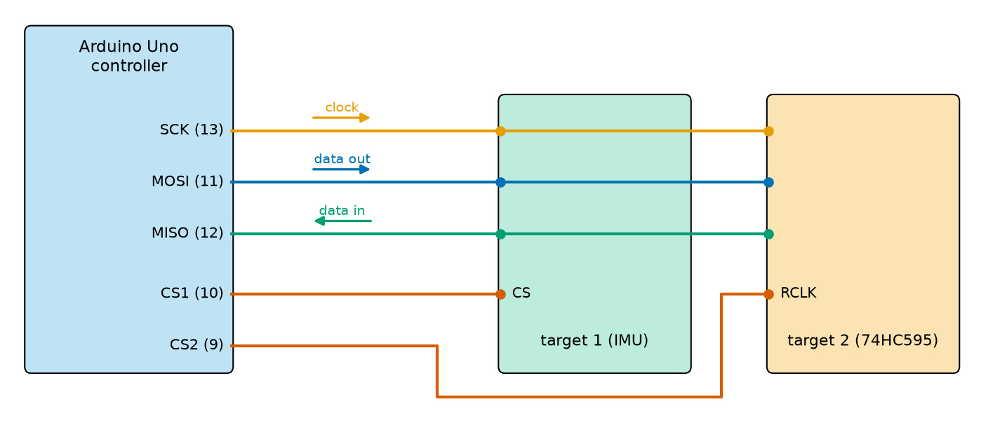
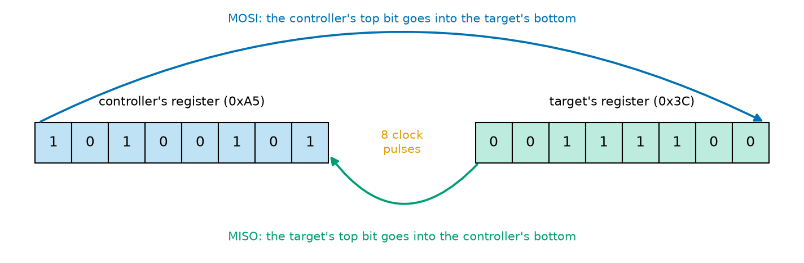
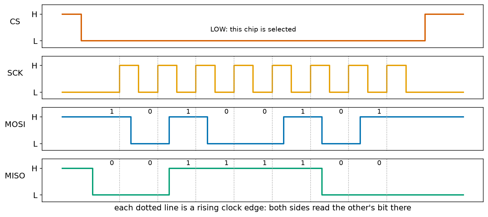
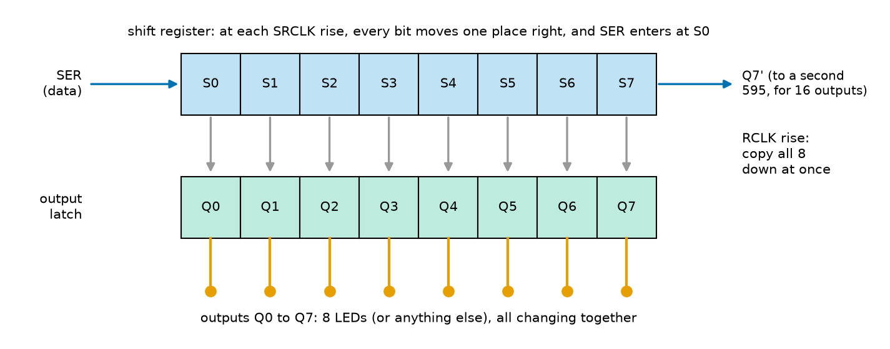
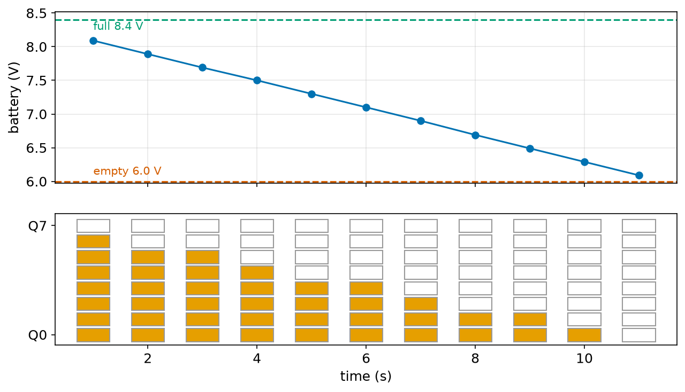
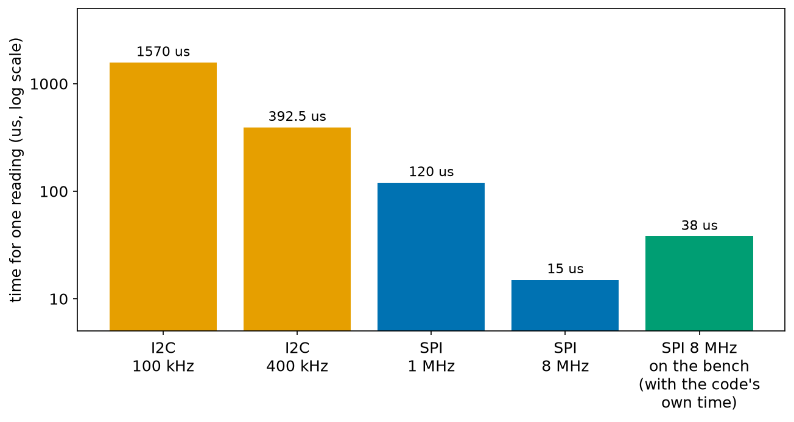

# Chapter 109 — Communication part 3: SPI

> **Part 6 · Chapter 109 of 749**
> **You need:** Chapter 91 (level shifting), Chapter 95 (Application 1: running out of pins), Chapter 96 (`int16_t`), Chapter 98 (`digitalWrite` takes a few microseconds), Chapter 101 (Rover's battery monitor), Chapter 106 (bit operators, shift registers of bits) and Chapter 108 (I2C, registers, the MPU-6050).
> **You will make:** a model of how SPI swaps two bytes in 8 clock pulses, a 74HC595 shift register driven first by software and then by the SPI hardware (10 times faster), a battery bar-graph of 8 LEDs from 3 pins, and an IMU read over SPI in 38 µs instead of I2C's 1,570.

---

## What you will learn

- How **SPI** works: a clock, a data wire each way, and one **chip-select** wire per device.
- Why SPI sends and receives **at the same time**, and what "full duplex" means.
- The four **SPI modes**, and why they must match the chip.
- How a **74HC595 shift register** turns 3 pins into 8 outputs (or 16, or 24).
- How to use the Arduino `SPI` library, and `shiftOut()` when SPI pins are not free.
- When to choose SPI, I2C or UART.

---

## New words in this chapter

| Word | Simple meaning |
|---|---|
| **SPI** | Serial Peripheral Interface: a fast bus with a clock, two data wires and a chip select per device. |
| **MOSI / MISO** | Controller Out Target In / Controller In Target Out: the two data wires. |
| **SCK** | The clock wire, driven by the controller. |
| **chip select (CS)** | A wire per target, pulled LOW to tell that one chip "this is for you". |
| **full duplex** | Data travels both ways at the same time. |
| **shift register** | A row of bit stores that moves its bits one place along at each clock pulse. |
| **latch** | A store that copies its input and then holds it steady until told to copy again. |
| **daisy chain** | Chips connected one after another, each passing data on to the next. |

---

## 109.1 Four wires and a fast clock

Chapter 108's I2C is clever with its wires: two for everything. The price is speed: open-drain lines rise slowly through their pull-ups, every byte waits for an acknowledge, and every transaction starts with an address. Reading Rover's IMU took 1.57 ms at 100 kHz.

📖 **New word: SPI** — **S**erial **P**eripheral **I**nterface, created by Motorola in the 1980s. It drops the clever parts to go fast:

- **SCK** (serial clock): driven by the controller, typically 1 to 20 MHz (the Uno can make up to 8 MHz);
- **MOSI** (controller out, target in): data from the controller;
- **MISO** (controller in, target out): data back from the target;
- **CS** (chip select, also called SS, "slave select", in older documents): **one wire per target**, LOW when that target is being talked to.

📖 **New words: MOSI, MISO, SCK** — the three shared wires. (Newer documents may call them COPI, CIPO and SCLK; they are the same wires.)

📖 **New word: chip select (CS)** — instead of an address, each target has its own wire. A target ignores everything on the bus while its CS is HIGH, and listens (and answers on MISO) while its CS is LOW.

On the Uno, the SPI hardware is fixed to pins **13 (SCK)**, **11 (MOSI)** and **12 (MISO)**. Chip selects can be any digital pins; pin 10 is the usual first one.



*Figure 109.1 — One controller and two targets. SCK, MOSI and MISO are shared; each target has its own chip-select wire.*

**How to read this picture:** The orange (clock) and blue (data out) wires go from the Uno to both targets; the green wire (data in) comes back from both. The red wires are the chip selects: pin 10 to the IMU's CS, pin 9 to the shift register's RCLK pin (which works as its chip select, section 109.4). Only the chip whose red wire is LOW takes part; the other ignores the clock.

Unlike I2C, every line is driven actively, HIGH and LOW: push-pull outputs, no pull-ups, sharp edges, so the clock can run 20 to 100 times faster. And because no two chips are selected at once, two chips never drive MISO together. (A target releases MISO when it is not selected, so the others can use it.)

🔢 **No addresses, no acknowledges.** A byte on SPI is exactly 8 clock pulses. Nothing says "I am here": if a chip is missing, the controller simply reads `0xFF` (or `0x00`) and carries on. Checking a chip's ID register at start-up (as Chapter 108 did with WHO_AM_I) is the only way to know.

---

## 109.2 Both ways at once

📖 **New word: shift register** — a row of bit stores (flip-flops) that, at each clock pulse, moves every bit one place along. A bit goes in at one end, and the bit at the other end comes out.

The heart of SPI is two 8-bit shift registers, one in the controller and one in the target, joined in a ring by MOSI and MISO.



*Figure 109.2 — At each clock pulse, each side's top bit crosses to the other side's bottom.*

**How to read this picture:** Left, the Uno's register holding 0xA5; right, the chip's register holding 0x3C. At every clock pulse the blue path carries the Uno's highest bit over MOSI into the bottom of the chip's register, and at the same moment the green path carries the chip's highest bit over MISO into the bottom of the Uno's register. Both registers shift one place.

`spi_ring.py` steps through the 8 pulses:

```
clock  controller  target
start  10100101    00111100
    1  01001010    01111001
    2  10010100    11110010
    3  00101001    11100101
    4  01010011    11001010
    5  10100111    10010100
    6  01001111    00101001
    7  10011110    01010010
    8  00111100    10100101
the controller now holds 0x3C, the target 0xA5
```

After 8 pulses the two bytes have **swapped**.

📖 **New word: full duplex** — data travels both ways at the same time. Every SPI transfer is an exchange: to read a byte, the controller must send one (often 0x00, ignored by the chip), and while it sends a byte it always receives one (often meaningless). That is why the Arduino function is called `SPI.transfer(b)`: it sends `b` **and returns** the byte that came back.



*Figure 109.3 — CS goes LOW; 8 clock pulses; MOSI carries 0xA5 and MISO carries 0x3C, highest bit first.*

**How to read this picture:** Top to bottom: CS falls to select the chip and rises at the end. SCK gives 8 pulses. At each dotted line (a rising clock edge), both sides read the bit on the other side's wire; between the edges, while the clock is LOW, each side puts its next bit on its own wire. Read the bits above MOSI left to right: 1 0 1 0 0 1 0 1 = 0xA5. MISO: 0 0 1 1 1 1 0 0 = 0x3C.

### SPI modes

There is no single rule for which clock edge to read on, or whether the clock rests LOW or HIGH. Two settings describe it: **CPOL** (clock polarity: does SCK rest LOW (0) or HIGH (1)?) and **CPHA** (clock phase: are bits read on the first edge of each pulse (0) or the second (1)?). Together they make four **SPI modes**:

| Mode | Clock rests | Bits read on |
|---|---|---|
| 0 | LOW | the rising edge (Figure 109.3) |
| 1 | LOW | the falling edge |
| 2 | HIGH | the falling edge |
| 3 | HIGH | the rising edge |

Mode 0 is the most common. The chip's datasheet says which it uses (often "mode 0 or 3"). The wrong mode usually gives bytes shifted by one bit, which looks like nonsense or like values twice or half as big.

The Arduino `SPI` library takes these settings together:

```cpp
SPI.beginTransaction(SPISettings(8000000, MSBFIRST, SPI_MODE0));   // speed, bit order, mode
```

The speed is a maximum: the Uno divides its 16 MHz by 2, 4, 8 … 128 and chooses the fastest that does not exceed it. `MSBFIRST` (most significant bit first) is almost universal. `beginTransaction` and `endTransaction` around each conversation let different chips on the same bus use different settings.

---

## 109.3 Running out of outputs: the 74HC595

Chapter 95 found Rover 4 pins short and mentioned shift registers as one way out. The **74HC595** is the classic one: an 8-bit shift register with an output stage, for a few cents.



*Figure 109.4 — The shift register (top), the output latch (bottom), and the eight output pins.*

**How to read this picture:** Bits enter at the left (SER, the data pin). At each rising edge of the shift clock (SRCLK), every bit in the top row moves one place right, and the new bit enters S0; the bit that falls off S7 leaves on the pin Q7′ (right). The top row's contents do **not** reach the outputs yet. Only when the latch clock (RCLK) rises are all 8 bits copied down at once into the bottom row, the outputs Q0 to Q7, which then stay steady until the next latch.

📖 **New word: latch** — a store that copies its input when told to and then holds it steady. The 595's latch means the outputs never show the half-shifted, flickering in-between patterns: they jump straight from the old byte to the new one.

Three pins drive it: data, shift clock and latch. They match SPI exactly: data = MOSI, shift clock = SCK, and latch = a chip-select pin used the opposite way round (LOW while sending, and its rising edge, at the end, latches). So a 595 can be driven by the SPI hardware. When pins 11 and 13 are busy, the Arduino function `shiftOut(dataPin, clockPin, MSBFIRST, value)` does the same in software on any pins, by calling `digitalWrite` three times per bit.

`shift_speed.ino` compares the two, sending the same pattern 100 times each way:

```
shiftOut: 104.0 us per update
SPI:      9.8 us per update
the 595 latched 200 times; first Q7..Q0 = 10110001, last Q7..Q0 = 10110001
```

(The last line comes from the test, which watches the simulated 595's outputs.) Both ways latched the right pattern, 10110001. `shiftOut` takes 104 µs: 24 `digitalWrite`s at about 4 µs each (Chapter 98), plus two for the latch. The SPI hardware takes 9.8 µs, most of which is the two `digitalWrite`s for the latch pin; the byte itself takes 1 µs at 8 MHz, plus a little library time.

📖 **New word: daisy chain** — chips connected in a line, each passing data on to the next. Connect the first 595's Q7′ to a second 595's SER, share the clocks, and the pair is a 16-bit shift register: send two bytes, then latch, and 16 outputs change together. Three pins can drive as many outputs as you like, at 8 per chip.

⚠️ **Careful: the 595's outputs are weak-ish.** Each output can give about 6 mA comfortably (35 mA absolute maximum), and the whole chip at most 70 mA. Fine for 8 LEDs with 1 kΩ resistors (3 mA each); not for motors or relays, which need a transistor or a driver chip (Chapter 88).

---

## Code

All outputs come from the PC test bench. For this chapter the bench has an SPI bus with simulated chips: a 74HC595 that watches its pins (so it works with both `shiftOut` and SPI) and an MPU-6000 IMU (the SPI version of Chapter 108's MPU-6050, with the same registers). Each `SPI.transfer` takes 8 clock periods plus about 0.8 µs of library time.

File `code/ch109/spi_ring.py`:

```python
# spi_ring.py - SPI is two 8-bit shift registers joined in a ring: at each clock pulse, each side
# sends its top bit to the other and takes the other's top bit in at its bottom.
# After 8 pulses the two bytes have swapped places: data goes both ways at the same time.
controller = 0xA5                                 # the byte the Uno sends   (10100101)
target = 0x3C                                     # the byte the chip sends  (00111100)
print(f"clock  controller  target")
print(f"start  {controller:08b}    {target:08b}")
for pulse in range(1, 9):
    out_c = (controller >> 7) & 1                 # on MOSI: the controller's highest bit
    out_t = (target >> 7) & 1                     # on MISO: the target's highest bit
    controller = ((controller << 1) & 0xFF) | out_t
    target = ((target << 1) & 0xFF) | out_c
    print(f"{pulse:5d}  {controller:08b}    {target:08b}")
print(f"the controller now holds 0x{controller:02X}, the target 0x{target:02X}")
```

| Line | Code | What it does (simple English) |
|---|---|---|
| 1–3 | comments | The model. |
| 4–5 | `controller = 0xA5`, `target = 0x3C` | What each side has to send. |
| 6–7 | `print(…)` | Heading and starting values, as 8 binary digits. |
| 8 | `for pulse in range(1, 9):` | Eight clock pulses. |
| 9–10 | `out_c = (controller >> 7) & 1`, `out_t = …` | The top bit of each register (Chapter 106's shift and mask): what each side puts on its wire. |
| 11 | `controller = ((controller << 1) & 0xFF) \| out_t` | Shift left one place, drop the bit that left the top (`& 0xFF`), and put the bit from MISO in at the bottom. |
| 12 | `target = ((target << 1) & 0xFF) \| out_c` | The same for the target, with the bit from MOSI. |
| 13 | `print(…)` | Both registers after this pulse. |
| 14 | `print(…)` | The result in hex. |

File `code/ch109/shift_speed/shift_speed.ino`:

```cpp
// shift_speed.ino - send a byte to a 74HC595 shift register: with shiftOut() in software, then with hardware SPI
#include <SPI.h>
const int LATCH_PIN = 10;              // the 595's RCLK
const int DATA_PIN = 11;               // the 595's SER   (also SPI's MOSI pin)
const int CLOCK_PIN = 13;              // the 595's SRCLK (also SPI's SCK pin)

void writeShiftOut(byte pattern) {
  digitalWrite(LATCH_PIN, LOW);
  shiftOut(DATA_PIN, CLOCK_PIN, MSBFIRST, pattern);   // 8 bits, one clock pulse each, made in software
  digitalWrite(LATCH_PIN, HIGH);       // the rising edge copies the 8 bits to the outputs
}

void writeSPI(byte pattern) {
  digitalWrite(LATCH_PIN, LOW);
  SPI.transfer(pattern);               // the same 8 bits and 8 clock pulses, made by the SPI hardware
  digitalWrite(LATCH_PIN, HIGH);
}

void setup() {
  Serial.begin(115200);
  pinMode(LATCH_PIN, OUTPUT);
  pinMode(DATA_PIN, OUTPUT);
  pinMode(CLOCK_PIN, OUTPUT);

  unsigned long t0 = micros();
  for (int i = 0; i < 100; i++) {
    writeShiftOut(0b10110001);
  }
  unsigned long t1 = micros();

  SPI.begin();                         // from now on the SPI hardware drives pins 11 and 13
  SPI.beginTransaction(SPISettings(8000000, MSBFIRST, SPI_MODE0));
  unsigned long t2 = micros();
  for (int i = 0; i < 100; i++) {
    writeSPI(0b10110001);
  }
  unsigned long t3 = micros();
  SPI.endTransaction();

  Serial.print("shiftOut: ");
  Serial.print((t1 - t0) / 100.0, 1);
  Serial.println(" us per update");
  Serial.print("SPI:      ");
  Serial.print((t3 - t2) / 100.0, 1);
  Serial.println(" us per update");
}

void loop() {
}
```

| Line | Code | What it does (simple English) |
|---|---|---|
| 1–2 | comment, `#include <SPI.h>` | The SPI library, part of the Arduino software. |
| 3–5 | `LATCH_PIN = 10`, `DATA_PIN = 11`, `CLOCK_PIN = 13` | The 595 wired to the SPI pins, so the same wiring works both ways. |
| 6 | (blank) | |
| 7–11 | `void writeShiftOut(byte pattern) { digitalWrite(LATCH_PIN, LOW); shiftOut(…); digitalWrite(LATCH_PIN, HIGH); }` | Latch LOW, 8 bits in software, latch HIGH: the outputs change. |
| 12 | (blank) | |
| 13–17 | `void writeSPI(byte pattern) { … SPI.transfer(pattern); … }` | The same with the SPI hardware. The byte that comes back (from the 595's Q7′, if wired to MISO) is not used. |
| 18 | (blank) | |
| 19–23 | `void setup() { Serial.begin(…); pinMode(…) ×3` | |
| 24 | (blank) | |
| 25–29 | `t0 = micros(); for (…) { writeShiftOut(0b10110001); } t1 = micros();` | 100 updates in software. |
| 30 | (blank) | |
| 31 | `SPI.begin();` | Hand pins 11, 12 and 13 to the SPI hardware. After this, `digitalWrite` on 11 and 13 no longer works. |
| 32 | `SPI.beginTransaction(SPISettings(8000000, MSBFIRST, SPI_MODE0));` | 8 MHz, highest bit first, mode 0: what the 595 needs. |
| 33–37 | `t2 = micros(); for (…) { writeSPI(…); } t3 = micros();` | 100 updates with SPI. |
| 38 | `SPI.endTransaction();` | |
| 39 | (blank) | |
| 40–45 | `Serial.print(…)` | Average time per update, with one decimal. |
| 46–49 | `}`, `void loop() { }` | |

The output is in section 109.3.

File `code/ch109/bus_compare.py`:

```python
# bus_compare.py - time on the wires to read an IMU's 14 measurement bytes, I2C against SPI
# I2C: write (address + register) then read (address + 14 bytes), 9 clocks per byte, + start/stop (Chapter 108)
# SPI: 1 register byte + 14 data bytes, 8 clocks per byte, no address and no acknowledge bits
i2c_bits = (1 + 9 * 2 + 1) + (1 + 9 * 15 + 1)
spi_bits = 8 * 15
print(f"{'bus and clock':<16s} {'clock bits':>10s} {'time on the wires':>18s} {'readings per second, at most':>30s}")
for name, bits, hz in [("I2C 100 kHz", i2c_bits, 100e3), ("I2C 400 kHz", i2c_bits, 400e3),
                       ("SPI 1 MHz", spi_bits, 1e6), ("SPI 8 MHz", spi_bits, 8e6), ("SPI 20 MHz", spi_bits, 20e6)]:
    t = bits / hz
    print(f"{name:<16s} {bits:10d} {t * 1e6:15.1f} us {int(1 / t):30d}")
```

| Line | Code | What it does (simple English) |
|---|---|---|
| 1–3 | comments | How each bus spends its clock pulses. |
| 4 | `i2c_bits = (1 + 9 * 2 + 1) + (1 + 9 * 15 + 1)` | 157, as in Chapter 108. |
| 5 | `spi_bits = 8 * 15` | 120: one register byte and 14 data bytes. |
| 6 | `print(…)` | Heading. |
| 7–8 | `for name, bits, hz in […]:` | Five bus speeds. |
| 9 | `t = bits / hz` | Seconds on the wires. |
| 10 | `print(…)` | In microseconds, and how many fit in a second (`int` rounds down). |

Output:

```
bus and clock    clock bits  time on the wires   readings per second, at most
I2C 100 kHz             157          1570.0 us                            636
I2C 400 kHz             157           392.5 us                           2547
SPI 1 MHz               120           120.0 us                           8333
SPI 8 MHz               120            15.0 us                          66666
SPI 20 MHz              120             6.0 us                         166666
```

---

## Small examples

**Example 1.** At 8 MHz one SPI byte takes 8 ÷ 8,000,000 = 1 µs on the wires.

**Example 2.** `SPISettings(5000000, …)` on an Uno gives 4 MHz: the fastest of 8, 4, 2 … MHz that is not above 5 MHz.

**Example 3.** To read register 0x75 of an MPU-6000, send `0x75 | 0x80` = 0xF5, then any byte; the second byte back is the answer.

**Example 4.** Three daisy-chained 595s give 24 outputs from 3 pins; one update sends 3 bytes.

**Example 5.** With `shiftOut(…, LSBFIRST, 0b10110001)`, the 595 latches the bits in reverse: Q7..Q0 = `10001101`.

**Example 6.** Two SPI chips need 3 shared wires + 2 chip selects = 5 Uno pins; on I2C they would need 2.

**Example 7.** A 595 with all 8 LEDs on at 3 mA each uses 24 mA, well under its 70 mA total.

**Example 8.** A missing SPI chip makes every read return 0xFF (MISO floats HIGH): `WHO_AM_I = 0xFF` means "check the wiring".

---

## 🏭 Real robot applications

### Application 1 (worked in full) — 🤖 A battery bar-graph from 3 pins

**1. The real problem.** Chapter 101 built Rover's battery monitor; the Serial Monitor showed the volts. But Rover drives away from the computer. Its owner needs to see the battery level at a glance on the robot itself: a bar of 8 LEDs, full to empty. Driving 8 LEDs directly would take 8 pins, and Rover has none to spare (Chapter 95).

**2. Why this theory.** A 74HC595 drives 8 LEDs from the 3 SPI-style pins (section 109.3), and the latch makes the bar change cleanly from one pattern to the next. The SPI hardware sends the byte in microseconds. Reading the battery is Chapter 101's method: 16 readings averaged, against the internal 1.1 V reference, through a 68 kΩ / 10 kΩ divider on A3.

**3. The numbers.** Battery (two lithium cells): 8.4 V full, 6.0 V empty (Chapter 101). 8 LEDs over 2.4 V: one LED per 0.3 V. The test empties the battery from 8.30 V to 6.10 V in 11 seconds, hundreds of times faster than a real one, so that every step of the bar shows in one run. Pins: latch 10, data 11 (MOSI), clock 13 (SCK).

**4. The maths.** LEDs = (V − 6.0) ÷ 2.4 × 8, rounded to the nearest whole number (add 0.5 and drop the fraction), kept between 0 and 8. A pattern of n LEDs lit from the bottom is the number with n ones at the right: (1 << n) − 1. For n = 3: 8 − 1 = 7 = `0b00000111`. For n = 8: 256 − 1 = 255 = `0b11111111`.

**5. The code.** File `code/ch109/battery_bar/battery_bar.ino`:

```cpp
// battery_bar.ino - Rover's battery level on a bar of 8 LEDs, driven by a 74HC595 over SPI
#include <SPI.h>
const int LATCH_PIN = 10;              // the 595's RCLK, used like a chip select
const int BATTERY_PIN = A3;            // the battery through 68 k / 10 k (Chapter 101)
const float FULL = 8.4;                // volts
const float EMPTY = 6.0;
unsigned long lastUpdate = 0;
byte shown = 0;                        // the pattern the LEDs show now

float batteryVolts() {                 // Chapter 101's battery monitor: 16 readings, internal 1.1 V reference
  long sum = 0;
  for (int i = 0; i < 16; i++) {
    sum += analogRead(BATTERY_PIN);
  }
  float count = sum / 16.0;
  return count * 1.1 / 1024.0 / (10.0 / 78.0);
}

byte barPattern(float volts) {         // how many LEDs, as a pattern of 1s from the bottom
  int leds = (int)((volts - EMPTY) / (FULL - EMPTY) * 8 + 0.5);   // 0 to 8, rounded
  leds = constrain(leds, 0, 8);
  return (byte)((1 << leds) - 1);      // 3 LEDs: (1 << 3) - 1 = 8 - 1 = 0b00000111
}

void showBar(byte pattern) {
  SPI.beginTransaction(SPISettings(8000000, MSBFIRST, SPI_MODE0));
  digitalWrite(LATCH_PIN, LOW);
  SPI.transfer(pattern);
  digitalWrite(LATCH_PIN, HIGH);       // the new pattern appears on the LEDs, all 8 at once
  SPI.endTransaction();
  shown = pattern;
}

void setup() {
  Serial.begin(115200);
  analogReference(INTERNAL);
  pinMode(LATCH_PIN, OUTPUT);
  SPI.begin();
  showBar(0);
}

void loop() {
  if (millis() - lastUpdate >= 1000) {
    lastUpdate += 1000;
    float v = batteryVolts();
    byte bar = barPattern(v);
    if (bar != shown) {
      showBar(bar);                    // only talk to the 595 when the picture changes
    }
    Serial.print(millis() / 1000);
    Serial.print(" s: ");
    Serial.print(v, 2);
    Serial.print(" V  [");
    for (int k = 7; k >= 0; k--) {     // draw the bar: Q7 on the left, Q0 on the right
      Serial.print((shown >> k) & 1 ? "#" : ".");
    }
    Serial.println("]");
  }
}
```

| Line | Code | What it does (simple English) |
|---|---|---|
| 1–2 | comment, `#include <SPI.h>` | |
| 3–6 | `LATCH_PIN`, `BATTERY_PIN`, `FULL`, `EMPTY` | Pins and the battery's range. |
| 7–8 | `lastUpdate`, `shown` | A timer, and what the LEDs show now. |
| 9 | (blank) | |
| 10–17 | `float batteryVolts() { … }` | Chapter 101: sum 16 readings in a `long`, average, convert to battery volts with the 1.1 V reference and the divider ratio 10 ÷ 78. |
| 18 | (blank) | |
| 19–23 | `byte barPattern(float volts) { … }` | Section 4's maths. `constrain` keeps 0 to 8 even if the battery reads above full or below empty. `(byte)` keeps the low 8 bits. |
| 24 | (blank) | |
| 25–32 | `void showBar(byte pattern) { SPI.beginTransaction(…); digitalWrite(LATCH_PIN, LOW); SPI.transfer(pattern); digitalWrite(LATCH_PIN, HIGH); SPI.endTransaction(); shown = pattern; }` | Send one byte to the 595 and latch it; remember it. |
| 33 | (blank) | |
| 34–40 | `void setup() { … analogReference(INTERNAL); … SPI.begin(); showBar(0); }` | The 1.1 V reference (Chapter 101), SPI on, all LEDs off. |
| 41 | (blank) | |
| 42–44 | `void loop() { if (millis() - lastUpdate >= 1000) { lastUpdate += 1000;` | Once a second. |
| 45–49 | `float v = batteryVolts(); byte bar = barPattern(v); if (bar != shown) { showBar(bar); }` | Talk to the 595 only when the bar must change. |
| 50–57 | `Serial.print(…)`, `for (int k = 7; k >= 0; k--) { … }` | Print the time, the volts, and a picture of the bar: `#` for a lit LED, `.` for a dark one. |
| 58–59 | `}` `}` | |

Output:

```
1 s: 8.09 V  [.#######]
2 s: 7.89 V  [..######]
3 s: 7.69 V  [..######]
4 s: 7.50 V  [...#####]
5 s: 7.30 V  [....####]
6 s: 7.10 V  [....####]
7 s: 6.90 V  [.....###]
8 s: 6.69 V  [......##]
9 s: 6.49 V  [......##]
10 s: 6.29 V  [.......#]
11 s: 6.09 V  [........]
```



*Figure 109.5 — The battery voltage (top) and the 8 LEDs at each second (bottom), from the PC test bench.*

**How to read this picture:** Top: the battery falls steadily from 8.1 V to 6.1 V, between the green "full" and red "empty" lines. Bottom: one column of 8 LEDs per second, Q0 at the bottom; orange is lit. The bar shrinks one LED for about every 0.3 V, and is dark at 6.09 V.

**6. The result.** The bar followed the battery: 7 LEDs at 8.09 V, 4 at 7.30 V, 1 at 6.29 V, none at 6.09 V. Each value matches the formula: (8.09 − 6.0) ÷ 2.4 × 8 = 6.97, rounded to 7. Three pins drive all 8 LEDs, and the sketch only talks to the 595 when the picture changes (8 times in 11 seconds), each time for about 10 µs.

**7. Going further.** A real gauge needs two more things. A battery's voltage drops while the motors draw current and recovers when they stop (Chapter 89's internal resistance), so the bar would flicker by an LED as Rover drives: average over several seconds, or only allow the bar to go down while driving. And the last LED should **blink** below about 6.4 V as a warning, using Chapter 103's `millis()` pattern to send a new byte twice a second.

### Application 2 (worked in full) — 🚁 Reading an IMU fast enough for a drone

**1. The real problem.** A drone's attitude controller runs at 1 to 8 kHz (Chapter 94), and each run needs a fresh IMU reading: 14 bytes of acceleration, temperature and rotation. Chapter 108 found that I2C needs 1.57 ms per reading at 100 kHz and 0.39 ms at 400 kHz: at 1 kHz the I2C bus alone would use 39% of every millisecond, and 8 kHz is impossible.

**2. Why this theory.** SPI has no address bytes and no acknowledges (8 clocks per byte instead of 9), and its push-pull lines allow far faster clocks (section 109.1). The MPU-6000 is the SPI version of the MPU-6050, with the same registers, so Chapter 108's register knowledge carries over. One difference: on SPI, bit 7 of the register byte says "read" (1) or "write" (0).

**3. The numbers.** The MPU-6000 datasheet allows SPI up to 1 MHz for all registers, and up to 20 MHz when reading the measurement and interrupt registers. The Uno's fastest is 8 MHz. One reading: 1 register byte + 14 data bytes = 15 bytes. The test makes the drone turn (yaw) at 90 °/s from 0.5 to 1.0 s.

**4. The maths.** On the wires (`bus_compare.py`): 15 × 8 = 120 clocks; at 8 MHz, 15 µs; at 1 MHz, 120 µs. The sketch also spends time in `digitalWrite` for CS (about 4 µs each, twice) and in the library (about 0.8 µs per byte): about 15 + 8 + 12 = 35 µs, plus 3 µs for the second `micros()` call itself. Rotation: 131 counts per °/s (Chapter 96), so 90 °/s = 11,790 counts.

**5. The code.** File `code/ch109/imu_spi/imu_spi.ino`:

```cpp
// imu_spi.ino - read an MPU-6000 IMU over SPI (the SPI version of Chapter 108's MPU-6050), and time each reading
#include <SPI.h>
const int IMU_CS = 10;                 // the IMU's chip select
const SPISettings SLOW(1000000, MSBFIRST, SPI_MODE0);   // settings registers: at most 1 MHz (datasheet)
const SPISettings FAST(8000000, MSBFIRST, SPI_MODE0);   // measurements: up to 20 MHz; the Uno's top is 8 MHz
unsigned long lastRead = 0;

byte readRegister(byte reg) {
  SPI.beginTransaction(SLOW);
  digitalWrite(IMU_CS, LOW);           // select the IMU
  SPI.transfer(reg | 0x80);            // the register number, with bit 7 = 1 for "read"
  byte value = SPI.transfer(0);        // send anything: the chip's answer comes back at the same time
  digitalWrite(IMU_CS, HIGH);          // deselect
  SPI.endTransaction();
  return value;
}

void writeRegister(byte reg, byte value) {
  SPI.beginTransaction(SLOW);
  digitalWrite(IMU_CS, LOW);
  SPI.transfer(reg & 0x7F);            // bit 7 = 0 for "write"
  SPI.transfer(value);
  digitalWrite(IMU_CS, HIGH);
  SPI.endTransaction();
}

void setup() {
  Serial.begin(115200);
  pinMode(IMU_CS, OUTPUT);
  digitalWrite(IMU_CS, HIGH);          // not selected until we talk to it
  SPI.begin();
  Serial.print("WHO_AM_I = 0x");
  Serial.println(readRegister(0x75), HEX);
  writeRegister(0x6B, 0);              // wake up, as in Chapter 108
}

void loop() {
  if (millis() - lastRead >= 250) {
    lastRead += 250;
    byte raw[14];
    unsigned long t0 = micros();
    SPI.beginTransaction(FAST);
    digitalWrite(IMU_CS, LOW);
    SPI.transfer(0x3B | 0x80);         // start reading at ACCEL_XOUT_H
    for (int i = 0; i < 14; i++) {
      raw[i] = SPI.transfer(0);        // all 14 measurement bytes, one after another
    }
    digitalWrite(IMU_CS, HIGH);
    SPI.endTransaction();
    unsigned long t1 = micros();
    int16_t az = (int16_t)((raw[4] << 8) | raw[5]);     // acceleration Z: bytes 4 and 5
    int16_t gz = (int16_t)((raw[12] << 8) | raw[13]);   // rotation Z: bytes 12 and 13
    Serial.print(millis());
    Serial.print(" ms: z ");
    Serial.print(az / 16384.0, 3);
    Serial.print(" g, turning ");
    Serial.print(gz / 131.0, 1);       // 131 counts per degree per second (Chapter 96)
    Serial.print(" deg/s; the 14-byte read took ");
    Serial.print(t1 - t0);
    Serial.println(" us");
  }
}
```

| Line | Code | What it does (simple English) |
|---|---|---|
| 1–3 | comment, `#include <SPI.h>`, `IMU_CS = 10` | |
| 4–5 | `const SPISettings SLOW(…)`, `FAST(…)` | Two sets of settings, kept as constants: 1 MHz for registers, 8 MHz for measurements. |
| 6 | `lastRead` | |
| 7 | (blank) | |
| 8–16 | `byte readRegister(byte reg) { … SPI.transfer(reg \| 0x80); byte value = SPI.transfer(0); … }` | Select, send the register number with the read bit (Chapter 106's `\|`), send a dummy byte and keep what comes back, deselect. |
| 17 | (blank) | |
| 18–25 | `void writeRegister(byte reg, byte value) { … SPI.transfer(reg & 0x7F); SPI.transfer(value); … }` | `& 0x7F` clears bit 7: "write". |
| 26 | (blank) | |
| 27–31 | `void setup() { … pinMode(IMU_CS, OUTPUT); digitalWrite(IMU_CS, HIGH); SPI.begin();` | CS HIGH first, so the chip does not see half a conversation while SPI starts. |
| 32–34 | `Serial.print("WHO_AM_I = 0x"); Serial.println(readRegister(0x75), HEX); writeRegister(0x6B, 0);` | Check the ID, wake the chip. |
| 35 | `}` | |
| 36 | (blank) | |
| 37–39 | `void loop() { if (millis() - lastRead >= 250) { lastRead += 250;` | Four readings per second, to print; a flight controller would read thousands. |
| 40–41 | `byte raw[14]; unsigned long t0 = micros();` | Room for the bytes; start timing. |
| 42–49 | `SPI.beginTransaction(FAST); digitalWrite(IMU_CS, LOW); SPI.transfer(0x3B \| 0x80); for (…) { raw[i] = SPI.transfer(0); } digitalWrite(IMU_CS, HIGH); SPI.endTransaction();` | One conversation: the start register, then 14 dummy bytes out and 14 measurement bytes in. |
| 50 | `unsigned long t1 = micros();` | |
| 51–52 | `int16_t az = (int16_t)((raw[4] << 8) \| raw[5]); …` | High byte first, as in Chapter 108. The bytes are already in the array, so the order of evaluation is no problem here. |
| 53–60 | `Serial.print(…)` … | Acceleration Z in g, rotation in °/s, and the time. |
| 61–62 | `}` `}` | |

Output:

```
WHO_AM_I = 0x68
250 ms: z 1.000 g, turning 0.0 deg/s; the 14-byte read took 38 us
500 ms: z 1.000 g, turning 90.0 deg/s; the 14-byte read took 38 us
750 ms: z 1.000 g, turning 90.0 deg/s; the 14-byte read took 38 us
1000 ms: z 1.000 g, turning 0.0 deg/s; the 14-byte read took 38 us
1250 ms: z 1.000 g, turning 0.0 deg/s; the 14-byte read took 38 us
```



*Figure 109.6 — The time to read 14 bytes on each bus (log scale): wire time from `bus_compare.py`, and the bench's measurement with the code's own time (green).*

**How to read this picture:** The height of each bar is time, on a logarithmic scale (each line is ten times the one below). I2C at 100 kHz needs 1,570 µs; SPI at 8 MHz needs 15 µs on the wires, a hundred times less. The green bar is what the sketch really spent, 38 µs, including the `digitalWrite`s and library time.

**6. The result.** The chip answered with the same ID as its I2C twin, the readings were right (1 g on Z, 90 °/s during the turn), and each complete reading took 38 µs: **41 times faster** than I2C at 100 kHz, and 10 times faster than I2C at 400 kHz. At 1 kHz, reading the IMU now costs under 4% of the time. This is why flight controllers put their IMU on SPI and leave the slower sensors on I2C (Chapter 108, Application 3).

**7. Going further.** A real flight controller goes further still. It writes the CS pin through its port register (Chapter 106) instead of `digitalWrite`, saving most of the 8 µs. On a 32-bit board the SPI clock can reach the chip's 20 MHz, and a **DMA** controller (direct memory access: hardware that copies data between a peripheral and memory by itself) moves the 15 bytes while the CPU does other work. The IMU's "data ready" pin starts each reading through an interrupt (Chapter 105). Our own flight controller in Chapter 641 is built this way.

### Application 3 — 🏭 Stepper motor drivers you can talk to

Simple stepper drivers (Chapter 145) take only STEP and DIRECTION pins. Advanced ones, such as the TMC2130 and TMC5160 used in 3D printers and small CNC machines, also have an SPI port. Through it, the controller sets the motor current in fine steps, chooses the microstepping, turns on silent modes, and reads back a **load measurement** that rises when the motor is close to stalling. 3D printers use this "sensorless homing": the axis moves until the load reading jumps (the carriage has hit the end), with no end switch at all. Several drivers share one SPI bus with separate chip selects, or are daisy-chained like 595s.

### Application 4 — 🤖 Logging to an SD card

An SD card (the same kind as in a camera) can be read and written over SPI: this is the "SPI mode" every SD card supports. A robot or drone logs its sensors, commands and battery to a file many times per second, and the log is read on a computer after the run to find out what happened (Chapter 639 does this with flight logs). The Arduino SD library speaks SPI to the card underneath, with a chip-select pin of its own; the IMU and the card can share the bus. Writing needs care: an SD card sometimes pauses for tens of milliseconds while it erases internally, so a robot buffers its log in memory and writes in big blocks, never inside a timing-critical loop.

### Application 5 — 🖥️ Displays

Small colour displays (TFT and OLED screens) on robot control panels and handheld controllers are almost always driven over SPI, with one extra pin, D/C, that tells the display whether each byte is a command or pixel data. A 240 × 240 colour screen has 57,600 pixels of 2 bytes each: 115,200 bytes for one full picture. At 8 MHz that is 115 ms (about 8 pictures per second); a 32-bit board at 40 MHz manages 40. That is why robot screens usually redraw only the parts that change, such as a battery number or a status icon, rather than the whole screen.

---

## 🔧 Hands-on lab

### Lab 109.1 — Eight LEDs from three pins (hardware or Wokwi)

You need: an Uno (or Wokwi), a 74HC595, 8 LEDs, 8 resistors of 1 kΩ, jumper wires. Wokwi has a 74HC595 part.

1. Wire the 595: VCC (pin 16) and MR (pin 10) to 5 V; GND (pin 8) and OE (pin 13) to GND; SER (pin 14) to Uno pin 11; SRCLK (pin 11) to Uno pin 13; RCLK (pin 12) to Uno pin 10. Each output Q0–Q7 through a 1 kΩ resistor to an LED to GND.
2. Upload `shift_speed.ino`. The LEDs should show `10110001` (Q7 on the left).
3. Change `MSBFIRST` to `LSBFIRST` in `writeShiftOut`, and comment out the SPI part. Upload again.

**What you should see:** Step 2: LEDs Q7, Q5, Q4 and Q0 on. Step 3: the pattern reversed, `10001101` (Q7, Q3, Q2 and Q0), because the first bit sent ends up furthest along. The PC test bench shows the same: `first Q7..Q0 = 10001101`.

| If it does not work | Likely cause | Fix |
|---|---|---|
| No LEDs at all | OE not at GND, or MR not at 5 V | OE (13) LOW enables the outputs; MR (10) HIGH stops the reset |
| LEDs flicker or show junk | No 100 nF capacitor across the 595's supply | Add one between pins 16 and 8 (Chapter 84) |
| The pattern is shifted by one | Clock and latch swapped | SRCLK = pin 11 of the 595, RCLK = pin 12 |

**Challenge:** Add a second 595 (daisy chain: Q7′, pin 9, to the second's SER; shared clocks) and make a 16-LED light that runs from one end to the other. Send two bytes before each latch.

### Lab 109.2 — The battery bar (simulation, then hardware)

Copy `battery_bar.ino` and `pc_tests/test_battery_bar.cpp`.

1. Run the test and compare with Application 1.
2. Change the bar to light from the top instead (`0xFF << (8 - leds)`) and run again. Watch out for 8 − 0 = 8.
3. On hardware: connect a bench power supply set to 7.5 V through the 68 kΩ / 10 kΩ divider to A3 (never more than 8.4 V), and turn it down slowly.

**What you should see:** Step 2: the lit LEDs now gather at Q7 and the dark ones at Q0. With `leds = 0`, `0xFF << 8` is 0xFF00, and `(byte)` keeps 0x00: still right. Step 3: one LED goes out for about every 0.3 V.

| If it does not work | Likely cause | Fix |
|---|---|---|
| All LEDs always on | The battery reading is too high: `DEFAULT` reference | `analogReference(INTERNAL)` and the 68 k / 10 k divider |
| The bar jumps between two values | The voltage sits near a step | Add hysteresis: change only if the new count differs by 2, or wait for 3 equal readings |

**Challenge:** Make the lowest LED blink at 2 Hz when the battery is below 6.4 V, without `delay()`.

### Lab 109.3 — How fast is fast? (simulation)

Copy `imu_spi.ino` and `pc_tests/test_imu_spi.cpp`.

1. Run it and note the time per reading.
2. Do practice question 11 (1 MHz).
3. Replace the two `digitalWrite(IMU_CS, …)` calls in `loop()` with port register writes (pin 10 is bit 2 of port B: `PORTB &= ~(1 << 2);` and `PORTB |= (1 << 2);`) and add `#include "avr_regs.h"` to the test (the bench's registers, Chapter 106). Run again.

**What you should see:** Step 1: 38 µs. Step 2: 143 µs. Step 3: 30 µs, 8 µs less, since each `digitalWrite` cost about 4 µs and each register write 0.125 µs.

| If it does not work | Likely cause | Fix |
|---|---|---|
| WHO_AM_I = 0xFF | CS never goes LOW, or the chip is on another pin | Check `IMU_CS` |
| All readings 0 | The chip was not woken | `writeRegister(0x6B, 0)` |
| Readings look like random large numbers | The wrong SPI mode or bit order | Mode 0 (or 3), `MSBFIRST` |

**Challenge:** Read the IMU 1,000 times as fast as possible and measure the total time. How many readings per second could the Uno do, and what fraction of a 1 kHz loop does each use?

---

## Common mistakes

⚠️ **MOSI to MISO.** Unlike UART, SPI does **not** cross over: MOSI goes to MOSI (the target's data in, sometimes labelled SDI or DIN), MISO to MISO (SDO or DOUT).

⚠️ **Forgetting to raise CS between conversations.** Many chips only reset their "first byte is the register number" logic when CS goes HIGH.

⚠️ **Two chips selected at once.** Both drive MISO; the data is garbage and the outputs fight.

⚠️ **The wrong SPI mode.** Values come out shifted by one bit.

⚠️ **Using `digitalWrite` on pins 11 or 13 after `SPI.begin()`.** The SPI hardware owns them.

⚠️ **Pin 10 as an input on the Uno.** If the SS pin (10) is an input and goes LOW, the Uno's SPI hardware switches itself into target mode and stops working as controller. Keep pin 10 an output (as `SPI.begin()` sets it), even if you use another pin for CS.

⚠️ **5 V SPI signals into a 3.3 V chip.** SPI is push-pull, so use a one-way level shifter or divider on SCK, MOSI and CS (Chapter 91), and check that the chip's 3.3 V MISO HIGH is enough for the Uno.

⚠️ **Long SPI wires.** At several MHz, wires longer than 20–30 cm ring and pick up noise; keep SPI on the board, or slow it down.

---

## Practice

🏋️ **1.** Name the four SPI signals and which way each travels.

🏋️ **2.** How does an SPI target know a byte is meant for it? How does an I2C target know?

🏋️ **3.** Why must the controller send a byte to receive one?

🏋️ **4.** What do CPOL and CPHA describe? Which mode is most common?

🏋️ **5.** How many 595s, and how many Uno pins, are needed for 40 LEDs?

🏋️ **6.** A sketch sends `0b00001111` to a 595 with `shiftOut(…, MSBFIRST, …)`. Which outputs are on?

🏋️ **7.** How many LEDs does the battery bar show at 7.0 V? Give the byte sent to the 595.

🏋️ **8.** To write the value 0x10 to register 0x1B of an MPU-6000, which two bytes are sent?

🏋️ **9.** Give two reasons why a drone reads its IMU over SPI, not I2C.

🏋️ **10.** Your robot has a UART GPS, an I2C compass, and an SPI SD card and IMU. How many Uno pins does that take (not counting power and ground)?

🏋️ **11.** In `imu_spi.ino`, make the measurement reading use the `SLOW` settings (1 MHz) instead of `FAST`. Run it on the PC test bench. How long does a reading take now, and how does it compare with I2C at 400 kHz?

---

## Answers

**1.** SCK (clock, controller → target), MOSI (data, controller → target), MISO (data, target → controller), CS (select, controller → one target).

**2.** SPI: its own chip-select wire is LOW. I2C: the address byte at the start of the transaction matches its address.

**3.** SPI is an exchange of two shift registers: the clock that moves the target's bits out also moves the controller's bits in. The controller makes the clock only while it sends.

**4.** CPOL: whether the clock rests LOW or HIGH. CPHA: whether data is read on the first or second edge of each clock pulse. **Mode 0** (rests LOW, read on the rising edge).

**5.** 40 ÷ 8 = **5 chips** in a daisy chain, still **3 pins**.

**6.** The 595's Q3, Q2, Q1 and Q0 (the four lowest outputs).

**7.** (7.0 − 6.0) ÷ 2.4 × 8 = 3.33, + 0.5 = 3.83, so **3 LEDs**: `0b00000111` (7).

**8.** `0x1B & 0x7F` = **0x1B** (bit 7 already 0: write), then **0x10**.

**9.** Speed: 38 µs instead of 392 µs or more per reading, so a kHz loop is possible. And reliability: push-pull lines with no pull-ups, no acknowledges, and no other sensors waiting on the same bus. (Also: full duplex, and a clock of tens of MHz on 32-bit boards.)

**10.** UART: 2 (RX, TX). I2C: 2 (SDA, SCL). SPI: 3 shared (SCK, MOSI, MISO) + 2 chip selects = 5. Total **9 pins**.

**11.** Change line 42 to `SPI.beginTransaction(SLOW);`. PC test bench output:

```
WHO_AM_I = 0x68
250 ms: z 1.000 g, turning 0.0 deg/s; the 14-byte read took 143 us
500 ms: z 1.000 g, turning 90.0 deg/s; the 14-byte read took 143 us
```

**143 µs** per reading (15 bytes × (8 µs + 0.8 µs) = 132 µs, plus the CS `digitalWrite`s and `micros()`). Still almost **3 times faster** than I2C at 400 kHz (392.5 µs on the wires alone), and 11 times faster than I2C at 100 kHz, even though the SPI clock (1 MHz) is only 2.5 times the I2C clock: SPI wastes no clocks on addresses and acknowledges.

---

## Summary

🧠 **SPI**: SCK (clock), MOSI, MISO, and one **chip select** per target, pulled LOW to choose it. Push-pull lines, no addresses, no acknowledges: clocks of 1 to 20 MHz (8 MHz on the Uno).

🧠 SPI is **full duplex**: two shift registers swap their contents in 8 clock pulses. `SPI.transfer(b)` sends `b` and returns the byte that came back.

🧠 Four **modes** (CPOL, CPHA) and the bit order must match the chip. Use `SPI.beginTransaction(SPISettings(speed, MSBFIRST, SPI_MODEn))`.

🧠 A **74HC595** turns 3 pins into 8 outputs, and more when **daisy-chained**; its **latch** changes all outputs at once. SPI drives it in about 10 µs, `shiftOut()` in about 100 µs.

🧠 Choose by need: **UART** for two devices and long links (GPS, the Pi); **I2C** for many slow sensors on two wires; **SPI** for speed (IMUs, SD cards, displays).

---

## Next chapter

You have now used `Wire.h` and `SPI.h` without looking inside, and `#include` has appeared in every chapter since 95. Chapter 110, **Libraries and how they work inside**, opens them up: what a library is made of (a `.h` file and a `.cpp` file), how to install one and read its examples, how C++ **classes** let one library control several devices of the same kind, and how to turn Rover's own bumper and battery code into a small library of your own. It also looks inside SoftwareSerial, the library Chapter 107 mentioned, to see how a UART can be made in software.
