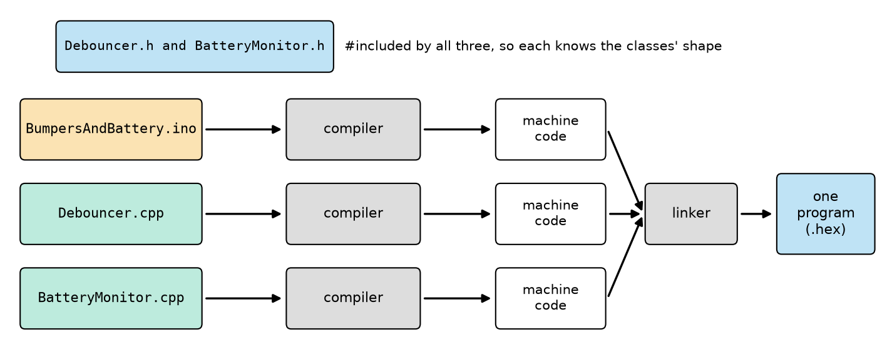
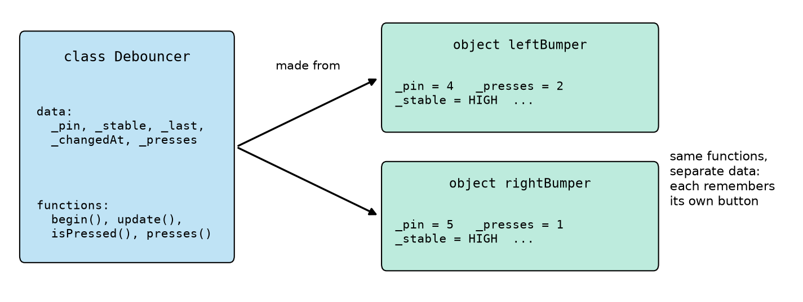
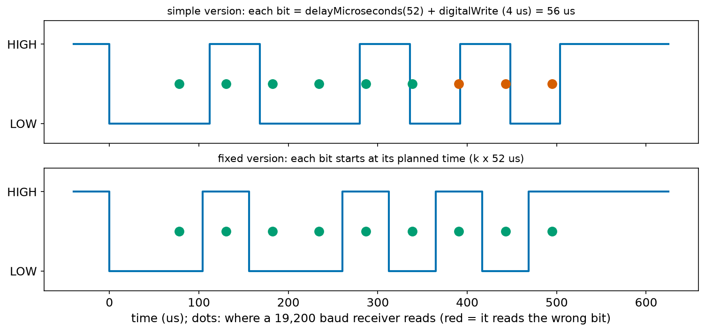
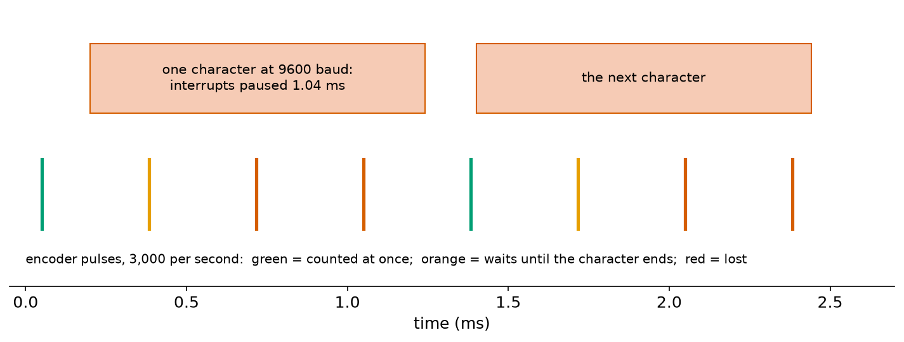
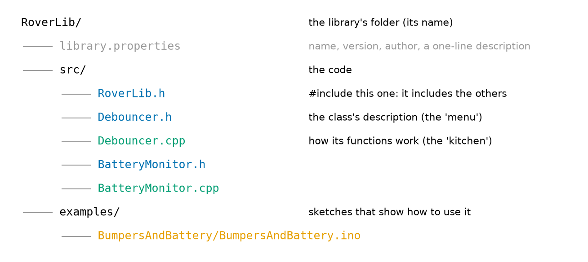
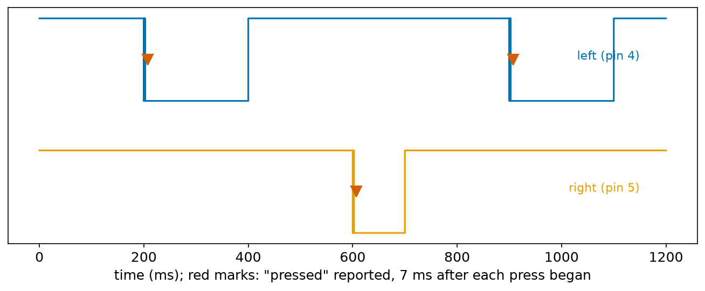

# Chapter 110 — Libraries and how they work inside

> **Part 6 · Chapter 110 of 749**
> **You need:** Chapter 28 (Python classes, `__init__` and `self`), Chapter 95 (compiling, linking, `#include`), Chapter 97 (functions, and the note about declarations outside sketches), Chapter 99 (debouncing), Chapter 101 (Rover's battery monitor), Chapter 105 (interrupts paused), Chapter 107 (UART frames) and Chapters 108–109 (the `Wire` and `SPI` libraries).
> **You will make:** a software UART transmitter written as a C++ class, found broken at 19,200 baud by a logic analyser on the PC test bench and then fixed; and **RoverLib**, a real Arduino library with a `Debouncer` class and a `BatteryMonitor` class, its `library.properties` file and an example sketch.

---

## What you will learn

- What a **library** is, how to install one, and where to find its examples.
- What `#include` really does, and why a library has a **`.h`** file and a **`.cpp`** file.
- How a library is compiled separately and joined to your sketch by the **linker**.
- How to write a C++ **class**: data, functions, a **constructor**, `public` and `private`.
- How one class gives many **objects**, each with its own data: one object per button.
- How a software UART like SoftwareSerial works, and why it pauses interrupts.
- How to package your own code as a library.

---

## New words in this chapter

| Word | Simple meaning |
|---|---|
| **library** | Ready-made code in a folder, which sketches can `#include`. |
| **header file (`.h`)** | The file that describes what a library offers: its classes and functions, without their inside. |
| **source file (`.cpp`)** | The file with the code that does the work. |
| **declaration / definition** | Saying that something exists and what it looks like / writing out how it works. |
| **class** | A description of a kind of thing: the data it holds and the functions it can do. |
| **object** | One thing made from a class, with its own copy of the data. |
| **constructor** | The function that runs when an object is made, to set up its data. |
| **`public` / `private`** | Parts of a class anyone may use / parts only the class's own functions may use. |

---

## 110.1 What a library is

Since Chapter 108 your sketches have started with `#include <Wire.h>` or `#include <SPI.h>`, and with a few lines they talked to an IMU or a shift register. Somebody else had written the hard part: setting up the chip's I2C hardware, waiting for each byte, handling errors.

📖 **New word: library** — ready-made code, kept in a folder, that any sketch can use with `#include`. Some come with the Arduino software (`Wire`, `SPI`, `Servo`, `SoftwareSerial`, `EEPROM`); thousands more are written by chip makers and by other people, for nearly every sensor, display and motor driver.

**Installing one.** In the Arduino IDE, **Tools → Manage Libraries…** opens the Library Manager. Type the name of a chip (for example "MPU6050") and choose a library; the IDE downloads it into your sketchbook's `libraries` folder (on Windows usually `Documents\Arduino\libraries`). A library can also come as a `.zip` file (**Sketch → Include Library → Add .ZIP Library…**), or be copied into that folder by hand. In Wokwi, libraries are listed in a file called `libraries.txt` in the project, or added with the Library Manager button.

**Its examples.** Almost every library comes with example sketches: **File → Examples**, then the library's name. They are the fastest way to learn a library: start from an example that works, then change it.

💡 **Tip: choosing a library.** For one chip there may be ten libraries. Prefer one that is recently updated, has many users, has examples, and comes from the chip maker or a known supplier (Adafruit, SparkFun, Pololu). Then read its examples before trusting it with your robot.

**`<…>` or `"…"`?** `#include <Wire.h>` looks for the file in the libraries folders. `#include "Debouncer.h"` looks first in the same folder as the file being compiled. Use `<…>` for installed libraries and `"…"` for files that belong to your own project.

---

## 110.2 What `#include` does, and why two files

`#include` is not magic. Before compiling, a step called the **preprocessor** replaces the line `#include "Debouncer.h"` with the entire text of `Debouncer.h`, as if you had pasted it in (Chapter 95 met it as the first of the build steps).

📖 **New words: declaration and definition** — a **declaration** says that something exists and what it looks like: "there is a function `update` that takes nothing and returns a `bool`". A **definition** writes out how it works: the function's body with its `{ … }`. C++ needs to see the declaration before you use something, but the definition may be anywhere, even in another file.

That is why a library has two kinds of files:

📖 **New word: header file (`.h`)** — the declarations: what the library offers, like a restaurant's **menu**. Every file that uses the library includes it.

📖 **New word: source file (`.cpp`)** — the definitions: how each function does its work, the **kitchen**. It is compiled once, by itself.



*Figure 110.2 — The sketch and each of the library's `.cpp` files are compiled separately; the linker joins them into one program.*

**How to read this picture:** Each row is one file going through the compiler on its own, becoming machine code. The headers at the top are included by all three, so each file knows the shape of the classes (what data, what functions) even though only `Debouncer.cpp` contains `Debouncer`'s code. At the right, the **linker** (Chapter 95) joins the three pieces, connecting every call of `leftBumper.update()` in the sketch to the code in `Debouncer.cpp`, and produces the one program that is uploaded.

Two things follow:

- **Code outside a sketch needs its declarations.** Chapter 97 noted that the IDE quietly adds missing function declarations to `.ino` files. It does not do this for `.cpp` files: there, every function must be declared before it is used, which the `.h` file does.
- **A header must be safe to include twice.** If `RoverLib.h` includes `Debouncer.h`, and the sketch includes both, the class would be declared twice, which is an error. The line `#pragma once` at the top of a header tells the preprocessor to skip the file if it has already been included. (Older code does the same with three lines: `#ifndef DEBOUNCER_H`, `#define DEBOUNCER_H`, … `#endif`.)

⚠️ **Careful: definitions in a header.** If a function's body is in a `.h` file and two `.cpp` files include it, the linker finds two copies and stops with "multiple definition of …". Bodies belong in the `.cpp` file. (Short functions written inside a class's `{ }` are an exception: C++ allows those in headers.)

---

## 110.3 Classes: one description, many objects

Chapter 28 built a `Robot` class in Python, with `__init__` and `self`. C++ classes are the same idea, with a little more to write.

📖 **New word: class** — a description of a kind of thing: what data each one holds and what functions it can do. A class is a blueprint: it makes nothing by itself.

📖 **New word: object** — one thing made from a class, with its own copy of the data. `Debouncer leftBumper(4);` makes an object called `leftBumper` from the class `Debouncer`.

Rover has two bumpers. Chapter 99's debounce code needed four variables per button (`stableLevel`, `lastReading`, `lastChange`, `presses`); for two bumpers, eight variables with different names, and the same code written twice. A class packs the four variables and the code together, and each object gets its own set:



*Figure 110.3 — The class `Debouncer` describes the data and the functions; each object holds its own data.*

**How to read this picture:** Left, the class: the names of the data every debouncer has, and the functions every debouncer can do. Right, two objects made from it. Each has its own `_pin` (4 and 5) and its own count of presses (2 and 1). Calling `leftBumper.update()` runs the class's `update` code on `leftBumper`'s data only.

Here is the class's header, `Debouncer.h`, from RoverLib:

```cpp
// Debouncer.h - one button or bumper, read with INPUT_PULLUP and debounced (Chapters 99 and 104)
// This file only DESCRIBES the class: what an object holds and what it can do.
#pragma once
#include <Arduino.h>

class Debouncer {
  public:
    Debouncer(uint8_t pin, unsigned long stableMs = 5);   // the constructor
    void begin();                      // call once, in setup()
    bool update();                     // call often; true once for each new press
    bool isPressed() const;            // the debounced state now
    unsigned long presses() const;     // how many presses so far

  private:
    uint8_t _pin;
    unsigned long _stableMs;           // how long a new level must stay before we believe it
    int _stable;                       // the level we believe
    int _last;                         // the level read last time
    unsigned long _changedAt;          // when _last last changed
    unsigned long _presses;
};
```

| Line | Code | What it does (simple English) |
|---|---|---|
| 1–2 | comments | |
| 3 | `#pragma once` | Include this file only once per compilation (section 110.2). |
| 4 | `#include <Arduino.h>` | A `.ino` file gets this automatically; a library file must ask for it, to know `uint8_t`, `HIGH`, `digitalRead` and so on. |
| 5 | (blank) | |
| 6 | `class Debouncer {` | The class's name; its description runs to the `};` on line 22. |
| 7 | `public:` | Everything after this, until `private:`, may be used by any sketch. |
| 8 | `Debouncer(uint8_t pin, unsigned long stableMs = 5);` | The **constructor** (below). `= 5` is a default: leave it out and you get 5 ms. |
| 9–12 | `void begin();` … `unsigned long presses() const;` | The functions every debouncer has: only declared here. `const` after the brackets promises that the function only reads the object's data and never changes it. |
| 13 | (blank) | |
| 14 | `private:` | Everything after this may be used only by the class's own functions. |
| 15–20 | `uint8_t _pin;` … `unsigned long _presses;` | The data each object holds. The `_` at the front is a common habit that marks "this belongs to the object". |
| 21 | `};` | The end of the class. The `;` is needed here, unlike after a function. |

📖 **New word: constructor** — the function that runs automatically when an object is made, to set up its data; it is C++'s `__init__`. It has the same name as the class and no return type. `Debouncer leftBumper(4);` calls it with `pin = 4`.

📖 **New words: `public` and `private`** — `public` parts are for anyone; `private` parts can be used only by the class's own functions. A sketch cannot write `leftBumper._presses = 100;`: the compiler refuses. This protects the object from being put into a state that makes no sense, and lets the library's author change the inside later without breaking anyone's sketch, as long as the public part stays the same.

And part of `Debouncer.cpp`, where the functions are defined:

```cpp
// Debouncer.cpp - how a Debouncer does its work
#include "Debouncer.h"

Debouncer::Debouncer(uint8_t pin, unsigned long stableMs) {
  _pin = pin;
  _stableMs = stableMs;
  _stable = HIGH;
  _last = HIGH;
  _changedAt = 0;
  _presses = 0;
}

void Debouncer::begin() {
  pinMode(_pin, INPUT_PULLUP);
  _stable = digitalRead(_pin);
  _last = _stable;
  _changedAt = millis();
}

bool Debouncer::update() {
  int now = digitalRead(_pin);
  if (now != _last) {                  // still changing: start timing again
    _last = now;
    _changedAt = millis();
  }
  if (_stable != _last && millis() - _changedAt >= _stableMs) {   // steady long enough: believe it
    _stable = _last;
    if (_stable == LOW) {              // pressed (the pull-up makes free = HIGH)
      _presses++;
      return true;
    }
  }
  return false;
}

bool Debouncer::isPressed() const {
  return _stable == LOW;
}

unsigned long Debouncer::presses() const {
  return _presses;
}
```

| Line | Code | What it does (simple English) |
|---|---|---|
| 1–2 | comment, `#include "Debouncer.h"` | The source file includes its own header, so it knows the class's shape. |
| 3 | (blank) | |
| 4 | `Debouncer::Debouncer(uint8_t pin, unsigned long stableMs) {` | `Debouncer::` means "belonging to the class `Debouncer`". This is the constructor's definition (the default `= 5` is written only in the header). |
| 5–10 | `_pin = pin;` … `_presses = 0;` | Store the pin and the time; start as "not pressed". No `self.` is needed: inside the class's functions, `_pin` means this object's `_pin`. |
| 11 | `}` | |
| 12 | (blank) | |
| 13–18 | `void Debouncer::begin() { pinMode(_pin, INPUT_PULLUP); … }` | Set up the pin and read its level now. This is in `begin()`, not in the constructor, for a reason explained below. |
| 19 | (blank) | |
| 20–34 | `bool Debouncer::update() { … }` | Chapter 99's debounce, unchanged: a new level is believed only after it has stayed the same for `_stableMs`. A press (a change to LOW) adds 1 and returns `true`, once. |
| 35 | (blank) | |
| 36–42 | `isPressed()`, `presses()` | Read-only windows onto the private data. |

⚠️ **Careful: no hardware in the constructor.** Objects like `leftBumper` are made **before** `setup()` runs, even before the Arduino core has set up its timers. Calling `pinMode`, `millis()` or `Wire.begin()` in a constructor may run too early. That is why Arduino libraries almost always have a `begin()` function, called in `setup()`: `Serial.begin`, `Wire.begin`, `SPI.begin`, and RoverLib's own.

The same class in Python, `debouncer.py`, for comparison with Chapter 28:

```python
# debouncer.py - the same Debouncer class in Python (Chapter 28), to compare with Debouncer.h and Debouncer.cpp
class Debouncer:
    def __init__(self, stable_ms=5):              # the constructor
        self.stable_ms = stable_ms
        self.stable = 1                           # HIGH: not pressed
        self.last = 1
        self.changed_at = 0
        self.presses = 0

    def update(self, level, now_ms):              # in C++ the object reads its own pin and the clock
        if level != self.last:
            self.last = level
            self.changed_at = now_ms
        if self.stable != self.last and now_ms - self.changed_at >= self.stable_ms:
            self.stable = self.last
            if self.stable == 0:
                self.presses += 1
                return True
        return False


left = Debouncer()
right = Debouncer()
# one reading per millisecond: a press with bounce on the left, a clean press on the right
left_levels = [1] * 3 + [0, 1, 0, 1, 0] + [0] * 12 + [1] * 10
right_levels = [1] * 10 + [0] * 10 + [1] * 10
for ms, (l, r) in enumerate(zip(left_levels, right_levels)):
    if left.update(l, ms):
        print(f"{ms} ms: left pressed")
    if right.update(r, ms):
        print(f"{ms} ms: right pressed")
print(f"presses: left {left.presses}, right {right.presses}")
```

| Line | Code | What it does (simple English) |
|---|---|---|
| 1 | comment | |
| 2–8 | `class Debouncer: def __init__(self, stable_ms=5): …` | The same data. Python has no `private`; the habit is a leading `_` to mean "please do not touch", which here we leave out for easy reading. |
| 9 | (blank) | |
| 10–19 | `def update(self, level, now_ms): …` | The same logic. Python's `self.last` is C++'s `_last`. |
| 20–21 | (blank) | |
| 22–23 | `left = Debouncer()`, `right = Debouncer()` | Two objects. |
| 24–26 | `left_levels = …`, `right_levels = …` | Pretend readings, one per millisecond: the left press bounces for 5 ms. |
| 27–32 | `for ms, (l, r) in enumerate(zip(…)): …` | Feed each object its own readings. |
| 33 | `print(…)` | |

Output:

```
12 ms: left pressed
15 ms: right pressed
presses: left 1, right 1
```

The bouncing left press was counted once, 5 ms after its last bounce (at 7 ms); the clean right press 5 ms after it began (at 10 ms). Two objects, one piece of code, two separate memories.

| Python | C++ |
|---|---|
| `class Debouncer:` | `class Debouncer { … };` |
| `def __init__(self, …):` | `Debouncer(…)` (the constructor) |
| `self.stable` | `_stable` (inside the class's functions) |
| `left = Debouncer()` | `Debouncer left(4);` |
| everything is public | `public:` and `private:` |
| one file | declaration in `.h`, definition in `.cpp` |

---

## Code

All outputs come from the PC test bench. For this chapter the bench adds a **logic analyser with a serial decoder** (`sim_probe.h`): it watches a pin and decodes UART frames exactly as a receiver at a given baud rate would (Chapter 107), reading each bit in its middle with a perfect clock. And a test file can now build a library: a line `// simrun-include: ../RoverLib/src` tells the bench where the library's headers are, and the test includes the library's `.cpp` files along with the sketch.

The sketch `soft_tx_naive.ino` is our first try at a software UART transmitter (the idea inside the SoftwareSerial library), written as a class, with two objects: one on pin 4 at 9,600 baud and one on pin 5 at 19,200:

```cpp
// soft_tx_naive.ino - a software UART transmitter written as a C++ class: a first, simple try
class SoftTx {
  public:
    SoftTx(int pin, long baud) {       // the constructor: runs when an object is made
      _pin = pin;
      _bitUs = 1000000L / baud;        // microseconds per bit
    }
    void begin() {
      pinMode(_pin, OUTPUT);
      digitalWrite(_pin, HIGH);        // a UART line rests HIGH (Chapter 107)
    }
    void write(byte b) {
      noInterrupts();                  // nothing may stretch a bit (Chapter 105)
      digitalWrite(_pin, LOW);         // the start bit
      delayMicroseconds(_bitUs);
      for (int k = 0; k < 8; k++) {    // the data bits, lowest first
        digitalWrite(_pin, (b >> k) & 1);
        delayMicroseconds(_bitUs);
      }
      digitalWrite(_pin, HIGH);        // the stop bit
      delayMicroseconds(_bitUs);
      interrupts();
    }
    void print(const char *s) {
      while (*s) {
        write(*s);
        s++;
      }
    }

  private:
    int _pin;                          // each object has its own pin ...
    unsigned int _bitUs;               // ... and its own bit time
};

SoftTx slow(4, 9600);                  // two objects of the same class
SoftTx fast(5, 19200);

void setup() {
  slow.begin();
  fast.begin();
  slow.print("Rover 9600");
  fast.print("Rover 19200");
}

void loop() {
}
```

| Line | Code | What it does (simple English) |
|---|---|---|
| 1 | comment | |
| 2–3 | `class SoftTx { public:` | A class written straight into the sketch: allowed, and handy before making a library. Function bodies inside the class's `{ }` are definitions too. |
| 4–7 | `SoftTx(int pin, long baud) { _pin = pin; _bitUs = 1000000L / baud; }` | The constructor: 104 µs per bit at 9,600 baud, 52 µs at 19,200. |
| 8–11 | `void begin() { pinMode(…); digitalWrite(_pin, HIGH); }` | Make the pin an output resting HIGH. |
| 12–13 | `void write(byte b) { noInterrupts();` | Send one byte. An interrupt in the middle would stretch a bit, so they are paused. |
| 14–15 | `digitalWrite(_pin, LOW); delayMicroseconds(_bitUs);` | The start bit. |
| 16–19 | `for (int k = 0; k < 8; k++) { digitalWrite(_pin, (b >> k) & 1); delayMicroseconds(_bitUs); }` | Each data bit, lowest first (Chapter 107's frame), held for one bit time. |
| 20–21 | `digitalWrite(_pin, HIGH); delayMicroseconds(_bitUs);` | The stop bit. |
| 22–23 | `interrupts(); }` | |
| 24–29 | `void print(const char *s) { while (*s) { write(*s); s++; } }` | Send each character of a text until the 0 that ends it (Chapter 97). |
| 30 | (blank) | |
| 31–33 | `private: int _pin; unsigned int _bitUs;` | Each object's data. |
| 34 | `};` | |
| 35 | (blank) | |
| 36–37 | `SoftTx slow(4, 9600);`, `SoftTx fast(5, 19200);` | Two objects: two software serial ports. |
| 38–44 | `void setup() { … }` | Start both and send a message on each. |
| 45–47 | `void loop() { }` | |

PC test bench output, from the two decoders:

```
pin 4 at  9600 baud decodes: "Rover 9600"   (framing errors: 0)
pin 5 at 19200 baud decodes: "~~~~~~~~~~~"   (framing errors: 11)
```

At 9,600 baud it works. At 19,200, every one of the 11 characters is a framing error (`~`). Application 1 finds out why, and fixes it.

---

## Small examples

**Example 1.** `#include "x.h"` in a sketch is replaced, before compiling, by the whole text of `x.h`.

**Example 2.** `int add(int a, int b);` is a declaration; `int add(int a, int b) { return a + b; }` is a definition.

**Example 3.** `Debouncer button(7, 20);` makes an object on pin 7 that needs 20 ms of steady level.

**Example 4.** `Servo left, right;` makes two objects of the Servo library's class; `left.attach(9);` calls a function on one of them.

**Example 5.** Outside the class, `Debouncer::update` names the function `update` that belongs to `Debouncer`.

**Example 6.** A sketch that writes `leftBumper._presses = 0;` does not compile: `_presses` is `private`.

**Example 7.** Ten bumpers need ten `Debouncer` objects and one copy of the code; an array `Debouncer pads[10] = {…};` works too.

**Example 8.** A library is used in the IDE as `#include <RoverLib.h>` once it is in `Documents\Arduino\libraries\RoverLib`.

---

## 🏭 Real robot applications

### Application 1 (worked in full) — 🤖 Inside a software serial port

**1. The real problem.** The Uno has one hardware UART, shared with USB (Chapter 107). Rover sometimes needs a second serial port, for a GPS or a debugging link, and the SoftwareSerial library provides one on any pins. To trust a library, it helps to know what it does inside. We wrote a transmitter like the one inside SoftwareSerial, and it failed at 19,200 baud. Why, and how do the real libraries avoid it?

**2. Why this theory.** Chapter 107: a receiver reads each bit in its middle, 1.5, 2.5 … 9.5 bit-times after the start edge, with its own clock; timing errors add up over the frame, and the total must stay well under half a bit. Chapter 103: a loop that waits a fixed time **after** doing its work drifts by the work's time at every step; a loop that waits until a planned **time** does not.

**3. The numbers.** At 19,200 baud a bit should last 1,000,000 ÷ 19,200 = 52.1 µs; the code uses 52. But each bit in `soft_tx_naive` is `digitalWrite` (about 4 µs on an Uno, Chapter 98) **plus** `delayMicroseconds(52)`: 56 µs. At 9,600 baud: 104 + 4 = 108 µs instead of 104.2.

**4. The maths.** The error per bit: at 9,600, 108 ÷ 104.2 = 3.7% too slow; at 19,200, 56 ÷ 52.1 = 7.5% too slow. Over the frame it adds up. The receiver reads the stop bit at 9.5 × 52.1 = 495 µs, but the slow sender is then only at 495 ÷ 56 = 8.84 bits: still in bit 8 (the last data bit), not the stop bit. Even "bit 7" is read at 8.5 × 52.1 = 443 µs = 7.9 of the sender's bits: still in bit 6. At 9,600, the stop-bit reading falls at 9.5 × 104.2 ÷ 108 = 9.16 bits: just inside the stop bit, so it works, with little margin. The fix: compute when bit k **should** start (k × 52 µs after the start bit) and wait until `micros()` reaches that time, whatever the code before took. Errors then cannot add up.

**5. The code.** File `code/ch110/soft_tx/soft_tx.ino` changes only `write()`:

```cpp
    void write(byte b) {
      noInterrupts();
      unsigned long t0 = micros();     // the moment the start bit begins
      digitalWrite(_pin, LOW);
      for (int k = 1; k <= 9; k++) {   // bits 1 to 8 are data, bit 9 is the stop bit
        int level = (k <= 8) ? (b >> (k - 1)) & 1 : HIGH;
        while (micros() - t0 < (unsigned long)k * _bitUs) {
        }                              // wait for this bit's planned start: errors cannot add up
        digitalWrite(_pin, level);
      }
      while (micros() - t0 < 10UL * _bitUs) {
      }                                // let the stop bit last its full time
      interrupts();
    }
```

| Line | Code | What it does (simple English) |
|---|---|---|
| 12–13 | `void write(byte b) { noInterrupts();` | As before. |
| 14 | `unsigned long t0 = micros();` | Note the time the frame starts. Every other bit is planned from this moment. |
| 15 | `digitalWrite(_pin, LOW);` | The start bit. |
| 16 | `for (int k = 1; k <= 9; k++) {` | The 9 bits after the start bit. |
| 17 | `int level = (k <= 8) ? (b >> (k - 1)) & 1 : HIGH;` | Bits 1 to 8 are data bits 0 to 7; bit 9 is the stop bit (HIGH). |
| 18–19 | `while (micros() - t0 < (unsigned long)k * _bitUs) { }` | Wait (doing nothing: an empty loop) until bit k's planned start, k × `_bitUs` after `t0`. Chapter 103's subtraction keeps it safe even if `micros()` wraps. |
| 20 | `digitalWrite(_pin, level);` | Then set the pin. The `digitalWrite` time is the same at every edge, so it shifts all edges equally and does no harm. |
| 21 | `}` | |
| 22–23 | `while (micros() - t0 < 10UL * _bitUs) { }` | Hold the stop bit for its full time before the next start bit. |
| 24–25 | `interrupts(); }` | |

Output:

```
pin 4 at  9600 baud decodes: "Rover 9600"   (framing errors: 0)
pin 5 at 19200 baud decodes: "Rover 19200"   (framing errors: 0)
```



*Figure 110.4 — The letter 'R' (0x52) at 19,200 baud from the simple version (top) and the fixed version (bottom); the dots are where a receiver reads.*

**How to read this picture:** In both panels the dots are at the same places: 1.5, 2.5 … 9.5 bit-times of 52.1 µs. Top: each of the sender's bits lasts 56 µs, so its edges drift right of the dots; from the seventh dot on, the receiver reads the wrong bit (red), and the last dot, the stop bit, lands on a data bit. Bottom: each edge is placed at its planned time; every dot is in the middle of its bit (green).



*Figure 110.5 — While a software UART sends at 9,600 baud, interrupts are paused for 1.04 ms per character. Pulses from a fast encoder arrive meanwhile.*

**How to read this picture:** The red boxes are two characters being sent. The marks below are pulses from an encoder giving 3,000 per second. Green pulses arrive while interrupts are on and are counted at once. The first pulse inside each box (orange) is remembered by the hardware and counted when the character ends (Chapter 105: one waiting interrupt is kept). Every further pulse in the same box (red) is lost.

**6. The result.** Planning each bit's time from the start of the frame made 19,200 baud work, where the simple version produced only framing errors, and the bench's decoder confirmed every character. The real SoftwareSerial library goes further: it counts CPU cycles exactly instead of calling `micros()`, which is how it reaches 57,600 baud and more. It also receives, using a pin change interrupt (Chapter 105) to catch the start bit, and then reads the 8 bits inside that ISR. Both directions pause other interrupts for a whole character: 1.04 ms at 9,600 baud. Figure 110.5 shows the cost: with a fast encoder, half the pulses are lost. So Rover never uses a software serial port while counting its encoders at speed; a board with a second hardware UART (an Arduino Mega, an ESP32) is the real answer.

**7. Going further.** This is how to read any library: open its `.h` file to see what it offers, then its `.cpp` file to see what it does, looking especially for `noInterrupts()`, `delay()`, and loops that wait. On Windows, installed libraries are in `Documents\Arduino\libraries`; the ones that come with the Arduino software (such as SoftwareSerial and Wire) are inside the Arduino15 folder, in `packages/arduino/hardware/avr/<version>/libraries`. Reading other people's code is how most programmers learn the tricks of a new chip.

### Application 2 (worked in full) — 🤖 RoverLib: Rover's own library

**1. The real problem.** Rover's sketches keep repeating the same pieces: Chapter 99's debounce for every button and bumper, and Chapter 101's battery reading. Copying them into every new sketch means copying mistakes too, and a fix must then be made everywhere. Chapter 104 promised that button code would become "this machine inside a class, so one object handles one button".

**2. Why this theory.** A class (section 110.3) holds each button's data with its code. A library (sections 110.1–110.2) puts the classes in one place that every sketch can `#include`, with a `.h` and a `.cpp` for each class, and an example that shows how to use them.

**3. The numbers.** Two bumpers on pins 4 and 5 (on a robot with pins to spare; Rover's own bumpers are on the I2C expander, Chapter 108, and a `Debouncer` that reads the expander is this chapter's challenge). Debounce time: 5 ms. Battery: 68 kΩ / 10 kΩ on A3, 8.4 V full, 6.0 V empty (Chapter 101). The test: left bumper pressed 200–400 ms and 900–1,100 ms, right 600–700 ms, all with 3 ms of bounce; the battery at 7.60 V.

**4. The maths.** A press is reported when the last bounce has ended (2.55 ms after the press began, from the bench's bounce model) plus the 5 ms steady time: about 7.5 ms after it began. Battery percent: (7.60 − 6.0) ÷ (8.4 − 6.0) × 100 = 66.7, rounded to 67.



*Figure 110.1 — The files of RoverLib, as the Arduino IDE expects them.*

**How to read this picture:** The top folder's name is the library's name. `library.properties` (grey) describes it to the Library Manager. `src/` holds the code: one header (blue) and one source file (green) per class, plus `RoverLib.h`, which simply includes the others. `examples/` holds sketches (orange), each in a folder of the same name, which then appear under **File → Examples → RoverLib**.

**5. The code.** File `code/ch110/RoverLib/library.properties`:

```
name=RoverLib
version=1.0.0
author=Robotics course, Chapter 110
maintainer=Robotics course
sentence=Debounced buttons and a battery monitor for Rover.
paragraph=A Debouncer class (one object per button or bumper) and a BatteryMonitor class (the 1.1 V internal reference and a resistor divider).
category=Sensors
url=https://example.com/roverlib
architectures=avr
```

| Line | What it says |
|---|---|
| `name` | The name shown in the IDE. |
| `version` | Three numbers: major.minor.patch. Change the first when old sketches would break. |
| `author`, `maintainer` | Who wrote it and who looks after it. |
| `sentence`, `paragraph` | Short and longer descriptions. |
| `category` | Where the Library Manager lists it. |
| `url` | The library's web page (here a placeholder: `example.com` is a name kept for examples). |
| `architectures` | Which chips it works on: `avr` is the Uno's family. `*` would mean "all". |

The `Debouncer` files are in section 110.3. File `code/ch110/RoverLib/src/BatteryMonitor.h`:

```cpp
// BatteryMonitor.h - a battery's voltage through a resistor divider, against the 1.1 V internal reference (Chapter 101)
#pragma once
#include <Arduino.h>

class BatteryMonitor {
  public:
    BatteryMonitor(uint8_t pin, float rTop, float rBottom, float fullVolts = 8.4, float emptyVolts = 6.0);
    void begin();                      // switches the ADC to the 1.1 V reference
    float volts();                     // 16 readings, averaged
    int percent();                     // 0 to 100, straight line from empty to full

  private:
    uint8_t _pin;
    float _ratio;                      // rBottom / (rTop + rBottom)
    float _full;
    float _empty;
};
```

File `code/ch110/RoverLib/src/BatteryMonitor.cpp`:

```cpp
// BatteryMonitor.cpp - how a BatteryMonitor does its work
#include "BatteryMonitor.h"

BatteryMonitor::BatteryMonitor(uint8_t pin, float rTop, float rBottom, float fullVolts, float emptyVolts) {
  _pin = pin;
  _ratio = rBottom / (rTop + rBottom);
  _full = fullVolts;
  _empty = emptyVolts;
}

void BatteryMonitor::begin() {
  analogReference(INTERNAL);
}

float BatteryMonitor::volts() {
  long sum = 0;
  for (int i = 0; i < 16; i++) {
    sum += analogRead(_pin);
  }
  return sum / 16.0 * 1.1 / 1024.0 / _ratio;
}

int BatteryMonitor::percent() {
  float p = (volts() - _empty) / (_full - _empty) * 100.0;
  return constrain((int)(p + 0.5), 0, 100);
}
```

| Line | Code | What it does (simple English) |
|---|---|---|
| 1–2 | comment, `#include "BatteryMonitor.h"` | |
| 4–9 | `BatteryMonitor::BatteryMonitor(…) { … _ratio = rBottom / (rTop + rBottom); … }` | Work out the divider's ratio once (10 ÷ 78 = 0.128) and keep it. The resistor values are now settings, not numbers buried in the code. |
| 11–13 | `void BatteryMonitor::begin() { analogReference(INTERNAL); }` | The 1.1 V reference (Chapter 101). |
| 15–21 | `float BatteryMonitor::volts() { … }` | Chapter 101's 16-reading average, converted to battery volts. |
| 23–26 | `int BatteryMonitor::percent() { … }` | A straight line from empty (0%) to full (100%), rounded and kept between 0 and 100. |

File `code/ch110/RoverLib/src/RoverLib.h`:

```cpp
// RoverLib.h - include this one file to get everything in RoverLib
#pragma once
#include "Debouncer.h"
#include "BatteryMonitor.h"
```

And the example, file `code/ch110/RoverLib/examples/BumpersAndBattery/BumpersAndBattery.ino`:

```cpp
// BumpersAndBattery.ino - an example that comes with RoverLib: two debounced bumpers and the battery
#include <RoverLib.h>

Debouncer leftBumper(4);               // three objects: each holds its own pin and its own state
Debouncer rightBumper(5);
BatteryMonitor battery(A3, 68000.0, 10000.0);
unsigned long lastReport = 0;

void setup() {
  Serial.begin(115200);
  leftBumper.begin();
  rightBumper.begin();
  battery.begin();
}

void loop() {
  if (leftBumper.update()) {
    Serial.print(millis());
    Serial.println(" ms: left bumper pressed");
  }
  if (rightBumper.update()) {
    Serial.print(millis());
    Serial.println(" ms: right bumper pressed");
  }
  if (millis() - lastReport >= 1000) {
    lastReport += 1000;
    Serial.print("battery ");
    Serial.print(battery.volts(), 2);
    Serial.print(" V (");
    Serial.print(battery.percent());
    Serial.print(" %), presses: left ");
    Serial.print(leftBumper.presses());
    Serial.print(", right ");
    Serial.println(rightBumper.presses());
  }
}
```

| Line | Code | What it does (simple English) |
|---|---|---|
| 1–2 | comment, `#include <RoverLib.h>` | One line brings in both classes. |
| 3 | (blank) | |
| 4–6 | `Debouncer leftBumper(4);`, `Debouncer rightBumper(5);`, `BatteryMonitor battery(A3, 68000.0, 10000.0);` | Three objects, made before `setup()`; their constructors only store settings. |
| 7 | `unsigned long lastReport = 0;` | |
| 8 | (blank) | |
| 9–14 | `void setup() { … leftBumper.begin(); rightBumper.begin(); battery.begin(); }` | Now the hardware is set up, in `setup()`. |
| 15 | (blank) | |
| 16–24 | `if (leftBumper.update()) { … } if (rightBumper.update()) { … }` | Each object checks its own pin. The sketch has no debounce variables at all. |
| 25–36 | `if (millis() - lastReport >= 1000) { … battery.volts() … battery.percent() … leftBumper.presses() … }` | Once a second, the battery and the press counts. |
| 37 | `}` | |

PC test bench output (the test compiles the example with the library's two `.cpp` files):

```
207 ms: left bumper pressed
607 ms: right bumper pressed
907 ms: left bumper pressed
battery 7.60 V (67 %), presses: left 2, right 1
battery 7.60 V (67 %), presses: left 2, right 1
```



*Figure 110.6 — The two bumper pins (with their bounce, too quick to see at this scale) and the moments each press was reported (red).*

**How to read this picture:** Blue is the left bumper's pin, orange the right's; LOW is pressed. Each red mark is a "pressed" line in the output, 7 ms after the press began: the bounce, then 5 ms of steady LOW. Releases are not reported (the class reports presses), and no bounce was ever counted.

**6. The result.** Each of the three presses was reported exactly once, about 7 ms after it began, as predicted; the battery read 7.60 V and 67%. The sketch itself is short and contains no debounce logic: adding a third bumper would be one more line, `Debouncer frontBumper(6);`. To install RoverLib in the real IDE, copy the `RoverLib` folder into `Documents\Arduino\libraries` and restart the IDE; the example then appears under **File → Examples → RoverLib**.

**7. Going further.** Real libraries add a few more things. A `keywords.txt` file colours the class's names in the IDE. A `README` explains the wiring. A **version number** that changes with every release lets a project say exactly which version it was tested with, which matters in industry (Application 4). And a class can be made more general: a `Debouncer` that reads its input through a function you give it would work with the I2C expander's bumpers too (this chapter's Lab 110.3 challenge).

### Application 3 — 🚁 A flight controller is a pile of libraries

Open-source flight stacks such as PX4, ArduPilot and Betaflight (Chapter 644) contain hundreds of thousands of lines of code, and are built exactly like RoverLib, only larger: a **driver** class for each sensor chip (one for the MPU-6000, one for each barometer, each GPS protocol), all with the same public functions, such as `init()` and `read()`, so the rest of the code does not care which chip a drone has; libraries for maths (vectors, quaternions, filters); and libraries for each controller. When a manufacturer brings out a new IMU, someone writes one new driver class, and every drone using that flight stack can fly with the new chip. ArduPilot calls its libraries `AP_InertialSensor`, `AP_Baro`, `AP_GPS` and so on, each a folder with headers and source files.

### Application 4 — 🏭 Libraries in industry: versions and trust

A factory machine must behave the same every time its software is rebuilt, for years. So industrial teams treat libraries carefully: they **pin** each library to an exact version (`RoverLib 1.0.0`, never just "the latest"), keep a copy of each library's code with the project, and read or test a library before letting it control a machine. Safety-related software (for example under IEC 61508) may only use libraries whose development was documented, or that the team has tested itself. Git (Chapter 552) records which version of every file was used in each release. Hobby projects benefit from the same habit: note the versions of the libraries your robot uses, so it can be rebuilt next year.

### Application 5 — 🤖 ROS 2 packages

On Rover's Raspberry Pi (Part 27), code is organised into ROS 2 **packages** (Chapter 557): folders with a description file (`package.xml`, very like `library.properties`), the code, and a list of the other packages they need. A package for a laser scanner, one for maps, one for path planning: each written by different people, shared on the internet, and combined into a robot. The idea is exactly this chapter's: one job per package, a clear public face, and the inside hidden behind it.

---

## 🔧 Hands-on lab

### Lab 110.1 — Install a library and run its example (hardware or Wokwi)

You need: the Arduino IDE (or Wokwi), an Uno, a button, a LED.

1. In the IDE, open **Tools → Manage Libraries…**, search for "Bounce2" (a popular button library) and install it. (In Wokwi, add `Bounce2` to `libraries.txt`.)
2. Open **File → Examples → Bounce2** and choose one of the examples that reads a button. Read it before running it: find the object, its constructor, and the functions it calls.
3. Wire the button and LED as the example's comments say, upload and press the button.
4. Find the library's folder (`Documents\Arduino\libraries\Bounce2`) and open its `.h` file. Find the class, its `public:` part and its `private:` part.

**What you should see:** The LED follows the button cleanly. The `.h` file has the same shape as `Debouncer.h`: a class with a constructor and an `update()` function, and data for the button's state and the time of its last change, kept out of reach of sketches (marked `private:`, or `protected:`, a close cousin of `private` used when classes are built from other classes).

| If it does not work | Likely cause | Fix |
|---|---|---|
| `Bounce2.h: No such file or directory` | Library not installed, or the IDE not restarted | Install it; restart the IDE |
| Example not in the menu | The library's `examples` folder is missing | Reinstall from the Library Manager |
| Button does nothing | Wired to a different pin from the example's | Change the pin number in the sketch |

**Challenge:** Compare Bounce2's `update()` with RoverLib's: how does it handle the time a change must be stable?

### Lab 110.2 — Break and fix the software UART (simulation)

Copy `soft_tx_naive.ino`, `soft_tx.ino` and their tests.

1. Run both tests and compare with Application 1.
2. In `soft_tx_naive.ino`, change `delayMicroseconds(_bitUs)` to `delayMicroseconds(_bitUs - 4)` in all three places. Run it.
3. In `soft_tx.ino`, add a third object, `SoftTx faster(6, 57600);`, send `"Rover 57600"`, and add a decoder for pin 6 at 57,600 baud in the test.

**What you should see:** Step 2: both speeds now decode correctly on the bench, because each bit is back to its planned length. But that fix depends on knowing that `digitalWrite` takes exactly 4 µs, which is different on other boards, and on a real Uno the delay is not that precise. Step 3: `"Rover 57600"` decodes too on the bench (practice question 11).

| If it does not work | Likely cause | Fix |
|---|---|---|
| Nothing decoded at all | Decoder on the wrong pin, or the pin never set HIGH | Call `begin()` before `print()` |
| The first character is wrong | The line was LOW before `begin()` | `begin()` sets it HIGH; send after that |

**Challenge:** Add a `println(const char *s)` function to the class that sends the text and then `"\r\n"`.

### Lab 110.3 — Make and use RoverLib (hardware, then simulation)

1. Copy the `RoverLib` folder into your `Documents\Arduino\libraries` folder and restart the IDE.
2. Open **File → Examples → RoverLib → BumpersAndBattery**, wire two buttons to pins 4 and 5 (to GND), upload, and press them.
3. On the bench, add a quick tap to the right bumper: change its line in the test to `sim::bouncy_button({{600, 700}, {800, 810}})` (a second press lasting only 10 ms). Run it. Then change `Debouncer rightBumper(5);` to `Debouncer rightBumper(5, 15);` and run again.

**What you should see:** Step 2: one "pressed" line per press, however roughly you press. Step 3: with 5 ms, both right presses are reported (`607 ms` and `807 ms`, "right 2"). With 15 ms, the long press is reported 10 ms later (`617 ms`) and the 10 ms tap is not reported at all ("right 1"): its LOW level never lasted 15 ms. A longer debounce time rejects more noise but reacts later and can miss short presses; with the class, that choice is one number per object, with no other change to the sketch.

| If it does not work | Likely cause | Fix |
|---|---|---|
| `RoverLib.h: No such file` | The folder is one level too deep (`libraries/RoverLib/RoverLib/…`) | `library.properties` must be directly inside `libraries/RoverLib` |
| "multiple definition of" errors | A function body copied into a `.h` file | Bodies belong in the `.cpp` file |
| The battery reads far too high | Another part of the sketch set `analogReference(DEFAULT)` | One reference for the whole sketch |

**Challenge:** Give `Debouncer` a second constructor that takes a function to read the input instead of a pin (`Debouncer(int (*readFn)())`), so it can debounce a bumper on the I2C expander of Chapter 108.

---

## Common mistakes

⚠️ **Forgetting `#pragma once` in a header.** Including it twice gives "redefinition" errors.

⚠️ **Function bodies in a `.h` file** (outside a class). Two `.cpp` files including it give "multiple definition" errors.

⚠️ **Forgetting the `;` after a class's closing `}`.** The error appears on a later line and is confusing.

⚠️ **Forgetting `ClassName::` in the `.cpp` file.** `void update() { … }` defines a separate, ordinary function; the class's `update` stays undefined ("undefined reference").

⚠️ **Hardware set-up in a constructor.** It runs before `setup()`; use a `begin()` function.

⚠️ **Writing `#include "Wire.h"` for an installed library, or `<RoverLib.h>` before installing it.** Check which folder the compiler searches.

⚠️ **Trusting a library without reading it.** Look for `delay()`, `noInterrupts()` and waiting loops, which can break your timing.

⚠️ **A software serial port at a high baud rate while interrupts matter.** It pauses interrupts for a whole character.

---

## Practice

🏋️ **1.** What is the difference between a declaration and a definition? Give an example of each.

🏋️ **2.** Why does a library have both a `.h` and a `.cpp` file?

🏋️ **3.** What does `#pragma once` prevent?

🏋️ **4.** What is the difference between a class and an object? Give an example from this chapter.

🏋️ **5.** Why do Arduino libraries have `begin()` functions instead of doing everything in the constructor?

🏋️ **6.** A sketch writes `battery._ratio = 0.5;`. What happens, and why is that good?

🏋️ **7.** Write the line that makes a `Debouncer` object called `start` on pin 7 that needs 10 ms of steady level.

🏋️ **8.** In `soft_tx_naive`, each bit takes 108 µs at 9,600 baud. When does the sender's stop bit begin, and when does the receiver read it? Is it inside?

🏋️ **9.** How long are interrupts paused when a software UART sends a 20-character message at 9,600 baud? How many pulses of a 3,000-per-second encoder arrive meanwhile?

🏋️ **10.** Where must the folder `RoverLib` go for `#include <RoverLib.h>` to work in the Arduino IDE on Windows?

🏋️ **11.** Add a third object to `soft_tx.ino`: `SoftTx faster(6, 57600);` sending `"Rover 57600"`, with a decoder on pin 6 at 57,600 baud in the test. (Or, more simply, change `fast` to 57,600 baud.) Run it: does it decode? Why might a real Uno do worse than the bench here?

---

## Answers

**1.** A declaration says something exists and what it looks like: `bool update();`. A definition gives its body: `bool Debouncer::update() { … }`.

**2.** The `.h` (declarations) is included by every file that uses the library, so each knows what the library offers. The `.cpp` (definitions) is compiled once, by itself, and joined to the program by the linker. Bodies in the header would be compiled again in every file that includes it, and the linker would find several copies.

**3.** The same header being included twice in one compilation, which would declare the same class twice (an error).

**4.** A class is the description (`Debouncer`); an object is one thing made from it, with its own data (`leftBumper` on pin 4, `rightBumper` on pin 5).

**5.** Objects made outside functions are constructed before `setup()` runs, possibly before the Arduino core has set up its timers and pins. `begin()` is called from `setup()`, when the hardware is ready.

**6.** It does not compile: `_ratio` is `private`. Good, because only the class's own code can change the ratio, so it can never be set to something that does not match the resistors given to the constructor.

**7.** `Debouncer start(7, 10);`

**8.** The stop bit begins after 9 bits: 9 × 108 = **972 µs**. The receiver reads at 9.5 × 104.2 = **990 µs**: 18 µs into the stop bit, which lasts until 1,080 µs. **Inside**, but only 18 µs after its start (out of a 104 µs bit): very little margin.

**9.** 20 × 1.04 ms = **20.8 ms** in total (in 20 pieces of 1.04 ms). 3,000 × 0.0208 = about **62 pulses** arrive; at most 20 of them (one per character) can wait, so about 40 are lost.

**10.** `Documents\Arduino\libraries\RoverLib`, with `library.properties` and `src` directly inside it.

**11.** Changing `fast` to `SoftTx fast(5, 57600);` and the test's decoder to 57,600 baud gives:

```
pin 4 at  9600 baud decodes: "Rover 9600"   (framing errors: 0)
pin 5 at 57600 baud decodes: "Rover 57600"   (framing errors: 0)
```

It decodes. The bit time is 1,000,000 ÷ 57,600 = 17.4 µs, stored as 17 (2% short), which is acceptable. But the bench's `micros()` is exact to 1 µs; on a real Uno, `micros()` moves in steps of 4 µs, so each edge can be up to 4 µs late, almost a quarter of a 17 µs bit. That still usually works, but with little margin left: the real SoftwareSerial counts CPU cycles instead.

---

## Summary

🧠 A **library** is code in a folder that sketches `#include`: install it with the Library Manager, learn it from its **examples**, and read its `.h` file to see what it offers.

🧠 `#include` pastes a file's text in. A **header (`.h`)** holds **declarations** (with `#pragma once`); a **source file (`.cpp`)** holds **definitions**. Each `.cpp` is compiled alone and the **linker** joins them.

🧠 A C++ **class** describes data and functions; each **object** has its own data. The **constructor** sets up an object; `public` parts are for anyone, `private` parts only for the class. Hardware is set up in `begin()`, not the constructor.

🧠 A software UART times its bits in code and pauses interrupts for a whole character. Timing each bit from the start of the frame (not one after another) stops errors adding up.

🧠 **RoverLib** packs Rover's debounce and battery code into two classes with a `library.properties` file and an example: one line per bumper in every sketch from now on.

---

## Next chapter

So far the Arduino has talked to a person through the Serial Monitor. Chapter 111, **Arduino talking to Python (`pyserial`)**, puts a program at the other end instead: a Python script on the PC or the Raspberry Pi opens the serial port, sends Rover's motor packets from Chapter 107, decodes the status replies, and logs and plots sensor readings. It also explains a surprise that catches everyone: opening the port **resets** the Uno (Chapter 95).
