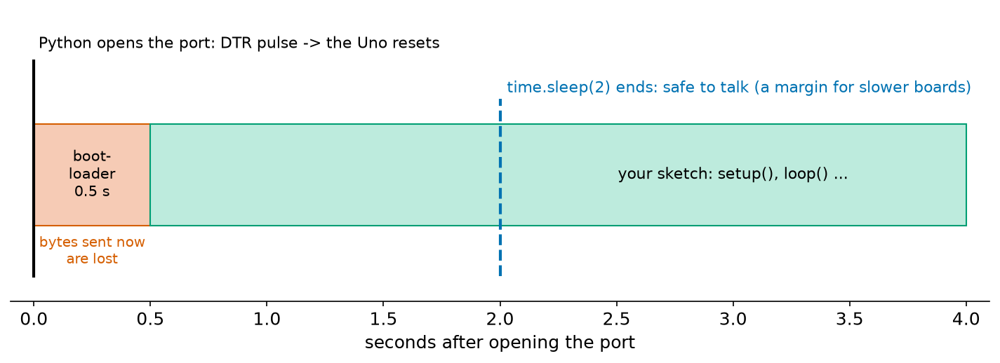
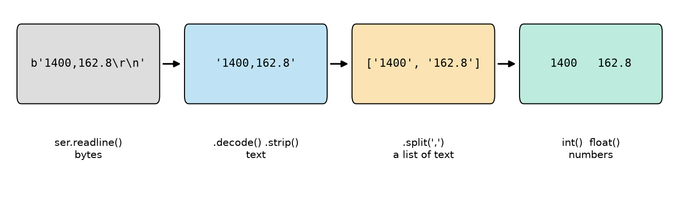
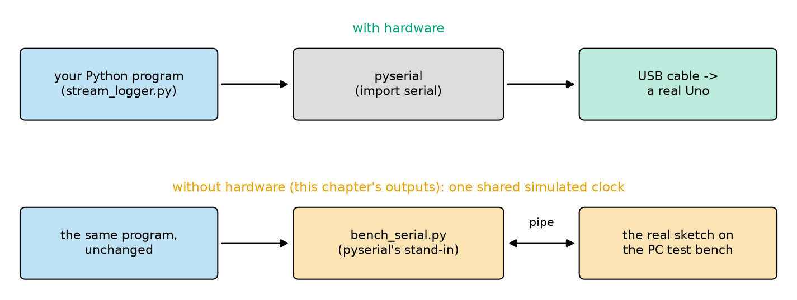
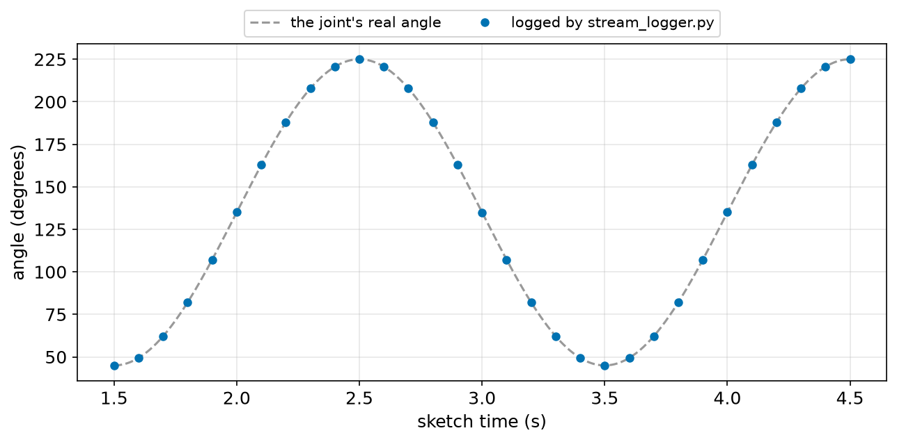
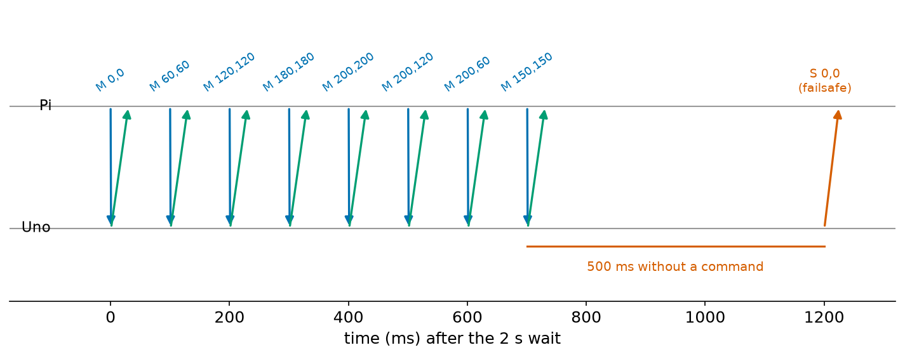
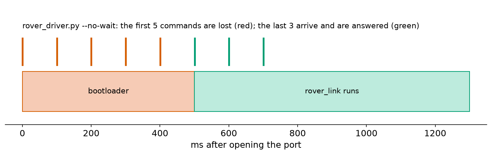

# Chapter 111 — Arduino talking to Python (`pyserial`)

> **Part 6 · Chapter 111 of 749**
> **You need:** Chapter 22 (lists and dictionaries), Chapter 25 (`try` and `except`), Chapter 27 (files and `with`), Chapter 33 (matplotlib), Chapter 95 (ports, and the reset when a port opens), Chapter 100 (the Serial Monitor), Chapter 103 (timing) and Chapter 107 (Rover's packets and failsafe).
> **You will make:** a Python program that lists the serial ports, a logger that reads an Arduino's CSV lines, checks them and saves them to a file, a plot of a swinging robot joint from that file, and the Raspberry Pi side of Rover's link: a program that sends motor packets, decodes the status replies, and shows the failsafe stopping Rover when the program goes quiet.

---

## What you will learn

- How to install **pyserial** and find the Arduino's **port**.
- How to open a port, and why you must wait after opening it.
- How to read **lines** of text, turn them into numbers, and survive bad lines.
- How to send and receive **binary packets** with Python's `struct` module.
- How to keep a Python program and an Arduino in step: timeouts, buffers, and who talks when.
- How the outputs in this chapter were produced without hardware.

---

## New words in this chapter

| Word | Simple meaning |
|---|---|
| **pyserial** | The Python library for serial ports: `import serial`. |
| **port name** | What the computer calls the connection: `COM3` on Windows, `/dev/ttyACM0` on Linux. |
| **timeout** | How long a read waits for data before giving up. |
| **input buffer** | Bytes that have arrived but that the program has not read yet. |
| **CSV** | Comma-separated values: lines of text with fields separated by commas. |
| **`struct`** | A Python module that packs numbers into bytes and unpacks them again, in a fixed format. |
| **DTR** | A signal on the USB serial link that the Uno uses to reset itself when a program opens the port. |

---

## 111.1 A program at the other end

Until now, the other end of the Arduino's serial port was a person: you, reading the Serial Monitor (Chapter 100). But on a real robot the other end is a program: Rover's Raspberry Pi sends it motor commands and reads its sensors; a laptop logs a test run; a factory test station checks every board that comes off the line. Python is the most common language for that other end, and its serial library is **pyserial**.

📖 **New word: pyserial** — the Python library for serial ports. Install it once with `pip install pyserial` (on a Raspberry Pi it is usually already there, or `sudo apt install python3-serial`). In a program it is imported as `serial`:

```python
import serial
ser = serial.Serial("COM3", 115200, timeout=1)
```

That one line opens the port at 115,200 baud (the same baud rate as the sketch's `Serial.begin`: Chapter 107's rule) and sets a **timeout** of 1 second.

📖 **New word: port name** — the name the computer gives the connection (Chapter 95): `COM3`, `COM7` … on Windows; `/dev/ttyACM0` or `/dev/ttyUSB0` on Linux and the Raspberry Pi; `/dev/cu.usbmodem…` on a Mac. It can change when you plug the board into another USB socket. pyserial can list them; `list_ports.py`:

```python
# list_ports.py - which serial ports does this computer have, and which one is the Arduino?
from serial.tools import list_ports              # part of pyserial

for p in list_ports.comports():
    print(f"{p.device:12s} {p.description}")
```

| Line | Code | What it does (simple English) |
|---|---|---|
| 1 | comment | |
| 2 | `from serial.tools import list_ports` | A part of pyserial that knows about the computer's ports. |
| 3 | (blank) | |
| 4–5 | `for p in list_ports.comports(): print(…)` | Each port's name and description. |

On a PC with an Uno plugged in, it prints something like `COM7  Arduino Uno (COM7)`. (Our run, on the test bench described below, prints `COM7  Arduino Uno (PC test bench: sensor_stream.ino)`.)

⚠️ **Careful: only one program can open a port at a time.** If the Arduino IDE's Serial Monitor is open, your Python program gets an error such as "Access is denied" or "could not open port". Close the Serial Monitor first. The reverse is also true: you cannot upload a new sketch while a Python program holds the port.

---

## 111.2 Opening the port resets the Uno

Chapter 95 warned: opening the port resets the Uno. When a program opens the port, the USB chip changes a signal called **DTR**, and on the Uno that signal is wired to the reset pin.

📖 **New word: DTR** — "data terminal ready", one of the old control signals of serial ports. The Arduino IDE uses it on purpose: it resets the board to start the bootloader before an upload. But every program that opens the port does the same.



*Figure 111.1 — Opening the port resets the Uno; the bootloader runs for about half a second; then the sketch starts from `setup()`.*

**How to read this picture:** Time 0 is the moment Python opens the port. For the first half-second the Uno runs its bootloader (red), waiting to see if a new sketch is coming; anything Python sends then is lost. Then the sketch starts from the beginning (green): its `setup()` runs again, and the lines it prints there arrive first. The blue line is where a program that waits 2 seconds starts talking: safely after the sketch has started, with a margin for boards whose bootloader waits longer.

So every program that talks to an Uno starts the same way:

```python
ser = serial.Serial(PORT, 115200, timeout=1)
time.sleep(2)                  # let the bootloader finish and the sketch start
ser.reset_input_buffer()       # throw away whatever arrived meanwhile
```

📖 **New word: input buffer** — bytes that have arrived from the Arduino but that the program has not read yet. pyserial (and the computer's driver) keep them until a read takes them out. `reset_input_buffer()` empties it, so the program starts with fresh data.

💡 **Tip: sometimes the reset is not wanted.** A robot that is already driving should not restart because a logging program connected. Two fixes: a 10 µF capacitor between the Uno's RESET and GND pins stops the automatic reset (remove it to upload); or `ser = serial.Serial(); ser.port = PORT; ser.dtr = False; ser.open()` on systems where the driver allows it. Boards with a built-in USB port (such as the Leonardo, or an ESP32 with native USB) behave differently.

---

## 111.3 Lines of text: read, decode, split, convert

The simplest way for an Arduino to send data is text, one line per reading (Chapter 100): `Serial.print(millis()); Serial.print(','); Serial.println(angle, 1);` sends `1400,162.8` followed by `\r\n`.

📖 **New word: CSV** — comma-separated values: each line holds fields separated by commas, often with a first "header" line naming the columns. Spreadsheets open CSV files directly.

pyserial reads **bytes**, not text, so four steps turn a line into numbers:



*Figure 111.2 — The four steps from the bytes of one line to two numbers.*

**How to read this picture:** Left to right. `ser.readline()` returns the bytes up to and including the newline: `b'1400,162.8\r\n'` (the `b` means "bytes"). `.decode()` turns bytes into text and `.strip()` removes the `\r\n`. `.split(',')` cuts the text at each comma, giving a list of two texts. `int()` and `float()` turn them into numbers.

Each step can fail. A line can arrive half-written (the program opened the port in the middle of a line), contain a header instead of numbers, or be damaged by noise. A robust reader expects this: it wraps the conversion in `try` / `except` (Chapter 25), skips bad lines, and counts them.

---

## Code

**How the outputs in this chapter were made.** pyserial was not available on the computer used to write this chapter, and no Arduino was connected. So every Python program here was run on the PC test bench through `code/common/bench_link/run_on_bench.py`, which puts a small stand-in for pyserial (`bench_serial.py`) in its place. The stand-in starts the **real sketch** on the test bench and connects the Python program to the sketch's `Serial`, byte for byte. Python's `time.sleep` and `time.monotonic` follow the bench's simulated clock, so the program and the sketch share one clock, and opening the port resets the pretend Uno with a half-second bootloader, as on a real board.



*Figure 111.3 — Top: how the programs run with a real Uno. Bottom: how this chapter's outputs were produced.*

**How to read this picture:** In both rows the blue box is the same Python program, unchanged. With hardware, pyserial carries its bytes through the USB cable to a real Uno. Without, `bench_serial.py` carries them through a pipe to the same sketch running on the PC test bench.

With a real Uno, run the programs directly: `python stream_logger.py COM3` (use your own port name). On the bench: `python ../common/bench_link/run_on_bench.py --sketch sensor_stream/sensor_stream.ino --world pc_tests/world_stream.h stream_logger.py COM7`. With real hardware, the numbers will match in content, but times will differ by a few milliseconds and real sensors add noise.

File `code/ch111/sensor_stream/sensor_stream.ino`, the Arduino side of Application 1:

```cpp
// sensor_stream.ino - send a joint angle to the PC as lines of comma-separated text (CSV), 10 lines per second
const int ANGLE_PIN = A0;              // a 270-degree potentiometer on a joint (Chapter 101)
unsigned long lastSend = 0;

void setup() {
  Serial.begin(115200);
  Serial.println("time_ms,angle_deg"); // a header line that names the columns
}

void loop() {
  if (millis() - lastSend >= 100) {
    lastSend += 100;
    int raw = analogRead(ANGLE_PIN);
    float angle = raw * 270.0 / 1023.0;
    Serial.print(millis());
    Serial.print(',');
    Serial.println(angle, 1);
  }
}
```

| Line | Code | What it does (simple English) |
|---|---|---|
| 1–3 | comment, `ANGLE_PIN = A0`, `lastSend` | Chapter 101's potentiometer angle sensor. |
| 4 | (blank) | |
| 5–8 | `void setup() { Serial.begin(115200); Serial.println("time_ms,angle_deg"); }` | Same baud rate as the Python side. The header names the columns, for spreadsheets. |
| 9 | (blank) | |
| 10–12 | `void loop() { if (millis() - lastSend >= 100) { lastSend += 100;` | Ten readings per second, evenly spaced (Chapter 103). |
| 13–14 | `int raw = analogRead(ANGLE_PIN); float angle = raw * 270.0 / 1023.0;` | The count, as an angle: 0 to 270 degrees. |
| 15–17 | `Serial.print(millis()); Serial.print(','); Serial.println(angle, 1);` | One CSV line: the time in ms, a comma, the angle with one decimal. |
| 18–19 | `}` `}` | |

The test's pretend world (`pc_tests/world_stream.h`) swings the joint between 45° and 225°, once every 2 seconds.

---

## Small examples

**Example 1.** `serial.Serial("/dev/ttyACM0", 9600, timeout=0.5)` opens the first Arduino on a Raspberry Pi at 9,600 baud.

**Example 2.** `ser.write(b"L1\n")` sends three bytes: `L`, `1`, newline. `ser.write("L1\n".encode())` does the same from a text.

**Example 3.** `ser.readline()` returns `b''` (empty) if no newline arrived before the timeout.

**Example 4.** `"20,7.5".split(",")` gives `['20', '7.5']`; `float("7.5")` gives 7.5; `int("abc")` raises `ValueError`.

**Example 5.** `ser.in_waiting` is the number of bytes in the input buffer now; `ser.read(ser.in_waiting)` takes all of them without waiting.

**Example 6.** `struct.pack("<hh", 120, -80)` gives `b'x\x00\xb0\xff'`: the bytes `78 00 B0 FF`, as in Chapter 107.

**Example 7.** `struct.unpack("<hhBB", data)` turns 6 bytes into four numbers: two signed 16-bit, two unsigned 8-bit.

**Example 8.** At 115,200 baud a 12-character line arrives in 12 × 86.8 µs ≈ 1 ms.

---

## 🏭 Real robot applications

### Application 1 (worked in full) — 🤖 Logging a robot joint to a file

**1. The real problem.** To tune or test a robot (Rover's motors, an arm's joint), you need its sensor readings on a computer: saved in a file, plotted, compared with what was expected. Copying lines from the Serial Monitor by hand does not scale. A Python program should read the Arduino's readings for a set time, check each one, save them to a CSV file, and report what it got.

**2. Why this theory.** pyserial opens the port (section 111.1); waiting 2 seconds and emptying the input buffer handles the reset (section 111.2); `readline`, `decode`, `split` and `int`/`float` turn each line into numbers, and `try`/`except` skips bad lines (section 111.3). Python's `csv` module (Chapter 27's files) writes the file.

**3. The numbers.** The sketch sends 10 lines per second. The program logs for 3 seconds of its own clock, so it should collect about 30 readings, 100 ms apart. The joint swings between 45° and 225° (135 ± 90) with a period of 2 s.

**4. The maths.** Each count is 270 ÷ 1,023 = 0.26° (the potentiometer's resolution); the readings should lie on the sine curve within about that. Timing: 3 seconds at 10 per second = 30 intervals, so 30 or 31 readings depending on where the window starts.

**5. The code.** File `code/ch111/stream_logger.py`:

```python
# stream_logger.py - read the Arduino's CSV lines with pyserial, check each one, and save them to a file
# usage: python stream_logger.py COM3        (or /dev/ttyACM0 on Linux and the Raspberry Pi)
import csv
import sys
import time

import serial                                    # pyserial: pip install pyserial

PORT = sys.argv[1] if len(sys.argv) > 1 else "COM3"
WAIT_FOR_RESET = "--no-wait" not in sys.argv

rows = []
skipped = []
with serial.Serial(PORT, 115200, timeout=1) as ser:   # opening the port resets the Uno (Chapter 95)
    if WAIT_FOR_RESET:
        time.sleep(2)                            # let the bootloader finish and the sketch start
        ser.reset_input_buffer()                 # throw away anything that arrived meanwhile
    start = time.monotonic()
    while time.monotonic() - start < 3.0:        # log for 3 seconds
        raw = ser.readline()                     # bytes up to and including b"\n", or b"" after the timeout
        if not raw:
            continue
        text = raw.decode("ascii", errors="replace").strip()
        parts = text.split(",")
        try:
            t_ms = int(parts[0])
            angle = float(parts[1])
        except (ValueError, IndexError):         # a header, a broken line, or noise
            skipped.append(text)
            continue
        rows.append((t_ms, angle))

with open("joint_log.csv", "w", newline="") as f:
    writer = csv.writer(f)
    writer.writerow(["time_ms", "angle_deg"])
    writer.writerows(rows)

print(f"{len(rows)} readings saved to joint_log.csv; {len(skipped)} line(s) skipped: {skipped}")
print(f"first: {rows[0]}, last: {rows[-1]}")
angles = [a for _, a in rows]
print(f"angle from {min(angles):.1f} to {max(angles):.1f} degrees")
gaps = [b[0] - a[0] for a, b in zip(rows, rows[1:])]
print(f"time between readings: {min(gaps)} to {max(gaps)} ms")
```

| Line | Code | What it does (simple English) |
|---|---|---|
| 1–2 | comments | How to run it. |
| 3–5 | `import csv`, `import sys`, `import time` | Standard Python modules: CSV files, the command line, time. |
| 6–7 | (blank), `import serial` | pyserial. |
| 8 | (blank) | |
| 9 | `PORT = sys.argv[1] if len(sys.argv) > 1 else "COM3"` | The port name from the command line (`sys.argv` is the list of words typed after `python`), or COM3 if none was given. |
| 10 | `WAIT_FOR_RESET = "--no-wait" not in sys.argv` | A switch for Lab 111.2, to see what happens without the wait. |
| 11–13 | (blank), `rows = []`, `skipped = []` | Good readings and bad lines. |
| 14 | `with serial.Serial(PORT, 115200, timeout=1) as ser:` | Open the port. `with` (Chapter 27) closes it automatically at the end, even after an error. |
| 15–17 | `if WAIT_FOR_RESET: time.sleep(2); ser.reset_input_buffer()` | Section 111.2. |
| 18–19 | `start = time.monotonic()`, `while time.monotonic() - start < 3.0:` | Log for 3 seconds. `monotonic()` is a clock that never jumps (unlike the time of day). |
| 20–22 | `raw = ser.readline()`, `if not raw: continue` | One line, or nothing after a 1 s timeout; then try again. |
| 23 | `text = raw.decode("ascii", errors="replace").strip()` | Bytes to text; a damaged byte becomes `?` instead of crashing the program. |
| 24 | `parts = text.split(",")` | |
| 25–30 | `try: t_ms = int(parts[0]); angle = float(parts[1]) except (ValueError, IndexError): skipped.append(text); continue` | `ValueError`: a field is not a number (such as the header). `IndexError`: there was no comma, so `parts[1]` does not exist. Either way: note it and go on. |
| 31 | `rows.append((t_ms, angle))` | Keep the good reading as a tuple (Chapter 22). |
| 32 | (blank) | |
| 33–36 | `with open("joint_log.csv", "w", newline="") as f: writer = csv.writer(f); …` | Save a header and all the rows. `newline=""` is what the `csv` module asks for on Windows. |
| 37 | (blank) | |
| 38–43 | `print(…)` … | A summary: how many, the first and last, the range of angles, and the time between readings (`zip(rows, rows[1:])` pairs each reading with the next). |

Output (on the PC test bench, through `run_on_bench.py`):

```
31 readings saved to joint_log.csv; 0 line(s) skipped: []
first: (1500, 44.9), last: (4500, 225.1)
angle from 44.9 to 225.1 degrees
time between readings: 100 to 100 ms
```



*Figure 111.4 — `joint_log.csv` plotted with matplotlib (Chapter 33): every reading on the joint's true path.*

**How to read this picture:** The grey dashed curve is the angle the pretend joint really had. The blue dots are the 31 readings from the file, one every 0.1 s. Every dot sits on the curve.

**6. The result.** 31 readings, exactly 100 ms apart, covering the joint's whole range, 44.9° to 225.1° (the true range is 45° to 225°, read through 0.26° steps). The first reading has the sketch time 1,500 ms: the sketch started half a second after the port opened, the program waited 2 seconds, and the header line `time_ms,angle_deg` was printed by `setup()` during the wait and thrown away by `reset_input_buffer()`, so nothing had to be skipped. The CSV file opens in a spreadsheet, or in Python for plotting.

**7. Going further.** For longer logs, write each row to the file as it arrives (and call `f.flush()` now and then) instead of keeping everything in a list, so a crash loses nothing. For live plots, matplotlib can redraw a few times per second. And at high data rates, text becomes slow: 10 characters per reading at 115,200 baud allows only about 1,150 readings per second, while 4 binary bytes would allow 2,880: Application 2's packets.

### Application 2 (worked in full) — 🤖 Driving Rover from Python

**1. The real problem.** Rover's Raspberry Pi decides how fast each wheel should turn; the Arduino runs the motors. Chapter 107 built the Arduino side (`rover_link.ino`): it receives `M` packets with two `int16_t` speeds, answers each with an `S` status packet, and stops the motors if commands stop for 500 ms. Now the Pi side: a Python program that sends a driving plan, decodes the replies, and checks the failsafe.

**2. Why this theory.** The same packet format as Chapter 107: `AA`, length, type, payload, checksum. Python's `struct` module turns numbers into the right bytes. The receiver must collect bytes as they come and find complete packets, as the Arduino's state machine did.

📖 **New word: `struct`** — a Python module that packs numbers into bytes and unpacks them, following a format string. `"<hh"` means: `<` little-endian (low byte first, the Uno's order), `h` a signed 16-bit number ("short"), twice. `"<hhBB"` adds two unsigned bytes (`B`). It replaces Chapter 107's hand-made `int16_bytes`.

**3. The numbers.** A plan of 8 commands, one every 100 ms: stop, speed up to 200, curve right (200/120, 200/60), then 150/150. After the last command the program stops sending, as if it had crashed, and keeps listening for 0.8 s. Expected: one status reply per command, good count rising from 1 to 8, and then one more reply 500 ms after the last command, with both speeds 0.

**4. The maths.** A packet is 8 bytes; at 115,200 baud it arrives in 0.7 ms, and the reply comes back in another 0.9 ms. The program reads the replies 100 ms later, when it next looks. The failsafe: last command at about 700 ms (after the 2 s wait), plus 500 ms = about 1,200 ms.

**5. The code.** File `code/ch111/rover_driver.py`:

```python
# rover_driver.py - the Raspberry Pi side of Rover's link (Chapter 107): send motor packets, read status packets
# usage: python rover_driver.py COM3          (the Arduino runs ch107/rover_link/rover_link.ino)
import struct
import sys
import time

import serial                                    # pyserial: pip install pyserial

PORT = sys.argv[1] if len(sys.argv) > 1 else "COM3"
WAIT_FOR_RESET = "--no-wait" not in sys.argv
START = 0xAA


def packet(ptype, payload):
    body = bytes([len(payload), ptype]) + payload
    return bytes([START]) + body + bytes([sum(body) & 0xFF])


def motor(left, right):
    return packet(ord("M"), struct.pack("<hh", left, right))   # two int16, low byte first


class PacketReader:
    """Collects bytes and gives back each complete packet whose checksum is right (Chapter 107)."""

    def __init__(self):
        self.buf = bytearray()

    def feed(self, data):
        self.buf += data
        found = []
        while True:
            k = self.buf.find(bytes([START]))
            if k < 0:
                self.buf.clear()
                return found
            del self.buf[:k]                     # skip anything before a start byte
            if len(self.buf) < 2 or len(self.buf) < self.buf[1] + 4:
                return found                     # not complete yet: wait for more bytes
            n = self.buf[1]
            p = bytes(self.buf[:n + 4])
            if sum(p[1:-1]) & 0xFF == p[-1]:
                found.append((chr(p[2]), p[3:-1]))
                del self.buf[:n + 4]
            else:
                del self.buf[:1]                 # a false start or a damaged packet: look further on


plan = [(0, 0), (60, 60), (120, 120), (180, 180), (200, 200), (200, 120), (200, 60), (150, 150)]
reader = PacketReader()
with serial.Serial(PORT, 115200, timeout=0.1) as ser:
    if WAIT_FOR_RESET:
        time.sleep(2)
        ser.reset_input_buffer()
    start = time.monotonic()

    def report():
        for ptype, payload in reader.feed(ser.read(ser.in_waiting)):
            left, right, good, bad = struct.unpack("<hhBB", payload)
            print(f"{(time.monotonic() - start) * 1000:7.1f} ms  status: left {left:4d} right {right:4d}  good {good} bad {bad}")

    for left, right in plan:                     # one command every 100 ms
        ser.write(motor(left, right))
        print(f"{(time.monotonic() - start) * 1000:7.1f} ms  sent M {left:4d} {right:4d}")
        time.sleep(0.1)
        report()
    print("... the Pi stops sending (as if its program had crashed) ...")
    for _ in range(8):
        time.sleep(0.1)
        report()
```

| Line | Code | What it does (simple English) |
|---|---|---|
| 1–11 | comments, imports, `PORT`, `WAIT_FOR_RESET`, `START = 0xAA` | As in Application 1. |
| 12–15 | `def packet(ptype, payload): …` | Chapter 107's `make_packet.py`, with `bytes` throughout. |
| 16–18 | `def motor(left, right): return packet(ord("M"), struct.pack("<hh", left, right))` | Two signed 16-bit numbers, low byte first, as the Arduino expects. |
| 19–21 | `class PacketReader:` | A small class (Chapter 28; Chapter 110 for the idea) that remembers bytes between calls. |
| 22–24 | `def __init__(self): self.buf = bytearray()` | Bytes received but not yet used. |
| 25–27 | `def feed(self, data): self.buf += data; found = []` | Add new bytes; collect the packets found. |
| 28–32 | `while True: k = self.buf.find(bytes([START])); if k < 0: self.buf.clear(); return found` | Look for a start byte; with none, nothing in the buffer can be part of a packet. |
| 33 | `del self.buf[:k]` | Drop any junk before it (Chapter 107's resynchronising). |
| 34–35 | `if len(self.buf) < 2 or len(self.buf) < self.buf[1] + 4: return found` | Not all of the packet has arrived yet: keep the bytes and wait. |
| 36–41 | `n = self.buf[1]; p = …; if sum(p[1:-1]) & 0xFF == p[-1]: found.append(…); del self.buf[:n + 4]` | A complete packet with the right checksum: keep its type and payload, remove it from the buffer. |
| 42–43 | `else: del self.buf[:1]` | Wrong checksum: this `AA` was not a real start; drop it and look again. |
| 44–46 | (blank), `plan = […]`, `reader = PacketReader()` | Eight (left, right) commands. |
| 47–50 | `with serial.Serial(PORT, 115200, timeout=0.1) as ser: if WAIT_FOR_RESET: …` | Open, wait for the reset, empty the buffer. |
| 51 | `start = time.monotonic()` | |
| 52–56 | `def report(): for ptype, payload in reader.feed(ser.read(ser.in_waiting)): …` | Take every byte waiting (without blocking), feed the reader, print each status packet. `struct.unpack("<hhBB", payload)` turns its 6 bytes back into four numbers. |
| 57–61 | `for left, right in plan: ser.write(motor(left, right)); print(…); time.sleep(0.1); report()` | Send a command, wait 100 ms, print any replies. |
| 62–65 | `print("... the Pi stops sending ..."); for _ in range(8): time.sleep(0.1); report()` | Go quiet for 0.8 s but keep listening. `_` is the usual name for a loop variable that is not used. |

Output (on the PC test bench, with `ch107/rover_link/rover_link.ino` as the sketch):

```
    0.0 ms  sent M    0    0
  100.1 ms  status: left    0 right    0  good 1 bad 0
  100.1 ms  sent M   60   60
  200.2 ms  status: left   60 right   60  good 2 bad 0
  200.2 ms  sent M  120  120
  300.3 ms  status: left  120 right  120  good 3 bad 0
  300.3 ms  sent M  180  180
  400.4 ms  status: left  180 right  180  good 4 bad 0
  400.4 ms  sent M  200  200
  500.5 ms  status: left  200 right  200  good 5 bad 0
  500.5 ms  sent M  200  120
  600.6 ms  status: left  200 right  120  good 6 bad 0
  600.6 ms  sent M  200   60
  700.7 ms  status: left  200 right   60  good 7 bad 0
  700.7 ms  sent M  150  150
  800.8 ms  status: left  150 right  150  good 8 bad 0
... the Pi stops sending (as if its program had crashed) ...
 1201.2 ms  status: left    0 right    0  good 8 bad 0
```



*Figure 111.5 — Each command (blue, Pi to Uno) and its reply (green), and the failsafe stop (red) 500 ms after the last command.*

**How to read this picture:** Time runs left to right after the 2 s wait. The upper line is the Pi, the lower one the Uno. Each blue arrow is an `M` packet, each green arrow its `S` reply (drawn a little later than real, so it can be seen; the real reply comes within 2 ms). After 700 ms the blue arrows stop. 500 ms later the Uno sends one more reply, by itself: the failsafe, with both speeds 0.

**6. The result.** All 8 commands arrived and were obeyed (each status shows exactly the speeds just sent), with no bad packets. Each reply appears in the output 100 ms after its command only because the program looks for replies once every 100 ms. When the program went quiet, the Arduino stopped the motors by itself at 1,201 ms, 500 ms after the last command, and reported it. This program, unchanged, drives a real Rover over the USB cable, or over the two wires of Figure 107.6 with the port name `/dev/serial0` on the Pi.

**7. Going further.** A real Pi program would send commands from a control loop at a steady rate (Chapter 103's pattern, in Python: Chapter 30), read replies in every pass, and warn when `good` stops rising or `bad` starts rising. In ROS 2 (Part 27), this program becomes a "node" that turns speed messages into packets: a "hardware interface", which Chapter 603 builds for real robots.

### Application 3 — 🏭 Testing every board on the production line

Factories that make electronic products test every board before it is packed. A test station is often a PC running a Python program: it powers the board, opens its serial port, sends commands ("measure the 3.3 V rail", "turn on LED 2", "report the sensor"), checks each answer against limits, and prints a label or rejects the board. Laboratory instruments (power supplies, multimeters, oscilloscopes) also take text commands over serial or USB in a standard language called SCPI: the station sends `MEAS:VOLT?` and reads back `3.298`. A board takes seconds to test, the results go into a database, and any board can later be traced back to its test. pyserial (or its cousin PyVISA for instruments) is at the heart of many such stations.

### Application 4 — 🚁 A drone's ground station

A drone's flight controller sends its position, attitude, battery and status over a serial link, through a telemetry radio, to a ground station on a laptop, and receives commands back ("go to this point", "return home"). The messages follow the **MAVLink** protocol: binary packets with a start byte, a length, a sequence number, the sender's ID, a message ID, the payload and a CRC: Chapter 107's ideas, in full. Ground station programs such as QGroundControl speak MAVLink, and so does the Python library pymavlink, built on pyserial, which lets a few lines of Python read a drone's battery or send it a mission (Chapters 644 and 652).

### Application 5 — 🤖 Sending G-code to a CNC machine or a robot arm

Hobby CNC machines and some robot arms run GRBL (Chapter 106, Application 4) on an Arduino, and take G-code commands over serial: `G1 X10 Y5 F300` means "move in a straight line to X = 10, Y = 5 at 300 mm/min". A Python sender reads a G-code file and sends it line by line, but it must not send faster than the machine can plan its moves: the Arduino's 64-byte receive buffer (Chapter 100) would overflow. So GRBL answers `ok` after each line it has taken in, and the sender waits for that `ok` before sending the next line. This is **flow control** by software: the receiver tells the sender when it is ready. Without it, lines would be lost, and the machine would cut in the wrong place.

---

## 🔧 Hands-on lab

### Lab 111.1 — Find the Arduino and talk to it (hardware)

You need: an Uno with a USB cable, Python on the computer.

1. Install pyserial: `pip install pyserial` (or `python -m pip install pyserial`).
2. Run `list_ports.py` with the Uno unplugged, then plugged in. Which new port appears?
3. Upload `sensor_stream.ino` with a potentiometer on A0 (Chapter 101). Close the Serial Monitor.
4. Run `python stream_logger.py COM3` with your port name, turning the potentiometer while it logs.

**What you should see:** Step 2: a new port, for example `COM7  Arduino Uno (COM7)` or `/dev/ttyACM0`. Step 4: about 30 readings saved, and a `joint_log.csv` file that opens in a spreadsheet. With a real potentiometer the angles follow your hand, with a little noise in the last digit.

| If it does not work | Likely cause | Fix |
|---|---|---|
| `ModuleNotFoundError: No module named 'serial'` | pyserial not installed (or a package called `serial` installed instead) | `pip uninstall serial`, then `pip install pyserial` |
| "Access is denied" / "Device or resource busy" | The Serial Monitor (or another program) has the port | Close it |
| Only `b''` lines, or none | Wrong baud rate, or wrong port | 115200 on both sides; check `list_ports.py` |
| Linux: "Permission denied" | Your user may not use serial ports | `sudo usermod -a -G dialout $USER`, then log out and in |

**Challenge:** Plot `joint_log.csv` with matplotlib (Chapter 33). (`figures.py` in the chapter's code folder does this for Figure 111.4.)

### Lab 111.2 — What the wait is for (simulation)

Run on the PC test bench, from `code/ch111`:

1. `python ../common/bench_link/run_on_bench.py --sketch sensor_stream/sensor_stream.ino --world pc_tests/world_stream.h stream_logger.py COM7`, and then the same with `--no-wait` added at the end.
2. The same for `rover_driver.py` with `--sketch ../ch107/rover_link/rover_link.ino`, with and without `--no-wait`.

**What you should see:** With `--no-wait`, the logger reports `25 readings saved …; 1 line(s) skipped: ['time_ms,angle_deg']`: the header was not thrown away, so the `try`/`except` had to catch it, and the first half-second was lost to the bootloader. The driver with `--no-wait` shows no status at all for the first five commands; the first reply is `600.6 ms  status: left  200 right  120  good 1 bad 0`: the commands sent during the bootloader's half-second were lost, and Rover only started obeying with the sixth (Figure 111.6).



*Figure 111.6 — `rover_driver.py --no-wait`: commands sent during the bootloader are lost.*

**How to read this picture:** The red box is the bootloader's half-second after the port opens; the green box is `rover_link` running. Each mark above is one command: the five red ones fell into the bootloader and vanished; the three green ones arrived and were answered.

| If it does not work | Likely cause | Fix |
|---|---|---|
| "the bench could not build the sketch" | A typo in the sketch path, or g++ missing | Check the path; `g++ --version` |
| The program waits for ever | A `read()` without a timeout and no data | Always give `timeout=` |

**Challenge:** In `rover_driver.py`, replace the fixed `time.sleep(2)` with a loop that sends a command every 100 ms until the first status packet comes back. How long after opening does Rover first answer on the bench?

### Lab 111.3 — A damaged line (simulation or hardware)

1. In `sensor_stream.ino`, make every 10th line damaged on purpose: add a counter, and when it reaches 10, print `"12,3x.4"` instead of the real line.
2. Run the logger again (on the bench, or on hardware).
3. Remove the `try`/`except` from `stream_logger.py` and run it once more.

**What you should see:** Step 2: the logger saves the good lines and lists the damaged ones under "skipped". Step 3: the program stops with `ValueError: could not convert string to float: '3x.4'` at the first damaged line, and the file is never written. One bad line can end a whole test run, unless the program expects it.

| If it does not work | Likely cause | Fix |
|---|---|---|
| Nothing is skipped | The damaged line is still a valid number | Make sure it contains a letter |

**Challenge:** Add a checksum to each line, as GPS sentences do (Chapter 107, Application 2), and make the logger reject lines whose checksum is wrong.

---

## Common mistakes

⚠️ **Not waiting after opening the port.** The Uno is still in its bootloader; your first bytes are lost.

⚠️ **The Serial Monitor still open.** Only one program can use a port.

⚠️ **Different baud rates in the sketch and in Python.** You get garbage, not an error.

⚠️ **No timeout.** `serial.Serial(PORT, 115200)` waits for ever in `read()` if nothing comes. Always set `timeout`.

⚠️ **Treating bytes as text.** `readline()` returns `bytes`; decode before splitting, and encode before writing text.

⚠️ **No `try`/`except` around conversions.** The first header or damaged line crashes the program.

⚠️ **Sending faster than the Arduino reads.** Its receive buffer holds 64 bytes (Chapter 100); use replies (like GRBL's `ok`) to pace the sender.

⚠️ **Hard-coding `COM3`.** The port name changes between computers and USB sockets; take it from the command line, or find it with `list_ports`.

---

## Practice

🏋️ **1.** Write the line that opens `/dev/ttyACM0` at 57,600 baud with a 0.5 s timeout.

🏋️ **2.** Why does an Uno restart when a Python program opens its port? What must the program do about it?

🏋️ **3.** What does `ser.readline()` return if no complete line arrives before the timeout?

🏋️ **4.** Turn `b'250,17.25\r\n'` into the numbers 250 and 17.25, step by step.

🏋️ **5.** Which exceptions should a line parser catch, and when does each happen?

🏋️ **6.** What bytes does `struct.pack("<hh", 300, -1)` give?

🏋️ **7.** What does `struct.unpack("<hhBB", bytes([0x64, 0, 0x9C, 0xFF, 5, 1]))` give?

🏋️ **8.** At 115,200 baud, about how many 12-character lines per second can the Uno send at most?

🏋️ **9.** In Application 2, why is each status printed 100 ms after its command, when the reply really arrives within 2 ms?

🏋️ **10.** A G-code sender sends 100 lines as fast as it can, without waiting for `ok`. What goes wrong, and why?

🏋️ **11.** Change `sensor_stream.ino` to send a line every 20 ms instead of every 100 ms, and run `stream_logger.py` on the PC test bench. How many readings are saved, and what is the time between them?

---

## Answers

**1.** `ser = serial.Serial("/dev/ttyACM0", 57600, timeout=0.5)`

**2.** Opening the port changes the DTR signal, which is wired to the Uno's reset. The program must wait (2 s is a safe choice) before sending, and empty the input buffer with `reset_input_buffer()` before reading.

**3.** Whatever bytes arrived (perhaps part of a line), or `b''` (empty) if nothing arrived at all.

**4.** `.decode()` → `'250,17.25\r\n'`; `.strip()` → `'250,17.25'`; `.split(',')` → `['250', '17.25']`; `int('250')` → 250, `float('17.25')` → 17.25.

**5.** `ValueError` when a field is not a number (a header, damaged text); `IndexError` when the line has fewer fields than expected (no comma, a cut-off line).

**6.** 300 = 0x012C → `2C 01`; −1 = 0xFFFF → `FF FF`. So `b',\x01\xff\xff'`, the bytes **`2C 01 FF FF`**.

**7.** `(100, -100, 5, 1)`: 0x0064 = 100; 0xFF9C = −100; then 5 and 1.

**8.** Each character takes 10 bits; 12 characters = 120 bits; 115,200 ÷ 120 = **960 lines per second**.

**9.** The program only looks for replies after each `time.sleep(0.1)`. The reply waits in the input buffer until then, and the time printed is the time it was read.

**10.** The Arduino can hold only 64 bytes in its receive buffer and takes time to plan each move; lines that arrive while the buffer is full are lost (Chapter 100), so the machine skips moves and cuts the wrong shape. Waiting for `ok` after each line keeps the sender in step with the receiver.

**11.** Change both `100`s in the `if` and `lastSend +=` lines to `20`. On the PC test bench:

```
151 readings saved to joint_log.csv; 0 line(s) skipped: []
first: (1500, 44.9), last: (4500, 225.1)
angle from 44.9 to 225.1 degrees
time between readings: 20 to 20 ms
```

**151 readings**, **20 ms** apart: five times as many in the same 3 seconds. At about 12 characters per line, 50 lines per second use 600 of the 11,520 characters per second that 115,200 baud allows: still only 5%.

---

## Summary

🧠 **pyserial** (`import serial`) opens a port: `serial.Serial(PORT, baud, timeout=…)`. Find the port with `serial.tools.list_ports`; only one program can have it open.

🧠 Opening the port **resets the Uno** (the DTR signal): wait about 2 seconds, then `reset_input_buffer()`.

🧠 Text lines: `readline()` → `decode()` → `strip()` → `split(',')` → `int()`/`float()`, inside `try`/`except`, skipping bad lines. Save with the `csv` module.

🧠 Binary packets: build them with **`struct.pack("<hh", …)`**, decode with `struct.unpack`, and find them in the byte stream with a small reader class that checks each checksum.

🧠 Always use timeouts, pace the sender, and let the Arduino's failsafe protect the robot when the Python side stops.

---

## Next chapter

The Python programs of this chapter can run on any computer, including the small one that will ride on Rover: the **Raspberry Pi**. Chapter 112, **Raspberry Pi: a small computer, GPIO with Python**, shows what makes it different from the Uno: an operating system, a 64-bit processor running at over a gigahertz, gigabytes of memory, and its own GPIO pins at 3.3 V. It drives an LED and reads a button from Python, measures how much a Linux program's timing wobbles compared with the Uno's, and explains why Rover uses both.
