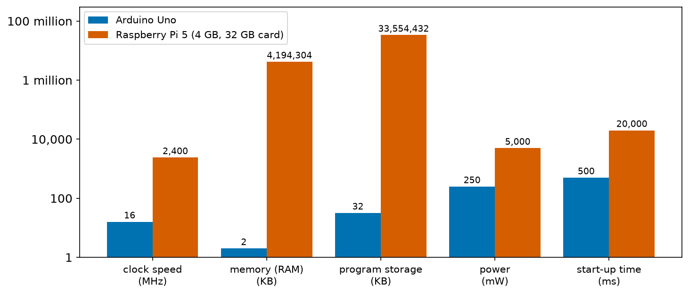
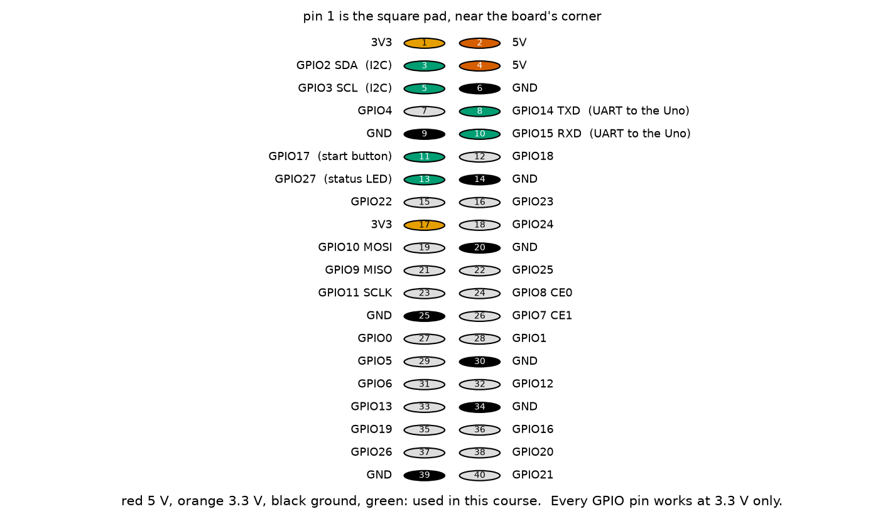
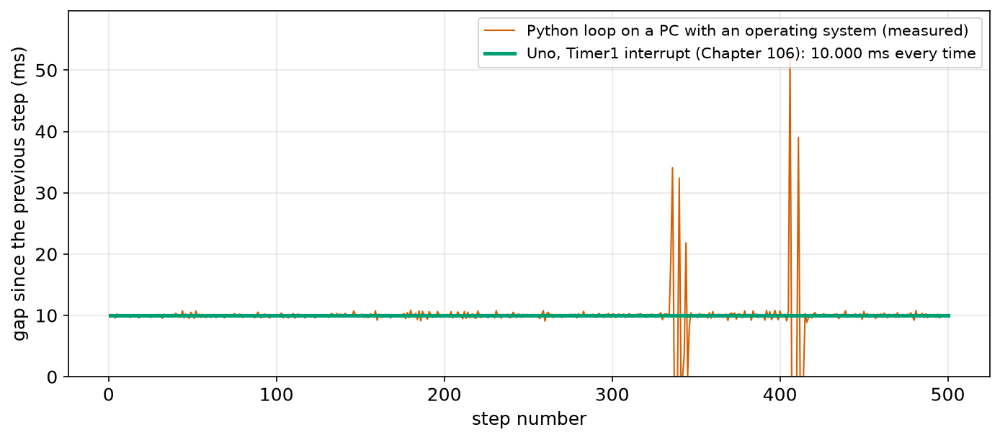
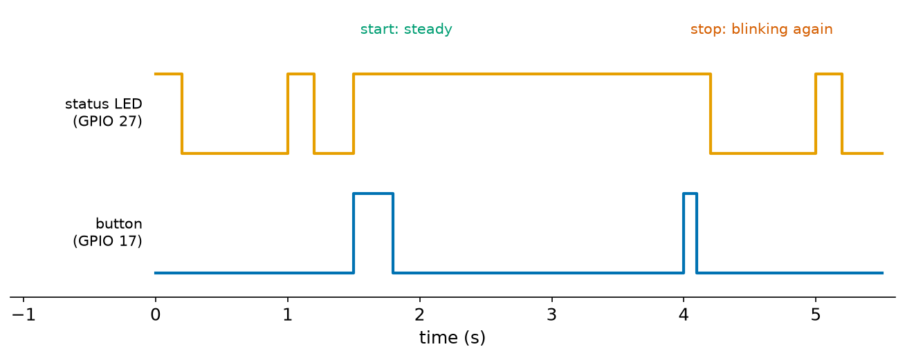
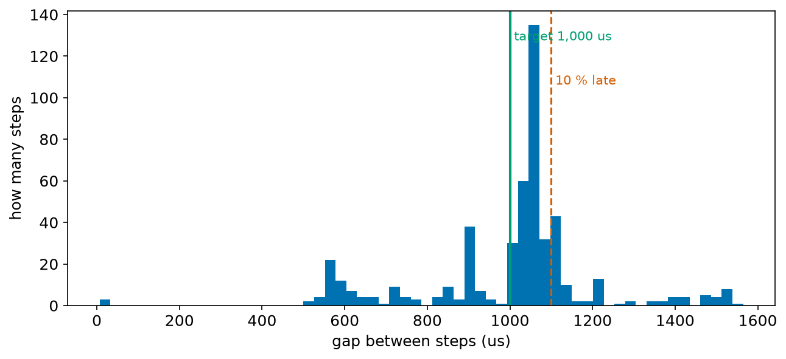
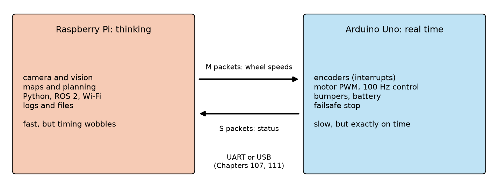

# Chapter 112 — Raspberry Pi: a small computer, GPIO with Python

> **Part 6 · Chapter 112 of 749**
> **You need:** Chapter 30 (timing a loop in Python), Chapter 91 (3.3 V and 5 V logic, level shifting), Chapter 94 (microcontrollers and computers; jitter), Chapter 99 (buttons and bounce), Chapter 105 (interrupts: reacting to events), Chapter 106 (a timer that is exactly on time) and Chapters 107 and 111 (Rover's link and pyserial).
> **You will make:** a start button and status LED for Rover on the Raspberry Pi's GPIO pins, written with gpiozero; a measurement of how much a timed loop wobbles on a computer with an operating system; and the reasoning behind Rover's two brains.

---

## What you will learn

- What a **Raspberry Pi** is, and how it differs from an Arduino.
- What an **operating system** does, and why it makes timing less exact.
- The Pi's 40-pin **GPIO header**: pin numbering, 3.3 V logic, and current limits.
- How to drive an LED and read a button from Python with **gpiozero**, using **callbacks**.
- How to measure **jitter**, and what it means for control loops.
- Why Rover, like most real robots, has a computer **and** a microcontroller.

---

## New words in this chapter

| Word | Simple meaning |
|---|---|
| **single-board computer** | A whole computer (processor, memory, ports) on one small board. |
| **operating system (OS)** | The program that manages a computer and shares it between many programs: Linux, Windows, macOS. |
| **scheduler** | The part of the OS that decides which program runs on each processor core, and when. |
| **GPIO** | General-purpose input/output: pins a program can use as digital inputs and outputs. |
| **BCM number** | The number of a GPIO pin as the chip knows it (GPIO17), not its position on the header. |
| **gpiozero** | The Python library that comes with the Raspberry Pi for LEDs, buttons, motors and more. |
| **callback** | A function you hand to a library, which the library calls later when something happens. |
| **jitter** | How much the time between steps that should be equal varies (Chapter 106). |

---

## 112.1 A computer the size of a credit card

📖 **New word: single-board computer** — a whole computer on one small board: processor, memory, storage, USB, network, video. The best known is the **Raspberry Pi**, made by a UK charity for teaching since 2012. The model used in this course is the Raspberry Pi 5 (an older Pi 4 works for everything in this part).

A Raspberry Pi and an Arduino Uno look alike: small boards with pins. They are very different machines (Chapter 94):



*Figure 112.1 — Five numbers for each, on a logarithmic scale (each line is 100 times the one below).*

**How to read this picture:** Blue is the Uno, red the Pi 5 with 4 GB of memory and a 32 GB memory card. The Pi's clock is 150 times faster (and it has 4 cores, not one); it has two million times more memory and a million times more storage. But it also uses 20 times more power and takes 40 times longer to start: about 20 seconds, against half a second.

The Pi's processor is like a phone's: a 64-bit Arm chip running at 2.4 GHz. It runs a full **operating system**, Raspberry Pi OS (a version of Linux), from a microSD card, with a desktop, Wi-Fi, a web browser, Python, and everything Rover's "thinking" needs: cameras (Chapter 477), maps, path planning, ROS 2 (Part 27).

📖 **New word: operating system (OS)** — the program that runs a computer and shares it between many programs at once: it loads them, gives each its memory, handles files, network and screen, and stops one program from damaging another. Linux, Windows, macOS and Android are operating systems. The Uno has none: your sketch is the only program, and it owns the chip.

📖 **New word: scheduler** — the part of the OS that decides, many times per second, which program runs on each core. On a Pi, a hundred programs are "running" at once (the desktop, the network, logging, updates, your program); the scheduler gives each a turn. Your program can be paused at any moment, for microseconds or milliseconds, while another one runs. That is the price of an OS, and section 112.4 measures it.

⚠️ **Careful: shut the Pi down; do not just pull the power.** Linux keeps parts of files in memory and writes them to the card later. Pulling the power can corrupt the card and stop the Pi from starting. Use the desktop's **Shutdown**, or `sudo shutdown now`, and wait for the green light to stop flashing. (The Uno can be unplugged at any moment.) The Pi 5 also needs a strong 5 V supply (the official 27 W one); a weak supply makes it slow down or restart.

---

## 112.2 The GPIO header

📖 **New word: GPIO** — **g**eneral-**p**urpose **i**nput/**o**utput: pins that a program can use as digital inputs and outputs, like the Uno's digital pins (Chapters 98 and 99). The Pi has 28 of them on its 40-pin header, which also carries power and ground.



*Figure 112.2 — The Pi's header: each pin's position number and what it is.*

**How to read this picture:** The header has two columns of 20 pins; pin 1 is at the end nearest the board's corner (its pad is square). Odd numbers are in the left column, even numbers in the right. Red pins carry 5 V, orange 3.3 V, black ground. The rest are GPIO pins, named by their **BCM number** (GPIO17 is physical pin 11). Several have a second job: GPIO2 and 3 are I2C (Chapter 108), GPIO14 and 15 are the UART (Chapter 107), GPIO10, 9, 11, 8 and 7 are SPI (Chapter 109). Green marks the pins this chapter and Chapter 107 use.

📖 **New word: BCM number** — the number of a GPIO pin as the processor chip knows it ("BCM" from Broadcom, the maker of the Pi's chips). Programs use BCM numbers: `LED(27)` means GPIO27, which is physical pin 13. Mixing the two numberings is the most common Pi wiring mistake: always check a header diagram.

Three facts matter more than anything else:

1. **3.3 V only.** Every GPIO pin works at 3.3 V, and **none is 5 V tolerant**. A 5 V signal (from an Uno's output, a 5 V sensor, or the 5 V pins themselves) can destroy the pin or the whole chip (Chapter 91). Use a divider or a level shifter, as Rover's link does (Figure 107.6).
2. **Small currents.** Keep each pin under about 16 mA, and all the pins together under about 50 mA. An LED with a 330 Ω resistor takes (3.3 − 2.0) ÷ 330 = 4 mA: fine. A motor, a relay or a buzzer needs a transistor (Chapter 88) or a driver.
3. **No analog inputs.** The Pi has no ADC (Chapter 101). To read a potentiometer or a battery voltage, add an ADC chip such as the MCP3008 on SPI (Chapter 109), or let the Arduino measure and send the result.

💡 **Tip: the Pi Pico is not a Pi.** The Raspberry Pi **Pico** (with the RP2040 or RP2350 chip) is a **microcontroller** board, like an Arduino, with no operating system. It is a fine alternative to the Uno (faster, 3.3 V, more memory), and it runs C++ or MicroPython. This chapter is about the Raspberry Pi computers.

---

## 112.3 Python on the pins: gpiozero

📖 **New word: gpiozero** — the Python library, included with Raspberry Pi OS, that controls things on the GPIO pins with very little code. Each thing is an object (Chapter 110): `LED(27)`, `Button(17)`, `PWMLED(18)`, `Motor(…)`, `DistanceSensor(…)`.

```python
from gpiozero import LED, Button
led = LED(27)                 # GPIO27 as an output
button = Button(17)           # GPIO17 as an input, with the internal pull-up switched on
led.on()
print(button.is_pressed)      # True while the button connects GPIO17 to ground
```

`Button` assumes the button connects the pin to ground and turns on the chip's internal pull-up resistor, as `INPUT_PULLUP` does on the Uno (Chapter 99); `is_pressed` is already the right way round. gpiozero works on every Pi model. Older programs use a library called RPi.GPIO, which does not work on the Pi 5.

📖 **New word: callback** — a function you hand to a library, which the library calls later, when something happens. Instead of polling the button in a loop (Chapter 99), you say what should happen on a press:

```python
def started():
    print("pressed!")

button.when_pressed = started     # no brackets: we hand over the function itself, we do not call it
```

gpiozero watches the pin in the background (with its own thread, a second line of execution inside your program) and calls `started()` at each press. This is the Pi's version of an interrupt (Chapter 105): the program reacts to an event instead of looking for it. But it is not as fast or as exact as a real interrupt on the Uno: the callback runs when the OS gets round to it, usually within a millisecond.

`Button(17, bounce_time=0.05)` adds debouncing (Chapter 99): after a change, further changes for 50 ms are ignored.

---

## 112.4 Linux and timing

📖 **New word: jitter** — Chapter 106 measured it on the Uno: with a timer interrupt, Rover's 100 Hz control step came exactly 10,000 µs apart, every time. What happens to the same kind of loop on a computer with an operating system?

The program `jitter.py` (in the Code section) runs a loop that should repeat every 10 ms, planning each step from the start (Chapter 30's method), and measures the real gap between steps, 500 times. On the PC used to write this chapter (a Windows 11 laptop, with nothing else important running):

```
target 10000 us, 500 gaps measured
smallest 2 us, median 10065 us, largest 51905 us
99 % of the gaps were under 21833 us
gaps more than 10 % late: 6 of 500
```



*Figure 112.3 — The gap before each of 500 steps of `jitter.py` (red, measured), and the Uno's timer-driven loop (green, Chapter 106).*

**How to read this picture:** The green line is flat at 10 ms: the Uno's timer never wavers. The red line is the Python loop. Most of the time it stays close to 10 ms, wobbling by a fraction of a millisecond. But twice, around steps 340 and 405, the operating system held the program back for 30 to 50 ms: a few steps came very late, and then, because each step is planned from the start, the missed steps ran immediately, almost 0 ms apart (the drops to the bottom). The "smallest 2 µs" in the output is one of those catch-up steps.

Your numbers will be different every run and on every computer: that is the point. On a Raspberry Pi running Linux the picture is of the same kind: usually within a fraction of a millisecond, with occasional delays of many milliseconds when the system is busy (writing to the card, Wi-Fi, a desktop redrawing). Nothing in your program can promise that the next step will come on time.

🧠 **An ordinary operating system is fast on average but cannot promise timing.** A microcontroller with a timer interrupt is slow but exact. Control loops that must be on time (motor speed control, balancing, flight) belong on a microcontroller, or on a real-time system (Chapter 522; Linux can be made far more predictable with PREEMPT_RT, Chapter 530).

---

## Code

The outputs of `jitter.py` in this chapter are real measurements, on the PC described in section 112.4. The gpiozero programs need a Raspberry Pi, and none was available (nor the gpiozero library) on the computer used to write this chapter. So they were run unchanged through `code/common/pi_mock/run_with_mock_gpio.py`, which puts a small stand-in for gpiozero in its place: it prints every change of an output pin with a pretend time, plays a list of button presses (with 3 ms of contact bounce, like the test bench of Chapter 99), and implements `bounce_time` as gpiozero does. On a real Pi, run the programs directly: `python3 pi_start_button.py`. (gpiozero also has its own "mock pin factory" for testing on a PC, once it is installed.)

File `code/ch112/jitter.py`:

```python
# jitter.py - how steady is a timed loop on a computer with an operating system (Windows, Linux, macOS)?
# usage: python jitter.py [period in ms]      (default 10 ms, like Rover's control loop in Chapter 106)
import statistics
import sys
import time

PERIOD = (float(sys.argv[1]) if len(sys.argv) > 1 else 10.0) / 1000.0   # seconds
N = 500

gaps = []
next_t = time.perf_counter()
last = None
for i in range(N + 1):
    next_t += PERIOD                             # plan each step from the start (Chapter 30), never "sleep a period"
    remaining = next_t - time.perf_counter()
    if remaining > 0:
        time.sleep(remaining)
    now = time.perf_counter()
    if last is not None:
        gaps.append((now - last) * 1e6)          # microseconds
    last = now

with open(f"jitter_gaps_{PERIOD * 1000:g}ms.txt", "w") as f:   # for the chapter's figure
    f.write("\n".join(f"{g:.1f}" for g in gaps))
s = sorted(gaps)
target = PERIOD * 1e6
print(f"target {target:.0f} us, {len(gaps)} gaps measured")
print(f"smallest {s[0]:.0f} us, median {statistics.median(s):.0f} us, largest {s[-1]:.0f} us")
print(f"99 % of the gaps were under {s[int(0.99 * len(s))]:.0f} us")
print(f"gaps more than 10 % late: {sum(g > 1.1 * target for g in gaps)} of {len(gaps)}")
```

| Line | Code | What it does (simple English) |
|---|---|---|
| 1–5 | comments, imports | `statistics` gives the median. |
| 6–8 | (blank), `PERIOD = …`, `N = 500` | The period in seconds, from the command line in ms (default 10); 500 steps. |
| 9–12 | (blank), `gaps = []`, `next_t = time.perf_counter()`, `last = None` | `perf_counter()` is Python's most precise clock. |
| 13 | `for i in range(N + 1):` | 501 steps give 500 gaps. |
| 14 | `next_t += PERIOD` | The planned time of this step: start + i × period. |
| 15–17 | `remaining = next_t - time.perf_counter()`, `if remaining > 0: time.sleep(remaining)` | Sleep until then. If we are already late, do not sleep at all (catch up). |
| 18–21 | `now = …`, `if last is not None: gaps.append((now - last) * 1e6)`, `last = now` | When the step really started, and the gap since the previous one, in µs. |
| 22 | (blank) | |
| 23–24 | `with open(f"jitter_gaps_{PERIOD * 1000:g}ms.txt", "w") as f: …` | Save every gap, one per line, for the figures. `:g` writes 10.0 as `10`. |
| 25–30 | `s = sorted(gaps)`, `print(…)` … | The smallest, median and largest gap; the gap that 99% of steps beat; and how many came more than 10% late. |

---

## Small examples

**Example 1.** `LED(27)` is physical pin 13; `Button(17)` is physical pin 11.

**Example 2.** A LED with a 220 Ω resistor on a 3.3 V pin takes (3.3 − 2.0) ÷ 220 = 5.9 mA.

**Example 3.** Ten LEDs at 5.9 mA each = 59 mA: more than the Pi's GPIO pins should supply together.

**Example 4.** A 5 V Uno TX into a Pi RX through 1 kΩ / 2 kΩ arrives as 3.33 V (Chapter 107).

**Example 5.** `led.blink(on_time=0.2, off_time=0.8)` blinks once per second, in the background.

**Example 6.** `button.when_pressed = toggle` hands over the function; `button.when_pressed = toggle()` would call it once, now, and hand over its result, `None`.

**Example 7.** A 10 ms loop delayed by 50 ms once misses 5 planned steps, which then run at once.

**Example 8.** At 100 Hz, a 2 ms jitter is 20% of a step: a speed worked out as "counts ÷ 0.010 s" would be 20% wrong.

---

## 🏭 Real robot applications

### Application 1 (worked in full) — 🤖 Rover's start button and status LED on the Pi

**1. The real problem.** Rover's Pi starts its main program when it boots, but Rover must not drive away at once: a person should press a **start button** when the robot is on the floor and ready. A **status LED** tells them what Rover is doing: short blinks for "ready, waiting", steady for "driving". A second press stops it. The button and LED connect straight to the Pi, because they belong to the Pi's program.

**2. Why this theory.** gpiozero's `LED` and `Button` (section 112.3). A **callback** reacts to each press without a polling loop. `bounce_time` removes contact bounce (Chapter 99). `blink()` runs in the background, so the program can simply wait with `pause()`.

**3. The numbers.** Button: GPIO17 (pin 11) to ground; LED: GPIO27 (pin 13) → 330 Ω → LED → ground, 4 mA. Blink: 0.2 s on, 0.8 s off. Debounce: 50 ms. The test presses the button from 1.5 to 1.8 s and from 4.0 to 4.1 s, each with 3 ms of bounce.

**4. The maths.** A press bounces for 3 ms (7 edges); with a 50 ms `bounce_time`, only the first edge counts. The release comes 300 ms later (or 100 ms), well after 50 ms, so it is accepted too (and ignored, since there is no `when_released`). Expected: LED blinking from 0 s; steady from 1.5 s; blinking again from 4.0 s, with its first "off" 0.2 s later.

**5. The code.** File `code/ch112/pi_start_button.py`:

```python
# pi_start_button.py - Rover's start button and status LED on the Raspberry Pi, with gpiozero
from signal import pause

from gpiozero import LED, Button                 # comes with Raspberry Pi OS

status = LED(27)                                 # GPIO 27 -> 330 ohm resistor -> LED -> GND
button = Button(17, bounce_time=0.05)            # GPIO 17 -> button -> GND (gpiozero turns on the pull-up)
running = False


def toggle_run():                                # gpiozero calls this when the button is pressed
    global running
    running = not running
    if running:
        status.on()                              # steady light: Rover is driving
        print("Rover: start")
    else:
        status.blink(on_time=0.2, off_time=0.8)  # short blinks: ready and waiting
        print("Rover: stop")


button.when_pressed = toggle_run
status.blink(on_time=0.2, off_time=0.8)
print("ready: press the button to start")
pause()                                          # wait for ever; gpiozero runs toggle_run in the background
```

| Line | Code | What it does (simple English) |
|---|---|---|
| 1 | comment | |
| 2 | `from signal import pause` | `pause()` waits for ever without using the processor (on Linux). |
| 3–4 | (blank), `from gpiozero import LED, Button` | |
| 5 | (blank) | |
| 6 | `status = LED(27)` | An LED object on GPIO27. |
| 7 | `button = Button(17, bounce_time=0.05)` | A button object on GPIO17, pull-up on, 50 ms debounce. |
| 8 | `running = False` | Rover starts stopped. |
| 9–10 | (blank) | |
| 11 | `def toggle_run():` | What a press does. |
| 12 | `global running` | The function changes the variable made outside it (Chapter 24). |
| 13 | `running = not running` | Flip between driving and stopped. |
| 14–19 | `if running: status.on(); print("Rover: start") else: status.blink(…); print("Rover: stop")` | Steady LED for driving; blinking for waiting. `on()` also stops any blinking. On Rover, these lines would also send the first motor packets or a stop packet to the Arduino (Chapter 111). |
| 20–21 | (blank) | |
| 22 | `button.when_pressed = toggle_run` | Hand over the callback (no brackets). |
| 23–24 | `status.blink(…)`, `print(…)` | Start in the "waiting" state. |
| 25 | `pause()` | Nothing else to do: gpiozero calls `toggle_run` when needed. |

Output (through the gpiozero stand-in, with presses at 1.5–1.8 s and 4.0–4.1 s; the lines in brackets are its pin reports):

```
[   0.000 s] GPIO27 -> HIGH  (LED on)
ready: press the button to start
[   0.200 s] GPIO27 -> LOW  (LED off)
[   1.000 s] GPIO27 -> HIGH  (LED on)
[   1.200 s] GPIO27 -> LOW  (LED off)
[   1.500 s] GPIO27 -> HIGH  (LED on)
Rover: start
Rover: stop
[   4.200 s] GPIO27 -> LOW  (LED off)
[   5.000 s] GPIO27 -> HIGH  (LED on)
[   5.200 s] GPIO27 -> LOW  (LED off)
```



*Figure 112.4 — The status LED (top) and the button (bottom, HIGH = pressed), from the output above.*

**How to read this picture:** Until 1.5 s the LED gives short blinks: waiting. At the press (1.5 s) it goes steady: driving. At the second press (4.0 s) it starts blinking again: the "Rover: stop" line comes at 4.0 s, while the LED is still on from the steady state, so the first visible change is the blink turning it off at 4.2 s. Each bouncing press gave exactly one start or stop.

**6. The result.** The button started and stopped Rover once per press, the LED showed the state, and the program did nothing at all between events: no polling loop, no `sleep`. With gpiozero, a Pi program reads like a description of the behaviour. Lab 112.3 shows what the 50 ms `bounce_time` is protecting against.

**7. Going further.** A real robot's start button should also be checked by the Arduino's failsafe logic (Chapter 107): if the Pi's program crashes while Rover is driving, the Arduino stops the motors within 500 ms whatever the LED shows. And the Pi can start the program automatically at boot, as a Linux **service** (Part 27 shows how), so Rover needs no keyboard: power on, wait for the blinking, press the button.

### Application 2 (worked in full) — 🤖 Why Rover has two brains

**1. The real problem.** If the Pi is 150 times faster than the Uno, why not do everything on the Pi: read the encoders, run the 100 Hz speed controller, drive the motors' PWM, all in Python? It would save a board and the link between them.

**2. Why this theory.** Section 112.4: on an operating system, a program cannot be sure when it will run. Chapter 106: the speed controller assumes exactly 10 ms between steps, and gaps from 4 to 16 ms already made its speed estimates 60% wrong. Chapter 105: encoder pulses come every 0.77 ms at 0.5 m/s, and must all be counted.

**3. The numbers.** From `jitter.py` (10 ms): median 10,065 µs, 99% under 21,833 µs, largest 51,905 µs. From `jitter.py 1` (1 ms, practice question 11): median 1,055 µs, largest 1,565 µs, 92 of 500 steps more than 10% late.

**4. The maths.** A step 21.8 ms after the previous one, in a loop that assumes 10 ms, makes "counts ÷ 0.010 s" 118% too high: the controller would think Rover was driving at more than twice its real speed, and brake hard. A 51.9 ms delay is five whole missed steps, during which the motors run unwatched. Encoder pulses 0.77 ms apart cannot be caught by a program that can be held back for 50 ms (that is 65 pulses), unless special hardware counts them.

**5. The code.** `jitter.py` (above) is the measurement. Figure 112.5 shows the 1 ms run:



*Figure 112.5 — How many of the 500 steps of the 1 ms loop had each gap (measured).*

**How to read this picture:** Each bar counts the steps whose gap fell in its range. A perfect loop would be one tall bar at the green line (1,000 µs). Here the gaps spread from about 550 to 1,560 µs: many come a little late (just right of the green line), almost a fifth come more than 10% late (right of the red dashed line), and the early ones (left) are the catch-up steps after late ones.

**6. The result.** On the measured computer, a Python loop kept its period **on average**, but individual steps came up to five periods late. That is fine for planning a route (a few milliseconds do not matter), for a camera (30 frames per second), or for a user interface. It is not fine for a motor speed controller, encoder counting, or a balance loop. So Rover splits the work (Figure 112.6): the Pi decides **where** to go and **how fast**, about 20 times per second, and sends wheel speeds over the link; the Uno counts every encoder pulse with interrupts, runs the speed controller exactly every 10 ms with a timer, and stops the motors if the Pi goes quiet.



*Figure 112.6 — The Pi does the thinking; the Uno does everything that must happen exactly on time; packets carry wheel speeds one way and status the other.*

**How to read this picture:** Left, the Pi's jobs: heavy, flexible, not time-critical. Right, the Uno's: light, but each must happen on time. The arrows are Chapter 107's packets: `M` (wheel speeds) one way, `S` (status) back.

**7. Going further.** This split is everywhere: a drone's flight controller and its companion computer (Application 3), a robot arm's joint controllers and its planning PC, a car's dozens of microcontrollers and its central computer. Where one board must do both, there are other answers: a real-time operating system on a microcontroller (Chapter 526), Linux with the PREEMPT_RT patches (Chapter 530), or chips that put Linux cores and real-time cores side by side, such as the processors in many industrial robots.

### Application 3 — 🚁 Companion computers on drones

Autonomous drones carry two computers, exactly like Rover. The **flight controller** (a microcontroller, often an STM32, running PX4 or ArduPilot) runs the attitude control at hundreds or thousands of hertz with hard timing. A **companion computer** (a Raspberry Pi, or an NVIDIA Jetson for heavy vision) runs Linux, the camera, obstacle detection and mission logic. They talk over a UART with MAVLink packets (Chapter 111, Application 4), and the flight controller keeps flying safely, and lands or returns home, if the companion computer stops talking. Chapter 652 builds this link with ROS 2.

### Application 4 — 🏭 PLCs and industrial Raspberry Pis

Factory machines are controlled by **PLCs** (programmable logic controllers): rugged computers that run a control program in a fixed cycle (often 1 to 10 ms) with guaranteed timing, and with inputs and outputs at the factory's 24 V. A PLC's cycle never wobbles the way a desktop program does. Industrial versions of the Raspberry Pi exist (in metal cases, with 24 V inputs and outputs and certified power supplies), and they are used for data collection, displays and network gateways, often next to a PLC rather than instead of it. When they do control machinery, they run a real-time version of Linux and a PLC-style runtime, and safety functions stay in separate, certified hardware (Chapter 744).

### Application 5 — 🤖 Reading sensors the Pi cannot read

Because the Pi has no ADC and only 3.3 V pins, many robot builders put the Pi's "senses" on helpers: an MCP3008 ADC chip on SPI for analog sensors, an I2C board for servos (the PCA9685, which makes 16 PWM signals in hardware), or an Arduino or Pico over USB for anything with tight timing, such as ultrasonic echoes or encoders. The Pi then reads finished numbers. This is the same principle as Rover's split: let each chip do what it is good at.

---

## 🔧 Hands-on lab

### Lab 112.1 — First steps on a real Pi (hardware)

You need: a Raspberry Pi 4 or 5 with Raspberry Pi OS, its power supply, a keyboard, mouse and screen (or SSH from another computer), a LED, a 330 Ω resistor, a push button, jumper wires.

1. Shut the Pi down and unplug it before wiring. Connect GPIO27 (pin 13) → 330 Ω → LED (long leg) → LED (short leg) → GND (pin 14). Connect a button between GPIO17 (pin 11) and GND (pin 9).
2. Power up, open a terminal, and type `python3`, then: `from gpiozero import LED, Button`, `led = LED(27)`, `led.on()`, `led.off()`, `led.blink()`.
3. Copy `pi_start_button.py` to the Pi and run `python3 pi_start_button.py`. Press the button a few times. Stop it with Ctrl+C.

**What you should see:** Step 2: the LED follows each command at once; `blink()` keeps it blinking while you type more. Step 3: as in Application 1.

| If it does not work | Likely cause | Fix |
|---|---|---|
| LED never lights | Wrong pin (physical vs BCM numbering), or LED backwards | GPIO27 is physical pin 13; long leg towards the GPIO pin |
| `Button` always pressed | Button wired to 3.3 V instead of GND | gpiozero's default expects the button to connect to GND |
| Pi restarts when the LED turns on | A short circuit, or a weak power supply | Check the wiring; use the official supply |

**Challenge:** Use `PWMLED(18)` and set `.value` from 0 to 1 in steps of 0.1 to fade the LED (Chapter 102's PWM, made by the Pi).

### Lab 112.2 — Measure your own computer's jitter (real, on any computer)

You need: any computer with Python. This lab runs for real; no simulation.

1. Run `python jitter.py` three times. Write down the median, the largest gap and the "late" count each time.
2. Run it again while doing something heavy: open a big web page, play a video, or copy a large file.
3. Run `python jitter.py 1` (1 ms period) and `python jitter.py 100` (100 ms).
4. On a Raspberry Pi, run the same. Then run it with `sudo nice -n -20 python3 jitter.py` (a higher priority) and compare.

**What you should see:** The median is always close to the target; the largest gap changes from run to run, and grows when the computer is busy. A shorter period makes the same delays a bigger fraction of each step: more steps count as "late". A higher priority on Linux usually reduces the delays, but cannot remove them.

| If it does not work | Likely cause | Fix |
|---|---|---|
| Every gap is 15–16 ms on Windows | An old Python whose `sleep` uses the coarse Windows timer | Use a recent Python (3.11 or newer) |
| `nice: permission denied` | Raising priority needs administrator rights | Use `sudo` |

**Challenge:** Change `jitter.py` to busy-wait instead of sleeping (`while time.perf_counter() < next_t: pass`). Does the jitter shrink? What happens to the processor's load, and to everything else on the computer?

### Lab 112.3 — Callbacks and bounce (simulation)

Run from `code/ch112`, through the gpiozero stand-in:

1. `python ../common/pi_mock/run_with_mock_gpio.py --press 17:1.5-1.8 --press 17:4.0-4.1 --end 5.5 pi_start_button.py`
2. Remove `, bounce_time=0.05` from line 7 and run it again.

**What you should see:** Step 1: as in Application 1. Step 2: the output fills with `Rover: start` and `Rover: stop` lines. The stand-in's button bounces 7 times in 3 ms at the press **and** at the release, and every bounce that closes the contact counts as a press: each press toggles Rover 4 times (ending stopped: the LED gives one short blink, off at 1.703 s) and each release 3 more times (ending driving: steady from 1.8 s). The final states happen to match what the person wanted, but only by luck, and on a real Rover each of those 7 toggles would have started or stopped the motors. Without debouncing, a start button is worse than useless.

| If it does not work | Likely cause | Fix |
|---|---|---|
| `ModuleNotFoundError: gpiozero` | Running the program directly on a PC | Use `run_with_mock_gpio.py`, or install gpiozero and use its mock pin factory |
| Nothing happens at the presses | The `--press` pin number differs from the program's | Both must be 17 |

**Challenge:** Add `button.when_held = shutdown_request` with `Button(17, hold_time=3)`, so holding the button for 3 seconds prints "shutting down": a common way to shut a headless Pi down safely.

---

## Common mistakes

⚠️ **5 V on a GPIO pin.** The Pi's pins are 3.3 V only and not 5 V tolerant. One mistake can destroy the Pi.

⚠️ **Mixing physical pin numbers and BCM numbers.** `LED(13)` is GPIO13 (physical pin 33), not physical pin 13.

⚠️ **Pulling the power without shutting down.** The memory card can be corrupted.

⚠️ **Driving motors, relays or many LEDs straight from GPIO pins.** Use a transistor or a driver board.

⚠️ **Expecting exact timing from Python on Linux.** Use the Arduino (or hardware PWM, or a real-time system) for anything that must be on time.

⚠️ **Calling the callback instead of handing it over.** `when_pressed = f()` runs `f` once; write `when_pressed = f`.

⚠️ **A long, slow callback.** While it runs, other events wait, like a long ISR (Chapter 105). Do the slow work elsewhere.

⚠️ **Forgetting that the Pi has no analog inputs.** `analogRead` has no Pi equivalent without an ADC chip.

---

## Practice

🏋️ **1.** Give three differences between a Raspberry Pi and an Arduino Uno.

🏋️ **2.** What does an operating system's scheduler do, and why does it make a program's timing less predictable?

🏋️ **3.** Which physical pin is GPIO27? Which BCM pin is physical pin 11?

🏋️ **4.** Why must an Uno's TX never connect straight to a Pi's RX?

🏋️ **5.** How much current does a LED with a 470 Ω resistor take on a Pi's GPIO pin (LED voltage 2.0 V)?

🏋️ **6.** What is a callback? Write the line that makes gpiozero call `beep` when `button` is released.

🏋️ **7.** What does `Button(17, bounce_time=0.05)` do that `Button(17)` does not?

🏋️ **8.** A Python loop meant to run every 10 ms is once held back for 51.9 ms. How many steps are missed, and what does a planned-time loop do next?

🏋️ **9.** Give two jobs on Rover that suit the Pi, and two that must stay on the Uno, with a reason for each.

🏋️ **10.** Name two ways to read a potentiometer from a Raspberry Pi.

🏋️ **11.** Run `jitter.py` with a 1 ms period (`python jitter.py 1`). What are the median and largest gaps, and how many steps are more than 10% late? Compare with the 10 ms run.

---

## Answers

**1.** Any three: the Pi runs an operating system (Linux), the Uno none; the Pi's clock is 2.4 GHz with 4 cores against 16 MHz and one; the Pi has gigabytes of memory, the Uno 2 KB; the Pi's pins are 3.3 V, the Uno's 5 V; the Pi has no analog inputs; the Pi takes about 20 s to start and must be shut down properly; the Uno's timing is exact, the Pi's is not.

**2.** It decides which program runs on each core, and when, switching between many programs many times per second. Your program can be paused at any moment while others run, for an amount of time it does not control.

**3.** GPIO27 is physical pin **13**; physical pin 11 is **GPIO17**.

**4.** The Uno's HIGH is 5 V and the Pi's pins are not 5 V tolerant (their limit is about 3.6 V): it can damage the Pi. Use a 1 kΩ / 2 kΩ divider (Chapter 107).

**5.** (3.3 − 2.0) ÷ 470 = **2.8 mA**.

**6.** A function handed to a library to be called later, when an event happens. `button.when_released = beep`.

**7.** It ignores any further changes for 50 ms after an accepted one, so the contact bounce of a press or release does not cause extra events (debouncing, Chapter 99).

**8.** 51.9 ÷ 10 = about **5 steps** fall due while it is held back; a planned-time loop then runs them one after another with almost no gap (catching up), as in Figure 112.3.

**9.** Pi: camera and vision (heavy computing, Linux libraries); planning the route (needs memory and maths; a few ms of delay do not matter); also logging, Wi-Fi, ROS 2. Uno: counting encoder pulses (must catch every 0.77 ms pulse: interrupts); the 100 Hz speed controller (needs exactly 10 ms steps: a timer); the failsafe stop (must work even if the Pi crashes).

**10.** An ADC chip on SPI or I2C (such as the MCP3008); or an Arduino (or Pico) that reads it with `analogRead` and sends the number over serial (Chapter 111).

**11.** Run on the same PC as section 112.4:

```
target 1000 us, 500 gaps measured
smallest 7 us, median 1055 us, largest 1565 us
99 % of the gaps were under 1520 us
gaps more than 10 % late: 92 of 500
```

The median is 1,055 µs (5% above the target, where the 10 ms run was 0.65% above), and **92 of 500** steps were more than 10% late, against 6 of 500 for 10 ms. The OS's small delays (the median step is 55 to 65 µs too long in both runs, plus occasional longer ones) are the same size, but a much bigger share of a 1 ms step. In this run no long delay happened, so the largest gap was only 1,565 µs; another run might show one. Your own numbers will differ.

---

## Summary

🧠 A **Raspberry Pi** is a single-board computer: a 2.4 GHz, 4-core 64-bit processor, gigabytes of memory, Linux, Wi-Fi and Python. It starts in about 20 s, must be shut down properly, and needs a strong 5 V supply.

🧠 Its **GPIO** pins work at **3.3 V only** (not 5 V tolerant), take a few mA each, and include I2C, SPI and UART pins. Programs use **BCM numbers** (GPIO17), not header positions (pin 11). There are no analog inputs.

🧠 **gpiozero** makes each device an object: `LED(27)`, `Button(17, bounce_time=0.05)`. **Callbacks** (`when_pressed = f`) react to events without a polling loop.

🧠 An **operating system's scheduler** shares the processor between many programs, so timing **jitters**: on the measured PC, a 10 ms loop's gaps ranged up to 52 ms.

🧠 So Rover has two brains: the **Pi** thinks (vision, maps, plans), the **Uno** keeps time (encoders, motor control, failsafe), joined by Chapter 107's packets.

---

## Next chapter

Part 6 ends with a project. Chapter 113, **Project: a traffic light and a reaction-time game**, puts the whole part together on one Uno: a state machine with non-blocking timing, debounced buttons, interrupts for a fair reaction timer, PWM for brightness, a buzzer, serial output, and a Python program that collects the scores. Then a review of Part 6 and a short test of everything in it.
