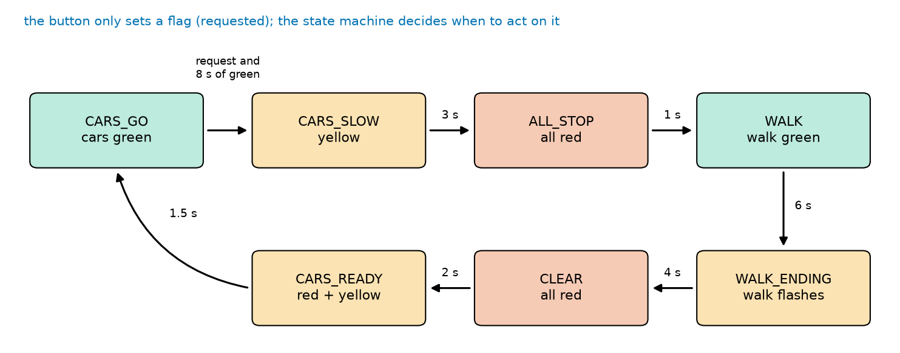
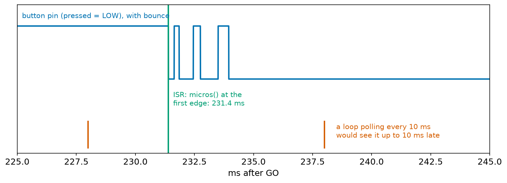
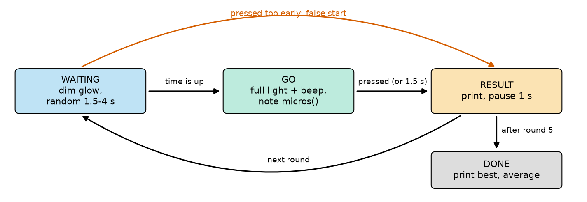
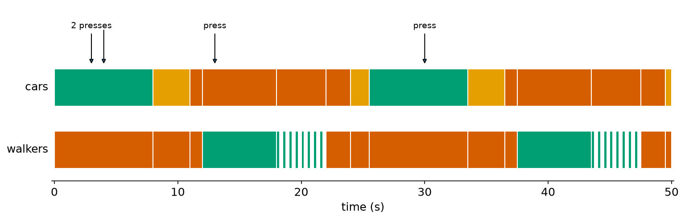
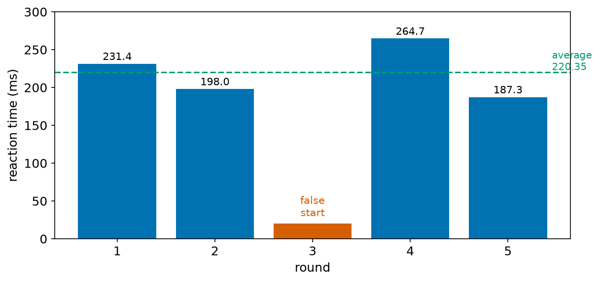
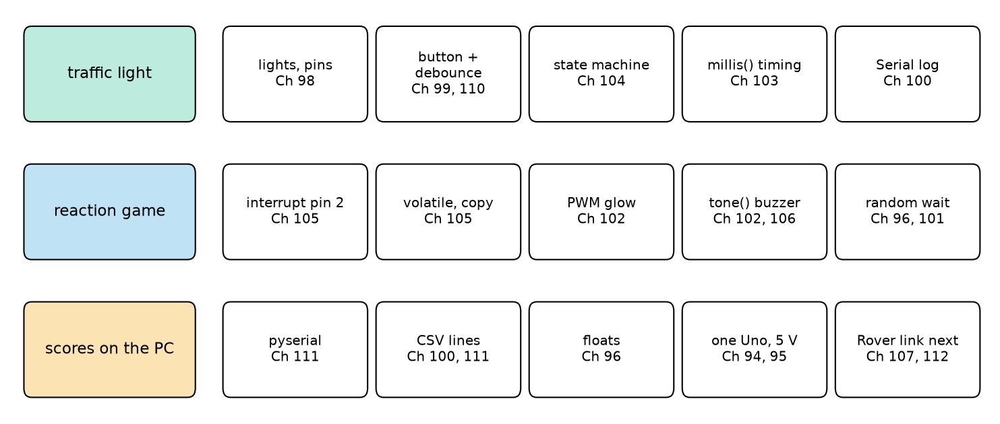

# Chapter 113 — Project: a traffic light and a reaction-time game

> **Part 6 · Chapter 113 of 749**
> **You need:** All of Part 6, especially Chapter 98 (digital outputs), 99 (buttons), 102 (PWM and `tone()`), 103 (`millis()` timing), 104 (state machines), 105 (interrupts), 110 (RoverLib) and 111 (pyserial).
> **You will make:** a pedestrian crossing with seven states, a request button and a flashing walk light, all on one Uno without a single `delay()`; a reaction-time game that times your press to the microsecond with an interrupt and catches false starts; and a Python program that collects the scores. Then a review of Part 6 and a test of everything in it.

---

## What you will learn

- How to plan a project as **states**, **events** and **timers** before writing code.
- How to combine non-blocking timing, debouncing, a state machine and serial logging in one sketch.
- When an interrupt really is the right tool for a button: **measuring** the moment of a press.
- How to use `random()`, PWM brightness and `tone()` together.
- How to test a whole project on the PC test bench, with a pretend pedestrian and a pretend player.
- How to collect a project's results with Python.

---

## New words in this chapter

| Word | Simple meaning |
|---|---|
| **specification** | A clear list of what a project must do, written before building it. |
| **request flag** | A variable that remembers "someone asked", so the request can be served later. |
| **false start** | Pressing before the signal: the press is caught and the round does not count. |
| **reaction time** | The time between a signal and a person's response to it. |
| **integration** | Putting separately working parts together into one system, and testing them together. |

---

## 113.1 The specification

📖 **New word: specification** — a clear list of what a project must do, written before building it. Engineers write one so that everyone agrees what "finished" means, and so that tests can check each point.

**Part A: the pedestrian crossing.**

1. Cars normally have green. Walkers have a red figure.
2. A walker presses a button to ask to cross. A "request" light confirms it.
3. Cars always keep green for at least 8 seconds, even if the button is pressed sooner.
4. Then: yellow 3 s, all red 1 s, walk green 6 s, walk green **flashing** 4 s ("hurry"), all red 2 s, red-and-yellow 1.5 s, then green again.
5. Extra presses while a request is waiting, or while people are walking, are ignored.
6. Every change is reported on the Serial Monitor, with the time.
7. No `delay()` anywhere: the button must be read at all times.

**Part B: the reaction game.**

1. A dim glow means "get ready". After a **random** 1.5 to 4 seconds, the light goes to full brightness and the buzzer beeps: GO.
2. The player presses as fast as possible. The time from GO to the press is measured to better than a millisecond and printed.
3. A press **before** GO is a false start: a low buzz, and the round does not count.
4. No press within 1.5 s: "too slow".
5. After 5 rounds, print the best and the average.
6. A Python program on the PC collects the results and saves them.

---

## 113.2 Part A: a state machine with a request flag

Chapter 104 built a traffic light with fixed timings. The pedestrian crossing adds one new idea:

📖 **New word: request flag** — a variable that remembers "someone asked", so the request can be served when the time is right. The button never changes the lights directly. It only sets `requested = true` and turns on the request light. The state machine looks at the flag only in the state where it matters (CARS_GO), and only after the minimum green time.



*Figure 113.1 — Seven states in a ring. Each arrow is labelled with the time spent in the state before it; the first arrow also needs a request.*

**How to read this picture:** Start at CARS_GO (top left). Without a request, the machine stays there for ever. With a request and at least 8 s of green, it moves right: yellow, all red, walk. Then down the right side and back along the bottom: the flashing walk light, all red again (so the last walkers can finish crossing), red-and-yellow (cars get ready), and back to green. The colour of each box is the cars' light in that state.

This sketch also **reuses** Chapter 110's library: the request button is a `Debouncer` object from RoverLib. (With real hardware, install RoverLib first, as in Lab 110.3.)

---

## 113.3 Part B: an interrupt that measures

Chapter 105 advised against interrupts for buttons: they bounce, and polling every few milliseconds is fast enough to **notice** a press. But the reaction game does not just need to notice the press: it needs to know **when** it happened, as exactly as possible. A loop that polls every 10 ms (say, while also updating a display) could see the press up to 10 ms late, and a player's score would depend on luck.

📖 **New word: reaction time** — the time between a signal and a person's response to it. For a light, most people need 180 to 300 ms; differences of 10 to 20 ms are what players compete over.

So the button goes on interrupt pin 2, and the ISR stores `micros()` at the **first** falling edge, then ignores the rest of the bounce, because it only stores a time while `pressed` is still false. The bounce is not a problem here, since only its first edge matters.



*Figure 113.4 — The button pin around a press 231.4 ms after GO, with its bounce; the ISR's timestamp (green) and the moments a 10 ms polling loop would look (red).*

**How to read this picture:** The blue line is the button pin: HIGH until the press, then bouncing for 3 ms, then LOW. The green line is where the ISR runs: exactly at the first edge, 231.4 ms after GO. The red marks show a polling loop's reads, 10 ms apart: the first read after the press is at 238 ms, 6.6 ms late, and the amount would change from round to round.

📖 **New word: false start** — pressing before the signal. The same ISR catches it: if `pressed` becomes true while the game is still in its WAITING state, the round is a false start. The random wait makes guessing useless: `random(1500, 4000)` gives a different wait each round, and `randomSeed(analogRead(A0))` with A0 unconnected (floating, Chapter 83) gives a different sequence each game.



*Figure 113.3 — Four states: waiting, GO, the result, and done after 5 rounds.*

**How to read this picture:** A round starts in WAITING. When the random wait is over, GO. A press in GO (or 1.5 s without one) leads to RESULT, which pauses for a second and starts the next round, or after round 5 goes to DONE. The red arc is the false start: a press during WAITING goes straight to RESULT.

---

## Code

All outputs come from the PC test bench. Its test files play the people: a pedestrian who presses the button at chosen moments (with Chapter 99's 3 ms of bounce), and a player (`pc_tests/world_reaction.h`) who watches pin 9 and presses a set time after the light goes to full brightness, except in round 3, where they lose patience and press 800 ms into the wait. The Python program runs through Chapter 111's bench link (`run_on_bench.py`), since pyserial and a real Uno were not available to the author.

File `code/ch113/traffic_light/traffic_light.ino`:

```cpp
// traffic_light.ino - a pedestrian crossing: a state machine (Chapter 104) timed with millis() (Chapter 103),
// with a debounced request button from RoverLib (Chapter 110)
#include <Debouncer.h>

const int CAR_RED = 4;
const int CAR_YELLOW = 5;
const int CAR_GREEN = 6;
const int WALK_RED = 7;
const int WALK_GREEN = 8;
const int WAIT_LED = 13;               // "request received", the built-in LED
Debouncer button(12);                  // the pedestrians' button, pin 12 to GND

enum State { CARS_GO, CARS_SLOW, ALL_STOP, WALK, WALK_ENDING, CLEAR, CARS_READY };
const char *NAMES[] = {"CARS_GO", "CARS_SLOW", "ALL_STOP", "WALK", "WALK_ENDING", "CLEAR", "CARS_READY"};
const unsigned long MIN_GREEN_MS = 8000;   // cars always get at least this much green

State state = CARS_GO;
unsigned long enteredAt = 0;           // when the current state began
bool requested = false;

void lights(int cr, int cy, int cg, int wr, int wg) {
  digitalWrite(CAR_RED, cr);
  digitalWrite(CAR_YELLOW, cy);
  digitalWrite(CAR_GREEN, cg);
  digitalWrite(WALK_RED, wr);
  digitalWrite(WALK_GREEN, wg);
}

void enter(State s) {                  // every change of state goes through here
  state = s;
  enteredAt = millis();
  Serial.print(enteredAt);
  Serial.print(" ms: ");
  Serial.println(NAMES[s]);
  switch (s) {
    case CARS_GO:     lights(LOW, LOW, HIGH, HIGH, LOW); break;
    case CARS_SLOW:   lights(LOW, HIGH, LOW, HIGH, LOW); break;
    case ALL_STOP:    lights(HIGH, LOW, LOW, HIGH, LOW); break;
    case WALK:        lights(HIGH, LOW, LOW, LOW, HIGH);
                      requested = false;
                      digitalWrite(WAIT_LED, LOW);
                      break;
    case WALK_ENDING: break;             // the walk light flashes: see loop()
    case CLEAR:       lights(HIGH, LOW, LOW, HIGH, LOW); break;
    case CARS_READY:  lights(HIGH, HIGH, LOW, HIGH, LOW); break;
  }
}

void setup() {
  Serial.begin(115200);
  for (int pin = 4; pin <= 8; pin++) {
    pinMode(pin, OUTPUT);
  }
  pinMode(WAIT_LED, OUTPUT);
  button.begin();
  enter(CARS_GO);
}

void loop() {
  if (button.update() && !requested && state != WALK && state != WALK_ENDING) {
    requested = true;
    digitalWrite(WAIT_LED, HIGH);
    Serial.print(millis());
    Serial.println(" ms: button pressed, request noted");
  }
  unsigned long t = millis() - enteredAt;
  switch (state) {
    case CARS_GO:
      if (requested && t >= MIN_GREEN_MS) enter(CARS_SLOW);
      break;
    case CARS_SLOW:
      if (t >= 3000) enter(ALL_STOP);
      break;
    case ALL_STOP:
      if (t >= 1000) enter(WALK);
      break;
    case WALK:
      if (t >= 6000) enter(WALK_ENDING);
      break;
    case WALK_ENDING:
      digitalWrite(WALK_GREEN, (t / 250) % 2 == 0 ? HIGH : LOW);   // flash at 2 Hz: hurry up
      if (t >= 4000) enter(CLEAR);
      break;
    case CLEAR:
      if (t >= 2000) enter(CARS_READY);
      break;
    case CARS_READY:
      if (t >= 1500) enter(CARS_GO);
      break;
  }
}
```

| Line | Code | What it does (simple English) |
|---|---|---|
| 1–3 | comments, `#include <Debouncer.h>` | One class from RoverLib (Chapter 110). |
| 4–11 | pin constants, `Debouncer button(12);` | Five lights on pins 4–8, the request light on the built-in LED, the button on pin 12. |
| 12 | (blank) | |
| 13 | `enum State { … };` | The seven states of Figure 113.1 (Chapter 104). |
| 14 | `const char *NAMES[] = { … };` | Each state's name as text, in the same order, for printing: `NAMES[WALK]` is `"WALK"`, because an `enum`'s values are the numbers 0, 1, 2 … |
| 15 | `const unsigned long MIN_GREEN_MS = 8000;` | Specification point 3. |
| 16–19 | (blank), `state`, `enteredAt`, `requested` | The machine's memory: which state, since when, and whether someone is waiting. |
| 20 | (blank) | |
| 21–27 | `void lights(int cr, int cy, int cg, int wr, int wg) { … }` | Set all five lights in one call, so each state's lights are one readable line. |
| 28 | (blank) | |
| 29–34 | `void enter(State s) { state = s; enteredAt = millis(); Serial.print(…); … }` | Every change of state goes through one function: it notes the time (for the timers) and reports it (specification point 6). |
| 35–46 | `switch (s) { case CARS_GO: lights(…); break; … }` | Each state's lights. Entering WALK also clears the request and its light: the request has been served. WALK_ENDING sets no lights here, because its walk light flashes in `loop()`. |
| 47 | `}` | |
| 48 | (blank) | |
| 49–57 | `void setup() { … for (int pin = 4; pin <= 8; pin++) { pinMode(pin, OUTPUT); } … button.begin(); enter(CARS_GO); }` | Pins 4 to 8 as outputs with one loop (Chapter 97). |
| 58 | (blank) | |
| 59 | `void loop() {` | |
| 60–65 | `if (button.update() && !requested && state != WALK && state != WALK_ENDING) { requested = true; … }` | A new press, when no request is waiting and nobody is walking (point 5): set the flag, light the request light, report. `button.update()` runs on every pass, so the button is always being watched (point 7). |
| 66 | `unsigned long t = millis() - enteredAt;` | How long the machine has been in this state (Chapter 103's subtraction). |
| 67–70 | `case CARS_GO: if (requested && t >= MIN_GREEN_MS) enter(CARS_SLOW);` | The only place the request is looked at. |
| 71–79 | `case CARS_SLOW: …`, `case ALL_STOP: …`, `case WALK: …` | Fixed times. |
| 80–83 | `case WALK_ENDING: digitalWrite(WALK_GREEN, (t / 250) % 2 == 0 ? HIGH : LOW); …` | `t / 250` counts quarter-seconds; `% 2` alternates 0, 1, 0, 1: on for 250 ms, off for 250 ms, worked out from the time on every pass (no extra timer needed). |
| 84–89 | `case CLEAR: …`, `case CARS_READY: …` | Fixed times, then back to green. |
| 90–91 | `}` `}` | |

The test presses the button at 3 s, impatiently again at 4 s, during the walk at 13 s, and once more at 30 s. Output:

```
0 ms: CARS_GO
3007 ms: button pressed, request noted
8000 ms: CARS_SLOW
11000 ms: ALL_STOP
12000 ms: WALK
18000 ms: WALK_ENDING
22000 ms: CLEAR
24000 ms: CARS_READY
25500 ms: CARS_GO
30007 ms: button pressed, request noted
33500 ms: CARS_SLOW
36500 ms: ALL_STOP
37500 ms: WALK
43500 ms: WALK_ENDING
47500 ms: CLEAR
49500 ms: CARS_READY
```



*Figure 113.2 — The cars' light (top) and the walkers' light (bottom) during the test, with the button presses marked.*

**How to read this picture:** Colours are the lights shown: green, yellow (orange), red. The arrows mark the four presses. The first request (3 s) is served at 8 s, when the cars' minimum green ends; the second press (4 s) changes nothing; the press during the walk (13 s) changes nothing; the press at 30 s is served at 33.5 s, 8 s after the cars' green began again at 25.5 s. The striped part of the walkers' row is the flashing walk light.

**Checking the specification:** point 3: the first green lasted 8,000 ms although the request came at 3,007 ms; the second green, from 25,500 to 33,500 ms, also 8 s. Point 4: every duration in the output matches (3,000, 1,000, 6,000, 4,000, 2,000, 1,500 ms). Point 5: the presses at 4 s and 13 s produced no "request noted" line. Point 6: every change is printed. Point 7: the request at 3,007 ms was noted 7 ms after the press began (the bounce plus the 5 ms debounce, Chapter 110), while the lights were running.

---

## Small examples

**Example 1.** `NAMES[CARS_READY]` is `NAMES[6]`, the text `"CARS_READY"`.

**Example 2.** In WALK_ENDING at `t` = 1,300 ms: 1,300 ÷ 250 = 5 (whole number division), 5 % 2 = 1: the walk light is off.

**Example 3.** One full crossing cycle after a request: 3 + 1 + 6 + 4 + 2 + 1.5 = 17.5 s, plus at least 8 s of green: at most one crossing every 25.5 s.

**Example 4.** `random(1500, 4000)` gives a whole number from 1,500 to 3,999.

**Example 5.** A reaction measured as `(p - goMicros) / 1000.0` with `p - goMicros` = 231,400 gives 231.4 ms.

**Example 6.** `analogWrite(9, 15)` makes a glow at 15 ÷ 255 = 6% duty (Chapter 102).

**Example 7.** `tone(8, 2000, 100)` plays 2 kHz for 100 ms on pin 8, using Timer2 (Chapter 106), so PWM on pins 3 and 11 stops meanwhile.

**Example 8.** The average of 231.4, 198.0, 264.7 and 187.3 is 881.4 ÷ 4 = 220.35 ms.

---

## 🏭 Real robot applications

### Application 1 (worked in full) — 🎮 The reaction-time game

**1. The real problem.** Build the game of Part B: random waits, exact timing, false starts, five rounds, a summary, and a Python program that keeps the results. It must be fair: two players with the same reaction time must get the same score.

**2. Why this theory.** An interrupt timestamps the first edge of the press (section 113.3, Chapter 105), with `volatile` variables and a safe copy. A state machine (Chapter 104) runs the rounds without `delay()`. PWM (Chapter 102) makes the dim glow and the bright GO; `tone()` the sounds. `random()` makes the wait unpredictable. Serial CSV lines (Chapter 100) go to a Python program with pyserial (Chapter 111).

**3. The numbers.** Pins: button 2 (interrupt), LED 9 (PWM), buzzer 8. Waits 1.5 to 4 s; "too slow" after 1.5 s; 1 s between rounds; 5 rounds. The pretend player's reaction times: 231.4, 198.0, 264.7 and 187.3 ms, with a false start in round 3.

**4. The maths.** Timing accuracy: `micros()` has a resolution of 4 µs on a real Uno, and the ISR starts within a few microseconds of the edge (Chapter 105): far better than the 0.1 ms the game prints. The bench should reproduce the player's times exactly. Expected summary: best 187.3 ms, average 220.35 ms over 4 good rounds.

**5. The code.** File `code/ch113/reaction_game/reaction_game.ino`:

```cpp
// reaction_game.ino - how fast can you react? A random wait, then GO: press the button as fast as you can.
// The button is on interrupt pin 2, so the moment of the press is caught to the microsecond (Chapter 105).
const int BUTTON_PIN = 2;              // button to GND
const int LED_PIN = 9;                 // a PWM pin: a dim glow while waiting, full brightness for GO (Chapter 102)
const int BUZZER_PIN = 8;              // a passive buzzer, played with tone() (Chapter 102)
const int ROUNDS = 5;

enum State { WAITING, GO, RESULT, DONE };
State state = DONE;
volatile unsigned long pressMicros = 0;
volatile bool pressed = false;
unsigned long goMicros = 0;
unsigned long stateStart = 0;
unsigned long waitMs = 0;
int roundNo = 0;
int scored = 0;
float total = 0;
float best = 99999;

void onPress() {                       // the ISR: only the first edge counts; the bounce after it is ignored
  if (!pressed) {
    pressMicros = micros();
    pressed = true;
  }
}

void enter(State s) {
  state = s;
  stateStart = millis();
}

void startRound() {
  roundNo++;
  noInterrupts();
  pressed = false;
  interrupts();
  waitMs = random(1500, 4000);         // a random wait, so nobody can guess the moment
  analogWrite(LED_PIN, 15);            // a dim glow: get ready
  enter(WAITING);
}

void setup() {
  Serial.begin(115200);
  pinMode(BUTTON_PIN, INPUT_PULLUP);
  attachInterrupt(digitalPinToInterrupt(BUTTON_PIN), onPress, FALLING);
  randomSeed(analogRead(A0));          // A0 left unconnected: its noise makes every game different
  Serial.println("round,reaction_ms");
  startRound();
}

void loop() {
  switch (state) {
    case WAITING:
      if (pressed) {                   // pressed before GO: a false start
        Serial.print(roundNo);
        Serial.println(",false start");
        tone(BUZZER_PIN, 200, 400);    // a low "wrong" sound
        analogWrite(LED_PIN, 0);
        enter(RESULT);
      } else if (millis() - stateStart >= waitMs) {
        analogWrite(LED_PIN, 255);     // GO!
        tone(BUZZER_PIN, 2000, 100);
        goMicros = micros();
        enter(GO);
      }
      break;
    case GO:
      if (pressed) {
        noInterrupts();
        unsigned long p = pressMicros; // a safe copy (Chapter 105)
        interrupts();
        float ms = (p - goMicros) / 1000.0;
        Serial.print(roundNo);
        Serial.print(',');
        Serial.println(ms, 1);
        scored++;
        total += ms;
        if (ms < best) best = ms;
        analogWrite(LED_PIN, 0);
        enter(RESULT);
      } else if (millis() - stateStart >= 1500) {
        Serial.print(roundNo);
        Serial.println(",too slow");
        analogWrite(LED_PIN, 0);
        enter(RESULT);
      }
      break;
    case RESULT:
      if (millis() - stateStart >= 1000) {   // a pause before the next round
        if (roundNo < ROUNDS) {
          startRound();
        } else {
          Serial.print("best ");
          Serial.print(best, 1);
          Serial.print(" ms, average ");
          Serial.print(scored > 0 ? total / scored : 0.0, 1);
          Serial.print(" ms over ");
          Serial.print(scored);
          Serial.println(" good rounds");
          enter(DONE);
        }
      }
      break;
    case DONE:
      break;
  }
}
```

| Line | Code | What it does (simple English) |
|---|---|---|
| 1–6 | comments, pins, `ROUNDS = 5` | |
| 7 | (blank) | |
| 8–9 | `enum State { WAITING, GO, RESULT, DONE }; State state = DONE;` | The four states of Figure 113.3. |
| 10–11 | `volatile unsigned long pressMicros`, `volatile bool pressed` | Shared with the ISR: `volatile` (Chapter 105). |
| 12–18 | `goMicros`, `stateStart`, `waitMs`, `roundNo`, `scored`, `total`, `best` | When GO happened; the state timer; this round's wait; the scores. `best` starts impossibly high, so the first real score beats it. |
| 19 | (blank) | |
| 20–25 | `void onPress() { if (!pressed) { pressMicros = micros(); pressed = true; } }` | The ISR: record only the first edge since the round began. A 4-byte `pressMicros` is written here and read in `loop()` only after `pressed` is true, with interrupts paused. |
| 26 | (blank) | |
| 27–30 | `void enter(State s) { … }` | Change state and start its timer. |
| 31 | (blank) | |
| 32–40 | `void startRound() { roundNo++; noInterrupts(); pressed = false; interrupts(); waitMs = random(1500, 4000); analogWrite(LED_PIN, 15); enter(WAITING); }` | A new round: forget any old press, choose the wait, glow dimly. |
| 41 | (blank) | |
| 42–49 | `void setup() { … attachInterrupt(…, onPress, FALLING); randomSeed(analogRead(A0)); Serial.println("round,reaction_ms"); startRound(); }` | The button interrupt; a seed from the floating A0; a CSV header (Chapter 111). |
| 50 | (blank) | |
| 51–52 | `void loop() { switch (state) {` | |
| 53–59 | `case WAITING: if (pressed) { … ",false start" … tone(BUZZER_PIN, 200, 400); analogWrite(LED_PIN, 0); enter(RESULT); }` | A press during the wait: false start, a low buzz. |
| 60–66 | `else if (millis() - stateStart >= waitMs) { analogWrite(LED_PIN, 255); tone(BUZZER_PIN, 2000, 100); goMicros = micros(); enter(GO); }` | GO: full light, a high beep, and the start time in microseconds. |
| 67–71 | `case GO: if (pressed) { noInterrupts(); unsigned long p = pressMicros; interrupts();` | Copy the press time safely. |
| 72–75 | `float ms = (p - goMicros) / 1000.0; Serial.print(roundNo); Serial.print(','); Serial.println(ms, 1);` | Microseconds to milliseconds; print a CSV line such as `1,231.4`. |
| 76–80 | `scored++; total += ms; if (ms < best) best = ms; analogWrite(LED_PIN, 0); enter(RESULT);` | Keep the score. |
| 81–86 | `else if (millis() - stateStart >= 1500) { … ",too slow" … }` | No press within 1.5 s. |
| 87 | `break;` | |
| 88–91 | `case RESULT: if (millis() - stateStart >= 1000) { if (roundNo < ROUNDS) { startRound(); }` | After a 1 s pause, the next round. |
| 92–101 | `else { Serial.print("best "); … enter(DONE); }` | After round 5: the summary. `scored > 0 ? … : 0.0` avoids dividing by zero if every round was a false start. |
| 102–107 | `}` … `case DONE: break; }` `}` | DONE does nothing: the game is over until the Uno is reset. |

Output on the bench (with the time of each line):

```
[   0.0001 s] round,reaction_ms
[   3.6114 s] 1,231.4
[   6.5920 s] 2,198.0
[   8.3920 s] 3,false start
[  11.8957 s] 4,264.7
[  14.7803 s] 5,187.3
[  15.7800 s] best 187.3 ms, average 220.4 ms over 4 good rounds
```

📖 **New word: integration** — putting separately working parts together and testing them together. The game integrates an ISR, a state machine, PWM, `tone()`, `random()` and serial output; the Python program below integrates the Uno with a PC.

File `code/ch113/scores.py`:

```python
# scores.py - collect the reaction game's results from the Arduino with pyserial, and save and summarise them
# usage: python scores.py COM3        (the Arduino runs reaction_game.ino)
import csv
import sys
import time

import serial                                    # pyserial (Chapter 111)

PORT = sys.argv[1] if len(sys.argv) > 1 else "COM3"
results = []                                     # (round, reaction in ms, or None for a false start / too slow)
with serial.Serial(PORT, 115200, timeout=1) as ser:
    time.sleep(2)                                # the Uno restarts when the port opens: a fresh game (Chapter 111)
    ser.reset_input_buffer()
    deadline = time.monotonic() + 40
    while time.monotonic() < deadline:
        line = ser.readline().decode("ascii", errors="replace").strip()
        if not line:
            continue
        print("  Arduino:", line)
        if line.startswith("best"):
            break
        parts = line.split(",")
        if len(parts) != 2 or not parts[0].isdigit():
            continue                             # the header line
        try:
            results.append((int(parts[0]), float(parts[1])))
        except ValueError:
            results.append((int(parts[0]), None))   # "false start" or "too slow"

with open("scores.csv", "w", newline="") as f:
    csv.writer(f).writerows([("round", "reaction_ms")] + [(r, "" if ms is None else ms) for r, ms in results])
good = [ms for _, ms in results if ms is not None]
print(f"rounds: {len(results)}, good: {len(good)}, false starts or too slow: {len(results) - len(good)}")
print(f"best {min(good):.1f} ms, worst {max(good):.1f} ms, average {sum(good) / len(good):.1f} ms")
```

| Line | Code | What it does (simple English) |
|---|---|---|
| 1–9 | comments, imports, `PORT` | As in Chapter 111. |
| 10 | `results = []` | Each round as (number, time), with `None` for a round without a time. |
| 11–13 | `with serial.Serial(…) as ser: time.sleep(2); ser.reset_input_buffer()` | Opening the port restarts the Uno, and so starts a new game. |
| 14–15 | `deadline = time.monotonic() + 40`, `while …:` | Give up after 40 s if the summary never comes. |
| 16–19 | `line = ser.readline().decode(…).strip()`, `if not line: continue`, `print(…)` | One line, shown as it arrives. |
| 20–21 | `if line.startswith("best"): break` | The summary: the game is over. |
| 22–24 | `parts = line.split(",")`, `if len(parts) != 2 or not parts[0].isdigit(): continue` | Skip anything that is not "round,value". `isdigit()` is true only for text made of digits. |
| 25–28 | `try: results.append((int(parts[0]), float(parts[1]))) except ValueError: results.append((int(parts[0]), None))` | A time, or a round without one. |
| 29 | (blank) | |
| 30–31 | `with open("scores.csv", "w", newline="") as f: csv.writer(f).writerows(…)` | Save; an empty cell for a round without a time. |
| 32–34 | `good = […]`, `print(…)` | The best, worst and average of the good rounds. |

Output (through `run_on_bench.py`, with the same pretend player):

```
  Arduino: 1,231.4
  Arduino: 2,198.0
  Arduino: 3,false start
  Arduino: 4,264.7
  Arduino: 5,187.3
  Arduino: best 187.3 ms, average 220.4 ms over 4 good rounds
rounds: 5, good: 4, false starts or too slow: 1
best 187.3 ms, worst 264.7 ms, average 220.3 ms
```



*Figure 113.5 — The five rounds as collected by `scores.py`, with the average of the good ones.*

**How to read this picture:** One bar per round: blue for a measured reaction time, red for the false start in round 3. The green dashed line is the average of the four good rounds, 220.35 ms.

**6. The result.** Every reaction time came out exactly as the pretend player pressed (231.4, 198.0, 264.7, 187.3 ms): the ISR timed the first edge of each bouncing press. The false start in round 3 was caught and did not count. The Uno's summary and Python's agree on the best (187.3 ms), and both computed the same average, 220.35 ms, but they printed it differently: the Uno as 220.4 and Python as 220.3. Neither is wrong: 220.35 cannot be stored exactly in binary (Chapter 96). Python's 64-bit value is 220.34999999999999… and rounds down; the Uno works with 32-bit floats, whose nearest value to 220.35 is a different one, and here it rounds up. When two programs must agree to the last digit, compare the numbers with a tolerance, or round both the same way.

**7. Going further.** Two players with two buttons on pins 2 and 3 (both interrupt pins) make a duel: each ISR stores its own time, and the faster one wins, even if they press 1 ms apart. The game is also a real tool: reaction time is measured this way in driving and sports research, with the same care about false starts and random waits.

### Application 2 — 🚦 Real traffic lights

Real traffic controllers are this chapter's state machine, built to safety standards. They add **conflict monitoring**: a separate circuit watches the lamps themselves and switches the whole junction to flashing yellow if two conflicting greens are ever on together, whatever the software says. They add **detectors** (loops in the road, cameras, radar) that place requests exactly like the pedestrian button; **minimum and maximum green times**; and coordination, so that a line of junctions gives a "green wave". Pedestrian crossings also add sound for blind walkers: the familiar ticking that speeds up during the walk phase, which is `tone()` driven by the state.

### Application 3 — 🤖 A robot's mode machine

Every robot has a crossing-like machine at its top level: IDLE, READY, RUNNING, PAUSED, FAULT, CHARGING. Buttons, messages and sensors **request** changes (like the walk button), and the machine decides when they are allowed: "run" is refused in FAULT; "pause" is accepted at once; "resume" only after the robot has checked itself. Industrial robot controllers and ROS 2's "lifecycle nodes" use exactly this pattern of states and requested transitions.

### Application 4 — 🏭 Timing a machine's response

The reaction game is a measuring instrument: it times the delay between a stimulus and a response. Factories use the same arrangement to test machines: an output starts an action (open a valve, start a conveyor, trigger a safety stop), and an interrupt input records when a sensor sees the result. Safety standards demand this for emergency stops: the **stopping time** of a machine must be measured, and safety distances are calculated from it (a guard must be far enough away that a hand cannot reach the danger before the machine has stopped).

### Application 5 — 🚁 A drone's pre-flight checks

Before a drone arms its motors, its flight controller runs a state machine much like the crossing's: DISARMED → checks (sensors healthy, GPS fix, battery voltage, radio link) → ARMING (a short warning beep pattern) → ARMED → FLYING → LANDING → DISARMED. The pilot's "arm" switch is a request that the machine only accepts when every check passes, just as the walk button is only served after the minimum green. The beeps come from the same `tone()`-style buzzer as the game's, so a pilot can hear what state the drone is in without looking (Chapter 646).

---

## 🔧 Hands-on lab

### Lab 113.1 — Build the crossing (hardware or Wokwi)

You need: an Uno (or Wokwi), 5 LEDs (2 red, 1 yellow, 2 green) with 220 Ω resistors, a push button, RoverLib installed (Lab 110.3).

1. Wire the LEDs to pins 4 (car red), 5 (car yellow), 6 (car green), 7 (walk red), 8 (walk green), each through a resistor to GND. Wire the button between pin 12 and GND.
2. Upload `traffic_light.ino` and open the Serial Monitor at 115200.
3. Press the button at once, then again while the request light (pin 13's LED) is on, then during the walk.
4. Check every point of the specification (section 113.1) against what you see and the printed times.

**What you should see:** The same sequence as the test output, with your own press times; the walk light flashing for the last 4 s of the walk; extra presses ignored.

| If it does not work | Likely cause | Fix |
|---|---|---|
| `Debouncer.h: No such file` | RoverLib not installed | Lab 110.3 |
| The lights never change | The button is never seen | Pin 12 to GND, `INPUT_PULLUP` (set by `button.begin()`) |
| Two lights flicker together | A wrong number in one `lights()` line | Compare with Figure 113.1's colours |

**Challenge:** Add a "beep while walking" sound for blind pedestrians: `tone(…, 1000, 20)` every 500 ms during WALK and every 125 ms during WALK_ENDING, from `loop()`, without `delay()`.

### Lab 113.2 — Play the game (hardware, then simulation)

You need: an Uno, a button on pin 2 (to GND), an LED with resistor on pin 9, a passive buzzer on pin 8, and Python with pyserial.

1. Upload `reaction_game.ino`, open the Serial Monitor, and play 5 rounds. Try a false start on purpose.
2. Close the Serial Monitor. Run `python scores.py COM3` (your port), and play again.
3. On the PC test bench: run `pc_tests/test_reaction_game.cpp`, then change the player's times in `world_reaction.h` and run again.

**What you should see:** Step 1: your times, probably between 180 and 300 ms; the false start caught with a low buzz. Step 2: the same lines echoed by Python, and a `scores.csv` file. Step 3: the measured times equal the player's times to 0.1 ms.

| If it does not work | Likely cause | Fix |
|---|---|---|
| Every round is a false start | The button is wired to 5 V, or the pin floats | Button to GND; `INPUT_PULLUP` |
| No sound | An active buzzer, or the wrong pin | A passive buzzer for `tone()`; pin 8 |
| The same "random" waits every game | A0 connected to something steady | Leave A0 unconnected (or seed from `micros()` at the first press) |

**Challenge:** Add a second button on pin 3 for a two-player duel, as in Application 1's "Going further".

### Lab 113.3 — Change the crossing's timing (simulation)

1. Do practice question 11 on the bench.
2. Then make the request light blink (instead of staying on) while a request waits, using the `(t / 250) % 2` trick with `millis()`.

**What you should see:** Practice 11's output; then a blinking request light that stops when WALK begins.

| If it does not work | Likely cause | Fix |
|---|---|---|
| The request light blinks during WALK | The blink is not tied to `requested` | Blink only while `requested` is true |

**Challenge:** Add a **detector** for cars (a second button, standing for a sensor in the road): while cars keep arriving, extend their green, up to 20 s in all, before serving a waiting walker.

---

## Common mistakes

⚠️ **`delay()` in a project with buttons.** The button is deaf during every delay.

⚠️ **Letting the button change the lights directly.** It should set a request; the state machine decides.

⚠️ **Forgetting to clear the request when it is served.** The crossing would cycle for ever.

⚠️ **Polling a button to time a reaction.** The poll interval becomes part of the score.

⚠️ **Not clearing `pressed` at the start of each round.** The last round's press would count again.

⚠️ **A fixed `randomSeed`** (or none). Every game has the same "random" waits.

⚠️ **Reading a 4-byte variable shared with an ISR without pausing interrupts.** A torn read (Chapter 105).

⚠️ **Comparing two programs' rounded floats as text.** 220.4 and 220.3 can both be right.

---

## Practice

🏋️ **1.** List the crossing's seven states in order, with the cars' and walkers' lights in each.

🏋️ **2.** Why does the button set a flag instead of changing the state itself?

🏋️ **3.** A walker presses at 2 s and the cars' green began at 0. When does CARS_SLOW begin? And if they press at 12 s?

🏋️ **4.** How long does a crossing take, from the start of CARS_SLOW to the return of CARS_GO?

🏋️ **5.** At `t` = 3,100 ms in WALK_ENDING, is the walk light on or off?

🏋️ **6.** Why is an interrupt right for the reaction game's button, when Chapter 105 advised polling for buttons?

🏋️ **7.** How does the game detect a false start?

🏋️ **8.** `p - goMicros` is 198,000. What does the game print?

🏋️ **9.** Why must `pressed` be cleared with interrupts paused in `startRound()`?

🏋️ **10.** Give the average of 250.0, 210.5 and 199.5 ms. Why might two programs print it with different last digits?

🏋️ **11.** Give the walkers 8 s of steady walk light (instead of 6) and the cars a minimum green of 12 s (instead of 8). Run the test on the PC test bench. When does the first WALK begin and end? When is the request made at 30 s served?

---

## Answers

**1.** CARS_GO (cars green, walk red); CARS_SLOW (yellow, walk red); ALL_STOP (red, walk red); WALK (red, walk green); WALK_ENDING (red, walk green flashing); CLEAR (red, walk red); CARS_READY (red and yellow, walk red).

**2.** So that the state machine alone decides when the lights may change: the minimum green is respected, presses during the walk are ignored, and no press can ever jump the lights straight from green to walk.

**3.** At 2 s: CARS_SLOW at **8 s** (the minimum green). At 12 s: at about **12.007 s**: the minimum green is already over, so CARS_SLOW begins as soon as the press is accepted, 7 ms after it began (the bounce and the 5 ms debounce).

**4.** 3 + 1 + 6 + 4 + 2 + 1.5 = **17.5 s**.

**5.** 3,100 ÷ 250 = 12; 12 % 2 = 0: **on**.

**6.** The game must know **when** the press happened, not only that it happened. The ISR records `micros()` at the first edge, accurate to microseconds; a polling loop would add up to one loop period of error. The bounce does not matter, because only the first edge is used.

**7.** The ISR sets `pressed` at any press. If `loop()` finds `pressed` true while still in WAITING (before GO), it is a false start.

**8.** 198,000 ÷ 1,000.0 = 198.0, printed as `2,198.0` (with the round number first).

**9.** `pressed` is shared with the ISR. Clearing it is a single byte, so it cannot be torn, but pausing interrupts keeps the habit safe and makes sure no press can slip in between other changes made at the start of the round (Chapter 105).

**10.** (250.0 + 210.5 + 199.5) ÷ 3 = 660 ÷ 3 = **220.0 ms**. Here every program prints 220.0, but in general a value that ends in 5 at the rounding place may be stored a tiny bit above or below in binary (Chapter 96), and different float sizes (32-bit on the Uno, 64-bit in Python) can round it in different directions.

**11.** Change line 15 to `MIN_GREEN_MS = 12000;` and line 78 to `if (t >= 8000) enter(WALK_ENDING);`. PC test bench output:

```
0 ms: CARS_GO
3007 ms: button pressed, request noted
12000 ms: CARS_SLOW
15000 ms: ALL_STOP
16000 ms: WALK
24000 ms: WALK_ENDING
28000 ms: CLEAR
30000 ms: CARS_READY
30007 ms: button pressed, request noted
31500 ms: CARS_GO
43500 ms: CARS_SLOW
46500 ms: ALL_STOP
47500 ms: WALK
```

The first WALK runs from **16,000 to 24,000 ms**. The press at 30 s now falls in CARS_READY (red and yellow), so the request is noted then, the cars get green at 31.5 s, and the walkers are served after the new 12 s minimum: CARS_SLOW at **43,500 ms**, WALK at 47,500 ms.

---

## Summary

🧠 Start a project with a **specification**: a list of what it must do, which the tests then check point by point.

🧠 Part A is a **state machine** with a **request flag**: the button only asks; the machine decides, after the minimum green. `millis()` timing keeps the button live at all times, and the walk light flashes from `(t / 250) % 2`.

🧠 Part B uses an **interrupt to measure**: the ISR stores `micros()` at the first edge of the press, so the score does not depend on a polling loop. A random wait and a **false start** check keep the game fair.

🧠 PWM sets brightness, `tone()` makes sound, CSV lines carry the results, and a Python program collects them.

---

## Part 6 review

You have finished Part 6. Here is what you can now do, and where it will be used.

| You can now … | Chapters | Used again in |
|---|---|---|
| Explain what a microcontroller is and estimate a robot's CPU budget | 94 | every robot with a controller |
| Use the Arduino board, IDE and Wokwi, and plan a robot's pins | 95 | every hardware chapter |
| Write C++: types and their sizes, `if`, loops, functions, arrays | 96, 97 | all Arduino and ESP32 code |
| Drive outputs and read inputs, with pull-ups and debouncing | 98, 99 | sensors (Part 7), bumpers, switches |
| Print, plot and parse over the serial monitor | 100 | debugging everything |
| Read analog voltages with the ADC and the internal reference | 101 | sensors (Part 7), battery monitors |
| Make PWM for LEDs and motors, and sounds with `tone()` | 102 | motors (Part 8) |
| Time several jobs without `delay()` using `millis()` | 103 | every control loop |
| Organise behaviour as state machines | 104 | robot modes, behaviours, drones |
| Count fast events and time echoes with interrupts | 105 | encoders, ultrasonic sensors |
| Use hardware timers for exact loops and fast PWM | 106 | control (Part 12), motor drivers |
| Send packets with checksums over a UART | 107 | Rover's Pi link, GPS, radios |
| Read I2C sensors and expanders | 108 | IMUs, distance sensors |
| Use SPI and shift registers | 109 | fast IMUs, displays, SD cards |
| Use, read and write libraries and classes | 110 | every larger program |
| Talk to an Arduino from Python | 111 | logging, Rover's Pi side, ROS 2 |
| Use the Raspberry Pi's GPIO and know its timing limits | 112 | Rover's thinking brain, Part 27 |
| Plan, build and test a whole project | 113 | every project from now on |



*Figure 113.6 — The project's three parts and the Part 6 chapters behind each piece.*

**How to read this picture:** Each row is one part of the project (traffic light, reaction game, the PC side). Each white box is one technique it uses, with the chapter that taught it. Between them, the boxes cover most of Part 6: that is what a project is for.

### Quiz

🏋️ **R1.** An Uno runs at 16 MHz. How long is one clock tick, and how many ticks are in a 10 ms control loop?

🏋️ **R2.** On an Uno, what is `int x = 300 * 200;`, and why? What should be written instead?

🏋️ **R3.** A button on pin 7 uses `INPUT_PULLUP`. What does `digitalRead(7)` return when it is pressed, and why might one press be counted several times?

🏋️ **R4.** `analogRead` returns 512 with the 5 V reference. What voltage is that? And with the 1.1 V internal reference?

🏋️ **R5.** `analogWrite(9, 64)`: what duty cycle, and what average voltage on a 5 V pin?

🏋️ **R6.** Write the condition that runs a job every 250 ms with `millis()`, safely across the 49.7-day rollover.

🏋️ **R7.** Why must a variable changed in an ISR be `volatile`, and why is reading a `long` shared with an ISR done with interrupts paused?

🏋️ **R8.** Timer1 with prescaler 64 in CTC mode: what TOP gives a 500 Hz interrupt?

🏋️ **R9.** How long does one byte take at 9,600 baud with 8N1 framing? And on I2C at 100 kHz?

🏋️ **R10.** Why does Rover use both a Raspberry Pi and an Arduino? Give one job for each.

### Quiz answers

**R1.** 1 ÷ 16,000,000 = 62.5 ns; 10 ms ÷ 62.5 ns = 160,000 ticks (Chapter 94).

**R2.** 60,000 does not fit in a 16-bit `int` (largest 32,767): the result wraps to −5,536 (Chapter 96). Write `long x = 300L * 200;`.

**R3.** `LOW` (the button connects the pin to ground; the pull-up holds it HIGH otherwise). The contacts bounce, giving several edges per press; debounce in code (Chapter 99).

**R4.** 512 × 5 ÷ 1,024 = 2.5 V. With the 1.1 V reference: 512 × 1.1 ÷ 1,024 = 0.55 V (Chapter 101).

**R5.** 64 ÷ 255 = 25%; average 0.25 × 5 = 1.25 V (Chapter 102).

**R6.** `if (millis() - last >= 250) { last += 250; … }` (Chapter 103).

**R7.** `volatile` makes the compiler read the variable from memory every time, since the ISR can change it at any moment. A `long` is 4 bytes, read one at a time; an interrupt between them could give a torn value (Chapter 105).

**R8.** TOP = 16,000,000 ÷ (64 × 500) − 1 = **499** (Chapter 106).

**R9.** 10 bits ÷ 9,600 = 1.04 ms (Chapter 107). I2C: 9 clocks per byte (8 bits + ACK) ÷ 100,000 = 90 µs (Chapter 108).

**R10.** The Pi has the power for vision, maps and planning, but its operating system cannot promise exact timing; the Uno is slow but exactly on time. Pi: planning the route (or vision, logging, Wi-Fi). Uno: counting encoder pulses with interrupts, the 10 ms motor control loop, the failsafe stop (Chapters 107, 112).

---

## Next chapter

Part 7, **Sensors**, begins with Chapter 114: **What is a sensor? Range, resolution, accuracy, noise**. In Part 6 you learned to read pins, voltages and buses. Now the question changes from "how do I get a number?" to "how much can I trust it?" Every sensor has a range it can measure, a smallest step it can see, an accuracy that may be worse than its resolution, and noise that changes every reading. Chapter 114 gives you the words and the measurements to judge any sensor, before Rover's sensors arrive one by one: buttons and bumpers, potentiometers, light, infrared, ultrasonic, laser distance, encoders, the IMU, GPS and cameras.
